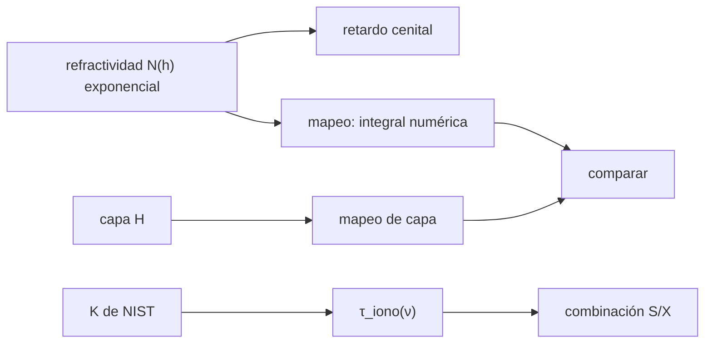

# B51-C10 — Retardo troposférico e ionosférico en VLBI y su modelado

<!-- nav:top -->
[🏠 Programa](../../../../README.md) · [📚 Bloque B51](../../../tronco-comun/B51-interferometria-avanzada-y-reduccion-de-datos-de-radio.md) · [← Anterior: B51-C09 — Fringe stopping y rotación de fase por retardo geométrico](../B51-C09-fringe-stopping-y-rotacion-de-fase-por-retardo-geometrico/CLASE.md) · [Siguiente: B51-C11 — Búsqueda de franjas VLBI: ajuste de retardo y tasa →](../B51-C11-busqueda-de-franjas-vlbi-ajuste-de-retardo-y-tasa/CLASE.md)
<!-- /nav -->

## 1. Ubicación, nivel y alcance

Clase 10 del bloque B51. Nivel N3. En VLBI el retardo de grupo incluye el de la troposfera (no dispersivo, se mapea con la elevación) y el de la ionosfera (dispersivo). Aquí comparas **funciones de mapeo** con una integral numérica, estimas el **retardo cenital húmedo** y eliminas la ionosfera con la **combinación S/X**. Usas [B46](../../../tronco-comun/B46-radioastronomia-e-interferometria.md) y [B05](../../../tronco-comun/B05-fisica-fundamental-para-el-espacio.md). Los datos son sintéticos.

## 2. Por qué esta clase existe

Un error atmosférico de centímetros es un error de posición en geodesia y un error de fase en imagen. La decisión central: **¿cómo se mapea el retardo con la elevación y cómo se separa lo dispersivo de lo no dispersivo?**

## 3. Lo que podrás hacer al terminar

1. Calcular el mapeo de capa `m = 1/√(1 − (R cos e/(R+H))²)`.
2. Compararlo con `1/sin e` y con una integral numérica en una atmósfera exponencial.
3. Estimar el retardo cenital húmedo por mínimos cuadrados y predecir su precisión.
4. Calcular el retardo ionosférico con la `K` derivada de NIST.
5. Aplicar la combinación libre de ionosfera `(ν₁²τ₁ − ν₂²τ₂)/(ν₁² − ν₂²)`.
6. Calcular la amplificación del ruido de esa combinación.

La evidencia es la **ficha de los retardos atmosféricos en VLBI** del ejercicio 12 (sección 20).

## 4. Con qué llegas y cómo comprobarlo

1. ¿Qué es una incertidumbre?
2. ¿Qué es una simulación Monte Carlo?
3. ¿Qué es una tabla de resultados?
4. ¿Qué es un valor ilustrativo?
5. ¿Qué es una verificación?

<details>
<summary>Ver respuestas</summary>

1. Un intervalo en que se espera el valor verdadero. 2. Repetir con números aleatorios de semilla fija. 3. Un resumen ordenado de cálculos. 4. Un valor propuesto para el ejemplo, no medido. 5. Comparar un cálculo con un caso independiente.
</details>

Con cuatro o cinco aciertos, sigue; si no, repasa los prerrequisitos.

## 5. Un caso de contexto y casos de referencia

Con una atmósfera sintética exponencial (`N₀ = 280` unidades, escala de 8 km), el retardo cenital es 2,2400 m y a 10° de elevación el mapeo vale 5,550 frente a 5,759 de `1/sin e`. Con 30 TECU, el retardo en banda S es 7,625 ns y en X 0,572 ns. Es el **ejemplo conductor**.

## 6. Vocabulario

El **retardo cenital** (hidrostático y húmedo). La **función de mapeo** `m(e)`. La **elevación** `e`. La **capa delgada** de altura `H`. El **retardo ionosférico** `K TEC/(c ν²)`. La **combinación libre de ionosfera**. La **amplificación del ruido** de dos bandas.

## 7. Modelo mental: mirar a través de un vidrio inclinado

Como mirar a través de una ventana: de frente atraviesas un vidrio fino y casi sin retraso; muy inclinado atraviesas mucho más grosor, y por eso el mismo vidrio retrasa más a baja elevación.



*Descripción textual:* el retardo troposférico se mapea con la elevación y el ionosférico se elimina con dos frecuencias.

Analogía: mirar a través de un vidrio inclinado. Límite: camino recto, simetría esférica y refractividad exponencial inventada.

## 8. La explicación, paso a paso

### 8.1 Mapeo

El retardo cenital numérico es 2,240000 m frente a `N₀ H₀ = 2,240000` m (analítico).

| Elevación (°) | 1/sin e | Capa (H = 8 km) | Integral numérica |
|---|---|---|---|
| 90 | 1,0000 | 1,0000 | 1,0000 |
| 30 | 2,0000 | 1,9925 | 1,9926 |
| 20 | 2,9238 | 2,8965 | 2,8969 |
| 10 | 5,7588 | 5,5398 | 5,5504 |
| 5 | 11,4737 | 9,9584 | 10,1226 |

A 20° la capa y la integral difieren en 0,01 %; a 5° ya difieren en 1,6 % y `1/sin e` sobrestima 1,13 veces.

### 8.2 Retardo cenital húmedo

Con 0,10 m y ruido de 5,0 mm: media 0,09998 m, desviación Monte Carlo 0,641 mm y fórmula 0,636 mm.

### 8.3 Ionosfera S/X (30 TECU)

| Banda | Retardo (ns) |
|---|---|
| S (2,3 GHz) | 7,6250 |
| X (8,4 GHz) | 0,5717 |

La combinación libre de ionosfera tiene error 1,7 × 10⁻²⁴ s sin ruido; con ruido de 0,02 ns por banda, la desviación Monte Carlo es 0,0223 ns y la amplificación analítica 1,0841 (0,0217 ns).

## 9. Magnitudes, símbolos y unidades

| Símbolo | Qué es | Unidad | Valor / nota |
|---|---|---|---|
| `m(e)` | función de mapeo | — | 1 en el cénit |
| `K` | constante del retardo dispersivo | m³ s⁻² | 40,3082 (derivada de NIST) |
| `TEC` | contenido electrónico | TECU | 30 (ilustrativo) |
| `R` | radio terrestre | km | 6371 (ilustrativo) |

## 10. Convenciones y referencias

Magnitudes en SI salvo que se indique (flujos en Jy, fases en radianes, retardos en segundos); los laboratorios usan la semilla 20261109, coma decimal en el texto y punto decimal en las salidas.

## 11. De dónde sale lo que afirmamos

| ID | Fuente | Localizador | Respalda | Estado |
|---|---|---|---|---|
| S1 | NIST, *Fundamental Physical Constants* (CODATA 2022) | https://physics.nist.gov/cuu/Constants/Table/allascii.txt | constantes citadas en la sección 9 | Consultada el 2026-11-09 |

Límites: no se consultó ningún modelo troposférico operativo ni sus coeficientes; la atmósfera exponencial y el retardo húmedo son inventados.

## 12. Cómo ver las cifras

| Símbolo | Qué es | Valor o nota |
|---|---|---|
| `m(e)` | función de mapeo | 1 en el cénit |
| `K` | constante del retardo dispersivo | 40,3082 (derivada de NIST) |
| `TEC` | contenido electrónico | 30 (ilustrativo) |
| `R` | radio terrestre | 6371 (ilustrativo) |

Descripción larga: la tabla resume las magnitudes de la sección 9; las cifras completas del laboratorio están en las tablas de la sección 8 y en la salida de la sección 17.

## 13. Ejemplo trabajado: la amplificación del ruido

**Paso 1 · Frecuencias.** `ν₁ = 2,3` GHz, `ν₂ = 8,4` GHz.

**Paso 2 · Cuartas potencias.** `ν₁⁴ = 27,98`, `ν₂⁴ = 4978,71` (GHz⁴).

**Paso 3 · Raíz.** `√(ν₁⁴ + ν₂⁴) = 70,758`; `ν₂² − ν₁² = 65,27`.

**Paso 4 · Cociente.** `1,0841`: el ruido de la combinación es 1,084 veces el de cada banda.

## 14. Distintas formas de describir el resultado

**Por ecuación:** `τ_libre = (ν₁²τ₁ − ν₂²τ₂)/(ν₁² − ν₂²)`. **Por tabla:** 8.1–8.3. **Por fórmula:** amplificación `√(ν₁⁴ + ν₂⁴)/(ν₂² − ν₁²)`. **Por código:** `retardos_atmosfericos_vlbi.py`.

## 15. Práctica guiada

**Ejercicio 1 · con los pasos indicados.** Mapeo `1/sin e` a 30°. *Pasos:* `1/0,5`.

<details><summary>Solución comentada</summary>

`2,0`.
</details>

**Ejercicio 2 · con una pista.** Retardo de 2,24 m cenital a 30° con mapeo 1,9926.

<details><summary>Solución comentada</summary>

`4,463 m`.
</details>

**Ejercicio 3 · casi autónomo.** Razón de retardos ionosféricos S/X. *Pista:* `(8,4/2,3)²`.

<details><summary>Solución comentada</summary>

`13,34`.
</details>

## 16. Práctica autónoma, transferencia e integrador

**Ejercicio 4.** Retardo ionosférico en X con 30 TECU.

<details><summary>Solución comentada</summary>

`0,572 ns`.
</details>

**Ejercicio 5.** Amplificación del ruido para S/X.

<details><summary>Solución comentada</summary>

`1,084`.
</details>

**Ejercicio 6.** Ruido de la combinación con 0,02 ns por banda.

<details><summary>Solución comentada</summary>

`0,0217 ns`.
</details>

**Ejercicio 7.** Precisión del retardo cenital húmedo con 7 elevaciones y 5 mm de ruido.

<details><summary>Solución comentada</summary>

`0,64 mm`.
</details>

**Ejercicio 8.** Diferencia entre `1/sin e` y la integral a 10°.

<details><summary>Solución comentada</summary>

`3,8 %`.
</details>

**Ejercicio 9 · transferencia.** **Transferencia.** ¿Por qué la troposfera no se puede eliminar con dos frecuencias?

<details><summary>Solución comentada</summary>

Porque no es dispersiva: el retardo es igual en ambas.
</details>

**Ejercicio 10 · transferencia.** **Transferencia.** ¿Por qué a baja elevación el ajuste del retardo húmedo es más sensible?

<details><summary>Solución comentada</summary>

Porque el mapeo crece y distingue mejor el cenital del ruido, pero la refracción real deja de ser una línea recta.
</details>

**Ejercicio 11 · transferencia.** **Transferencia.** ¿Qué amplifica la combinación libre de ionosfera?

<details><summary>Solución comentada</summary>

El ruido de cada banda, en un factor mayor que 1.
</details>

**Ejercicio 12.** **Integrador.** Elabora tu *ficha de los retardos atmosféricos en VLBI*: mapeo, cenital húmedo, combinación libre y límites.

<details><summary>Solución comentada</summary>

Secciones 8.1–8.3.
</details>

**Ejercicio 12 · integrador.** **Integrador.** Elabora tu *ficha de los retardos atmosféricos en VLBI*: mapeo, cenital húmedo, combinación libre y límites.

<details><summary>Solución modelo</summary>

Secciones 8.1–8.3.
</details>

## 17. Laboratorio: mapeo y combinación libre

El script [retardos_atmosfericos_vlbi.py](retardos_atmosfericos_vlbi.py) integra el camino, ajusta el cenital húmedo y combina bandas (**comprueba** la integral cenital, el mapeo a 20° dentro de 1 %, la dispersión del ajuste y la amplificación).

**Datos:** `e`, `m_e`, `ε₀`, `c` de NIST; atmósfera, TEC y bandas **sintéticos**. **Predice antes de ejecutar:** ¿Cuánto vale el mapeo a 10°? (≈ 5,6.) **Ejecución del 2026-11-09 (Python 3.12.9):**

```text
Python 3.12.9 (biblioteca estandar)
K = 40.3082 m^3/s^2 ; integral cenital numerica = 2.240000 m ; analitica N0 H0 = 2.240000 m
elev [gr]   1/sin e   capa H=8 km   integral numerica
       90    1.0000        1.0000              1.0000
       30    2.0000        1.9925              1.9926
       20    2.9238        2.8965              2.8969
       10    5.7588        5.5398              5.5504
        5   11.4737        9.9584             10.1226
retardo cenital humedo 0.1 m, ruido 0.005 m: media = 0.09998 m ; desviacion MC = 0.00064 m ; formula = 0.00064 m
retardo ionosferico (30 TECU): S (2,3 GHz) = 7.6250 ns ; X (8,4 GHz) = 0.5717 ns
combinacion libre de ionosfera sin ruido: error = 1.65e-24 s
con ruido 0.02 ns por banda: desviacion MC = 0.0223 ns ; amplificacion analitica = 1.0841 (-> 0.0217 ns)
Pruebas superadas.
```

```bash
python programa/clases/B51/B51-C10-retardo-troposferico-e-ionosferico-en-vlbi-y-su-modelado/retardos_atmosfericos_vlbi.py
```

**Límites:** camino recto; no sirve bajo unos 10° de elevación.

## 18. Errores frecuentes y cómo corregirlos

**Usar `1/sin e` a baja elevación.** Se corrige con 8.1.

**Creer que la troposfera es dispersiva.** Se corrige con el ejercicio 9.

**Olvidar que la combinación amplifica el ruido.** Se corrige con 8.3.

**Aplicar los valores sintéticos a una estación real.** Los datos son inventados.

## 19. Cómo sabrás que vas bien

Tras la sección 8: ¿qué resultado esperabas y cuál obtuviste? Si dudas, repasa el ejemplo 13. Tras el laboratorio: ¿qué comprueba? (ver la sección 17).

## 20. Qué entregas y cómo se evalúa

El producto es tu **ficha de los retardos atmosféricos en VLBI** (ejercicio 12).

| Criterio | Inicial | En desarrollo | Logrado | Destacado |
|---|---|---|---|---|
| Conceptos | Los confunde | Parciales | conceptos de la clase | Explica los límites |
| Cálculo | Sin unidades | Con errores | Tablas completas | Calcula casos nuevos |
| Numérico | Sin comprobar | Un caso | Contraste con el análisis | Interpreta las diferencias |
| Fuentes | Sin fuente | Sin fecha | fuentes con fecha | Declara lo ilustrativo |
| Límites | No los nombra | Uno | Tres | Discute qué falta del modelo |

**Condiciones críticas (no se compensan con promedio):** rotular lo sintético como sintético; no presentar la simulación como reducción de datos reales; citar solo lo consultado.

## 21. Ética, seguridad y límites

Clase educativa: los modelos son simplificados. Accesibilidad: tablas equivalentes a las gráficas, fórmulas en texto, ejercicios sin conexión.

## 22. Para cerrar y seguir

El mapeo de capa reproduce la integral numérica (a 20° difieren 0,01 %) y la combinación S/X elimina la ionosfera a costa de amplificar el ruido 1,08 veces. Queda una pregunta: ¿cómo se encuentra la señal en retardo y tasa?

**Glosario español–inglés.** función de mapeo · *mapping function*; retardo cenital · *zenith delay*; combinación libre de ionosfera · *ionosphere-free combination*; elevación · *elevation*.

**Continuidad.** [B51-C11](../B51-C11-busqueda-de-franjas-vlbi-ajuste-de-retardo-y-tasa/CLASE.md) estudia la búsqueda de franjas.

**Referencias:** ver sección 11.

<!-- nav:bottom -->
---

[← Anterior: B51-C09 — Fringe stopping y rotación de fase por retardo geométrico](../B51-C09-fringe-stopping-y-rotacion-de-fase-por-retardo-geometrico/CLASE.md) · [📚 Bloque B51](../../../tronco-comun/B51-interferometria-avanzada-y-reduccion-de-datos-de-radio.md) · [Siguiente: B51-C11 — Búsqueda de franjas VLBI: ajuste de retardo y tasa →](../B51-C11-busqueda-de-franjas-vlbi-ajuste-de-retardo-y-tasa/CLASE.md)
<!-- /nav -->
