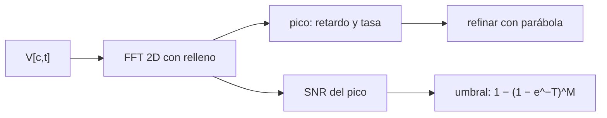

# B51-C11 — Búsqueda de franjas VLBI: ajuste de retardo y tasa

<!-- nav:top -->
[🏠 Programa](../../../../README.md) · [📚 Bloque B51](../../../tronco-comun/B51-interferometria-avanzada-y-reduccion-de-datos-de-radio.md) · [← Anterior: B51-C10 — Retardo troposférico e ionosférico en VLBI y su modelado](../B51-C10-retardo-troposferico-e-ionosferico-en-vlbi-y-su-modelado/CLASE.md) · [Siguiente: B51-C12 — Formatos de datos VLBI y geodésicos →](../B51-C12-formatos-de-datos-vlbi-y-geodesicos/CLASE.md)
<!-- /nav -->

## 1. Ubicación, nivel y alcance

Clase 11 del bloque B51. Nivel N3. En VLBI no se conoce exactamente el retardo ni la tasa residuales: se **buscan** como el pico de una transformada de Fourier bidimensional de la matriz canal × tiempo. Aquí buscas una señal débil, mides su SNR y calculas el umbral de falsa detección. Usas [B46](../../../tronco-comun/B46-radioastronomia-e-interferometria.md) y [B12](../../../tronco-comun/B12-probabilidad-estadistica-e-incertidumbre.md). Los datos son sintéticos.

## 2. Por qué esta clase existe

Declarar una detección sin umbral estadístico es un riesgo de falsos positivos. La decisión central: **¿qué pico es una señal y cuál es ruido, y con qué precisión se estiman retardo y tasa?**

## 3. Lo que podrás hacer al terminar

1. Formar `V[c,t] = A e^{2πi(τν_c + rt)} + ruido`.
2. Hallar el pico de la FFT 2D con relleno de ceros.
3. Refinar retardo y tasa por parábola en cada eje.
4. Predecir la SNR del pico incluyendo la pérdida por celda.
5. Calcular la probabilidad de falsa detección del máximo de `M` celdas.
6. Elegir un umbral para una probabilidad de falsa alarma dada.

La evidencia es la **ficha de la búsqueda de franjas** del ejercicio 12 (sección 20).

## 4. Con qué llegas y cómo comprobarlo

1. ¿Qué es una incertidumbre?
2. ¿Qué es una simulación Monte Carlo?
3. ¿Qué es una tabla de resultados?
4. ¿Qué es un valor ilustrativo?
5. ¿Qué es una verificación?

<details>
<summary>Ver respuestas</summary>

1. Un intervalo en que se espera el valor verdadero. 2. Repetir con números aleatorios de semilla fija. 3. Un resumen ordenado de cálculos. 4. Un valor propuesto para el ejemplo, no medido. 5. Comparar un cálculo con un caso independiente.
</details>

Con cuatro o cinco aciertos, sigue; si no, repasa los prerrequisitos.

## 5. Un caso de contexto y casos de referencia

Con una matriz de 64 × 64 (celdas de 15,62 ns y 0,01562 Hz), amplitud 0,35 y ruido 1,0 por componente (sintéticos), el pico da 336,70 ns y 0,01430 Hz (verdaderos 337 ns y 0,0137 Hz), con SNR 10,86. Es el **ejemplo conductor**.

## 6. Vocabulario

El **retardo** y la **tasa** residuales. La **FFT bidimensional** de canal × tiempo. El **relleno de ceros** (*zero padding*). La **pérdida por celda** (*scalloping*). El **umbral de detección** y la **probabilidad de falsa alarma**. Las **celdas independientes** `M`.

## 7. Modelo mental: buscar una nota en un acorde

Como buscar una nota débil en una sala ruidosa: la transformada ordena el sonido por tono y ritmo, y la nota aparece como un pico; pero entre miles de posiciones algún pico de ruido también sobresale, y hay que saber cuánto.



*Descripción textual:* el pico de la transformada estima retardo y tasa y su altura frente al ruido decide si es una detección.

Analogía: buscar una nota en un acorde. Límite: ruido blanco gaussiano, una sola fuente, amplitud constante.

## 8. La explicación, paso a paso

### 8.1 Estimación

| Magnitud | Verdadera | Estimada |
|---|---|---|
| Retardo | 337,00 ns | 336,70 ns |
| Tasa | 0,01370 Hz | 0,01430 Hz |

### 8.2 SNR

La SNR predicha `A √N / (σ √2)` es 15,84. Como el retardo y la tasa caen entre celdas (-0,43 y -0,12 celdas), el pico pierde un factor 0,702 y la SNR esperada es 11,12; la observada es 10,86.

### 8.3 Falsas detecciones

Con `M = 1024` celdas independientes y umbral `|z|² > 6,0`, la probabilidad de que el máximo de ruido lo supere es 0,9212; el Monte Carlo (1500 ensayos) da 0,9093. El umbral para 1 % de falsas alarmas es `|z|² > 11,532` (`|z| > 3,396`).

## 9. Magnitudes, símbolos y unidades

| Símbolo | Qué es | Unidad | Valor / nota |
|---|---|---|---|
| `τ` | retardo residual | ns | 337 |
| `r` | tasa residual | Hz | 0,0137 |
| `M` | celdas independientes | — | 1024 (ensayo de ruido) |
| `T` | umbral en potencia normalizada | — | 11,53 para 1 % |

## 10. Convenciones y referencias

Magnitudes en SI salvo que se indique (flujos en Jy, fases en radianes, retardos en segundos); los laboratorios usan la semilla 20261109, coma decimal en el texto y punto decimal en las salidas.

## 11. De dónde sale lo que afirmamos

| ID | Fuente | Localizador | Respalda | Estado |
|---|---|---|---|---|
| S1 | Event Horizon Telescope Collaboration, *First M87 Event Horizon Telescope Results. III. Data Processing and Calibration* | https://arxiv.org/abs/1906.11240 | tres cadenas independientes de calibración de fase y búsqueda de franjas; sistemáticos acotados a cerca de 2 % en amplitud y 1 grado en fase (resumen) | Solo resumen, consultado el 2026-11-09 |

Límites: el resumen de la colaboración dice que desarrollaron tres cadenas independientes de calibración de fase y búsqueda de franjas; el algoritmo del laboratorio es la FFT elemental y no reproduce ninguna de ellas.

## 12. Cómo ver las cifras

| Símbolo | Qué es | Valor o nota |
|---|---|---|
| `τ` | retardo residual | 337 |
| `r` | tasa residual | 0,0137 |
| `M` | celdas independientes | 1024 (ensayo de ruido) |
| `T` | umbral en potencia normalizada | 11,53 para 1 % |

Descripción larga: la tabla resume las magnitudes de la sección 9; las cifras completas del laboratorio están en las tablas de la sección 8 y en la salida de la sección 17.

## 13. Ejemplo trabajado: el umbral para 1 %

**Paso 1 · Ley.** El cuadrado normalizado del ruido sigue `Exp(1)`; `P(máx > T) = 1 − (1 − e^{−T})^M`.

**Paso 2 · Despejar.** `(1 − e^{−T})^M = 0,99`.

**Paso 3 · Valor.** Con `M = 1024`: `T = 11,532`.

**Paso 4 · Lectura.** `|z| > 3,396` veces la desviación del ruido.

## 14. Distintas formas de describir el resultado

**Por ecuación:** `V = A e^{2πi(τν + rt)}`. **Por tabla:** 8.1–8.3. **Por fórmula:** `P = 1 − (1 − e^{−T})^M`. **Por código:** `busqueda_de_franjas.py`.

## 15. Práctica guiada

**Ejercicio 1 · con los pasos indicados.** Resolución en retardo de 64 canales de 1 MHz. *Pasos:* `1/(N Δν)`.

<details><summary>Solución comentada</summary>

`15,62 ns`.
</details>

**Ejercicio 2 · con una pista.** Resolución en tasa de 64 s.

<details><summary>Solución comentada</summary>

`0,01562 Hz`.
</details>

**Ejercicio 3 · casi autónomo.** SNR de un pico con `A = 0,35`, `N = 4096`, `σ = 1`.

<details><summary>Solución comentada</summary>

`15,84`.
</details>

## 16. Práctica autónoma, transferencia e integrador

**Ejercicio 4.** Pérdida si el pico cae a media celda en ambos ejes.

<details><summary>Solución comentada</summary>

`sinc(0,5)² = 0,405`.
</details>

**Ejercicio 5.** `P` de falsa alarma con `M = 1024` y `T = 10`.

<details><summary>Solución comentada</summary>

`0,0454`.
</details>

**Ejercicio 6.** Umbral para 1 % con `M = 4096`.

<details><summary>Solución comentada</summary>

`T = 12,92`.
</details>

**Ejercicio 7.** Error de retardo de la estimación.

<details><summary>Solución comentada</summary>

`-0,30 ns`.
</details>

**Ejercicio 8.** Error de tasa.

<details><summary>Solución comentada</summary>

`+0,00060 Hz`.
</details>

**Ejercicio 9 · transferencia.** **Transferencia.** ¿Por qué el relleno de ceros ayuda a ubicar el pico pero no mejora la resolución?

<details><summary>Solución comentada</summary>

Interpola la transformada; la resolución la fija la longitud real de los datos.
</details>

**Ejercicio 10 · transferencia.** **Transferencia.** ¿Qué cambia si buscas en un rango de retardos mayor?

<details><summary>Solución comentada</summary>

Crece `M` y sube el umbral para la misma falsa alarma.
</details>

**Ejercicio 11 · transferencia.** **Transferencia.** ¿Por qué la SNR observada es menor que `A√N/(σ√2)`?

<details><summary>Solución comentada</summary>

Por la pérdida por celda y porque el pico no está centrado.
</details>

**Ejercicio 12.** **Integrador.** Elabora tu *ficha de la búsqueda de franjas*: matriz, FFT, estimación, SNR, umbral y límites.

<details><summary>Solución comentada</summary>

Secciones 8.1–8.3.
</details>

**Ejercicio 12 · integrador.** **Integrador.** Elabora tu *ficha de la búsqueda de franjas*: matriz, FFT, estimación, SNR, umbral y límites.

<details><summary>Solución modelo</summary>

Secciones 8.1–8.3.
</details>

## 17. Laboratorio: pico de retardo y tasa

El script [busqueda_de_franjas.py](busqueda_de_franjas.py) busca una señal con FFT 2D y mide falsas detecciones (**comprueba** retardo a 0,25 celda, tasa a 0,0035 Hz, SNR dentro de 15 % y la falsa alarma dentro de tres sigma binomiales).

**Datos:** ninguna constante; todo **sintético**. **Predice antes de ejecutar:** ¿Qué SNR observarás? (≈ 11.) **Ejecución del 2026-11-09 (Python 3.12.9):**

```text
Python 3.12.9 (biblioteca estandar)
celdas sin relleno: retardo 15.62 ns, tasa 0.01562 Hz
retardo verdadero = 337.00 ns ; estimado = 336.70 ns
tasa verdadera = 0.01370 Hz ; estimada = 0.01430 Hz
SNR del pico: A sqrt(N)/(sigma sqrt2) = 15.84 ; perdida por celda (desfases -0.43 y -0.12 celdas) = 0.702 -> 11.12 ; observada = 10.86
falsa deteccion con umbral |z|^2 > 6.0 sobre M = 1024 celdas: prediccion = 0.9212 ; Monte Carlo (1500) = 0.9093
umbral |z|^2 para 1 % de falsas detecciones con M = 1024: 11.532 (|z| = 3.396)
Pruebas superadas.
```

```bash
python programa/clases/B51/B51-C11-busqueda-de-franjas-vlbi-ajuste-de-retardo-y-tasa/busqueda_de_franjas.py
```

**Límites:** una fuente, ruido blanco y sin variación de amplitud.

## 18. Errores frecuentes y cómo corregirlos

**Declarar detección sin umbral.** Se corrige con 8.3.

**Olvidar la pérdida por celda.** Se corrige con 8.2.

**Confundir resolución con relleno de ceros.** Ver el ejercicio 9.

**Usar celdas rellenadas como independientes.** Cuentan menos que las celdas de la rejilla.

## 19. Cómo sabrás que vas bien

Tras la sección 8: ¿qué resultado esperabas y cuál obtuviste? Si dudas, repasa el ejemplo 13. Tras el laboratorio: ¿qué comprueba? (ver la sección 17).

## 20. Qué entregas y cómo se evalúa

El producto es tu **ficha de la búsqueda de franjas** (ejercicio 12).

| Criterio | Inicial | En desarrollo | Logrado | Destacado |
|---|---|---|---|---|
| Conceptos | Los confunde | Parciales | conceptos de la clase | Explica los límites |
| Cálculo | Sin unidades | Con errores | Tablas completas | Calcula casos nuevos |
| Numérico | Sin comprobar | Un caso | Contraste con el análisis | Interpreta las diferencias |
| Fuentes | Sin fuente | Sin fecha | fuentes con fecha | Declara lo ilustrativo |
| Límites | No los nombra | Uno | Tres | Discute qué falta del modelo |

**Condiciones críticas (no se compensan con promedio):** rotular lo sintético como sintético; no presentar la simulación como reducción de datos reales; citar solo lo consultado.

## 21. Ética, seguridad y límites

Clase educativa: los modelos son simplificados. Accesibilidad: tablas equivalentes a las gráficas, fórmulas en texto, ejercicios sin conexión.

## 22. Para cerrar y seguir

El pico de la FFT 2D ubica el retardo en 336,7 ns y la tasa en 0,0143 Hz, con SNR 10,9, y un umbral de potencia 11,5 da 1 % de falsas alarmas. Queda una pregunta: ¿en qué formatos viajan estos datos?

**Glosario español–inglés.** búsqueda de franjas · *fringe search*; relleno de ceros · *zero padding*; falsa alarma · *false alarm*; umbral · *threshold*.

**Continuidad.** [B51-C12](../B51-C12-formatos-de-datos-vlbi-y-geodesicos/CLASE.md) estudia los formatos de datos VLBI.

**Referencias:** ver sección 11.

<!-- nav:bottom -->
---

[← Anterior: B51-C10 — Retardo troposférico e ionosférico en VLBI y su modelado](../B51-C10-retardo-troposferico-e-ionosferico-en-vlbi-y-su-modelado/CLASE.md) · [📚 Bloque B51](../../../tronco-comun/B51-interferometria-avanzada-y-reduccion-de-datos-de-radio.md) · [Siguiente: B51-C12 — Formatos de datos VLBI y geodésicos →](../B51-C12-formatos-de-datos-vlbi-y-geodesicos/CLASE.md)
<!-- /nav -->
