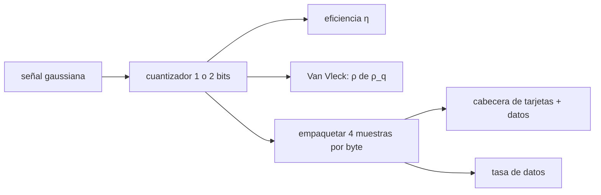

# B51-C12 — Formatos de datos VLBI y geodésicos

<!-- nav:top -->
[🏠 Programa](../../../../README.md) · [📚 Bloque B51](../../../tronco-comun/B51-interferometria-avanzada-y-reduccion-de-datos-de-radio.md) · [← Anterior: B51-C11 — Búsqueda de franjas VLBI: ajuste de retardo y tasa](../B51-C11-busqueda-de-franjas-vlbi-ajuste-de-retardo-y-tasa/CLASE.md) · [Siguiente: B51-C13 — Marcado de datos espurios e interferencia en visibilidades →](../B51-C13-marcado-de-datos-espurios-e-interferencia-en-visibilidades/CLASE.md)
<!-- /nav -->

## 1. Ubicación, nivel y alcance

Clase 12 del bloque B51. Nivel N3. Los datos VLBI se graban con pocos bits por muestra y viajan en tramas con cabeceras. Aquí estudias la **cuantización** de 1 y 2 bits (eficiencia y corrección de Van Vleck), el **empaquetado** de bits y una **cabecera de tarjetas de 80 caracteres** tipo FITS, y calculas la **tasa de datos**. Usas [B46](../../../tronco-comun/B46-radioastronomia-e-interferometria.md) y [B15](../../../tronco-comun/B15-senales-imagenes-y-estimacion-cientifica.md). El formato es didáctico: no implementa ninguna norma.

## 2. Por qué esta clase existe

La elección de bits y de formato fija cuánta sensibilidad se pierde y cuánto disco y red se necesitan. La decisión central: **¿cuántos bits por muestra, qué eficiencia se obtiene y cómo se empaqueta sin perder información?**

## 3. Lo que podrás hacer al terminar

1. Calcular la eficiencia de un cuantizador de 1 bit (`2/π`) y de 2 bits (óptimo numérico).
2. Verificarla con una simulación de semilla fija.
3. Aplicar la corrección de Van Vleck para 1 bit.
4. Empaquetar y desempaquetar muestras de 2 bits sin pérdida.
5. Calcular la tasa de datos de una grabación.
6. Construir y leer tarjetas de cabecera de 80 caracteres en bloques de 2880 bytes.

La evidencia es la **ficha de los formatos de datos** del ejercicio 12 (sección 20).

## 4. Con qué llegas y cómo comprobarlo

1. ¿Qué es una incertidumbre?
2. ¿Qué es una simulación Monte Carlo?
3. ¿Qué es una tabla de resultados?
4. ¿Qué es un valor ilustrativo?
5. ¿Qué es una verificación?

<details>
<summary>Ver respuestas</summary>

1. Un intervalo en que se espera el valor verdadero. 2. Repetir con números aleatorios de semilla fija. 3. Un resumen ordenado de cálculos. 4. Un valor propuesto para el ejemplo, no medido. 5. Comparar un cálculo con un caso independiente.
</details>

Con cuatro o cinco aciertos, sigue; si no, repasa los prerrequisitos.

## 5. Un caso de contexto y casos de referencia

Con muestras gaussianas sintéticas, 1 bit da eficiencia 0,6366 y 2 bits 0,8811 (umbral 1,00 σ). Grabar 2 GHz de ancho de banda, 2 polarizaciones y 2 bits da 16,0 Gbit/s, es decir 7,20 TB por hora. Es el **ejemplo conductor**.

## 6. Vocabulario

La **cuantización**: reemplazar un valor real por un nivel. La **eficiencia de muestreo** `η`. La **corrección de Van Vleck**: `ρ = sin(π ρ_q/2)` para 1 bit. El **empaquetado** (*packing*). La **tarjeta de cabecera** de 80 caracteres. El **bloque** de 2880 bytes. La **tasa de datos**.

## 7. Modelo mental: una balanza con pocas pesas

Como pesar con solo dos o cuatro pesas: pierdes algo de precisión (la eficiencia), pero con más muestras la compensas, y debes guardar bien qué pesa cada marca para no equivocarte al leer.



*Descripción textual:* la señal se cuantiza con pocos bits, se mide la eficiencia, se corrige la correlación y se empaqueta con una cabecera legible.

Analogía: una balanza con pocas pesas. Límite: muestras gaussianas independientes y umbrales fijos.

## 8. La explicación, paso a paso

### 8.1 Eficiencia

| Cuantizador | Eficiencia analítica | Monte Carlo |
|---|---|---|
| 1 bit | 0,6366 (`2/π`) | 0,6359 |
| 2 bits (umbral 1,00 σ, nivel 0,61 σ) | 0,8811 | 0,8806 |

### 8.2 Van Vleck (1 bit)

| ρ inyectada | ρ_q medida | (2/π) arcsen ρ | ρ recuperada | Error estándar |
|---|---|---|---|---|
| 0,05 | +0,0317 | +0,0318 | 0,0497 | 0,0025 |
| 0,30 | +0,1933 | +0,1940 | 0,2990 | 0,0023 |
| 0,70 | +0,4946 | +0,4936 | 0,7011 | 0,0015 |

La correlación medida con 1 bit es menor que la verdadera; la corrección recupera la verdadera dentro de su error.

### 8.3 Empaquetado y cabecera

1003 muestras de 2 bits ocupan 251 bytes (`⌈1003/4⌉`) y la ida y vuelta es exacta (True). La cabecera de tarjetas ocupa 2880 bytes (un bloque) y las tarjetas se leen de vuelta (True).

### 8.4 Tasa de datos

`2 × 2 GHz × 2 pol × 2 bits = 16,0` Gbit/s = 7,20 TB/hora.

## 9. Magnitudes, símbolos y unidades

| Símbolo | Qué es | Unidad | Valor / nota |
|---|---|---|---|
| `η` | eficiencia de muestreo | — | 0,637 (1 bit); 0,881 (2 bits) |
| `ρ_q` | correlación de muestras cuantizadas | — | ver 8.2 |
| `Δν` | ancho de banda grabado | GHz | 2 (ilustrativo) |
| `R` | tasa de datos | Gbit/s | 16,0 |

## 10. Convenciones y referencias

Magnitudes en SI salvo que se indique (flujos en Jy, fases en radianes, retardos en segundos); los laboratorios usan la semilla 20261109, coma decimal en el texto y punto decimal en las salidas.

## 11. De dónde sale lo que afirmamos

| ID | Fuente | Localizador | Respalda | Estado |
|---|---|---|---|---|
| S1 | Pence, White y Seaman, *Optimal Compression of Floating-point Astronomical Images Without Significant Loss of Information* | https://arxiv.org/abs/1007.1179 | cuantización de imágenes de punto flotante a enteros y su efecto de ruido (resumen); trata imágenes FITS y no datos VLBI | Solo resumen, consultado el 2026-11-09 |

Límites: el resumen de Pence et al. trata imágenes FITS y su cuantización (no datos VLBI); no se consultó la norma de VDIF, Mark 5 ni FITS-IDI, y la cabecera del laboratorio es un ejemplo didáctico propio.

## 12. Cómo ver las cifras

| Símbolo | Qué es | Valor o nota |
|---|---|---|
| `η` | eficiencia de muestreo | 0,637 (1 bit); 0,881 (2 bits) |
| `ρ_q` | correlación de muestras cuantizadas | ver 8.2 |
| `Δν` | ancho de banda grabado | 2 (ilustrativo) |
| `R` | tasa de datos | 16,0 |

Descripción larga: la tabla resume las magnitudes de la sección 9; las cifras completas del laboratorio están en las tablas de la sección 8 y en la salida de la sección 17.

## 13. Ejemplo trabajado: la tasa de datos

**Paso 1 · Muestreo.** Nyquist: `2 × 2 GHz = 4 Gmuestras/s` por polarización.

**Paso 2 · Bits.** `4 × 10⁹ × 2 bits = 8 Gbit/s` por polarización.

**Paso 3 · Polarizaciones.** `× 2 = 16,0` Gbit/s.

**Paso 4 · Volumen.** `16,0 × 10⁹ / 8 × 3600 / 10¹² = 7,20` TB/hora.

## 14. Distintas formas de describir el resultado

**Por ecuación:** `η = (E[x q])²/(E[q²]E[x²])`. **Por tabla:** 8.1–8.2. **Por fórmula:** `ρ = sin(π ρ_q/2)`. **Por código:** `formatos_de_datos.py`.

## 15. Práctica guiada

**Ejercicio 1 · con los pasos indicados.** Eficiencia de 1 bit. *Pasos:* `2/π`.

<details><summary>Solución comentada</summary>

`0,6366`.
</details>

**Ejercicio 2 · con una pista.** Pérdida de sensibilidad de 1 bit frente a ideal, en `√η`.

<details><summary>Solución comentada</summary>

`√0,6366 = 0,798`.
</details>

**Ejercicio 3 · casi autónomo.** Pérdida de 2 bits en `√η`.

<details><summary>Solución comentada</summary>

`0,939`.
</details>

## 16. Práctica autónoma, transferencia e integrador

**Ejercicio 4.** Bytes para 1000 muestras de 2 bits.

<details><summary>Solución comentada</summary>

`250`.
</details>

**Ejercicio 5.** Tasa para 1 GHz, 1 pol, 1 bit.

<details><summary>Solución comentada</summary>

`2 Gbit/s`.
</details>

**Ejercicio 6.** Tasa para 512 MHz, 2 pol, 2 bits.

<details><summary>Solución comentada</summary>

`4,1 Gbit/s`.
</details>

**Ejercicio 7.** Volumen en TB de 8 h a 16 Gbit/s.

<details><summary>Solución comentada</summary>

`57,6 TB`.
</details>

**Ejercicio 8.** `ρ` recuperada de `ρ_q = 0,19`.

<details><summary>Solución comentada</summary>

`sin(0,19 · π/2) = 0,294`.
</details>

**Ejercicio 9 · transferencia.** **Transferencia.** ¿Por qué 2 bits valen la pena frente a 1?

<details><summary>Solución comentada</summary>

Porque pasan de η = 0,64 a 0,88: el 38 % más de eficiencia por un bit más.
</details>

**Ejercicio 10 · transferencia.** **Transferencia.** ¿Por qué una cabecera legible ayuda?

<details><summary>Solución comentada</summary>

Porque los parámetros de la observación viajan con los datos y se pueden verificar.
</details>

**Ejercicio 11 · transferencia.** **Transferencia.** ¿Qué riesgo hay si se empaquetan 4 muestras por byte sin documentar el orden?

<details><summary>Solución comentada</summary>

Se invierten muestras y se corrompe la correlación.
</details>

**Ejercicio 12.** **Integrador.** Elabora tu *ficha de los formatos de datos*: eficiencia, Van Vleck, empaquetado, tasa y límites.

<details><summary>Solución comentada</summary>

Secciones 8.1–8.4.
</details>

**Ejercicio 12 · integrador.** **Integrador.** Elabora tu *ficha de los formatos de datos*: eficiencia, Van Vleck, empaquetado, tasa y límites.

<details><summary>Solución modelo</summary>

Secciones 8.1–8.4.
</details>

## 17. Laboratorio: cuantización y empaquetado

El script [formatos_de_datos.py](formatos_de_datos.py) cuantiza, corrige, empaqueta y arma una cabecera (**comprueba** `η` a 0,01, la corrección de Van Vleck a tres errores estándar y la ida y vuelta exacta).

**Datos:** ninguna constante; todo **sintético**; formato didáctico, no una norma. **Predice antes de ejecutar:** ¿Qué eficiencia esperas con 2 bits? (≈ 0,88.) **Ejecución del 2026-11-09 (Python 3.12.9):**

```text
Python 3.12.9 (biblioteca estandar)
1 bit: eta = 2/pi = 0.636620 ; Monte Carlo = 0.6359
2 bits: eta optima analitica = 0.8811 con umbral t = 1.00 sigma y nivel v0 = 0.61 sigma ; Monte Carlo = 0.8806
Van Vleck (1 bit): rho_inyectada, rho_q medida, (2/pi) asin(rho), rho recuperada, error estandar
  0.05 +0.0317 +0.0318 0.0497 0.0025
  0.30 +0.1933 +0.1940 0.2990 0.0023
  0.70 +0.4946 +0.4936 0.7011 0.0015
empaquetado: 1003 muestras de 2 bits -> 251 bytes ; ida y vuelta exacta = True
tasa de datos: 2 x 2 GHz x 2 pol x 2 bits = 16.0 Gbit/s = 7.20 TB por hora
cabecera tipo FITS: 2880 bytes (multiplo de 2880: True) ; ida y vuelta de tarjetas = True
Pruebas superadas.
```

```bash
python programa/clases/B51/B51-C12-formatos-de-datos-vlbi-y-geodesicos/formatos_de_datos.py
```

**Límites:** muestras gaussianas e independientes; no es VDIF ni FITS-IDI.

## 18. Errores frecuentes y cómo corregirlos

**Creer que 2 bits equivalen a muestreo ideal.** Se corrige con 8.1.

**Olvidar corregir la correlación de 1 bit.** Se corrige con 8.2.

**No documentar el orden de los bits.** Se corrige con la cabecera.

**Tomar la cabecera didáctica como el formato oficial.** Se corrige con la sección 11.

## 19. Cómo sabrás que vas bien

Tras la sección 8: ¿qué resultado esperabas y cuál obtuviste? Si dudas, repasa el ejemplo 13. Tras el laboratorio: ¿qué comprueba? (ver la sección 17).

## 20. Qué entregas y cómo se evalúa

El producto es tu **ficha de los formatos de datos** (ejercicio 12).

| Criterio | Inicial | En desarrollo | Logrado | Destacado |
|---|---|---|---|---|
| Conceptos | Los confunde | Parciales | conceptos de la clase | Explica los límites |
| Cálculo | Sin unidades | Con errores | Tablas completas | Calcula casos nuevos |
| Numérico | Sin comprobar | Un caso | Contraste con el análisis | Interpreta las diferencias |
| Fuentes | Sin fuente | Sin fecha | fuentes con fecha | Declara lo ilustrativo |
| Límites | No los nombra | Uno | Tres | Discute qué falta del modelo |

**Condiciones críticas (no se compensan con promedio):** rotular lo sintético como sintético; no presentar la simulación como reducción de datos reales; citar solo lo consultado.

## 21. Ética, seguridad y límites

Clase educativa: los modelos son simplificados. Accesibilidad: tablas equivalentes a las gráficas, fórmulas en texto, ejercicios sin conexión.

## 22. Para cerrar y seguir

Con 2 bits se conserva el 88 % de la sensibilidad y se graban 16 Gbit/s por antena en el ejemplo. Queda una pregunta: ¿cómo se descartan los datos contaminados?

**Glosario español–inglés.** cuantización · *quantization*; empaquetado · *packing*; eficiencia · *efficiency*; cabecera · *header*; tasa de datos · *data rate*.

**Continuidad.** [B51-C13](../B51-C13-marcado-de-datos-espurios-e-interferencia-en-visibilidades/CLASE.md) estudia el marcado de interferencia.

**Referencias:** ver sección 11.

<!-- nav:bottom -->
---

[← Anterior: B51-C11 — Búsqueda de franjas VLBI: ajuste de retardo y tasa](../B51-C11-busqueda-de-franjas-vlbi-ajuste-de-retardo-y-tasa/CLASE.md) · [📚 Bloque B51](../../../tronco-comun/B51-interferometria-avanzada-y-reduccion-de-datos-de-radio.md) · [Siguiente: B51-C13 — Marcado de datos espurios e interferencia en visibilidades →](../B51-C13-marcado-de-datos-espurios-e-interferencia-en-visibilidades/CLASE.md)
<!-- /nav -->
