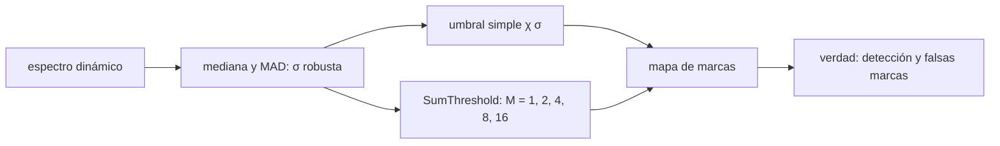

# B51-C13 — Marcado de datos espurios e interferencia en visibilidades

<!-- nav:top -->
[🏠 Programa](../../../../README.md) · [📚 Bloque B51](../../../tronco-comun/B51-interferometria-avanzada-y-reduccion-de-datos-de-radio.md) · [← Anterior: B51-C12 — Formatos de datos VLBI y geodésicos](../B51-C12-formatos-de-datos-vlbi-y-geodesicos/CLASE.md) · [Siguiente: B51-C14 — Calibración de banda en la reducción de datos de síntesis →](../B51-C14-calibracion-de-banda-en-la-reduccion-de-datos-de-sintesis/CLASE.md)
<!-- /nav -->

## 1. Ubicación, nivel y alcance

Clase 13 del bloque B51. Nivel N3. Las visibilidades llegan contaminadas por interferencia (RFI) y por datos malos. El marcado (*flagging*) los excluye con umbrales **robustos** (mediana y MAD) y con sumas de muestras vecinas (**SumThreshold**, versión didáctica). Aquí lo haces en un espectro dinámico de 64 × 128. Usas [B46](../../../tronco-comun/B46-radioastronomia-e-interferometria.md) y [B12](../../../tronco-comun/B12-probabilidad-estadistica-e-incertidumbre.md). Los datos son sintéticos.

## 2. Por qué esta clase existe

Dejar RFI en los datos degrada la imagen; marcar demasiado pierde señal. La decisión central: **¿qué umbral marca la interferencia sin marcar el ruido, y cómo se detecta la interferencia débil y extendida?**

## 3. Lo que podrás hacer al terminar

1. Estimar `σ` con `1,4826 MAD` y la mediana robusta.
2. Predecir la tasa de falsas marcas `erfc(χ/√2)`.
3. Explicar por qué la desviación típica ingenua se infla.
4. Aplicar un umbral simple a 5 σ.
5. Aplicar una versión de SumThreshold con umbral decreciente.
6. Medir detección y falsas marcas en un caso con verdad conocida.

La evidencia es la **ficha del marcado de datos** del ejercicio 12 (sección 20).

## 4. Con qué llegas y cómo comprobarlo

1. ¿Qué es una incertidumbre?
2. ¿Qué es una simulación Monte Carlo?
3. ¿Qué es una tabla de resultados?
4. ¿Qué es un valor ilustrativo?
5. ¿Qué es una verificación?

<details>
<summary>Ver respuestas</summary>

1. Un intervalo en que se espera el valor verdadero. 2. Repetir con números aleatorios de semilla fija. 3. Un resumen ordenado de cálculos. 4. Un valor propuesto para el ejemplo, no medido. 5. Comparar un cálculo con un caso independiente.
</details>

Con cuatro o cinco aciertos, sigue; si no, repasa los prerrequisitos.

## 5. Un caso de contexto y casos de referencia

Con ruido gaussiano sintético, el umbral de 3,5 σ marca 0,043 % de muestras (esperado 0,047 %). Con interferencia fuerte la σ robusta es 1,096 y la desviación típica ingenua 5,07. Es el **ejemplo conductor**.

## 6. Vocabulario

La **interferencia** (RFI). La **mediana** y el **MAD** (mediana de desviaciones absolutas). La **σ robusta** `1,4826 MAD`. El **umbral** `χ σ`. **SumThreshold**: umbrales sobre la media de `M` muestras consecutivas. La **falsa marca** y la **detección**.

## 7. Modelo mental: un colador de varios tamaños

Como un colador con mallas de varios tamaños: la malla fina atrapa los granos grandes y aislados (picos fuertes) y la malla ancha atrapa las manchas largas y suaves; si la malla es demasiado fina también retiene arena buena.



*Descripción textual:* la σ robusta fija el umbral; las sumas de muestras vecinas permiten detectar interferencia débil y extendida.

Analogía: un colador de varios tamaños. Límite: ruido gaussiano estacionario, interferencia aditiva y marcado solo en tiempo.

## 8. La explicación, paso a paso

### 8.1 Solo ruido

Umbral 3,5 σ robusta en 819200 muestras: falsas marcas 0,0426 %; gaussiana `erfc(χ/√2)` = 0,0465 %.

### 8.2 Con interferencia

La mediana robusta sube a +0,121 y la σ robusta a 1,096, porque el 7,9 % de las muestras está contaminado. La desviación típica ingenua vale 5,07: inútil como escala.

Umbrales de SumThreshold con `χ₁ = 4` y `ρ = 1,5`: 1 muestras: 4,00 σ, 2 muestras: 2,67 σ, 4 muestras: 1,78 σ, 8 muestras: 1,19 σ, 16 muestras: 0,79 σ.

| Método | Canales fuertes marcados | Interferencia débil marcada | Falsas marcas sobre muestras limpias |
|---|---|---|---|
| Umbral simple 5 σ | 1,000 | 0,000 | 0,00000 |
| SumThreshold | 1,000 | 0,250 | 0,00835 |

La interferencia débil (1,5 σ durante 16 muestras) pasa inadvertida con el umbral simple; la suma de 16 muestras la ve solo en parte (25 %) y a cambio marca 0,83 % de muestras limpias.

## 9. Magnitudes, símbolos y unidades

| Símbolo | Qué es | Unidad | Valor / nota |
|---|---|---|---|
| `χ` | umbral | σ | 3,5 (solo ruido); 5 (simple) |
| `σ_rob` | σ robusta | unidades arbitrarias | 1,096 |
| `M` | muestras sumadas | — | 1, 2, 4, 8, 16 |
| `ρ` | factor de decrecimiento del umbral | — | 1,5 (didáctico) |

## 10. Convenciones y referencias

Magnitudes en SI salvo que se indique (flujos en Jy, fases en radianes, retardos en segundos); los laboratorios usan la semilla 20261109, coma decimal en el texto y punto decimal en las salidas.

## 11. De dónde sale lo que afirmamos

| ID | Fuente | Localizador | Respalda | Estado |
|---|---|---|---|---|
| S1 | Offringa et al., *Post-correlation radio frequency interference classification methods* | https://arxiv.org/abs/1002.1957 | comparación de métodos de marcado de interferencia; SumThreshold como el más preciso de los comparados (resumen); el laboratorio usa una versión didáctica propia | Solo resumen, consultado el 2026-11-09 |

Límites: el resumen de Offringa et al. respalda que SumThreshold fue el más preciso de los métodos que compararon; el factor 1,5, la implementación unidimensional y las cifras del laboratorio son propios y no reproducen sus resultados.

## 12. Cómo ver las cifras

| Símbolo | Qué es | Valor o nota |
|---|---|---|
| `χ` | umbral | 3,5 (solo ruido); 5 (simple) |
| `σ_rob` | σ robusta | 1,096 |
| `M` | muestras sumadas | 1, 2, 4, 8, 16 |
| `ρ` | factor de decrecimiento del umbral | 1,5 (didáctico) |

Descripción larga: la tabla resume las magnitudes de la sección 9; las cifras completas del laboratorio están en las tablas de la sección 8 y en la salida de la sección 17.

## 13. Ejemplo trabajado: la falsa marca esperada

**Paso 1 · Cola.** `P(|z| > 3,5) = erfc(3,5/√2)`.

**Paso 2 · Valor.** `0,000465`.

**Paso 3 · Muestras.** Con 819200 muestras: 381 marcas esperadas.

**Paso 4 · Observado.** 349 marcas: dentro del ruido estadístico.

## 14. Distintas formas de describir el resultado

**Por ecuación:** marca si `|x − mediana| > χ σ_rob`. **Por tabla:** 8.1–8.2. **Por fórmula:** `P = erfc(χ/√2)`. **Por código:** `marcado_de_interferencia.py`.

## 15. Práctica guiada

**Ejercicio 1 · con los pasos indicados.** Falsa marca esperada a 5 σ. *Pasos:* `erfc(5/√2)`.

<details><summary>Solución comentada</summary>

`5,73 × 10⁻⁷`.
</details>

**Ejercicio 2 · con una pista.** Falsas marcas esperadas a 5 σ en 10⁶ muestras.

<details><summary>Solución comentada</summary>

`0,57`.
</details>

**Ejercicio 3 · casi autónomo.** A 3 σ.

<details><summary>Solución comentada</summary>

`2,70 × 10⁻³`.
</details>

## 16. Práctica autónoma, transferencia e integrador

**Ejercicio 4.** `σ` robusta de un MAD de 0,6745.

<details><summary>Solución comentada</summary>

`1,4826 · 0,6745 = 1,0`.
</details>

**Ejercicio 5.** Umbral de SumThreshold para `M = 8`.

<details><summary>Solución comentada</summary>

`4/1,5³ = 1,19 σ`.
</details>

**Ejercicio 6.** Umbral para `M = 16`.

<details><summary>Solución comentada</summary>

`0,79 σ`.
</details>

**Ejercicio 7.** Desviación de la media de 16 muestras de σ = 1.

<details><summary>Solución comentada</summary>

`0,25 σ`.
</details>

**Ejercicio 8.** Fracción contaminada real del ejemplo.

<details><summary>Solución comentada</summary>

`7,9 %`.
</details>

**Ejercicio 9 · transferencia.** **Transferencia.** ¿Por qué no usar la desviación típica para el umbral?

<details><summary>Solución comentada</summary>

Porque la RFI la infla y se enmascara a sí misma.
</details>

**Ejercicio 10 · transferencia.** **Transferencia.** ¿Qué riesgo hay en marcar con un umbral muy bajo?

<details><summary>Solución comentada</summary>

Eliminar señal astronómica y ruido bueno.
</details>

**Ejercicio 11 · transferencia.** **Transferencia.** ¿Por qué se itera marcando y reestimando σ?

<details><summary>Solución comentada</summary>

Porque la estimación robusta mejora al quitar contaminación.
</details>

**Ejercicio 12.** **Integrador.** Elabora tu *ficha del marcado de datos*: σ robusta, umbral simple, SumThreshold, detección y límites.

<details><summary>Solución comentada</summary>

Secciones 8.1–8.2.
</details>

**Ejercicio 12 · integrador.** **Integrador.** Elabora tu *ficha del marcado de datos*: σ robusta, umbral simple, SumThreshold, detección y límites.

<details><summary>Solución modelo</summary>

Secciones 8.1–8.2.
</details>

## 17. Laboratorio: umbral simple y SumThreshold

El script [marcado_de_interferencia.py](marcado_de_interferencia.py) marca un espectro dinámico con verdad conocida (**comprueba** las falsas marcas en solo ruido y que SumThreshold marque más interferencia débil que el umbral simple).

**Datos:** ninguna constante; todo **sintético**; idea de SumThreshold del resumen de Offringa et al. **Predice antes de ejecutar:** ¿Cuántas marcas esperas en solo ruido a 3,5 σ? (≈ 0,047 %.) **Ejecución del 2026-11-09 (Python 3.12.9):**

```text
Python 3.12.9 (biblioteca estandar)
solo ruido, umbral 3.5 sigma robusta (819200 muestras): falsas marcas observadas = 0.00043 ; gaussiana 2Q = 0.00047
con interferencia: sigma robusta = 1.0956 (mediana +0.1207) ; desviacion tipica ingenua = 5.066 ; fraccion interferida real = 0.0786
umbrales SumThreshold (M muestras, umbral en sigma): 1:4.00, 2:2.67, 4:1.78, 8:1.19, 16:0.79
                      canales fuertes marcados   interferencia debil marcada   falsas marcas sobre limpios
 umbral simple 5 sigma                  1.000                         0.000                        0.00000
          SumThreshold                  1.000                         0.250                        0.00835
Pruebas superadas.
```

```bash
python programa/clases/B51/B51-C13-marcado-de-datos-espurios-e-interferencia-en-visibilidades/marcado_de_interferencia.py
```

**Límites:** ruido gaussiano estacionario; marcado en una sola dimensión.

## 18. Errores frecuentes y cómo corregirlos

**Estimar σ con la desviación típica.** Se corrige con 8.2.

**Fijar un umbral sin calcular las falsas marcas.** Se corrige con 8.1.

**Creer que SumThreshold es gratis.** Se corrige con la tabla de 8.2.

**Tomar la versión didáctica por el algoritmo publicado.** Se corrige con la sección 11.

## 19. Cómo sabrás que vas bien

Tras la sección 8: ¿qué resultado esperabas y cuál obtuviste? Si dudas, repasa el ejemplo 13. Tras el laboratorio: ¿qué comprueba? (ver la sección 17).

## 20. Qué entregas y cómo se evalúa

El producto es tu **ficha del marcado de datos** (ejercicio 12).

| Criterio | Inicial | En desarrollo | Logrado | Destacado |
|---|---|---|---|---|
| Conceptos | Los confunde | Parciales | conceptos de la clase | Explica los límites |
| Cálculo | Sin unidades | Con errores | Tablas completas | Calcula casos nuevos |
| Numérico | Sin comprobar | Un caso | Contraste con el análisis | Interpreta las diferencias |
| Fuentes | Sin fuente | Sin fecha | fuentes con fecha | Declara lo ilustrativo |
| Límites | No los nombra | Uno | Tres | Discute qué falta del modelo |

**Condiciones críticas (no se compensan con promedio):** rotular lo sintético como sintético; no presentar la simulación como reducción de datos reales; citar solo lo consultado.

## 21. Ética, seguridad y límites

Clase educativa: los modelos son simplificados. Accesibilidad: tablas equivalentes a las gráficas, fórmulas en texto, ejercicios sin conexión.

## 22. Para cerrar y seguir

Con la σ robusta (1,10) el umbral de 3,5 σ marca 0,043 % del ruido y la suma de muestras recupera parte de la interferencia débil. Queda una pregunta: ¿cómo se calibra la banda en la reducción de síntesis?

**Glosario español–inglés.** marcado · *flagging*; interferencia · *RFI*; mediana · *median*; desviación absoluta mediana · *median absolute deviation*; umbral · *threshold*.

**Continuidad.** [B51-C14](../B51-C14-calibracion-de-banda-en-la-reduccion-de-datos-de-sintesis/CLASE.md) estudia la calibración de banda en síntesis.

**Referencias:** ver sección 11.

<!-- nav:bottom -->
---

[← Anterior: B51-C12 — Formatos de datos VLBI y geodésicos](../B51-C12-formatos-de-datos-vlbi-y-geodesicos/CLASE.md) · [📚 Bloque B51](../../../tronco-comun/B51-interferometria-avanzada-y-reduccion-de-datos-de-radio.md) · [Siguiente: B51-C14 — Calibración de banda en la reducción de datos de síntesis →](../B51-C14-calibracion-de-banda-en-la-reduccion-de-datos-de-sintesis/CLASE.md)
<!-- /nav -->
