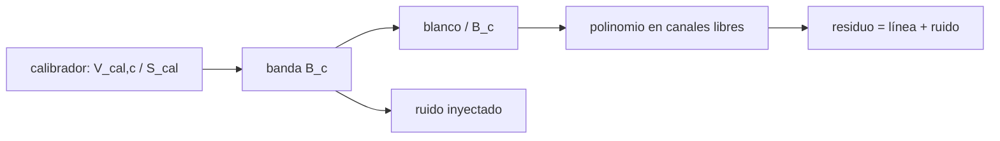

# B51-C14 — Calibración de banda en la reducción de datos de síntesis

<!-- nav:top -->
[🏠 Programa](../../../../README.md) · [📚 Bloque B51](../../../tronco-comun/B51-interferometria-avanzada-y-reduccion-de-datos-de-radio.md) · [← Anterior: B51-C13 — Marcado de datos espurios e interferencia en visibilidades](../B51-C13-marcado-de-datos-espurios-e-interferencia-en-visibilidades/CLASE.md) · [Siguiente: B52-C01 — Colapso de nebulosa protosolar →](../../../tronco-comun/B52-formacion-y-dinamica-de-sistemas-planetarios.md#b52-c01)
<!-- /nav -->

## 1. Ubicación, nivel y alcance

Clase 14 del bloque B51. Nivel N3. En la reducción de síntesis se resuelve la banda con un calibrador brillante, se aplica al blanco y se resta el continuo con un polinomio ajustado a los canales sin línea. Aquí lo haces en 128 canales con un blanco de 0,50 Jy y una línea de 5 mJy. Usas [B46](../../../tronco-comun/B46-radioastronomia-e-interferometria.md) y [B49](../../../tronco-comun/B49-antenas-y-receptores-de-radioastronomia.md). Los datos son sintéticos.

## 2. Por qué esta clase existe

Una línea débil sobre un continuo brillante solo se ve si la banda está calibrada mejor que la razón línea/continuo. La decisión central: **¿cuánto ruido inyecta la solución de banda y por qué no basta con restar un polinomio?**

## 3. Lo que podrás hacer al terminar

1. Resolver `B_c = |V_cal,c|/S_cal` promediando en el tiempo.
2. Aplicar la banda al blanco y restar el continuo.
3. Predecir el ruido inyectado `S_obj σ rms(1/B)/(S_cal √n)`.
4. Comparar con restar un polinomio sin calibrar.
5. Recuperar el flujo de la línea con su dispersión.
6. Relacionar la calidad de la banda con el rango dinámico espectral.

La evidencia es la **ficha de la calibración de banda en síntesis** del ejercicio 12 (sección 20).

## 4. Con qué llegas y cómo comprobarlo

1. ¿Qué es una incertidumbre?
2. ¿Qué es una simulación Monte Carlo?
3. ¿Qué es una tabla de resultados?
4. ¿Qué es un valor ilustrativo?
5. ¿Qué es una verificación?

<details>
<summary>Ver respuestas</summary>

1. Un intervalo en que se espera el valor verdadero. 2. Repetir con números aleatorios de semilla fija. 3. Un resumen ordenado de cálculos. 4. Un valor propuesto para el ejemplo, no medido. 5. Comparar un cálculo con un caso independiente.
</details>

Con cuatro o cinco aciertos, sigue; si no, repasa los prerrequisitos.

## 5. Un caso de contexto y casos de referencia

Con un calibrador de 5,0 Jy, 20 muestras por solución y ruido de 0,05 Jy (sintéticos), la banda inyecta 1,38 mJy de ruido en el blanco (fórmula 1,38 mJy). Sin calibrar la banda, el residuo es de 20,6 mJy con un polinomio de orden 5. Es el **ejemplo conductor**.

## 6. Vocabulario

La **solución de banda** (*bandpass solution*). El **calibrador de banda**. La **sustracción del continuo** con un polinomio de orden `p`. Los **canales libres de línea**. El **ruido inyectado** por la banda. El **rango dinámico espectral**: razón continuo/línea detectable.

## 7. Modelo mental: una lente con defectos conocidos

Como fotografiar con una lente que tiene manchas: primero fotografías una pared lisa para mapear las manchas (el calibrador) y después las quitas de la foto del objeto; si solo difuminas la foto, las manchas quedan.



*Descripción textual:* la banda se mide en un calibrador, se divide en el blanco y lo que queda tras restar el continuo es la línea más el ruido.

Analogía: una lente con defectos conocidos. Límite: banda igual en calibrador y blanco, constante en el tiempo.

## 8. La explicación, paso a paso

### 8.1 Ruido inyectado por la banda

Fórmula `S_obj σ rms(1/B) / (S_cal √n)` = 1,382 mJy; Monte Carlo = 1,380 mJy. El factor `rms(1/B)` aparece porque donde la banda es baja el ruido se amplifica al dividir.

### 8.2 Residuos y línea

| Orden del polinomio | rms con banda calibrada (mJy) | rms sin calibrar (mJy) | Flujo medio de la línea (mJy) | Dispersión (mJy) |
|---|---|---|---|---|
| 0 | 3,389 | 70,336 | 4,975 | 1,351 |
| 1 | 3,334 | 70,330 | 4,963 | 1,307 |
| 2 | 3,329 | 21,508 | 4,999 | 1,307 |
| 3 | 3,336 | 21,415 | 4,828 | 1,218 |
| 5 | 3,308 | 20,591 | 5,154 | 1,414 |

El flujo verdadero de la línea es 5,0 mJy en cada uno de 5 canales. La dispersión esperada del promedio de 5 canales es 1,278 mJy.

### 8.3 Lectura

Con la banda calibrada el residuo es 3,34 mJy (casi independiente del orden). Sin calibrar, un polinomio de orden 0 o 1 deja 70 mJy y subir el orden solo baja a 21 mJy: la ondulación de la banda no es un polinomio.

## 9. Magnitudes, símbolos y unidades

| Símbolo | Qué es | Unidad | Valor / nota |
|---|---|---|---|
| `B_c` | respuesta de banda del canal c | — | 0,55 a 1,05 (sintética) |
| `S_cal` | flujo del calibrador | Jy | 5,0 |
| `n` | muestras por solución | — | 20 |
| `p` | orden del polinomio | — | 0 a 5 |

## 10. Convenciones y referencias

Magnitudes en SI salvo que se indique (flujos en Jy, fases en radianes, retardos en segundos); los laboratorios usan la semilla 20261109, coma decimal en el texto y punto decimal en las salidas.

## 11. De dónde sale lo que afirmamos

| ID | Fuente | Localizador | Respalda | Estado |
|---|---|---|---|---|
| S1 | Documentación de CASA sobre bandpass y uvcontsub | — | procedimientos de reducción de síntesis | No consultado |

Límites: no se consultó la documentación de ningún paquete de reducción; el procedimiento es el de este laboratorio.

## 12. Cómo ver las cifras

| Símbolo | Qué es | Valor o nota |
|---|---|---|
| `B_c` | respuesta de banda del canal c | 0,55 a 1,05 (sintética) |
| `S_cal` | flujo del calibrador | 5,0 |
| `n` | muestras por solución | 20 |
| `p` | orden del polinomio | 0 a 5 |

Descripción larga: la tabla resume las magnitudes de la sección 9; las cifras completas del laboratorio están en las tablas de la sección 8 y en la salida de la sección 17.

## 13. Ejemplo trabajado: el ruido inyectado

**Paso 1 · Ruido relativo.** La banda se mide con error relativo `σ/(S_cal √n) = 0,00224`.

**Paso 2 · Al blanco.** Multiplica por `S_obj = 0,50` Jy: 1,118 mJy si `B = 1`.

**Paso 3 · Factor.** El `rms(1/B)` del ejemplo eleva el valor a 1,382 mJy.

**Paso 4 · Lectura.** El Monte Carlo da 1,380 mJy.

## 14. Distintas formas de describir el resultado

**Por ecuación:** `B_c = |V_cal,c|/S_cal`. **Por tabla:** 8.2. **Por fórmula:** `σ_inj = S_obj σ rms(1/B)/(S_cal √n)`. **Por código:** `calibracion_de_banda.py`.

## 15. Práctica guiada

**Ejercicio 1 · con los pasos indicados.** Error relativo de la banda con `σ = 0,05`, `S = 5`, `n = 20`. *Pasos:* `σ/(S√n)`.

<details><summary>Solución comentada</summary>

`0,00224`.
</details>

**Ejercicio 2 · con una pista.** Ruido inyectado con `B = 1`, `S_obj = 0,5`.

<details><summary>Solución comentada</summary>

`1,118 mJy`.
</details>

**Ejercicio 3 · casi autónomo.** Si `n` se cuadruplica.

<details><summary>Solución comentada</summary>

Baja a la mitad.
</details>

## 16. Práctica autónoma, transferencia e integrador

**Ejercicio 4.** Si el calibrador es 4 veces más brillante.

<details><summary>Solución comentada</summary>

Baja a la cuarta parte.
</details>

**Ejercicio 5.** Dispersión del promedio de 5 canales con 3 mJy por canal.

<details><summary>Solución comentada</summary>

`1,34 mJy`.
</details>

**Ejercicio 6.** Razón línea/continuo del ejemplo.

<details><summary>Solución comentada</summary>

`5/500 = 1 %`.
</details>

**Ejercicio 7.** Error de banda máximo para ver una línea de 1 % con 3 σ de margen: error relativo.

<details><summary>Solución comentada</summary>

`0,01/3 = 0,33 %`.
</details>

**Ejercicio 8.** Residuo sin calibrar con orden 5.

<details><summary>Solución comentada</summary>

`20,6 mJy`.
</details>

**Ejercicio 9 · transferencia.** **Transferencia.** ¿Por qué mejorar el orden del polinomio no arregla una banda sin calibrar?

<details><summary>Solución comentada</summary>

Porque la estructura de la banda tiene más oscilaciones que un polinomio de orden bajo.
</details>

**Ejercicio 10 · transferencia.** **Transferencia.** ¿Por qué el ruido sube con un blanco más brillante?

<details><summary>Solución comentada</summary>

Porque el error relativo de la banda se multiplica por el flujo del blanco.
</details>

**Ejercicio 11 · transferencia.** **Transferencia.** ¿Qué pasa si la banda deriva con el tiempo?

<details><summary>Solución comentada</summary>

La solución promediada deja un error residual por cada intervalo; hay que resolver la banda más seguido.
</details>

**Ejercicio 12.** **Integrador.** Elabora tu *ficha de la calibración de banda en síntesis*: solución, ruido inyectado, sustracción del continuo y límites.

<details><summary>Solución comentada</summary>

Secciones 8.1–8.3.
</details>

**Ejercicio 12 · integrador.** **Integrador.** Elabora tu *ficha de la calibración de banda en síntesis*: solución, ruido inyectado, sustracción del continuo y límites.

<details><summary>Solución modelo</summary>

Secciones 8.1–8.3.
</details>

## 17. Laboratorio: banda, continuo y línea

El script [calibracion_de_banda.py](calibracion_de_banda.py) resuelve la banda en un calibrador, la aplica al blanco y resta el continuo (**comprueba** el ruido inyectado dentro de 5 % de la fórmula y que sin calibrar el residuo es mucho mayor).

**Datos:** ninguna constante; todo **sintético**. **Predice antes de ejecutar:** ¿Cuánto ruido inyecta la banda? (≈ 1,4 mJy.) **Ejecución del 2026-11-09 (Python 3.12.9):**

```text
Python 3.12.9 (biblioteca estandar)
canales = 128 ; canales libres de linea = 119 ; calibrador 5.0 Jy ; continuo del blanco 0.5 Jy ; ruido 0.05 Jy ; 20 muestras por solucion
ruido inyectado por la solucion de banda en el blanco: formula S_obj sigma rms(1/B)/(S_cal sqrt n) = 1.382 mJy ; Monte Carlo = 1.380 mJy
orden  rms residuo con banda calibrada [mJy]  rms residuo sin calibrar [mJy]  flujo medio de la linea [mJy]  dispersion [mJy]
    0                          3.389                         70.336                      4.975               1.351
    1                          3.334                         70.330                      4.963               1.307
    2                          3.329                         21.508                      4.999               1.307
    3                          3.336                         21.415                      4.828               1.218
    5                          3.308                         20.591                      5.154               1.414
sigma esperada del flujo medio de la linea (5 canales) = 1.278 mJy
Pruebas superadas.
```

```bash
python programa/clases/B51/B51-C14-calibracion-de-banda-en-la-reduccion-de-datos-de-sintesis/calibracion_de_banda.py
```

**Límites:** banda real positiva y constante, igual en calibrador y blanco.

## 18. Errores frecuentes y cómo corregirlos

**Creer que un polinomio alto reemplaza la calibración.** Se corrige con 8.2.

**Olvidar el factor `1/B` en el ruido.** Se corrige con 8.1.

**Usar canales con línea para el ajuste del continuo.** Se corrige con los canales libres.

**Aplicar los números sintéticos a un instrumento real.** Los datos son inventados.

## 19. Cómo sabrás que vas bien

Tras la sección 8: ¿qué resultado esperabas y cuál obtuviste? Si dudas, repasa el ejemplo 13. Tras el laboratorio: ¿qué comprueba? (ver la sección 17).

## 20. Qué entregas y cómo se evalúa

El producto es tu **ficha de la calibración de banda en síntesis** (ejercicio 12).

| Criterio | Inicial | En desarrollo | Logrado | Destacado |
|---|---|---|---|---|
| Conceptos | Los confunde | Parciales | conceptos de la clase | Explica los límites |
| Cálculo | Sin unidades | Con errores | Tablas completas | Calcula casos nuevos |
| Numérico | Sin comprobar | Un caso | Contraste con el análisis | Interpreta las diferencias |
| Fuentes | Sin fuente | Sin fecha | fuentes con fecha | Declara lo ilustrativo |
| Límites | No los nombra | Uno | Tres | Discute qué falta del modelo |

**Condiciones críticas (no se compensan con promedio):** rotular lo sintético como sintético; no presentar la simulación como reducción de datos reales; citar solo lo consultado.

## 21. Ética, seguridad y límites

Clase educativa: los modelos son simplificados. Accesibilidad: tablas equivalentes a las gráficas, fórmulas en texto, ejercicios sin conexión.

## 22. Para cerrar y seguir

La banda calibrada reduce el residuo de 21 mJy a 3,3 mJy y recupera la línea de 5 mJy con ±1,2 mJy. Con este bloque se cierra el recorrido de la calibración a la reducción de datos de radio.

**Glosario español–inglés.** solución de banda · *bandpass solution*; sustracción del continuo · *continuum subtraction*; canal · *channel*; rango dinámico · *dynamic range*.

**Continuidad.** se cierra el bloque; el siguiente tema del programa está en B52.

**Referencias:** ver sección 11.

<!-- nav:bottom -->
---

[← Anterior: B51-C13 — Marcado de datos espurios e interferencia en visibilidades](../B51-C13-marcado-de-datos-espurios-e-interferencia-en-visibilidades/CLASE.md) · [📚 Bloque B51](../../../tronco-comun/B51-interferometria-avanzada-y-reduccion-de-datos-de-radio.md) · [Siguiente: B52-C01 — Colapso de nebulosa protosolar →](../../../tronco-comun/B52-formacion-y-dinamica-de-sistemas-planetarios.md#b52-c01)
<!-- /nav -->
