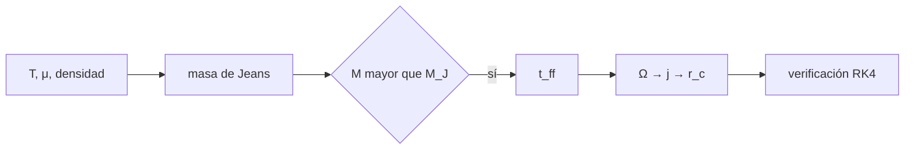

# B52-C01 — Colapso de nebulosa protosolar

<!-- nav:top -->
[🏠 Programa](../../../../README.md) · [📚 Bloque B52](../../../tronco-comun/B52-formacion-y-dinamica-de-sistemas-planetarios.md) · [← Anterior: B51-C14 — Calibración de banda en la reducción de datos de síntesis](../../B51/B51-C14-calibracion-de-banda-en-la-reduccion-de-datos-de-sintesis/CLASE.md) · [Siguiente: B52-C02 — Discos protoplanetarios →](../B52-C02-discos-protoplanetarios/CLASE.md)
<!-- /nav -->

## 1. Ubicación, nivel y alcance

Clase 1 del bloque B52. Nivel N3. Abre el bloque: antes de hablar de discos y planetas hay que saber por qué una nube de gas deja de sostenerse y cae, cuánto tarda y por qué lo que cae no llega al centro sino que forma un disco. Calculas la **masa de Jeans**, el **tiempo de caída libre** y el **radio centrífugo** de una nube ilustrativa, y contrastas cada resultado con una segunda vía numérica. Retoma [B24-C01](../../B24/B24-C01-colapso-de-nubes-moleculares/CLASE.md) desde el lado del disco y usa [B11](../../../tronco-comun/B11-ecuaciones-diferenciales-y-simulacion-numerica.md) para la integración. La nube es **sintética**.

## 2. Por qué esta clase existe

Sin colapso no hay protoestrella ni disco, y sin disco no hay planetas. La decisión central: **¿colapsa esta nube y a qué distancia del centro se detiene el material con momento angular?** El segundo dato fija el tamaño inicial del disco que estudian las clases siguientes.

## 3. Lo que podrás hacer al terminar

1. Calcular la velocidad del sonido isoterma de un gas a temperatura `T` y masa media `μ m_p`.
2. Calcular la masa de Jeans de una esfera uniforme y decidir si la nube colapsa.
3. Calcular el tiempo de caída libre y verificarlo integrando el movimiento de una capa.
4. Calcular el momento angular específico y el radio centrífugo `r_c = j²/(GM)`.
5. Verificar el periastro de una órbita de caída con una integración RK4 en 2D.
6. Declarar qué es dato, qué es ilustración y qué es modelo.

La evidencia es la **ficha del colapso protosolar** del ejercicio 12 (sección 20).

## 4. Con qué llegas y cómo comprobarlo

1. ¿Qué es una densidad media?
2. ¿Qué dice la tercera ley de Kepler?
3. ¿Qué se conserva en un movimiento bajo una fuerza central?
4. ¿Qué es un paso de integración?
5. ¿Qué es un valor ilustrativo?

<details>
<summary>Ver respuestas</summary>

1. La masa dividida por el volumen. 2. El cuadrado del periodo crece con el cubo del semieje. 3. El momento angular. 4. El intervalo de tiempo con que avanza un método numérico. 5. Un valor propuesto para el ejemplo, no medido.
</details>

Con cuatro o cinco aciertos, sigue; si no, repasa los prerrequisitos.

## 5. Un caso de contexto y casos de referencia

Una nube **sintética** de `1 M☉`, `T = 10 K`, `μ = 2,33` y radio `R₀ = 3000 ua` tiene una masa de Jeans de `0.464 M☉`: como `M/M_J = 2.16`, colapsa. Su tiempo de caída libre es de `29048` años y, con `Ω = 5·10⁻¹⁴ s⁻¹`, su material de la capa exterior se detiene a `5.11 ua`. Es el **ejemplo conductor**. Nada de esto es una observación de la nebulosa del Sol.

## 6. Vocabulario

La **masa de Jeans** es la masa mínima que una nube isoterma necesita para que su gravedad venza a la presión del gas. El **tiempo de caída libre** `t_ff` es lo que tarda en colapsar una esfera uniforme sin presión. El **momento angular específico** `j` es el momento angular por unidad de masa. El **radio centrífugo** `r_c = j²/(GM)` es el radio donde una órbita circular tiene ese `j`. El **periastro** es el punto más cercano de una órbita al cuerpo central.

## 7. Modelo mental

Como vaciar una bañera con remolino: el agua cae hacia el desagüe, pero lo que ya gira no entra en línea recta y forma un anillo alrededor. Límite: la nube del modelo es una esfera uniforme, isoterma y rígida, sin campo magnético ni turbulencia.



*Descripción textual:* la temperatura, la masa media y la densidad dan la masa de Jeans; si la nube la supera, colapsa en un tiempo de caída libre y su rotación fija el radio centrífugo, que se verifica integrando numéricamente.

## 8. La explicación, paso a paso

### 8.1 Masa de Jeans

Con velocidad del sonido isoterma `c_s² = k_B T/(μ m_p)`, la masa de Jeans de una esfera uniforme es `M_J = (5 c_s²/G)^(3/2) · (3/(4πρ))^(1/2)` (convención de esfera uniforme; otras convenciones cambian el factor de orden uno). Con `T = 10 K` y `μ = 2,33`, `c_s = 188.2 m/s`. La densidad media de la nube es `ρ = 3M/(4πR₀³) = 5.251e-15 kg/m³` y entonces `M_J = 0.464 M☉`.

### 8.2 Caída libre

`t_ff = √(3π/(32 G ρ))`. Con la densidad anterior, `t_ff = 29047.9 años`. La segunda vía integra con RK4 el movimiento radial `r'' = −GM/r²` de una capa que parte del reposo en `R₀` y da `29047.9 años`, con una diferencia relativa de `4.2e-07`.

### 8.3 Rotación y radio centrífugo

Una capa ecuatorial con velocidad angular `Ω` tiene `j = Ω R₀² = 1.007e+16 m²/s`. Al caer conserva `j`; el radio donde su órbita circular tendría ese `j` es `r_c = j²/(GM) = 5.11 ua`. La órbita de caída tiene excentricidad `0.998297` y su periastro es `q = 2.5564 ua`, casi `r_c/2 = 2.5542 ua` (en el límite de excentricidad 1 es exactamente `r_c/2`). La integración RK4 en 2D da `2.5564 ua`.

### 8.4 Lectura

El gas con `j` bajo cae cerca del centro; el de `j` alto se acumula a `r_c`. Como `r_c ∝ j² ∝ R₀⁴ Ω²`, las capas más externas aportan los radios más grandes del disco. El modelo supone esfera rígida y uniforme; una nube real tiene gradientes de densidad, turbulencia y campo magnético que cambian estos números.

## 9. Magnitudes, símbolos y unidades

| Símbolo | Qué es | Unidad | Valor / nota |
|---|---|---|---|
| `c_s` | velocidad del sonido isoterma | m/s | 188.2 |
| `M_J` | masa de Jeans | M☉ | 0.464 |
| `t_ff` | tiempo de caída libre | años | 29048 |
| `j` | momento angular específico | m²/s | 1.007e+16 |
| `r_c` | radio centrífugo | ua | 5.11 |
| `G`, `k_B`, `m_p` | constantes | SI | NIST, CODATA 2022 |

## 10. Convenciones y referencias

Unidades SI en el cálculo y ua o años solo para informar. Sistema inercial centrado en la nube. `GM` de la nube se toma igual al `(GM)☉` nominal de la IAU 2015 para que la nube tenga exactamente `1 M☉` (ilustrativo). Tolerancias: `t_ff` a `10⁻⁴` relativo y periastro a `10⁻³` relativo.

## 11. De dónde sale lo que afirmamos

| ID | Fuente | Localizador | Respalda | Estado |
|---|---|---|---|---|
| S1 | NIST, *Fundamental Physical Constants — Complete Listing* (CODATA 2022) | https://physics.nist.gov/cuu/Constants/Table/allascii.txt | `G`, `k_B`, `m_p` | Consultada el 2026-11-09 |
| S2 | Mamajek et al., *IAU 2015 Resolution B3*, arXiv:1510.07674 | https://arxiv.org/abs/1510.07674 | `(GM)☉` nominal | Texto del PDF extraído el 2026-11-09 |
| S3 | Morbidelli y Raymond, *Challenges in Planet Formation*, arXiv:1610.07202 | https://arxiv.org/abs/1610.07202 | El disco y sus propiedades son un cuello de botella de la formación planetaria | Solo resumen, consultado el 2026-11-09 |

Límites: de S3 solo se leyó el resumen; `T`, `μ`, `R₀` y `Ω` son ilustrativos y no tienen fuente; las fórmulas de Jeans y de caída libre son resultados estándar que aquí se verifican numéricamente, no se citan de un texto; la unidad astronómica no se consultó.

## 12. Cómo verlo

| Magnitud | Valor |
|---|---|
| masa de Jeans | 0.464 M☉ |
| M / M_J | 2.16 |
| t_ff | 29048 años |
| r_c | 5.11 ua |
| periastro | 2.556 ua |

Descripción larga: la nube supera la masa de Jeans, cae en unos treinta mil años y el material con rotación se detiene a unas cinco unidades astronómicas.

## 13. Ejemplo trabajado

**Paso 1 · Densidad.** `ρ = 3M/(4πR₀³) = 5.251e-15 kg/m³`.

**Paso 2 · Caída libre.** `t_ff = √(3π/(32Gρ)) = 9.167e+11 s = 29048 años`.

**Paso 3 · Momento angular.** `j = ΩR₀² = 1.007e+16 m²/s`.

**Paso 4 · Radio centrífugo.** `r_c = j²/(GM) = 5.11 ua`.

**Paso 5 · Comprobación.** El RK4 da un periastro de `2.5564 ua` frente a `2.5564 ua` analítico.

## 14. Distintas formas de describirlo

**Por fórmula:** `M_J`, `t_ff`, `r_c`. **Por tabla:** sección 12. **Por simulación:** RK4 radial y en 2D. **Por escalas:** `t_ff` frente a la vida del disco de gas (clase C09).

## 15. Práctica guiada

**Ejercicio 1 · con los pasos indicados.** Calcula `t_ff` para una densidad de `10⁻¹⁵ kg/m³`. *Pasos:* `√(3π/(32·6,674·10⁻¹¹·ρ))`.

<details><summary>Solución comentada</summary>

`√(9,4248/(2,1357·10⁻²⁴)) ≈ 2,10·10¹² s ≈ 6,7·10⁴ años`; la fórmula es la de la sección 8.2.
</details>

**Ejercicio 2 · con una pista.** Si la temperatura se duplica, ¿cómo cambia `M_J`? *Pista:* `M_J ∝ T^(3/2)`.

<details><summary>Solución comentada</summary>

Crece `2^(3/2) = 2,83` veces.
</details>

**Ejercicio 3 · casi autónomo.** Con `R₀` y `Ω` constantes, si la masa se cuadruplica, ¿cómo cambia `r_c`?

<details><summary>Solución comentada</summary>

`r_c ∝ j²/M`, con `j` fijo: baja a la cuarta parte.
</details>

## 16. Práctica autónoma, transferencia e integrador

**Ejercicio 4.** Calcula `c_s` con `T = 10 K` y `μ = 2,33`.

<details><summary>Solución comentada</summary>

`188.2 m/s`.
</details>

**Ejercicio 5.** Calcula `M/M_J` de la nube del caso conductor.

<details><summary>Solución comentada</summary>

`2.16`.
</details>

**Ejercicio 6.** Compara `t_ff` analítico y numérico.

<details><summary>Solución comentada</summary>

`29047.92` años frente a `29047.91` años; diferencia `4.2e-07`.
</details>

**Ejercicio 7.** Calcula `r_c` para `Ω = 10⁻¹³ s⁻¹` con el resto igual. *Pista:* `r_c ∝ Ω²`.

<details><summary>Solución comentada</summary>

Es `4` veces el valor base: `20.4 ua`.
</details>

**Ejercicio 8.** Calcula el periastro numérico.

<details><summary>Solución comentada</summary>

`2.5564 ua`.
</details>

**Ejercicio 9 · transferencia.** **Transferencia.** **Transferencia.** Un colega dice que la nube «mide» `r_c` porque lo observó. Responde.

<details><summary>Solución comentada</summary>

No: `r_c` sale de un modelo con `Ω` ilustrativo; para un caso real hay que medir `Ω` y justificar la hipótesis de rotación rígida.
</details>

**Ejercicio 10 · transferencia.** **Transferencia.** **Transferencia.** ¿Qué cambia si la nube tiene campo magnético?

<details><summary>Solución comentada</summary>

El campo transporta momento angular y puede reducir `j`: el disco inicial sería menor que `r_c`. El modelo no lo incluye.
</details>

**Ejercicio 11 · transferencia.** **Transferencia.** **Transferencia.** ¿Por qué el colapso real no es uniforme?

<details><summary>Solución comentada</summary>

La densidad crece hacia el centro; el centro colapsa antes que el borde y el tiempo de caída libre depende del radio.
</details>

**Ejercicio 12 · integrador.** **Integrador.** **Integrador.** Elabora tu *ficha del colapso protosolar*: tabla de la sección 12, el cociente `M/M_J`, la comparación de `t_ff` y de `r_c/2` con el RK4, y los límites.

<details><summary>Solución modelo</summary>

Secciones 8.1–8.4 y 12.
</details>

## 17. Laboratorio: colapso de una nube ilustrativa

El script [colapso.py](colapso.py) calcula la masa de Jeans, el tiempo de caída libre y el radio centrífugo, y verifica cada uno con una integración RK4 independiente (**comprueba** `t_ff` a `10⁻⁴` y el periastro a `10⁻³`).

**Datos:** `G`, `k_B`, `m_p` de NIST (CODATA 2022) y `(GM)☉` de la IAU 2015, consultados el 2026-11-09; temperatura, `μ`, masa, radio y rotación son **ilustrativos**. **Predice antes de ejecutar:** ¿colapsará la nube? (sí: `M/M_J` ≈ 2.) **Ejecución del 2026-11-09 (Python 3.12.9):**

```text
Python 3.12.9 (biblioteca estandar)
Datos ilustrativos: T = 10.0 K, mu = 2.33, M = 1.000 M_sol, R0 = 3000 ua, Omega = 5.0e-14 s^-1
Velocidad del sonido isoterma c_s = 188.2 m/s
Densidad media de la nube = 5.251e-15 kg/m^3 (n = 1.35e+12 particulas/m^3) ; masa de Jeans = 0.464 M_sol
Cociente M/M_J = 2.16 ; colapsa (M > M_J): True
Tiempo de caida libre: analitico = 29047.9237 anios ; RK4 = 29047.9114 anios ; dif. relativa = 4.24e-07
Momento angular especifico j = 1.007e+16 m^2/s ; radio centrifugo r_c = j^2/(GM) = 5.11 ua
Excentricidad de la orbita de caida e = 0.998297
Periastro: analitico = 2.5564 ua ; RK4 = 2.5564 ua ; r_c/2 = 2.5542 ua
Pruebas superadas.
```

```bash
python programa/clases/B52/B52-C01-colapso-de-nebulosa-protosolar/colapso.py
```

**Límites:** esfera uniforme, isoterma y rígida; sin campo magnético, turbulencia ni pérdida de masa.

## 18. Errores frecuentes y cómo corregirlos

**Confundir masa de Jeans con la masa de la nube.** Se corrige comparando `M/M_J` en 8.1.

**Pensar que lo que cae llega al centro.** Se corrige con `r_c` en 8.3.

**Usar `ρ` del núcleo en lugar de la media de la nube.** Se corrige con 8.1.

**Presentar la nube sintética como la nebulosa del Sol.** Se corrige con la sección 10.

## 19. Cómo sabrás que vas bien

Tras la sección 8: ¿qué resultado esperabas y cuál obtuviste? Si dudas, repasa el ejemplo de la sección 13. Tras el laboratorio: ¿qué comprueba? (ver la sección 17).

## 20. Qué entregas y cómo se evalúa

El producto es tu **ficha del colapso protosolar** (ejercicio 12).

| Criterio | Inicial | En desarrollo | Logrado | Destacado |
|---|---|---|---|---|
| Conceptos | Los confunde | Parciales | Conceptos de la clase | Explica los límites |
| Cálculo | Sin unidades | Con errores | Tablas completas | Calcula casos nuevos |
| Numérico | Sin comprobar | Un caso | Contraste con el análisis | Interpreta las diferencias |
| Fuentes | Sin fuente | Sin fecha | Fuentes con fecha | Declara lo ilustrativo |
| Límites | No los nombra | Uno | Tres | Discute qué falta del modelo |

**Condiciones críticas (no se compensan con promedio):** rotular lo sintético e ilustrativo; no presentar un resultado simulado como observado; citar solo lo consultado.

## 21. Ética, seguridad y límites

Clase educativa: los modelos son simplificados y no sustituyen a la literatura primaria ni a los códigos de producción. Lo simulado no es lo observado. Accesibilidad: tablas equivalentes a las gráficas, fórmulas en texto, ejercicios sin conexión.

## 22. Para cerrar y seguir

Una nube con `M/M_J = 2.16` colapsa en `29048` años y el material rotante se detiene a unas `5.1 ua`. Queda una pregunta: ¿qué estructura tiene el disco que se forma?

**Glosario español–inglés.** masa de Jeans · *Jeans mass*; caída libre · *free fall*; momento angular específico · *specific angular momentum*; radio centrífugo · *centrifugal radius*; periastro · *periapsis*.

**Continuidad.** [B52-C02](../B52-C02-discos-protoplanetarios/CLASE.md) describe el disco.

**Referencias:** ver sección 11.

<!-- nav:bottom -->
---

[← Anterior: B51-C14 — Calibración de banda en la reducción de datos de síntesis](../../B51/B51-C14-calibracion-de-banda-en-la-reduccion-de-datos-de-sintesis/CLASE.md) · [📚 Bloque B52](../../../tronco-comun/B52-formacion-y-dinamica-de-sistemas-planetarios.md) · [Siguiente: B52-C02 — Discos protoplanetarios →](../B52-C02-discos-protoplanetarios/CLASE.md)
<!-- /nav -->
