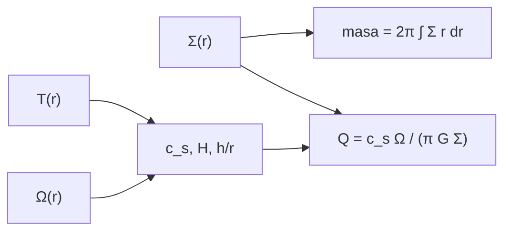

# B52-C02 — Discos protoplanetarios

<!-- nav:top -->
[🏠 Programa](../../../../README.md) · [📚 Bloque B52](../../../tronco-comun/B52-formacion-y-dinamica-de-sistemas-planetarios.md) · [← Anterior: B52-C01 — Colapso de nebulosa protosolar](../B52-C01-colapso-de-nebulosa-protosolar/CLASE.md) · [Siguiente: B52-C03 — Granulación de polvo y acreción →](../B52-C03-granulacion-de-polvo-y-acrecion/CLASE.md)
<!-- /nav -->

## 1. Ubicación, nivel y alcance

Clase 2 del bloque B52. Nivel N3. El colapso de [B52-C01](../B52-C01-colapso-de-nebulosa-protosolar/CLASE.md) deja un disco. Aquí lo describes con tres perfiles —densidad superficial, temperatura y espesor— y compruebas con el criterio de Toomre que no se fragmenta por sí mismo. Calculas la masa del disco por dos vías (fórmula y cuadratura) y la pendiente del cociente de espesor. El disco es **sintético**: sus leyes de potencia son una parametrización de enseñanza.

## 2. Por qué esta clase existe

Todo lo que sigue —deriva del polvo, crecimiento, migración— ocurre dentro de un disco y depende de cuánta masa tiene, cuán caliente y cuán grueso es. La decisión central: **¿cómo se resume un disco con tres funciones del radio y cuándo es estable?**

## 3. Lo que podrás hacer al terminar

1. Evaluar una densidad superficial y una temperatura de ley de potencias.
2. Calcular la velocidad del sonido, la frecuencia kepleriana y la escala de altura.
3. Integrar la masa del disco y contrastar fórmula y cuadratura.
4. Comprobar que `h/r` crece como `r^(1/4)` con una temperatura `∝ r^(−1/2)`.
5. Calcular el parámetro de Toomre `Q` y decidir si el disco es estable.
6. Distinguir una parametrización de ley de potencias de un disco observado.

La evidencia es la **ficha del disco** del ejercicio 12 (sección 20).

## 4. Con qué llegas y cómo comprobarlo

1. ¿Qué es una ley de potencias?
2. ¿Qué es una integral numérica?
3. ¿Qué es la frecuencia kepleriana?
4. ¿Qué es una densidad superficial?
5. ¿Qué es un valor ilustrativo?

<details>
<summary>Ver respuestas</summary>

1. Una función `y = a·x^p`. 2. Una suma ponderada que aproxima el área bajo una curva. 3. `Ω = √(GM/r³)`. 4. Masa por unidad de área, en kg/m². 5. Un valor propuesto para el ejemplo, no medido.
</details>

Con cuatro o cinco aciertos, sigue; si no, repasa los prerrequisitos.

## 5. Un caso de contexto y casos de referencia

Con `Σ = 10⁴ kg/m²·(r/ua)^(−1,5)` y `T = 280 K·(r/ua)^(−1/2)` entre 0,1 y 100 ua, el disco sintético tiene `0.01370 M☉` (unos 14 masas de Júpiter si se cuenta `M☉/M_J ≈ 1050`, valor que se da solo como orden de magnitud no consultado). A 1 ua, `h/r = 0.0337`; a 100 ua, `0.1064`. El `Q` mínimo es `30.1`: estable. Es el **ejemplo conductor**; no es un disco observado.

## 6. Vocabulario

La **densidad superficial** `Σ(r)` es la masa por unidad de área del disco. La **escala de altura** `H = c_s/Ω` mide su espesor vertical y `h/r` es su cociente con el radio. El **parámetro de Toomre** `Q = c_s Ω/(πGΣ)` indica si el disco resiste su propia gravedad (estable si `Q > 1`). Una **ley de potencias** es `y ∝ r^p`. La **masa del disco** es `2π∫Σ r dr`.

## 7. Modelo mental

Como un disco de vinilo con la mayor parte del material pegada al centro y un borde fino: tres funciones del radio bastan para describirlo. Límite: simetría axial, un solo exponente y sin estructuras (anillos, huecos, espirales).



*Descripción textual:* la densidad superficial da la masa; la temperatura y la frecuencia kepleriana dan el espesor; con todo ello se calcula el parámetro de Toomre.

## 8. La explicación, paso a paso

### 8.1 Perfiles

`Σ(r) = Σ₁ (r/ua)^(−p)` con `Σ₁ = 10⁴ kg/m²` y `p = 1,5`; `T(r) = 280 K (r/ua)^(−1/2)`; `μ = 2,3`. Con `c_s = √(k_B T/(μ m_p))` y `Ω = √(GM/r³)`:

| r [ua] | Σ [kg/m²] | T [K] | h/r | Q |
|---|---|---|---|---|
| 0.1 | 3.162e+05 | 885.4 | 0.0189 | 169.27 |
| 1 | 1.000e+04 | 280.0 | 0.0337 | 95.19 |
| 5 | 8.944e+02 | 125.2 | 0.0503 | 63.65 |
| 30 | 6.086e+01 | 51.1 | 0.0788 | 40.67 |
| 100 | 1.000e+01 | 28.0 | 0.1064 | 30.10 |

### 8.2 Masa

`M = 2π Σ₁ ua^p (r_out^(2−p) − r_in^(2−p))/(2−p) = 0.01370 M☉`. La regla de Simpson en `ln r` da `0.01370 M☉`, con diferencia `1.4e-15`.

### 8.3 Espesor

Con `T ∝ r^(−1/2)`, `c_s ∝ r^(−1/4)` y `Ω ∝ r^(−3/2)`, de modo que `h/r = c_s/(Ω r) ∝ r^(1/4)`. La pendiente log-log entre 1 y 100 ua es `0.250000`. El disco se ensancha hacia afuera («flaring»).

### 8.4 Estabilidad

`Q` baja hacia afuera: de `169` a `0,1 ua` a `30.1` a 100 ua. Como `Q > 1` en todo el disco, no se fragmenta por autogravedad. Con una masa mucho mayor sí podría; el cálculo muestra cómo escala `Q ∝ 1/Σ`.

### 8.5 Lectura

Los perfiles son una parametrización: sirven para razonar y para alimentar las clases siguientes. Los discos observados tienen anillos, huecos y colas exponenciales que una sola ley de potencias no recoge.

## 9. Magnitudes, símbolos y unidades

| Símbolo | Qué es | Unidad | Valor / nota |
|---|---|---|---|
| `Σ` | densidad superficial | kg/m² | 10⁴ a 1 ua (ilustrativo) |
| `T` | temperatura del plano medio | K | 280 a 1 ua (ilustrativo) |
| `c_s` | velocidad del sonido | m/s | 1002 a 1 ua |
| `Ω` | frecuencia kepleriana | s⁻¹ | 1.991e-07 a 1 ua |
| `h/r` | espesor relativo | — | 0.0337 a 1 ua |
| `Q` | parámetro de Toomre | — | 30.1 mínimo |

## 10. Convenciones y referencias

Unidades SI en el cálculo. Plano medio, simetría axial, estrella de `(GM)☉` nominal. Tolerancias: masa a `10⁻⁶` relativo y pendiente a `10⁻⁹`.

## 11. De dónde sale lo que afirmamos

| ID | Fuente | Localizador | Respalda | Estado |
|---|---|---|---|---|
| S1 | NIST, *Fundamental Physical Constants — Complete Listing* (CODATA 2022) | https://physics.nist.gov/cuu/Constants/Table/allascii.txt | `G`, `k_B`, `m_p` | Consultada el 2026-11-09 |
| S2 | Mamajek et al., *IAU 2015 Resolution B3*, arXiv:1510.07674 | https://arxiv.org/abs/1510.07674 | `(GM)☉` nominal | Texto del PDF extraído el 2026-11-09 |
| S3 | Morbidelli y Raymond, *Challenges in Planet Formation*, arXiv:1610.07202 | https://arxiv.org/abs/1610.07202 | La estructura del disco es uno de los problemas abiertos | Solo resumen, consultado el 2026-11-09 |

Límites: de S3 solo se leyó el resumen; las leyes de potencia, `Σ₁`, `T₁` y `μ` son ilustrativos y no se consultaron en una fuente; el cociente `M☉/M_J` es un orden de magnitud no consultado.

## 12. Cómo verlo

| Magnitud | Valor |
|---|---|
| masa del disco | 0.01370 M☉ |
| h/r a 1 ua | 0.0337 |
| h/r a 100 ua | 0.1064 |
| Q mínimo | 30.1 |
| pendiente de h/r | 0.250 |

Descripción larga: la masa del disco es un pequeño porcentaje de la estelar, el disco se ensancha hacia afuera y `Q` se mantiene muy por encima de 1.

## 13. Ejemplo trabajado

**Paso 1 · Temperatura.** A 5 ua, `T = 280·5^(−1/2) = 125.2 K`.

**Paso 2 · Velocidad del sonido.** `c_s = √(k_B T/(μ m_p)) = 670.4 m/s`.

**Paso 3 · Frecuencia.** `Ω = √(GM/r³)`.

**Paso 4 · Espesor.** `h/r = 0.0503`.

**Paso 5 · Toomre.** `Q = c_s Ω/(πGΣ) = 63.65`.

## 14. Distintas formas de describirlo

**Por fórmula:** `Σ`, `T`, `Ω`, `Q`. **Por tabla:** 8.1. **Por integral:** masa. **Por pendiente:** `h/r ∝ r^(1/4)`.

## 15. Práctica guiada

**Ejercicio 1 · con los pasos indicados.** Calcula `Σ` a 10 ua. *Pasos:* `10⁴·10^(−1,5)`.

<details><summary>Solución comentada</summary>

`316.2 kg/m²`.
</details>

**Ejercicio 2 · con una pista.** Calcula `T` a 100 ua. *Pista:* `280/10`.

<details><summary>Solución comentada</summary>

`28,0 K`.
</details>

**Ejercicio 3 · casi autónomo.** ¿Cómo cambia `Q` si `Σ` se duplica? *Pista:* `Q ∝ 1/Σ`.

<details><summary>Solución comentada</summary>

Se reduce a la mitad.
</details>

## 16. Práctica autónoma, transferencia e integrador

**Ejercicio 4.** Masa del disco por la fórmula.

<details><summary>Solución comentada</summary>

`0.01370 M☉`.
</details>

**Ejercicio 5.** Masa por Simpson.

<details><summary>Solución comentada</summary>

`0.01370 M☉`.
</details>

**Ejercicio 6.** `h/r` a 30 ua.

<details><summary>Solución comentada</summary>

`0.0788`.
</details>

**Ejercicio 7.** `Q` a 30 ua.

<details><summary>Solución comentada</summary>

`40.67`.
</details>

**Ejercicio 8.** Pendiente de `h/r`.

<details><summary>Solución comentada</summary>

`0.250000`, es decir `1/4`.
</details>

**Ejercicio 9 · transferencia.** **Transferencia.** **Transferencia.** Un compañero afirma que el disco del ejemplo «es el del Sol». Responde.

<details><summary>Solución comentada</summary>

No: sus leyes de potencia son ilustrativas; para el Sol habría que citar un modelo y su fuente.
</details>

**Ejercicio 10 · transferencia.** **Transferencia.** **Transferencia.** ¿Qué pasa con `Q` si la masa del disco sube diez veces?

<details><summary>Solución comentada</summary>

`Q` baja diez veces; en los radios externos quedaría cerca de `3`, todavía sobre 1 pero con poco margen.
</details>

**Ejercicio 11 · transferencia.** **Transferencia.** **Transferencia.** ¿Qué ocurre con `h/r` si `T ∝ r^(−3/4)`?

<details><summary>Solución comentada</summary>

`c_s ∝ r^(−3/8)` y `h/r ∝ r^(1/8)`: el flaring es menor.
</details>

**Ejercicio 12 · integrador.** **Integrador.** **Integrador.** Elabora tu *ficha del disco*: tabla de 8.1, masa por dos vías, pendiente de `h/r`, `Q` mínimo y límites.

<details><summary>Solución modelo</summary>

Secciones 8.1–8.5 y 12.
</details>

## 17. Laboratorio: perfiles de un disco sintético

El script [disco.py](disco.py) evalúa `Σ`, `T`, `h/r` y `Q`, integra la masa por dos vías y comprueba la pendiente de `h/r` (**comprueba** `10⁻⁶` y `10⁻⁹`).

**Datos:** `G`, `k_B`, `m_p` de NIST (CODATA 2022) y `(GM)☉` de la IAU 2015, consultados el 2026-11-09; el disco es **sintético**. **Predice antes de ejecutar:** ¿será estable el disco? (sí: `Q` mínimo de unas treinta unidades.) **Ejecución del 2026-11-09 (Python 3.12.9):**

```text
Python 3.12.9 (biblioteca estandar)
Disco ilustrativo: Sigma = 1.0e+04 kg/m^2 (r/ua)^-1.5; T = 280 K (r/ua)^-0.5; mu = 2.3; de 0.1 a 100.0 ua
  r [ua]  Sigma [kg/m^2]    T [K]      h/r          Q
     0.1      3.1623e+05    885.4   0.0189     169.27
     1.0      1.0000e+04    280.0   0.0337      95.19
     5.0      8.9443e+02    125.2   0.0503      63.65
    30.0      6.0858e+01     51.1   0.0788      40.67
   100.0      1.0000e+01     28.0   0.1064      30.10
Masa del disco: analitica = 0.01370 M_sol ; Simpson = 0.01370 M_sol ; dif. relativa = 1.4e-15
Pendiente log-log de h/r entre 1 y 100 ua = 0.250000000 (esperada 0.25)
Q minimo en la malla = 30.10 en r = 100.0 ua ; el disco es estable (Q > 1): True
Pruebas superadas.
```

```bash
python programa/clases/B52/B52-C02-discos-protoplanetarios/disco.py
```

**Límites:** simetría axial, un solo exponente y sin estructura; lo calculado no es un disco observado.

## 18. Errores frecuentes y cómo corregirlos

**Confundir `h` con `h/r`.** Se corrige con 8.3.

**Olvidar que `Q` depende de `Σ` y no de la masa total.** Se corrige con 8.4.

**Presentar la ley de potencias como medida.** Se corrige con la sección 10.

**Integrar en `r` con pocos puntos.** Se corrige integrando en `ln r` (8.2).

## 19. Cómo sabrás que vas bien

Tras la sección 8: ¿qué resultado esperabas y cuál obtuviste? Si dudas, repasa el ejemplo de la sección 13. Tras el laboratorio: ¿qué comprueba? (ver la sección 17).

## 20. Qué entregas y cómo se evalúa

El producto es tu **ficha del disco** (ejercicio 12).

| Criterio | Inicial | En desarrollo | Logrado | Destacado |
|---|---|---|---|---|
| Conceptos | Los confunde | Parciales | Conceptos de la clase | Explica los límites |
| Cálculo | Sin unidades | Con errores | Tablas completas | Calcula casos nuevos |
| Numérico | Sin comprobar | Un caso | Contraste con el análisis | Interpreta las diferencias |
| Fuentes | Sin fuente | Sin fecha | Fuentes con fecha | Declara lo ilustrativo |
| Límites | No los nombra | Uno | Tres | Discute qué falta del modelo |

**Condiciones críticas (no se compensan con promedio):** rotular lo sintético e ilustrativo; no presentar un resultado simulado como observado; citar solo lo consultado.

## 21. Ética, seguridad y límites

Clase educativa: los modelos son simplificados y no sustituyen a la literatura primaria ni a los códigos de producción. Lo simulado no es lo observado. Accesibilidad: tablas equivalentes a las gráficas, fórmulas en texto, ejercicios sin conexión.

## 22. Para cerrar y seguir

Tres funciones del radio describen el disco: `0.0137 M☉`, `h/r ∝ r^(1/4)` y `Q ≥ 30`. Queda una pregunta: ¿cómo se mueve el polvo dentro de ese gas?

**Glosario español–inglés.** densidad superficial · *surface density*; escala de altura · *scale height*; parámetro de Toomre · *Toomre parameter*; ley de potencias · *power law*; ensanchamiento del disco · *flaring*.

**Continuidad.** [B52-C03](../B52-C03-granulacion-de-polvo-y-acrecion/CLASE.md) sigue el polvo en el disco.

**Referencias:** ver sección 11.

<!-- nav:bottom -->
---

[← Anterior: B52-C01 — Colapso de nebulosa protosolar](../B52-C01-colapso-de-nebulosa-protosolar/CLASE.md) · [📚 Bloque B52](../../../tronco-comun/B52-formacion-y-dinamica-de-sistemas-planetarios.md) · [Siguiente: B52-C03 — Granulación de polvo y acreción →](../B52-C03-granulacion-de-polvo-y-acrecion/CLASE.md)
<!-- /nav -->
