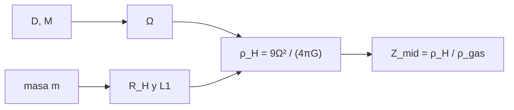

# B52-C04 — Formación de planetesimales

<!-- nav:top -->
[🏠 Programa](../../../../README.md) · [📚 Bloque B52](../../../tronco-comun/B52-formacion-y-dinamica-de-sistemas-planetarios.md) · [← Anterior: B52-C03 — Granulación de polvo y acreción](../B52-C03-granulacion-de-polvo-y-acrecion/CLASE.md) · [Siguiente: B52-C05 — Crecimiento de embriones planetarios →](../B52-C05-crecimiento-de-embriones-planetarios/CLASE.md)
<!-- /nav -->

## 1. Ubicación, nivel y alcance

Clase 4 del bloque B52. Nivel N3. La deriva de [B52-C03](../B52-C03-granulacion-de-polvo-y-acrecion/CLASE.md) destruye los granos antes de que crezcan, así que los planetesimales no pueden formarse solo por choques. Aquí estudias la **condición de colapso gravitacional**: una concentración de partículas se une si su densidad supera la **densidad de Hill**. Calculas esa densidad, la verificas hallando numéricamente el punto L1 del problema restringido de tres cuerpos y estimas qué razón polvo/gas exigiría la condición. Usas [B16](../../../tronco-comun/B16-sistemas-dinamicos-y-control-automatico.md). El disco es **sintético**.

## 2. Por qué esta clase existe

Si la autogravedad solo gana contra las mareas por encima de cierta densidad, esa densidad fija cuánto debe concentrarse el polvo. La decisión central: **¿qué densidad necesita un cúmulo de partículas para colapsar a una distancia dada?**

## 3. Lo que podrás hacer al terminar

1. Calcular el radio de Hill de un cúmulo y su densidad media interior.
2. Demostrar que la densidad de Hill `9Ω²/(4πG)` no depende de la masa del cúmulo.
3. Hallar numéricamente el punto L1 y compararlo con el radio de Hill.
4. Calcular la razón polvo/gas del plano medio que alcanza la densidad de Hill.
5. Comparar la densidad de un cuerpo compacto con la de Hill.
6. Distinguir la condición gravitacional del mecanismo que concentra las partículas.

La evidencia es la **ficha del colapso de partículas** del ejercicio 12 (sección 20).

## 4. Con qué llegas y cómo comprobarlo

1. ¿Qué es una esfera de Hill?
2. ¿Qué es una bisección?
3. ¿Qué es la densidad media?
4. ¿Qué es un punto de Lagrange?
5. ¿Qué es un valor ilustrativo?

<details>
<summary>Ver respuestas</summary>

1. La región donde domina la gravedad de un cuerpo frente a la de la estrella. 2. Un método que halla una raíz acotándola y partiendo el intervalo. 3. La masa dividida por el volumen. 4. Un equilibrio del problema restringido de tres cuerpos. 5. Un valor propuesto para el ejemplo, no medido.
</details>

Con cuatro o cinco aciertos, sigue; si no, repasa los prerrequisitos.

## 5. Un caso de contexto y casos de referencia

A 5 ua la densidad de Hill vale `3.403e-06 kg/m³`. El gas del disco sintético tiene allí `9.48e-09 kg/m³`, de modo que el polvo del plano medio debería ser `359` veces más denso que el gas para colapsar. Un cuerpo compacto de 100 km tiene `2.9e+08` veces la densidad de Hill. Es el **ejemplo conductor**; no explica cómo se llega a esa concentración.

## 6. Vocabulario

La **esfera de Hill** tiene radio `R_H = D (m/(3M))^(1/3)`. La **densidad de Hill** es la densidad media dentro de `R_H`: `ρ_H = 9M/(4πD³) = 9Ω²/(4πG)`. El **punto L1** es el equilibrio entre la estrella y el cúmulo. La **razón polvo/gas del plano medio** es `ρ_d/ρ_gas`. La **inestabilidad de corriente** es una inestabilidad lineal de la mezcla de polvo y gas en rotación que puede concentrar partículas.

## 7. Modelo mental

Como una ciudad que solo se mantiene unida si tiene suficiente gente por kilómetro cuadrado frente al «oleaje» de las mareas del vecindario. Límite: tres cuerpos puntuales, órbita circular, sin gas, sin rotación del cúmulo ni fuerzas de cohesión.



*Descripción textual:* la distancia y la masa estelar dan `Ω` y la densidad de Hill, que no depende de `m`; el radio de Hill se verifica con L1 y la comparación con la densidad del gas da la razón polvo/gas necesaria.

## 8. La explicación, paso a paso

### 8.1 Densidad de Hill

`R_H = D (m/(3M))^(1/3)` y `ρ̄ = m/(4π R_H³/3) = 9M/(4πD³) = 9Ω²/(4πG)`; la masa `m` se cancela. A 5 ua, `ρ_H = 3.4029e-06 kg/m³`.

### 8.2 Verificación con L1

El punto L1 del problema restringido circular (estrella `M`, cúmulo `m`, `ω² = G(M+m)/D³`) se halla por bisección de `GM/x² − Gm/(D−x)² − ω²(x − x_cm) = 0`. Para cúmulos de `10¹⁵` a `10²¹ kg` a 5 ua:

| m [kg] | R_H analítico [m] | \|L1\| numérico [m] | ρ en L1 / ρ_H |
|---|---|---|---|
| 1.000e+15 | 4.124326e+06 | 4.124319e+06 | 1.000006 |
| 1.000e+18 | 4.124326e+07 | 4.124251e+07 | 1.000055 |
| 4.190e+18 | 6.649021e+07 | 6.648824e+07 | 1.000089 |
| 1.000e+21 | 4.124326e+08 | 4.123568e+08 | 1.000552 |

La diferencia es menor de `10⁻³` y crece como `(m/M)^(1/3)`, porque `R_H` es la aproximación de masas pequeñas.

### 8.3 Razón polvo/gas

El gas del plano medio tiene `ρ_gas = Σ/(√(2π) H)`. La razón necesaria `Z_mid = ρ_H/ρ_gas` es:

| r [ua] | ρ_gas [kg/m³] | ρ_H [kg/m³] | Z_mid |
|---|---|---|---|
| 1 | 7.924e-07 | 4.254e-04 | 537 |
| 5 | 9.479e-09 | 3.403e-06 | 359 |
| 30 | 6.868e-11 | 1.575e-08 | 229 |

Ni la sedimentación simple ni la razón de metalicidad habitual (`≈ 0,01`) llegan a esos valores; hace falta un mecanismo que concentre, por ejemplo la inestabilidad de corriente o las trampas de presión.

### 8.4 Cuerpos compactos

Un cuerpo de 100 km de diámetro y 1000 kg/m³ pesa `5.24e+17 kg` y su radio de Hill a 5 ua es `33242 km`; su densidad es `2.9e+08` veces la de Hill, así que, una vez formado, queda muy ligado.

### 8.5 Lectura

La densidad de Hill es un umbral necesario, no un mecanismo. Qué lo alcanza (y si el polvo conserva su coherencia al colapsar) pertenece a los modelos de inestabilidad de corriente, que aquí no se simulan.

## 9. Magnitudes, símbolos y unidades

| Símbolo | Qué es | Unidad | Valor / nota |
|---|---|---|---|
| `ρ_H` | densidad de Hill | kg/m³ | 3.403e-06 a 5 ua |
| `R_H` | radio de Hill | m | 4.124e+07 para 10¹⁸ kg |
| `Z_mid` | razón polvo/gas necesaria | — | 359 a 5 ua |
| `ρ_gas` | densidad del gas en el plano medio | kg/m³ | 9.479e-09 a 5 ua |
| `m` | masa del cúmulo | kg | 10¹⁵ a 10²¹ (ilustrativo) |

## 10. Convenciones y referencias

Unidades SI. Problema restringido circular de tres cuerpos, estrella de `(GM)☉` nominal. Tolerancias: `10⁻³` en L1 y `3·10⁻³` en la densidad. Disco de B52-C02, sintético.

## 11. De dónde sale lo que afirmamos

| ID | Fuente | Localizador | Respalda | Estado |
|---|---|---|---|---|
| S1 | NIST, *Fundamental Physical Constants — Complete Listing* (CODATA 2022) | https://physics.nist.gov/cuu/Constants/Table/allascii.txt | `G` | Consultada el 2026-11-09 |
| S2 | Mamajek et al., *IAU 2015 Resolution B3*, arXiv:1510.07674 | https://arxiv.org/abs/1510.07674 | `(GM)☉` nominal | Texto del PDF extraído el 2026-11-09 |
| S3 | Youdin y Goodman, *Streaming Instabilities in Protoplanetary Disks*, arXiv:astro-ph/0409263 | https://arxiv.org/abs/astro-ph/0409263 | La fricción entre polvo y gas produce una inestabilidad lineal que puede concentrar partículas | Solo resumen, consultado el 2026-11-09 |
| S4 | Chiang y Youdin, *Forming Planetesimals in Solar and Extrasolar Nebulae*, arXiv:0909.2652 | https://arxiv.org/abs/0909.2652 | Los planetesimales se forman probablemente por autogravedad de muchas partículas | Solo resumen, consultado el 2026-11-09 |

Límites: de S3 y S4 solo se leyó el resumen; la inestabilidad de corriente no se simula; la densidad de Hill es un resultado estándar que aquí se verifica con el punto L1, no se cita de un texto; el disco es sintético.

## 12. Cómo verlo

| Magnitud | Valor |
|---|---|
| ρ_H a 5 ua | 3.403e-06 kg/m³ |
| Z_mid a 1 ua | 537 |
| Z_mid a 5 ua | 359 |
| Z_mid a 30 ua | 229 |
| R_H de 100 km | 33242 km |

Descripción larga: la razón polvo/gas necesaria es de cientos y baja hacia afuera, porque el gas del plano medio se enrarece más rápido hacia afuera que `ρ_H`.

## 13. Ejemplo trabajado

**Paso 1 · Frecuencia.** A 5 ua, `Ω² = GM/D³ = 3.171e-16 s⁻²`.

**Paso 2 · Densidad.** `ρ_H = 9Ω²/(4πG) = 3.403e-06 kg/m³`.

**Paso 3 · Gas.** `ρ_gas = 9.479e-09 kg/m³`.

**Paso 4 · Razón.** `Z_mid = 359`.

## 14. Distintas formas de describirlo

**Por fórmula:** `ρ_H`. **Por número:** L1. **Por tabla:** 8.2 y 8.3. **Por comparación:** cuerpo compacto frente a Hill.

## 15. Práctica guiada

**Ejercicio 1 · con los pasos indicados.** Calcula `R_H` a 5 ua para `m = 10¹⁸ kg`. *Pasos:* `D (m/(3M))^(1/3)`.

<details><summary>Solución comentada</summary>

`4.124e+07 m`.
</details>

**Ejercicio 2 · con una pista.** ¿Cambia `ρ_H` si `m` se multiplica por 1000? *Pista:* mira la fórmula.

<details><summary>Solución comentada</summary>

No: `ρ_H = 9Ω²/(4πG)` no depende de `m`.
</details>

**Ejercicio 3 · casi autónomo.** ¿Cómo escala `ρ_H` con la distancia?

<details><summary>Solución comentada</summary>

`ρ_H ∝ D⁻³`.
</details>

## 16. Práctica autónoma, transferencia e integrador

**Ejercicio 4.** `ρ_H` a 5 ua.

<details><summary>Solución comentada</summary>

`3.403e-06 kg/m³`.
</details>

**Ejercicio 5.** `Z_mid` a 30 ua.

<details><summary>Solución comentada</summary>

`229`.
</details>

**Ejercicio 6.** Diferencia relativa de L1 para `m = 10¹⁸ kg`.

<details><summary>Solución comentada</summary>

`1.8e-05`.
</details>

**Ejercicio 7.** Masa de un cuerpo de 100 km de diámetro y 1000 kg/m³.

<details><summary>Solución comentada</summary>

`5.24e+17 kg`.
</details>

**Ejercicio 8.** `ρ_cuerpo/ρ_H` a 5 ua.

<details><summary>Solución comentada</summary>

`2.94e+08`.
</details>

**Ejercicio 9 · transferencia.** **Transferencia.** **Transferencia.** Un colega dice que con `Z = 0,01` el polvo ya colapsa. Responde.

<details><summary>Solución comentada</summary>

Con `Z = 0,01` la densidad es cientos de veces menor que `ρ_H` en este disco; solo una concentración local lo logra.
</details>

**Ejercicio 10 · transferencia.** **Transferencia.** **Transferencia.** ¿Qué pasa con `Z_mid` si el disco es más masivo?

<details><summary>Solución comentada</summary>

`ρ_gas` crece con `Σ`, de modo que `Z_mid` necesario baja.
</details>

**Ejercicio 11 · transferencia.** **Transferencia.** **Transferencia.** ¿Por qué `ρ_H` no incluye cohesión?

<details><summary>Solución comentada</summary>

Porque el criterio es gravitacional; las fuerzas de cohesión actúan en cuerpos pequeños y no entran en el modelo.
</details>

**Ejercicio 12 · integrador.** **Integrador.** **Integrador.** Elabora tu *ficha del colapso de partículas*: `ρ_H`, la verificación con L1, la tabla de `Z_mid` y los límites.

<details><summary>Solución modelo</summary>

Secciones 8.1–8.5 y 12.
</details>

## 17. Laboratorio: densidad de Hill y punto L1

El script [planetesimal.py](planetesimal.py) calcula la densidad de Hill, la verifica hallando por bisección el punto L1 del problema restringido de tres cuerpos y estima la razón polvo/gas necesaria (**comprueba** `10⁻³` y `3·10⁻³`).

**Datos:** `G` de NIST y `(GM)☉` de la IAU 2015, consultados el 2026-11-09; el disco es **sintético**. **Predice antes de ejecutar:** ¿La densidad en L1 depende de `m`? (No, salvo una pequeña corrección de orden `(m/M)^(1/3)`.) **Ejecución del 2026-11-09 (Python 3.12.9):**

```text
Python 3.12.9 (biblioteca estandar)
Cumulo a D = 5 ua de una estrella de 1.9884e+30 kg ; rho_H analitica = 9 Omega^2/(4 pi G) = 3.4029e-06 kg/m^3
    m [kg]  R_H analitico [m]  |L1| numerico [m]  dif. rel.  rho en L1 / rho_H
 1.000e+15       4.124326e+06       4.124319e+06   1.84e-06           1.000006
 1.000e+18       4.124326e+07       4.124251e+07   1.84e-05           1.000055
 4.190e+18       6.649021e+07       6.648824e+07   2.96e-05           1.000089
 1.000e+21       4.124326e+08       4.123568e+08   1.84e-04           1.000552
  r [ua]  rho_gas [kg/m^3]  rho_H [kg/m^3]  Z_mid necesario
     1.0        7.9236e-07      4.2537e-04            536.8
     5.0        9.4788e-09      3.4029e-06            359.0
    30.0        6.8681e-11      1.5754e-08            229.4
Cuerpo compacto de 100 km de diametro (1000 kg/m^3): m = 5.236e+17 kg ; R_H a 5 ua = 33242 km ; rho_cuerpo/rho_H = 2.939e+08
Pruebas superadas.
```

```bash
python programa/clases/B52/B52-C04-formacion-de-planetesimales/planetesimal.py
```

**Límites:** tres cuerpos puntuales, órbita circular, sin gas ni cohesión; el umbral no es el mecanismo.

## 18. Errores frecuentes y cómo corregirlos

**Pensar que la densidad crítica depende de la masa del cúmulo.** Se corrige con 8.1.

**Confundir la densidad de Hill con la del cuerpo final.** Se corrige con 8.4.

**Dar por hecho que `Z = 0,01` alcanza.** Se corrige con 8.3.

**Presentar el disco sintético como real.** Se corrige con la sección 10.

## 19. Cómo sabrás que vas bien

Tras la sección 8: ¿qué resultado esperabas y cuál obtuviste? Si dudas, repasa el ejemplo de la sección 13. Tras el laboratorio: ¿qué comprueba? (ver la sección 17).

## 20. Qué entregas y cómo se evalúa

El producto es tu **ficha del colapso de partículas** (ejercicio 12).

| Criterio | Inicial | En desarrollo | Logrado | Destacado |
|---|---|---|---|---|
| Conceptos | Los confunde | Parciales | Conceptos de la clase | Explica los límites |
| Cálculo | Sin unidades | Con errores | Tablas completas | Calcula casos nuevos |
| Numérico | Sin comprobar | Un caso | Contraste con el análisis | Interpreta las diferencias |
| Fuentes | Sin fuente | Sin fecha | Fuentes con fecha | Declara lo ilustrativo |
| Límites | No los nombra | Uno | Tres | Discute qué falta del modelo |

**Condiciones críticas (no se compensan con promedio):** rotular lo sintético e ilustrativo; no presentar un resultado simulado como observado; citar solo lo consultado.

## 21. Ética, seguridad y límites

Clase educativa: los modelos son simplificados y no sustituyen a la literatura primaria ni a los códigos de producción. Lo simulado no es lo observado. Accesibilidad: tablas equivalentes a las gráficas, fórmulas en texto, ejercicios sin conexión.

## 22. Para cerrar y seguir

Un cúmulo colapsa si supera `ρ_H = 3.40e-06 kg/m³` a 5 ua, lo que pide `Z_mid ≈ 359`. Queda una pregunta: ¿qué ocurre cuando los planetesimales ya existen y se atraen?

**Glosario español–inglés.** densidad de Hill · *Hill density*; esfera de Hill · *Hill sphere*; punto de Lagrange · *Lagrange point*; planetesimal · *planetesimal*; inestabilidad de corriente · *streaming instability*.

**Continuidad.** [B52-C05](../B52-C05-crecimiento-de-embriones-planetarios/CLASE.md) estudia el crecimiento de embriones.

**Referencias:** ver sección 11.

<!-- nav:bottom -->
---

[← Anterior: B52-C03 — Granulación de polvo y acreción](../B52-C03-granulacion-de-polvo-y-acrecion/CLASE.md) · [📚 Bloque B52](../../../tronco-comun/B52-formacion-y-dinamica-de-sistemas-planetarios.md) · [Siguiente: B52-C05 — Crecimiento de embriones planetarios →](../B52-C05-crecimiento-de-embriones-planetarios/CLASE.md)
<!-- /nav -->
