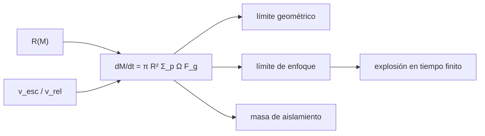

# B52-C05 — Crecimiento de embriones planetarios

<!-- nav:top -->
[🏠 Programa](../../../../README.md) · [📚 Bloque B52](../../../tronco-comun/B52-formacion-y-dinamica-de-sistemas-planetarios.md) · [← Anterior: B52-C04 — Formación de planetesimales](../B52-C04-formacion-de-planetesimales/CLASE.md) · [Siguiente: B52-C06 — Migración de planetas →](../../../tronco-comun/B52-formacion-y-dinamica-de-sistemas-planetarios.md#b52-c06)
<!-- /nav -->

## 1. Ubicación, nivel y alcance

Clase 5 del bloque B52. Nivel N3. Con planetesimales ya formados ([B52-C04](../B52-C04-formacion-de-planetesimales/CLASE.md)), un cuerpo crece barriendo a los demás. Aquí estudias cómo el **enfoque gravitacional** acelera el crecimiento hasta hacerlo «descontrolado» (en tiempo finito en el modelo), y cómo el crecimiento se detiene al agotar su **zona de alimentación**: la **masa de aislamiento**. Compruebas cada límite con una solución analítica y con una integración RK4. Usas [B11](../../../tronco-comun/B11-ecuaciones-diferenciales-y-simulacion-numerica.md). Los parámetros son **ilustrativos**.

## 2. Por qué esta clase existe

El tiempo de crecimiento decide si un núcleo existe antes de que el gas se disipe. La decisión central: **¿cómo cambia la tasa de acreción con la masa y cuándo se detiene?**

## 3. Lo que podrás hacer al terminar

1. Plantear `dM/dt = πR²Σ_pΩ F_g` con `F_g = 1 + (v_esc/v_rel)²`.
2. Resolver el límite geométrico, donde `M^(1/3)` crece linealmente.
3. Resolver el límite de enfoque, donde `M^(−1/3)` decrece linealmente y hay explosión en tiempo finito.
4. Verificar ambos con RK4 de paso adaptativo.
5. Calcular la masa de aislamiento y comprobarla por bisección.
6. Reconocer qué hace ilustrativo el resultado: `v_rel` fijo y coeficientes de orden uno.

La evidencia es la **ficha del crecimiento de embriones** del ejercicio 12 (sección 20).

## 4. Con qué llegas y cómo comprobarlo

1. ¿Qué es una ecuación diferencial separable?
2. ¿Qué es la velocidad de escape?
3. ¿Qué es una explosión en tiempo finito?
4. ¿Qué es una bisección?
5. ¿Qué es un valor ilustrativo?

<details>
<summary>Ver respuestas</summary>

1. Una en que se pueden separar las variables a cada lado de la igualdad. 2. `√(2GM/R)`. 3. Una solución que diverge a un tiempo finito. 4. Un método que acota una raíz y parte el intervalo. 5. Un valor propuesto para el ejemplo, no medido.
</details>

Con cuatro o cinco aciertos, sigue; si no, repasa los prerrequisitos.

## 5. Un caso de contexto y casos de referencia

Un embrión de `10¹⁸ kg` y 49 km a 1 ua con `Σ_p = 50 kg/m²` y `v_rel = 1 m/s` tiene `F_g ≈ 2712`. En el límite de enfoque pasa a `10²⁴ kg` en `458` años; sin enfoque tardaría `1.45e+06` años en pasar a `10¹⁹ kg`. Su masa de aislamiento es `0.040 M⊕`. Es el **ejemplo conductor**; `v_rel` constante exagera la rapidez.

## 6. Vocabulario

El **enfoque gravitacional** `F_g = 1 + (v_esc/v_rel)²` aumenta la sección eficaz de captura. El **crecimiento descontrolado** (*runaway*) es el régimen en que el cuerpo más masivo crece más rápido en términos relativos. La **zona de alimentación** es la franja del disco de la que un embrión toma material, de ancho `b` en radios de Hill. La **masa de aislamiento** es la masa a la que el embrión ha agotado su franja: `M_iso = 2π a b Σ_p`.

## 7. Modelo mental

Como una bola de nieve en una ladera: cuanto más pesa, más nieve recoge, hasta que ya limpió la franja por la que rueda. Límite: `v_rel` constante, un solo embrión, sin fragmentación ni gas, y un coeficiente de orden uno no calibrado.



*Descripción textual:* el radio y el enfoque determinan la tasa; sus dos límites tienen solución analítica, el de enfoque diverge en tiempo finito, y el crecimiento termina en la masa de aislamiento.

## 8. La explicación, paso a paso

### 8.1 Tasa

`R = (3M/(4πρ))^(1/3)`, `Ω = 1.991e-07 s⁻¹` a 1 ua. La tasa es `dM/dt = πR²Σ_pΩ[1 + v_esc²/v_rel²]`.

### 8.2 Límite geométrico

Sin enfoque, `dM/dt = A M^(2/3)`, con `A = 7.582e-08`; entonces `M^(1/3) = M₀^(1/3) + At/3`. Para pasar de `10¹⁸` a `10¹⁹ kg`: analítico `1447476.3730 años`, RK4 `1447476.3640 años` (diferencia `6.3e-09`).

### 8.3 Límite de enfoque

Con `F_g ≫ 1`, `dM/dt = C M^(4/3)`, `C = 2.055e-16`; entonces `M^(−1/3) = M₀^(−1/3) − Ct/3`. La masa diverge en `t* = 3M₀^(−1/3)/C = 462.49 años`. Alcanzar `10²⁴ kg` toma `457.86 años` (RK4: `457.86`). Con la tasa completa (`1 + F_g`), `457.81 años`.

### 8.4 Masa de aislamiento

Con `b = 10 R_H` y `R_H = a(M/(3M☆))^(1/3)`, `M = 2π a b Σ_p` conduce a `M_iso = (2π a² b̃ Σ_p)^(3/2)/√(3M☆)` con `b̃ = 10`. Resulta `2.4137e+23 kg = 0.0404 M⊕`; la bisección coincide a `2e-16`.

### 8.5 Lectura

Con `v_rel` fijo el crecimiento es extremadamente rápido. En un disco real los planetesimales se agitan unos a otros y `v_rel` crece con la masa del embrión, de modo que el crecimiento se frena. El aislamiento solo se supera con migración de planetesimales, con captura de guijarros o con interacción entre embriones.

## 9. Magnitudes, símbolos y unidades

| Símbolo | Qué es | Unidad | Valor / nota |
|---|---|---|---|
| `M₀` | masa inicial | kg | 10¹⁸ (ilustrativo) |
| `Σ_p` | densidad superficial de sólidos | kg/m² | 50 (ilustrativo) |
| `v_rel` | velocidad relativa | m/s | 1 (ilustrativo) |
| `F_g` | factor de enfoque | — | 2712 para `M₀` |
| `t*` | tiempo de explosión | años | 462.5 |
| `M_iso` | masa de aislamiento | kg | 2.414e+23 |

## 10. Convenciones y referencias

Unidades SI. Órbita circular a 1 ua de una estrella de `(GM)☉` nominal; `(GM)⊕` nominal de la IAU 2015 solo para expresar la masa de aislamiento en masas terrestres. Tolerancias: ODE `10⁻⁵`, aislamiento `10⁻⁹`.

## 11. De dónde sale lo que afirmamos

| ID | Fuente | Localizador | Respalda | Estado |
|---|---|---|---|---|
| S1 | NIST, *Fundamental Physical Constants — Complete Listing* (CODATA 2022) | https://physics.nist.gov/cuu/Constants/Table/allascii.txt | `G` | Consultada el 2026-11-09 |
| S2 | Mamajek et al., *IAU 2015 Resolution B3*, arXiv:1510.07674 | https://arxiv.org/abs/1510.07674 | `(GM)☉`, `(GM)⊕` nominales | Texto del PDF extraído el 2026-11-09 |
| S3 | Morbidelli y Raymond, *Challenges in Planet Formation*, arXiv:1610.07202 | https://arxiv.org/abs/1610.07202 | El crecimiento de planetesimales a embriones es un cuello de botella conocido | Solo resumen, consultado el 2026-11-09 |

Límites: de S3 solo se leyó el resumen; la forma de la tasa de acreción, `F_g` y el ancho `b = 10 R_H` de la zona de alimentación no se consultaron: son un modelo de enseñanza cuya consistencia se comprueba contra sus límites analíticos; los valores numéricos son ilustrativos.

## 12. Cómo verlo

| Magnitud | Valor |
|---|---|
| F_g inicial | 2712 |
| t* de explosión | 462.5 años |
| t a 10²⁴ kg (enfoque) | 457.9 años |
| t a 10¹⁹ kg (geométrico) | 1.45e+06 años |
| M_iso | 0.040 M⊕ |

Descripción larga: el enfoque gravitacional hace el crecimiento miles de veces más rápido que el límite geométrico, aun llegando a una masa un millón de veces mayor, y el crecimiento acaba en la masa de aislamiento.

## 13. Ejemplo trabajado

**Paso 1 · Constante.** `C = 2πGΣ_pΩ K_R/v_rel² = 2.055e-16`.

**Paso 2 · Explosión.** `t* = 3 M₀^(−1/3)/C = 1.460e+10 s = 462.49 años`.

**Paso 3 · Aislamiento.** `M_iso = 2.4137e+23 kg`.

**Paso 4 · Comparación.** `M_iso/M⊕ = 0.0404`.

## 14. Distintas formas de describirlo

**Por fórmula:** soluciones de los límites. **Por tabla:** sección 12. **Por simulación:** RK4. **Por raíz:** bisección de `M_iso`.

## 15. Práctica guiada

**Ejercicio 1 · con los pasos indicados.** ¿Cuánto vale `F_g` si `v_esc = v_rel`? *Pasos:* `1 + 1`.

<details><summary>Solución comentada</summary>

`2`.
</details>

**Ejercicio 2 · con una pista.** Si `v_rel` se duplica, ¿cómo cambia `C`? *Pista:* `C ∝ 1/v_rel²`.

<details><summary>Solución comentada</summary>

Baja a la cuarta parte.
</details>

**Ejercicio 3 · casi autónomo.** ¿Qué límite domina si `v_rel ≫ v_esc`?

<details><summary>Solución comentada</summary>

El geométrico.
</details>

## 16. Práctica autónoma, transferencia e integrador

**Ejercicio 4.** Tiempo geométrico de `10¹⁸` a `10¹⁹ kg`.

<details><summary>Solución comentada</summary>

`1.45e+06 años`.
</details>

**Ejercicio 5.** Tiempo de enfoque hasta `10²⁴ kg`.

<details><summary>Solución comentada</summary>

`457.9 años`.
</details>

**Ejercicio 6.** Tiempo de explosión.

<details><summary>Solución comentada</summary>

`462.5 años`.
</details>

**Ejercicio 7.** `M_iso` en masas terrestres.

<details><summary>Solución comentada</summary>

`0.0404`.
</details>

**Ejercicio 8.** ¿Cómo escala `M_iso` con `Σ_p`? *Pista:* mira la fórmula.

<details><summary>Solución comentada</summary>

`M_iso ∝ Σ_p^(3/2)`.
</details>

**Ejercicio 9 · transferencia.** **Transferencia.** **Transferencia.** Un colega dice que un embrión crece a `10²⁴ kg` en menos de 500 años. Responde.

<details><summary>Solución comentada</summary>

Solo con `v_rel` constante de 1 m/s e ilustrativo; en un disco real `v_rel` crece y el tiempo es mucho mayor.
</details>

**Ejercicio 10 · transferencia.** **Transferencia.** **Transferencia.** ¿Qué ocurre con `M_iso` si la zona de alimentación fuera de `5 R_H`?

<details><summary>Solución comentada</summary>

`M_iso ∝ b^(3/2)`: baja por un factor `2^(3/2) = 2,83`.
</details>

**Ejercicio 11 · transferencia.** **Transferencia.** **Transferencia.** ¿Por qué el modelo no explica Júpiter?

<details><summary>Solución comentada</summary>

Un núcleo de decenas de masas terrestres excede la masa de aislamiento calculada; haría falta otro aporte de sólidos, como los guijarros (S3 de B52-C08).
</details>

**Ejercicio 12 · integrador.** **Integrador.** **Integrador.** Elabora tu *ficha del crecimiento de embriones*: tasa, dos límites con RK4, explosión, aislamiento y límites.

<details><summary>Solución modelo</summary>

Secciones 8.1–8.5 y 12.
</details>

## 17. Laboratorio: crecimiento de un embrión y masa de aislamiento

El script [embrion.py](embrion.py) integra con RK4 la tasa de acreción en sus dos límites y la contrasta con las soluciones analíticas, y halla la masa de aislamiento por dos vías (**comprueba** `10⁻⁵` y `10⁻⁹`).

**Datos:** `G` de NIST y `(GM)☉`, `(GM)⊕` de la IAU 2015, consultados el 2026-11-09; el disco y los parámetros de acreción son **ilustrativos**. **Predice antes de ejecutar:** ¿Qué límite es más rápido? (El de enfoque, miles de veces más rápido.) **Ejecución del 2026-11-09 (Python 3.12.9):**

```text
Python 3.12.9 (biblioteca estandar)
Embrion ilustrativo a 1.0 ua: M0 = 1.0e+18 kg ; R0 = 49.2 km ; v_esc = 52.1 m/s ; F_g inicial = 2712
Limite geometrico: t(M0 -> 1e+19 kg) analitico = 1447476.3730 anios ; RK4 = 1447476.3640 anios ; dif. rel. = 6.3e-09
Limite de enfoque: t(M0 -> 1e+24 kg) analitico = 457.86 anios ; RK4 = 457.86 anios ; dif. rel. = 3.7e-10
Tiempo de explosion (masa infinita) del limite de enfoque = 462.49 anios
Modelo completo (1 + enfoque): t(M0 -> 1e+24 kg) = 457.81 anios
Masa de aislamiento (b = 10 R_H): cerrada = 2.4137e+23 kg = 0.0404 M_Tierra ; biseccion = 2.4137e+23 kg ; dif. rel. = 2.2e-16
Pruebas superadas.
```

```bash
python programa/clases/B52/B52-C05-crecimiento-de-embriones-planetarios/embrion.py
```

**Límites:** `v_rel` constante, un embrión, sin fragmentación ni gas; coeficientes sin calibrar.

## 18. Errores frecuentes y cómo corregirlos

**Creer que el crecimiento sigue siendo exponencial.** Se corrige con 8.3: es una ley de potencia con explosión.

**Olvidar que `v_rel` crece al agitarse el disco.** Se corrige con 8.5.

**Tratar la masa de aislamiento como universal.** Se corrige con 8.4.

**Presentar los tiempos como predicción.** Se corrige con la sección 10.

## 19. Cómo sabrás que vas bien

Tras la sección 8: ¿qué resultado esperabas y cuál obtuviste? Si dudas, repasa el ejemplo de la sección 13. Tras el laboratorio: ¿qué comprueba? (ver la sección 17).

## 20. Qué entregas y cómo se evalúa

El producto es tu **ficha del crecimiento de embriones** (ejercicio 12).

| Criterio | Inicial | En desarrollo | Logrado | Destacado |
|---|---|---|---|---|
| Conceptos | Los confunde | Parciales | Conceptos de la clase | Explica los límites |
| Cálculo | Sin unidades | Con errores | Tablas completas | Calcula casos nuevos |
| Numérico | Sin comprobar | Un caso | Contraste con el análisis | Interpreta las diferencias |
| Fuentes | Sin fuente | Sin fecha | Fuentes con fecha | Declara lo ilustrativo |
| Límites | No los nombra | Uno | Tres | Discute qué falta del modelo |

**Condiciones críticas (no se compensan con promedio):** rotular lo sintético e ilustrativo; no presentar un resultado simulado como observado; citar solo lo consultado.

## 21. Ética, seguridad y límites

Clase educativa: los modelos son simplificados y no sustituyen a la literatura primaria ni a los códigos de producción. Lo simulado no es lo observado. Accesibilidad: tablas equivalentes a las gráficas, fórmulas en texto, ejercicios sin conexión.

## 22. Para cerrar y seguir

El enfoque gravitacional lleva el crecimiento a una explosión en `462` años en el modelo, y el aislamiento lo frena en `0.040 M⊕`. Queda una pregunta: ¿qué hace un planeta una vez que el gas aún lo rodea?

**Glosario español–inglés.** enfoque gravitacional · *gravitational focusing*; crecimiento descontrolado · *runaway growth*; masa de aislamiento · *isolation mass*; zona de alimentación · *feeding zone*; embrión · *planetary embryo*.

**Continuidad.** [B52-C06](../B52-C06-migracion-de-planetas/CLASE.md) estudia la migración.

**Referencias:** ver sección 11.

<!-- nav:bottom -->
---

[← Anterior: B52-C04 — Formación de planetesimales](../B52-C04-formacion-de-planetesimales/CLASE.md) · [📚 Bloque B52](../../../tronco-comun/B52-formacion-y-dinamica-de-sistemas-planetarios.md) · [Siguiente: B52-C06 — Migración de planetas →](../../../tronco-comun/B52-formacion-y-dinamica-de-sistemas-planetarios.md#b52-c06)
<!-- /nav -->
