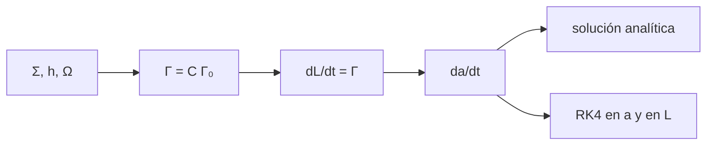

# B52-C06 — Migración de planetas

<!-- nav:top -->
[🏠 Programa](../../../../README.md) · [📚 Bloque B52](../../../tronco-comun/B52-formacion-y-dinamica-de-sistemas-planetarios.md) · [← Anterior: B52-C05 — Crecimiento de embriones planetarios](../B52-C05-crecimiento-de-embriones-planetarios/CLASE.md) · [Siguiente: B52-C07 — Resonancias orbitales →](../B52-C07-resonancias-orbitales/CLASE.md)
<!-- /nav -->

## 1. Ubicación, nivel y alcance

Clase 6 del bloque B52. Nivel N3. Un planeta que crece dentro del gas ([B52-C02](../B52-C02-discos-protoplanetarios/CLASE.md)) intercambia momento angular con el disco y cambia de órbita. Calculas el **par de torsión** de la migración de tipo I con un coeficiente ilustrativo, obtienes una solución analítica para un disco de ley de potencias y la verificas integrando el semieje y, por separado, el momento angular. Usas [B11](../../../tronco-comun/B11-ecuaciones-diferenciales-y-simulacion-numerica.md). El disco es **sintético**.

## 2. Por qué esta clase existe

La migración explica por qué las órbitas finales no coinciden con los lugares de formación. La decisión central: **¿en cuánto tiempo cae un planeta al interior y cómo depende de su masa?**

## 3. Lo que podrás hacer al terminar

1. Escribir `Γ = C q² Σ a⁴ Ω²/h²` y el momento angular `L = m√(GMa)`.
2. Deducir `da/dt` a partir de `dL/dt = Γ`.
3. Obtener la solución analítica `a^(3/2) = a₀^(3/2) − (3/2)Kt` para el disco sintético.
4. Verificar con RK4 en `a` y en `L`.
5. Calcular escalas de tiempo de migración para tres masas.
6. Reconocer que el coeficiente `C` es ilustrativo.

La evidencia es la **ficha de la migración** del ejercicio 12 (sección 20).

## 4. Con qué llegas y cómo comprobarlo

1. ¿Qué es una tabla de resultados?
2. ¿Qué es una verificación?
3. ¿Qué es una tolerancia numérica?
4. ¿Qué es la tercera ley de Kepler?
5. ¿Qué es un valor ilustrativo?

<details>
<summary>Ver respuestas</summary>

1. Un resumen ordenado de cálculos. 2. Comparar un cálculo con un caso independiente. 3. La diferencia máxima aceptada entre dos resultados. 4. El cuadrado del periodo crece con el cubo del semieje. 5. Un valor propuesto para el ejemplo, no medido.
</details>

Con cuatro o cinco aciertos, sigue; si no, repasa los prerrequisitos.

## 5. Un caso de contexto y casos de referencia

En el disco sintético, con `C = −2`, un planeta de `1 M⊕` a 5 ua migra con escala `a/|ȧ| = 1.49e+06` años y cae de 5 a 0,1 ua en `9.91e+05` años; para `10 M⊕`, `9.91e+04`. Es el **ejemplo conductor**; los coeficientes reales dependen de los gradientes del disco y no se consultaron.

## 6. Vocabulario

La **migración de tipo I** es el cambio de órbita de un planeta pequeño por el par de torsión neto del disco. El **par normalizado** es `Γ₀ = (q/h)² Σ a⁴ Ω²` y `C` es un coeficiente adimensional. El **momento angular** es `L = m√(GMa)`. La **escala de migración** es `τ = a/|ȧ|`.

## 7. Modelo mental

Como un bote que gira en un remolino y se desliza hacia el centro al ceder impulso al agua. Límite: coeficiente constante, un planeta, disco sin evolución y sin apertura de hueco.



*Descripción textual:* el disco da el par, el par cambia el momento angular y de ahí el semieje; el resultado se compara con la solución analítica y con dos integraciones.

## 8. La explicación, paso a paso

### 8.1 Del par al semieje

`L = m√(GMa)` implica `da/dt = 2Γ√a/(m√(GM))`. Con `Σ ∝ a^(−3/2)` y `h ∝ a^(1/4)`, `Γ ∝ a^(−1)` y `ȧ = −K a^(−1/2)` (a en ua). Entonces `a^(3/2) = a₀^(3/2) − (3/2)K t`.

### 8.2 Escalas

| m [M⊕] | K [ua^1,5/año] | τ(5 ua) [años] | 5→0,1 ua [años] |
|---|---|---|---|
| 0.1 | 7.500e-07 | 1.491e+07 | 9.910e+06 |
| 1 | 7.500e-06 | 1.491e+06 | 9.910e+05 |
| 10 | 7.500e-05 | 1.491e+05 | 9.910e+04 |

La escala es inversamente proporcional a la masa.

### 8.3 Verificación

Un planeta de `1 M⊕` que parte de 5 ua llega en `4.955e+05` años a `3.15573915 ua` (analítico); RK4 en `a` da `3.15573915` y RK4 en `L`, `3.15573915`.

### 8.4 Lectura

Los tiempos de caída son menores que unos pocos millones de años solo para masas grandes; con `C` ilustrativo no se concluye nada sobre un sistema real. Un planeta grande abre un hueco y migra con otra ley (tipo II), que no se trata aquí.

## 9. Magnitudes, símbolos y unidades

| Símbolo | Qué es | Unidad | Valor / nota |
|---|---|---|---|
| `C` | coeficiente de par | — | −2 (ilustrativo) |
| `h` | espesor relativo | — | 0.0503 a 5 ua |
| `Σ` | densidad superficial | kg/m² | 894.4 a 5 ua |
| `K` | constante de migración | ua^1,5/año | 7.500e-06 para 1 M⊕ |
| `τ` | escala de migración | años | 1.49e+06 |

## 10. Convenciones y referencias

Unidades SI. Órbita circular coplanar, estrella de `(GM)☉` nominal. Tolerancia `10⁻⁶`.

## 11. De dónde sale lo que afirmamos

| ID | Fuente | Localizador | Respalda | Estado |
|---|---|---|---|---|
| S1 | NIST, *Fundamental Physical Constants — Complete Listing* (CODATA 2022) | https://physics.nist.gov/cuu/Constants/Table/allascii.txt | `G`, `k_B`, `m_p` | Consultada el 2026-11-09 |
| S2 | Mamajek et al., *IAU 2015 Resolution B3*, arXiv:1510.07674 | https://arxiv.org/abs/1510.07674 | `(GM)☉`, `(GM)⊕`, `(GM)_J` nominales | Texto del PDF extraído el 2026-11-09 |
| S3 | Kley y Nelson, *Planet-disk interaction and orbital evolution*, arXiv:1203.1184 | https://arxiv.org/abs/1203.1184 | Los planetas intercambian momento angular con el disco y migran; la velocidad y el sentido dependen de las propiedades del disco | Solo resumen, consultado el 2026-11-09 |

Límites: de S3 solo se leyó el resumen; el coeficiente `C` y la forma del par no se consultaron en una fuente; el disco es sintético.

## 12. Cómo verlo

| Magnitud | Valor |
|---|---|
| τ(5 ua), 1 M⊕ | 1.49e+06 años |
| 5→0,1 ua, 1 M⊕ | 9.91e+05 años |
| 5→0,1 ua, 10 M⊕ | 9.91e+04 años |
| a tras medio trayecto | 3.156 ua |

Descripción larga: la migración es diez veces más rápida al multiplicar la masa por diez y su solución sigue una ley de potencia en `a^(3/2)`.

## 13. Ejemplo trabajado

**Paso 1 · Constante.** `K = 7.500e-06` ua^1,5/año para `1 M⊕`.

**Paso 2 · Tiempo total.** `t = (2/(3K))(5^1,5 − 0,1^1,5) = 9.910e+05` años.

**Paso 3 · Mitad.** A `4.955e+05` años, `a = 3.1557 ua`.

## 14. Distintas formas de describirlo

**Por fórmula:** `a(t)`. **Por tabla:** 8.2. **Por simulación:** RK4 en `a` y en `L`.

## 15. Práctica guiada

**Ejercicio 1 · con los pasos indicados.** Si `m` se duplica, ¿cómo cambia `τ`? *Pista:* `Γ ∝ m²` y `L ∝ m`.

<details><summary>Solución comentada</summary>

Se reduce a la mitad.
</details>

**Ejercicio 2 · con una pista.** ¿Qué signo tiene `Γ` si `C < 0`? 

<details><summary>Solución comentada</summary>

Negativo: el planeta pierde momento angular y migra hacia adentro.
</details>

**Ejercicio 3 · casi autónomo.** Calcula `L` de `1 M⊕` a 1 ua.

<details><summary>Solución comentada</summary>

`m√(GM a) = 5,97·10²⁴·√(1,327·10²⁰·1,496·10¹¹) ≈ 2,66·10⁴⁰ kg m²/s`.
</details>

## 16. Práctica autónoma, transferencia e integrador

**Ejercicio 4.** `τ` a 5 ua para `1 M⊕`.

<details><summary>Solución comentada</summary>

`1.491e+06` años.
</details>

**Ejercicio 5.** Tiempo de 5 a 0,1 ua para `0,1 M⊕`.

<details><summary>Solución comentada</summary>

`9.910e+06` años.
</details>

**Ejercicio 6.** `K` para `10 M⊕`.

<details><summary>Solución comentada</summary>

`7.500e-05`.
</details>

**Ejercicio 7.** Posición a medio trayecto.

<details><summary>Solución comentada</summary>

`3.15574 ua`.
</details>

**Ejercicio 8.** ¿Coinciden las tres vías?

<details><summary>Solución comentada</summary>

Sí, hasta ocho decimales en ua.
</details>

**Ejercicio 9 · transferencia.** **Transferencia.** **Transferencia.** Un colega usa estos tiempos para un exoplaneta. Responde.

<details><summary>Solución comentada</summary>

No: el disco y `C` son ilustrativos.
</details>

**Ejercicio 10 · transferencia.** **Transferencia.** **Transferencia.** ¿Qué cambia si `C > 0`?

<details><summary>Solución comentada</summary>

El planeta migraría hacia afuera.
</details>

**Ejercicio 11 · transferencia.** **Transferencia.** **Transferencia.** ¿Qué pasa con un planeta que abre hueco?

<details><summary>Solución comentada</summary>

Migra con la evolución viscosa del disco (tipo II), fuera de este modelo.
</details>

**Ejercicio 12 · integrador.** **Integrador.** **Integrador.** Elabora tu *ficha de la migración*: tabla 8.2, comparación de tres vías y límites.

<details><summary>Solución modelo</summary>

Secciones 8.1–8.4 y 12.
</details>

## 17. Laboratorio: migración de tipo I

El script [migracion.py](migracion.py) integra el semieje con RK4 y, por separado, el momento angular, y las compara con la solución analítica (**comprueba** `10⁻⁶`).

**Datos:** `G`, `k_B`, `m_p` de NIST y `(GM)☉`, `(GM)⊕` de la IAU 2015, consultados el 2026-11-09; el disco y `C` son **ilustrativos**. **Predice antes de ejecutar:** ¿Migra más rápido el planeta más masivo? (Sí, en proporción a `1/m`.) **Ejecución del 2026-11-09 (Python 3.12.9):**

```text
Python 3.12.9 (biblioteca estandar)
Disco sintetico de B52-C02; coeficiente de par C = -2.0 (ilustrativo); h(5 ua) = 0.0503
 m [M_T]  K [ua^1.5/anio]  tau(5 ua) [anios]  5 -> 0.1 ua [anios]
     0.1       7.5002e-07         1.4907e+07           9.9097e+06
     1.0       7.5002e-06         1.4907e+06           9.9097e+05
    10.0       7.5002e-05         1.4907e+05           9.9097e+04
Planeta de 1 M_T: a(5 ua, t = 4.9548e+05 anios): analitico = 3.15573915 ua ; RK4 en a = 3.15573915 ua ; RK4 en L = 3.15573915 ua
Pruebas superadas.
```

```bash
python programa/clases/B52/B52-C06-migracion-de-planetas/migracion.py
```

**Límites:** coeficiente constante, un planeta, sin hueco ni evolución del disco.

## 18. Errores frecuentes y cómo corregirlos

**Creer que el coeficiente `C` es universal.** Se corrige con la sección 10.

**Confundir `τ` con el tiempo total de caída.** Se corrige con 8.2.

**Ignorar el tipo II.** Se corrige con 8.4.

**Presentar el tiempo como predicción.** Se corrige con la sección 10.

## 19. Cómo sabrás que vas bien

Tras la sección 8: ¿qué resultado esperabas y cuál obtuviste? Si dudas, repasa el ejemplo de la sección 13. Tras el laboratorio: ¿qué comprueba? (ver la sección 17).

## 20. Qué entregas y cómo se evalúa

El producto es tu **ficha de la migración** (ejercicio 12).

| Criterio | Inicial | En desarrollo | Logrado | Destacado |
|---|---|---|---|---|
| Conceptos | Los confunde | Parciales | Conceptos de la clase | Explica los límites |
| Cálculo | Sin unidades | Con errores | Tablas completas | Calcula casos nuevos |
| Numérico | Sin comprobar | Un caso | Contraste con el análisis | Interpreta las diferencias |
| Fuentes | Sin fuente | Sin fecha | Fuentes con fecha | Declara lo ilustrativo |
| Límites | No los nombra | Uno | Tres | Discute qué falta del modelo |

**Condiciones críticas (no se compensan con promedio):** rotular lo sintético e ilustrativo; no presentar un resultado simulado como observado; citar solo lo consultado.

## 21. Ética, seguridad y límites

Clase educativa: los modelos son simplificados y no sustituyen a la literatura primaria ni a los códigos de producción. Lo simulado no es lo observado. Accesibilidad: tablas equivalentes a las gráficas, fórmulas en texto, ejercicios sin conexión.

## 22. Para cerrar y seguir

Con `C = −2`, `1 M⊕` cae de 5 a 0,1 ua en `9.9e+05` años. Queda una pregunta: ¿qué ocurre cuando dos planetas migran y se encuentran?

**Glosario español–inglés.** migración · *migration*; par de torsión · *torque*; momento angular · *angular momentum*; escala de tiempo · *timescale*.

**Continuidad.** [B52-C07](../B52-C07-resonancias-orbitales/CLASE.md) estudia las resonancias.

**Referencias:** ver sección 11.

<!-- nav:bottom -->
---

[← Anterior: B52-C05 — Crecimiento de embriones planetarios](../B52-C05-crecimiento-de-embriones-planetarios/CLASE.md) · [📚 Bloque B52](../../../tronco-comun/B52-formacion-y-dinamica-de-sistemas-planetarios.md) · [Siguiente: B52-C07 — Resonancias orbitales →](../B52-C07-resonancias-orbitales/CLASE.md)
<!-- /nav -->
