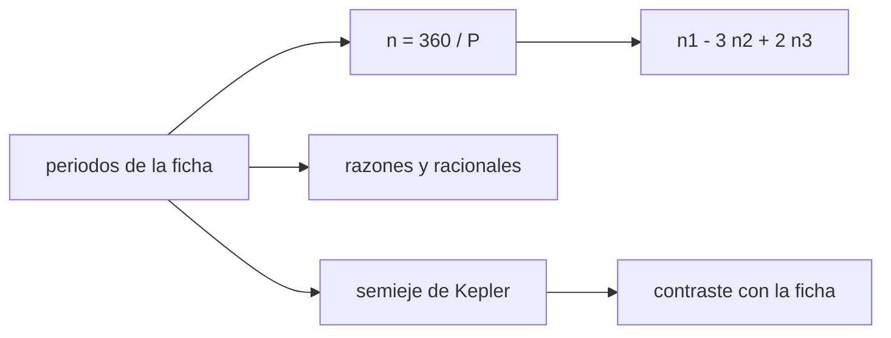

# B52-C07 — Resonancias orbitales

<!-- nav:top -->
[🏠 Programa](../../../../README.md) · [📚 Bloque B52](../../../tronco-comun/B52-formacion-y-dinamica-de-sistemas-planetarios.md) · [← Anterior: B52-C06 — Migración de planetas](../B52-C06-migracion-de-planetas/CLASE.md) · [Siguiente: B52-C08 — Formación de gigantes gaseosos →](../B52-C08-formacion-de-gigantes-gaseosos/CLASE.md)
<!-- /nav -->

## 1. Ubicación, nivel y alcance

Clase 7 del bloque B52. Nivel N3. Si la migración de [B52-C06](../B52-C06-migracion-de-planetas/CLASE.md) acerca dos cuerpos, sus periodos pueden quedar en una razón de enteros. Esta clase usa **datos publicados** de la NASA: con los periodos de los satélites galileanos compruebas la relación de Laplace `n₁ − 3n₂ + 2n₃ = 0`, buscas razones racionales cercanas y contrastas el semieje de la ficha con el que da la tercera ley de Kepler con `(GM)_J` de la IAU. Usas [B13](../../../tronco-comun/B13-metrologia-tiempo-y-mediciones-cientificas.md).

## 2. Por qué esta clase existe

Una resonancia protege o desestabiliza órbitas y deja huellas que se pueden medir. La decisión central: **¿cómo se reconoce una resonancia en datos orbitales y con qué cautela?**

## 3. Lo que podrás hacer al terminar

1. Convertir periodos a movimientos medios `n = 360°/P`.
2. Evaluar la relación de Laplace con datos de la NASA.
3. Buscar el racional más cercano a una razón de periodos.
4. Verificar el semieje con la tercera ley de Kepler y `(GM)_J`.
5. Distinguir una razón cercana a un racional de una resonancia dinámica.
6. Declarar que la ficha no da incertidumbre de los periodos.

La evidencia es la **ficha de la resonancia de Laplace** del ejercicio 12 (sección 20).

## 4. Con qué llegas y cómo comprobarlo

1. ¿Qué es una tabla de resultados?
2. ¿Qué es una verificación?
3. ¿Qué es una tolerancia numérica?
4. ¿Qué es la tercera ley de Kepler?
5. ¿Qué es un valor ilustrativo?

<details>
<summary>Ver respuestas</summary>

1. Un resumen ordenado de cálculos. 2. Comparar un cálculo con un caso independiente. 3. La diferencia máxima aceptada entre dos resultados. 4. El cuadrado del periodo crece con el cubo del semieje. 5. Un valor propuesto para el ejemplo, no medido.
</details>

Con cuatro o cinco aciertos, sigue; si no, repasa los prerrequisitos.

## 5. Un caso de contexto y casos de referencia

Con los periodos de la ficha, `n₁ − 3n₂ + 2n₃ = -2.86e-05 °/día`, es decir cero dentro del redondeo de la ficha. `P(Europa)/P(Io) = 2.007295` y `P(Ganimedes)/P(Europa) = 2.014697`, ambas cerca de 2. Es el **ejemplo conductor**: datos publicados, no simulados.

## 6. Vocabulario

El **movimiento medio** `n = 2π/P` es la velocidad angular media. Una **resonancia de movimiento medio** `p:q` ocurre cuando `p n₁ ≈ q n₂` y el ángulo resonante libra. La **resonancia de Laplace** liga tres cuerpos: `n₁ − 3n₂ + 2n₃ = 0`. La **tercera ley de Kepler** da `a³ = GM P²/(4π²)`.

## 7. Modelo mental

Como tres columpios que se empujan al ritmo justo: cada uno empuja al siguiente en el mismo punto de su vaivén. Límite: la razón de periodos cerca de un racional es necesaria pero no suficiente; la resonancia exige que un ángulo libre.



*Descripción textual:* los periodos dan movimientos medios, la relación de Laplace y las razones; el semieje de Kepler se contrasta con la ficha.

## 8. La explicación, paso a paso

### 8.1 Datos y movimientos medios

| satélite | P [d] | n [°/d] | a ficha [km] | a Kepler [km] | dif. |
|---|---|---|---|---|---|
| Io | 1.769138 | 203.488931 | 421800.0 | 421671.1 | -3.1e-04 |
| Europa | 3.551181 | 101.374726 | 671100.0 | 670987.8 | -1.7e-04 |
| Ganimedes | 7.154553 | 50.317609 | 1070400.0 | 1070338.3 | -5.8e-05 |
| Calisto | 16.689017 | 21.571073 | 1882700.0 | 1882579.1 | -6.4e-05 |

### 8.2 Relación de Laplace

`n₁ − 3n₂ + 2n₃ = -2.863e-05 °/día`. Frente a `n₁ = 203.5 °/día` es del orden de `10⁻⁷`, dentro del redondeo de seis cifras de la ficha. Como la ficha no da incertidumbres, no se calcula una significancia.

### 8.3 Razones

`P₂/P₁ = 2.007295` (racional `2`, desviación `+3.65e-03`); `P₃/P₂ = 2.014697` (`2`, `+7.35e-03`). Las razones no son exactamente 2 porque los periodos siderales incluyen la precesión de los pericentros; la relación de Laplace sobre los movimientos medios es la que se cumple con más precisión. Calisto da `2.3326`, cerca de `7/3` solo por coincidencia de una búsqueda de denominadores pequeños: no se afirma resonancia.

### 8.4 Contraste de Kepler

El semieje de Kepler con `(GM)_J = 1,2668653·10¹⁷ m³/s²` difiere de la ficha en menos de `3.1e-04` relativo. La diferencia refleja que las órbitas no son keplerianas puras (achatamiento de Júpiter, perturbaciones).

### 8.5 Lectura

Las razones cercanas a enteros muestran dónde mirar; la resonancia real se prueba con la libración de un ángulo, que exige las posiciones y no solo los periodos.

## 9. Magnitudes, símbolos y unidades

| Símbolo | Qué es | Unidad | Valor / nota |
|---|---|---|---|
| `P` | periodo sidéreo | días | 1,769138 (Io) |
| `n` | movimiento medio | °/día | 203.489 (Io) |
| `a` | semieje mayor | km | 421 800 (Io) |
| `(GM)_J` | parámetro de masa de Júpiter | m³/s² | 1,2668653·10¹⁷ (IAU) |

## 10. Convenciones y referencias

Órbitas keplerianas medias alrededor de Júpiter. Unidades: días y grados para los movimientos medios, SI para Kepler. Tolerancias: Laplace `10⁻³ °/día`, Kepler `0,5 %`.

## 11. De dónde sale lo que afirmamos

| ID | Fuente | Localizador | Respalda | Estado |
|---|---|---|---|---|
| S2 | Mamajek et al., *IAU 2015 Resolution B3*, arXiv:1510.07674 | https://arxiv.org/abs/1510.07674 | `(GM)☉`, `(GM)⊕`, `(GM)_J` nominales | Texto del PDF extraído el 2026-11-09 |
| S3 | NASA/NSSDC, *Jovian Satellite Fact Sheet* | https://nssdc.gsfc.nasa.gov/planetary/factsheet/joviansatfact.html | Semiejes y periodos siderales de Io, Europa, Ganimedes y Calisto | Consultada el 2026-11-09 |

Límites: la ficha de la NASA no da incertidumbres ni indica si los semiejes son medios u osculadores; la relación de Laplace se evalúa sin significancia estadística; las integraciones dinámicas no se hacen aquí.

## 12. Cómo verlo

| Magnitud | Valor |
|---|---|
| n₁ − 3n₂ + 2n₃ | -2.9e-05 °/día |
| P₂/P₁ | 2.007295 |
| P₃/P₂ | 2.014697 |
| dif. máx. de Kepler | 3.1e-04 |

Descripción larga: los tres satélites internos cumplen la relación de Laplace dentro del redondeo de la ficha, y Kepler reproduce los semiejes a unas décimas de por mil.

## 13. Ejemplo trabajado

**Paso 1 · Movimientos medios.** `n₁ = 360/1,769138 = 203.4889 °/d`.

**Paso 2 · Combinación.** `n₁ − 3n₂ + 2n₃ = -2.86e-05`.

**Paso 3 · Kepler.** Para Io, `a = 421671.1 km` frente a `421 800 km` de la ficha.

## 14. Distintas formas de describirlo

**Por fórmula:** Laplace y Kepler. **Por tabla:** 8.1. **Por razón:** racionales cercanos.

## 15. Práctica guiada

**Ejercicio 1 · con los pasos indicados.** Calcula `n` de Europa. *Pasos:* `360/3,551181`.

<details><summary>Solución comentada</summary>

`101.3747 °/día`.
</details>

**Ejercicio 2 · con una pista.** Si `P₂ = 2P₁` exactamente, ¿qué razón de semiejes sigue? *Pista:* `a ∝ P^(2/3)`.

<details><summary>Solución comentada</summary>

`2^(2/3) = 1,5874`.
</details>

**Ejercicio 3 · casi autónomo.** ¿Qué razón de semiejes da la ficha para Europa/Io?

<details><summary>Solución comentada</summary>

`1.5910`.
</details>

## 16. Práctica autónoma, transferencia e integrador

**Ejercicio 4.** Valor de la relación de Laplace.

<details><summary>Solución comentada</summary>

`-2.86e-05 °/día`.
</details>

**Ejercicio 5.** Desviación de `P₂/P₁` respecto de 2.

<details><summary>Solución comentada</summary>

`+3.65e-03`.
</details>

**Ejercicio 6.** Semieje de Kepler de Calisto.

<details><summary>Solución comentada</summary>

`1882579.1 km`.
</details>

**Ejercicio 7.** Diferencia relativa de Kepler en Io.

<details><summary>Solución comentada</summary>

`-3.06e-04`.
</details>

**Ejercicio 8.** ¿Por qué Calisto no se declara resonante?

<details><summary>Solución comentada</summary>

Su razón con Ganimedes es `2.3326`, cerca de `7/3`, pero no hay evidencia de un ángulo libre.
</details>

**Ejercicio 9 · transferencia.** **Transferencia.** **Transferencia.** Un colega dice que la razón 2,0073 prueba la resonancia. Responde.

<details><summary>Solución comentada</summary>

No: hace falta un ángulo resonante que libre; la relación de Laplace sobre los movimientos medios es la prueba cuantitativa aquí.
</details>

**Ejercicio 10 · transferencia.** **Transferencia.** **Transferencia.** ¿Qué cambia si la ficha diera semiejes osculadores?

<details><summary>Solución comentada</summary>

La comparación con Kepler tendría otro sentido y habría que declarar la época.
</details>

**Ejercicio 11 · transferencia.** **Transferencia.** **Transferencia.** ¿Cómo se verificaría una resonancia con efemérides?

<details><summary>Solución comentada</summary>

Calculando el ángulo `λ₁ − 3λ₂ + 2λ₃` en el tiempo y viendo si libra.
</details>

**Ejercicio 12 · integrador.** **Integrador.** **Integrador.** Elabora tu *ficha de la resonancia de Laplace*: tabla 8.1, relación, razones y límites.

<details><summary>Solución modelo</summary>

Secciones 8.1–8.5 y 12.
</details>

## 17. Laboratorio: relación de Laplace con datos publicados

El script [laplace.py](laplace.py) calcula los movimientos medios, la relación de Laplace, las razones y el semieje de Kepler con datos de la ficha de la NASA (**comprueba** `10⁻³ °/día` y `0,5 %`).

**Datos:** periodos y semiejes de la ficha de la NASA/NSSDC y `(GM)_J` de la IAU 2015, consultados el 2026-11-09; **datos publicados**, sin incertidumbre indicada. **Predice antes de ejecutar:** ¿Cumplen los tres satélites internos la relación de Laplace? (Sí, dentro del redondeo.) **Ejecución del 2026-11-09 (Python 3.12.9):**

```text
Python 3.12.9 (biblioteca estandar)
Datos: ficha NASA/NSSDC de satelites jovianos (consulta 2026-11-09); sin incertidumbre publicada en la ficha
  satelite      P [d]   n [grados/d]  a ficha [km]  a Kepler [km]      dif.
        Io   1.769138     203.488931      421800.0       421671.1 -3.06e-04
    Europa   3.551181     101.374726      671100.0       670987.8 -1.67e-04
 Ganimedes   7.154553      50.317609     1070400.0      1070338.3 -5.76e-05
   Calisto  16.689017      21.571073     1882700.0      1882579.1 -6.42e-05
Relacion de Laplace n1 - 3 n2 + 2 n3 = -2.863e-05 grados/dia
P(Europa)/P(Io) = 2.007295 ; racional mas cercano (den. <= 5) = 2 ; desviacion relativa = +3.65e-03
P(Ganimedes)/P(Europa) = 2.014697 ; racional mas cercano (den. <= 5) = 2 ; desviacion relativa = +7.35e-03
P(Calisto)/P(Ganimedes) = 2.332643 ; racional mas cercano (den. <= 5) = 7/3 ; desviacion relativa = -2.96e-04
Razon de semiejes de una resonancia 2:1 = 2^(2/3) = 1.58740 ; a(Europa)/a(Io) de la ficha = 1.59104
Pruebas superadas.
```

```bash
python programa/clases/B52/B52-C07-resonancias-orbitales/laplace.py
```

**Límites:** sin incertidumbres ni ángulos resonantes; no se simula la dinámica.

## 18. Errores frecuentes y cómo corregirlos

**Confundir razón cercana a un entero con resonancia.** Se corrige con 8.3.

**Usar periodos sinódicos como siderales.** Se corrige con 8.1.

**Inventar incertidumbres.** Se corrige con la sección 11.

**Atribuir a la ficha más de lo que dice.** Se corrige con la sección 10.

## 19. Cómo sabrás que vas bien

Tras la sección 8: ¿qué resultado esperabas y cuál obtuviste? Si dudas, repasa el ejemplo de la sección 13. Tras el laboratorio: ¿qué comprueba? (ver la sección 17).

## 20. Qué entregas y cómo se evalúa

El producto es tu **ficha de la resonancia de Laplace** (ejercicio 12).

| Criterio | Inicial | En desarrollo | Logrado | Destacado |
|---|---|---|---|---|
| Conceptos | Los confunde | Parciales | Conceptos de la clase | Explica los límites |
| Cálculo | Sin unidades | Con errores | Tablas completas | Calcula casos nuevos |
| Numérico | Sin comprobar | Un caso | Contraste con el análisis | Interpreta las diferencias |
| Fuentes | Sin fuente | Sin fecha | Fuentes con fecha | Declara lo ilustrativo |
| Límites | No los nombra | Uno | Tres | Discute qué falta del modelo |

**Condiciones críticas (no se compensan con promedio):** rotular lo sintético e ilustrativo; no presentar un resultado simulado como observado; citar solo lo consultado.

## 21. Ética, seguridad y límites

Clase educativa: los modelos son simplificados y no sustituyen a la literatura primaria ni a los códigos de producción. Lo simulado no es lo observado. Accesibilidad: tablas equivalentes a las gráficas, fórmulas en texto, ejercicios sin conexión.

## 22. Para cerrar y seguir

Los satélites galileanos cumplen `n₁ − 3n₂ + 2n₃ ≈ -3e-05 °/día`. Queda una pregunta: ¿cómo se forman los gigantes que gobiernan esos sistemas?

**Glosario español–inglés.** resonancia de movimiento medio · *mean-motion resonance*; movimiento medio · *mean motion*; periodo sidéreo · *sidereal period*; libración · *libration*.

**Continuidad.** [B52-C08](../B52-C08-formacion-de-gigantes-gaseosos/CLASE.md) estudia los gigantes gaseosos.

**Referencias:** ver sección 11.

<!-- nav:bottom -->
---

[← Anterior: B52-C06 — Migración de planetas](../B52-C06-migracion-de-planetas/CLASE.md) · [📚 Bloque B52](../../../tronco-comun/B52-formacion-y-dinamica-de-sistemas-planetarios.md) · [Siguiente: B52-C08 — Formación de gigantes gaseosos →](../B52-C08-formacion-de-gigantes-gaseosos/CLASE.md)
<!-- /nav -->
