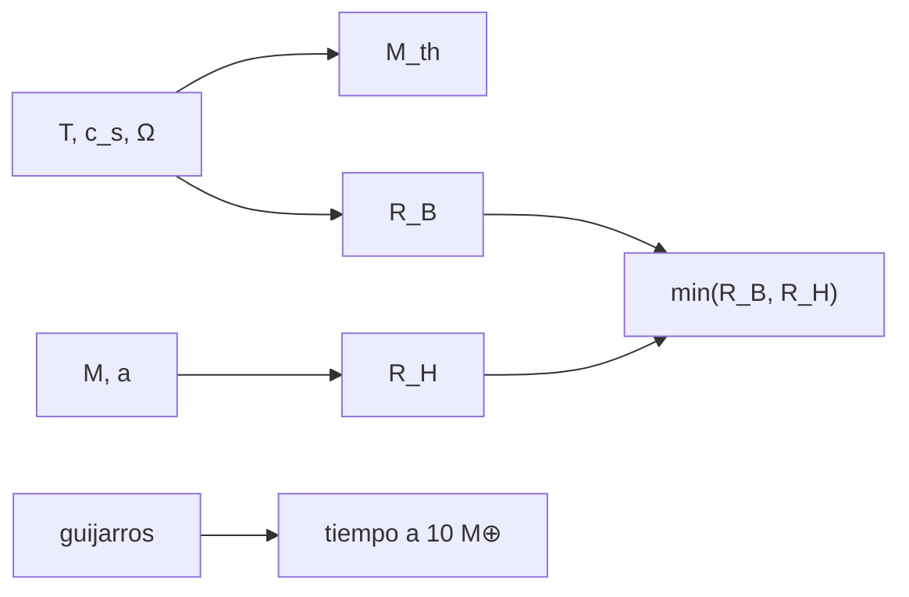

# B52-C08 — Formación de gigantes gaseosos

<!-- nav:top -->
[🏠 Programa](../../../../README.md) · [📚 Bloque B52](../../../tronco-comun/B52-formacion-y-dinamica-de-sistemas-planetarios.md) · [← Anterior: B52-C07 — Resonancias orbitales](../B52-C07-resonancias-orbitales/CLASE.md) · [Siguiente: B52-C09 — Dispersión de discos de gas →](../B52-C09-dispersion-de-discos-de-gas/CLASE.md)
<!-- /nav -->

## 1. Ubicación, nivel y alcance

Clase 8 del bloque B52. Nivel N3. Un núcleo sólido solo se convierte en gigante si retiene gas antes de que el disco se disipe. Calculas la **masa térmica**, comparas los radios de **Bondi** y de **Hill** para saber qué limita la captura y estimas, con un modelo de guijarros ilustrativo, cuánto tarda un núcleo en llegar a 10 masas terrestres. Retoma el crecimiento de [B52-C05](../B52-C05-crecimiento-de-embriones-planetarios/CLASE.md). El disco es **sintético**.

## 2. Por qué esta clase existe

El orden de magnitud de la masa del núcleo y el tiempo en alcanzarlo deciden si hay gigantes gaseosos. La decisión central: **¿a qué masa un núcleo pasa de capturar gas hasta Bondi a capturarlo hasta Hill, y cuánto tarda en crecer?**

## 3. Lo que podrás hacer al terminar

1. Calcular `c_s`, `h` y `Ω` a 5 ua.
2. Calcular la masa térmica `M_th = h³M*`.
3. Calcular `R_B = GM/c_s²` y `R_H` y decidir cuál limita.
4. Hallar la masa donde `R_B = R_H` y compararla con `M_th/√3`.
5. Obtener el tiempo de crecimiento por guijarros y verificarlo con RK4.
6. Distinguir un modelo de enseñanza de la tasa publicada.

La evidencia es la **ficha de la captura de gas** del ejercicio 12 (sección 20).

## 4. Con qué llegas y cómo comprobarlo

1. ¿Qué es una tabla de resultados?
2. ¿Qué es una verificación?
3. ¿Qué es una tolerancia numérica?
4. ¿Qué es la tercera ley de Kepler?
5. ¿Qué es un valor ilustrativo?

<details>
<summary>Ver respuestas</summary>

1. Un resumen ordenado de cálculos. 2. Comparar un cálculo con un caso independiente. 3. La diferencia máxima aceptada entre dos resultados. 4. El cuadrado del periodo crece con el cubo del semieje. 5. Un valor propuesto para el ejemplo, no medido.
</details>

Con cuatro o cinco aciertos, sigue; si no, repasa los prerrequisitos.

## 5. Un caso de contexto y casos de referencia

A 5 ua del disco sintético, `M_th = 42.4 M⊕`. Un núcleo de `10 M⊕` captura gas hasta su radio de Bondi (`8.87e+06 km`); uno de `100 M⊕`, hasta su radio de Hill (`3.47e+07 km`). Con guijarros ilustrativos, `10 M⊕` se alcanza en `5.52e+05` años. Es el **ejemplo conductor**.

## 6. Vocabulario

El **radio de Bondi** `R_B = GM/c_s²` es donde la velocidad de escape iguala a la del sonido. El **radio de Hill** `R_H` es el límite gravitatorio frente a la estrella. La **masa térmica** `M_th = c_s³/(GΩ) = h³M*` es la masa donde `R_B ~ R_H`. La **acreción de guijarros** es la captura de partículas de centímetros arrastradas por el gas.

## 7. Modelo mental

Como una bola que atrae aire: lo que retiene depende de si su pozo gravitatorio es más grande que la agitación térmica (Bondi) o que la influencia de la estrella (Hill). Límite: isoterma, sin acreción real de gas ni enfriamiento de la envoltura.



*Descripción textual:* el disco da la masa térmica y el radio de Bondi; con el de Hill se obtiene el radio de captura; los guijarros fijan el tiempo de crecimiento.

## 8. La explicación, paso a paso

### 8.1 Escalas del disco

A 5 ua: `T = 125,2 K`, `c_s = 670.4 m/s`, `h = 0.0503`, `Ω = 1.7808e-08 s⁻¹`. La masa térmica es `h³M* = 42.44 M⊕`; la otra vía, `c_s³/(GΩ)`, da lo mismo.

### 8.2 Bondi y Hill

| m [M⊕] | R_B [km] | R_H [km] | captura [km] | limita |
|---|---|---|---|---|
| 1 | 8.870e+05 | 7.483e+06 | 8.870e+05 | Bondi |
| 10 | 8.870e+06 | 1.612e+07 | 8.870e+06 | Bondi |
| 100 | 8.870e+07 | 3.473e+07 | 3.473e+07 | Hill |
| 1000 | 8.870e+08 | 7.483e+07 | 7.483e+07 | Hill |

`R_B = R_H` en `24.504 M⊕` (bisección), igual que `M_th/√3 = 24.504 M⊕`.

### 8.3 Tiempo de crecimiento

En régimen de Hill, `dM/dt = 2R_H²ΩΣ_p` implica `M^(1/3)` lineal en `t`: de `0,01` a `10 M⊕` toma `5.5202e+05` años (analítico) y `5.5202e+05` años (RK4), con diferencia `1e-08`. Es menor que la vida típica de un disco de unos millones de años, **pero** `Σ_p` y la forma de la tasa son ilustrativos.

### 8.4 Lectura

Que un núcleo llegue a unas decenas de masas terrestres antes de la dispersión del gas es la condición que el resumen de S3 plantea como problema; el modelo de enseñanza muestra cómo `Σ_p` la hace pasar o fallar. No se modela la envoltura ni el colapso hidrodinámico.

## 9. Magnitudes, símbolos y unidades

| Símbolo | Qué es | Unidad | Valor / nota |
|---|---|---|---|
| `c_s` | velocidad del sonido | m/s | 670.4 |
| `h` | espesor relativo | — | 0.0503 |
| `M_th` | masa térmica | M⊕ | 42.4 |
| `R_B`, `R_H` | radios de Bondi y de Hill | km | tabla 8.2 |
| `Σ_p` | guijarros | kg/m² | 1 (ilustrativo) |

## 10. Convenciones y referencias

Unidades SI. Órbita circular a 5 ua, estrella de `(GM)☉` nominal; `(GM)⊕` para expresar masas. Tolerancias: `10⁻⁹` en masas y `10⁻⁶` en el tiempo.

## 11. De dónde sale lo que afirmamos

| ID | Fuente | Localizador | Respalda | Estado |
|---|---|---|---|---|
| S1 | NIST, *Fundamental Physical Constants — Complete Listing* (CODATA 2022) | https://physics.nist.gov/cuu/Constants/Table/allascii.txt | `G`, `k_B`, `m_p` | Consultada el 2026-11-09 |
| S2 | Mamajek et al., *IAU 2015 Resolution B3*, arXiv:1510.07674 | https://arxiv.org/abs/1510.07674 | `(GM)☉`, `(GM)⊕`, `(GM)_J` nominales | Texto del PDF extraído el 2026-11-09 |
| S3 | Lambrechts y Johansen, *Rapid growth of gas-giant cores by pebble accretion*, arXiv:1205.3030 | https://arxiv.org/abs/1205.3030 | La acreción de planetesimales de kilómetros tarda demasiado para formar el núcleo de unos 10 masas terrestres de un gigante; la acreción de guijarros de centímetros lo acelera | Solo resumen, consultado el 2026-11-09 |

Límites: de S3 solo se leyó el resumen; la tasa de guijarros `2R_H²ΩΣ_p` es un modelo de enseñanza cuya forma no se consultó; `Σ_p` es ilustrativo; no se modela la envoltura de gas.

## 12. Cómo verlo

| Magnitud | Valor |
|---|---|
| M_th | 42.4 M⊕ |
| R_B = R_H en | 24.5 M⊕ |
| captura de 10 M⊕ | 8.87e+06 km (Bondi) |
| t a 10 M⊕ | 5.52e+05 años |

Descripción larga: la captura pasa de Bondi a Hill cerca de 25 masas terrestres y el crecimiento por guijarros es mucho más corto que la vida del disco en el modelo.

## 13. Ejemplo trabajado

**Paso 1 · Masa térmica.** `h³M* = 1.275e-04·1,989·10³⁰ kg = 42.44 M⊕`.

**Paso 2 · Cruce.** `M_th/√3 = 24.504 M⊕`.

**Paso 3 · Tiempo.** `t = 3(M₁^(1/3) − M₀^(1/3))/B = 5.520e+05 años`.

## 14. Distintas formas de describirlo

**Por fórmula:** `M_th`. **Por tabla:** 8.2. **Por biseccion:** cruce. **Por RK4:** tiempo.

## 15. Práctica guiada

**Ejercicio 1 · con los pasos indicados.** ¿Cuánto vale `h³` si `h = 0,05`? *Pasos:* `0,05³`.

<details><summary>Solución comentada</summary>

`1,25·10⁻⁴`.
</details>

**Ejercicio 2 · con una pista.** Si `T` sube cuatro veces, ¿cómo cambia `M_th`? *Pista:* `M_th ∝ c_s³ ∝ T^(3/2)`.

<details><summary>Solución comentada</summary>

Sube `8` veces.
</details>

**Ejercicio 3 · casi autónomo.** ¿Qué limita la captura de `1 M⊕`?

<details><summary>Solución comentada</summary>

El radio de Bondi.
</details>

## 16. Práctica autónoma, transferencia e integrador

**Ejercicio 4.** `M_th` a 5 ua.

<details><summary>Solución comentada</summary>

`42.44 M⊕`.
</details>

**Ejercicio 5.** Masa del cruce.

<details><summary>Solución comentada</summary>

`24.504 M⊕`.
</details>

**Ejercicio 6.** `R_H` de `100 M⊕`.

<details><summary>Solución comentada</summary>

`3.473e+07 km`.
</details>

**Ejercicio 7.** Tiempo de crecimiento analítico.

<details><summary>Solución comentada</summary>

`5.520e+05 años`.
</details>

**Ejercicio 8.** ¿Coinciden analítico y RK4?

<details><summary>Solución comentada</summary>

Sí, a `1e-08`.
</details>

**Ejercicio 9 · transferencia.** **Transferencia.** **Transferencia.** Un colega dice que el modelo prueba que Júpiter se formó en 0,5 Ma. Responde.

<details><summary>Solución comentada</summary>

No: `Σ_p` y la tasa son ilustrativos; el modelo solo muestra un orden de magnitud posible.
</details>

**Ejercicio 10 · transferencia.** **Transferencia.** **Transferencia.** ¿Qué cambia si el disco es más frío?

<details><summary>Solución comentada</summary>

`M_th` baja: el núcleo capta gas hasta Hill con menos masa.
</details>

**Ejercicio 11 · transferencia.** **Transferencia.** **Transferencia.** ¿Qué falta para formar el gigante?

<details><summary>Solución comentada</summary>

La contracción de la envoltura y la captura masiva de gas, no tratadas aquí.
</details>

**Ejercicio 12 · integrador.** **Integrador.** **Integrador.** Elabora tu *ficha de la captura de gas*: `M_th`, tabla 8.2, tiempo y límites.

<details><summary>Solución modelo</summary>

Secciones 8.1–8.4 y 12.
</details>

## 17. Laboratorio: masa térmica y captura de gas

El script [captura.py](captura.py) calcula la masa térmica, los radios de Bondi y de Hill, halla el cruce por bisección y el tiempo de crecimiento por guijarros con RK4 (**comprueba** `10⁻⁹` y `10⁻⁶`).

**Datos:** `G`, `k_B`, `m_p` de NIST y `(GM)☉`, `(GM)⊕` de la IAU 2015, consultados el 2026-11-09; el disco y los guijarros son **ilustrativos**. **Predice antes de ejecutar:** ¿Qué limita la captura de un núcleo de 10 M⊕? (El radio de Bondi.) **Ejecución del 2026-11-09 (Python 3.12.9):**

```text
Python 3.12.9 (biblioteca estandar)
Disco sintetico a 5 ua: T = 125.2 K ; c_s = 670.4 m/s ; h = 0.0503 ; Omega = 1.7808e-08 s^-1
Masa termica M_th = h^3 M* = 42.44 M_Tierra (otra via cs^3/(G Omega): 42.44)
R_B = R_H en M = 24.504 M_Tierra (biseccion) ; M_th/sqrt(3) = 24.504 M_Tierra
 m [M_T]     R_B [km]     R_H [km]  radio de captura [km]  limita
       1   8.8697e+05   7.4828e+06             8.8697e+05   Bondi
      10   8.8697e+06   1.6121e+07             8.8697e+06   Bondi
     100   8.8697e+07   3.4732e+07             3.4732e+07    Hill
    1000   8.8697e+08   7.4828e+07             7.4828e+07    Hill
Guijarros (Sigma = 1.0 kg/m^2, regimen de Hill): 0.01 -> 10 M_T en analitico = 5.5202e+05 anios ; RK4 = 5.5202e+05 anios ; dif. rel. = 1.0e-08
Pruebas superadas.
```

```bash
python programa/clases/B52/B52-C08-formacion-de-gigantes-gaseosos/captura.py
```

**Límites:** sin envoltura ni enfriamiento; tasa de enseñanza.

## 18. Errores frecuentes y cómo corregirlos

**Creer que `M_th` es un umbral exacto.** Se corrige con 8.2: el cruce está en `M_th/√3`.

**Confundir tiempo del modelo con tiempo real.** Se corrige con la sección 10.

**Olvidar la vida del disco.** Se compara con la clase C09.

**Usar la tasa como publicada.** Se corrige con la sección 11.

## 19. Cómo sabrás que vas bien

Tras la sección 8: ¿qué resultado esperabas y cuál obtuviste? Si dudas, repasa el ejemplo de la sección 13. Tras el laboratorio: ¿qué comprueba? (ver la sección 17).

## 20. Qué entregas y cómo se evalúa

El producto es tu **ficha de la captura de gas** (ejercicio 12).

| Criterio | Inicial | En desarrollo | Logrado | Destacado |
|---|---|---|---|---|
| Conceptos | Los confunde | Parciales | Conceptos de la clase | Explica los límites |
| Cálculo | Sin unidades | Con errores | Tablas completas | Calcula casos nuevos |
| Numérico | Sin comprobar | Un caso | Contraste con el análisis | Interpreta las diferencias |
| Fuentes | Sin fuente | Sin fecha | Fuentes con fecha | Declara lo ilustrativo |
| Límites | No los nombra | Uno | Tres | Discute qué falta del modelo |

**Condiciones críticas (no se compensan con promedio):** rotular lo sintético e ilustrativo; no presentar un resultado simulado como observado; citar solo lo consultado.

## 21. Ética, seguridad y límites

Clase educativa: los modelos son simplificados y no sustituyen a la literatura primaria ni a los códigos de producción. Lo simulado no es lo observado. Accesibilidad: tablas equivalentes a las gráficas, fórmulas en texto, ejercicios sin conexión.

## 22. Para cerrar y seguir

El cruce Bondi–Hill está en `25 M⊕` y el modelo de guijarros llega a `10 M⊕` en `5.5e+05` años. Queda una pregunta: ¿cuánto dura el gas?

**Glosario español–inglés.** radio de Bondi · *Bondi radius*; masa térmica · *thermal mass*; acreción de guijarros · *pebble accretion*; núcleo · *core*.

**Continuidad.** [B52-C09](../B52-C09-dispersion-de-discos-de-gas/CLASE.md) estudia la dispersión del gas.

**Referencias:** ver sección 11.

<!-- nav:bottom -->
---

[← Anterior: B52-C07 — Resonancias orbitales](../B52-C07-resonancias-orbitales/CLASE.md) · [📚 Bloque B52](../../../tronco-comun/B52-formacion-y-dinamica-de-sistemas-planetarios.md) · [Siguiente: B52-C09 — Dispersión de discos de gas →](../B52-C09-dispersion-de-discos-de-gas/CLASE.md)
<!-- /nav -->
