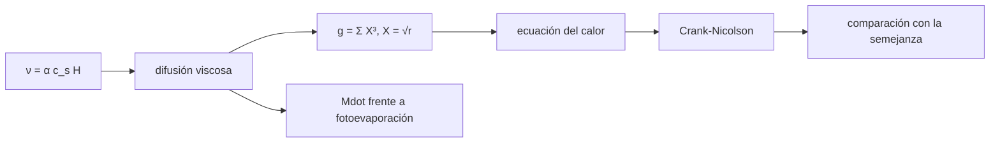

# B52-C09 — Dispersión de discos de gas

<!-- nav:top -->
[🏠 Programa](../../../../README.md) · [📚 Bloque B52](../../../tronco-comun/B52-formacion-y-dinamica-de-sistemas-planetarios.md) · [← Anterior: B52-C08 — Formación de gigantes gaseosos](../B52-C08-formacion-de-gigantes-gaseosos/CLASE.md) · [Siguiente: B52-C10 — Arquitecturas de sistemas exoplanetarios →](../B52-C10-arquitecturas-de-sistemas-exoplanetarios/CLASE.md)
<!-- /nav -->

## 1. Ubicación, nivel y alcance

Clase 9 del bloque B52. Nivel N3. El gas del disco no dura para siempre: la viscosidad lo hace fluir hacia la estrella y expandirse, y la fotoevaporación lo remata. Resuelves la **ecuación de difusión viscosa** de un disco con `ν ∝ r`, la reduces a una ecuación del calor, la integras con Crank–Nicolson y la contrastas con una **solución de semejanza**. Después estimas el tiempo en que la acreción viscosa cae al nivel de una fotoevaporación ilustrativa. Usas [B21](../../../tronco-comun/B21-metodos-numericos-para-edp-y-fluidos-computacionales.md). El disco es **sintético**.

## 2. Por qué esta clase existe

La vida del gas fija cuánto tiempo hay para formar núcleos, gigantes y migración. La decisión central: **¿cuánto tarda un disco en perder su gas y cómo se comprueba un esquema numérico de difusión?**

## 3. Lo que podrás hacer al terminar

1. Escribir la ecuación de difusión viscosa de un disco kepleriano.
2. Reducirla a `∂g/∂t = (3/4)∂²g/∂X²` cuando `ν ∝ r`.
3. Integrarla con Crank–Nicolson (matriz tridiagonal).
4. Contrastar con la solución de semejanza y con el cambio de paso.
5. Calcular la escala viscosa `t_ν` y la tasa de acreción.
6. Estimar el tiempo de dispersión con una fotoevaporación ilustrativa.

La evidencia es la **ficha de la dispersión del disco** del ejercicio 12 (sección 20).

## 4. Con qué llegas y cómo comprobarlo

1. ¿Qué es una tabla de resultados?
2. ¿Qué es una verificación?
3. ¿Qué es una tolerancia numérica?
4. ¿Qué es la tercera ley de Kepler?
5. ¿Qué es un valor ilustrativo?

<details>
<summary>Ver respuestas</summary>

1. Un resumen ordenado de cálculos. 2. Comparar un cálculo con un caso independiente. 3. La diferencia máxima aceptada entre dos resultados. 4. El cuadrado del periodo crece con el cubo del semieje. 5. Un valor propuesto para el ejemplo, no medido.
</details>

Con cuatro o cinco aciertos, sigue; si no, repasa los prerrequisitos.

## 5. Un caso de contexto y casos de referencia

Un disco sintético con `α = 10⁻³`, `r₁ = 10 ua` y `0,01 M☉` tiene `t_ν = 1.41e+06` años y una tasa de acreción inicial de `1.07e-08 M☉/año`. Con una fotoevaporación de `10⁻⁹ M☉/año` la acreción viscosa cae a ese nivel en `1.80e+06` años, cuando queda el `45 %` de la masa. Es el **ejemplo conductor**.

## 6. Vocabulario

La **viscosidad** `ν = α c_s H` es la de Shakura–Sunyaev (parametrización `α`). La **escala viscosa** es `t_ν = r²/ν`. Una **solución de semejanza** conserva su forma al reescalar. La **fotoevaporación** es la pérdida de gas calentado por radiación. **Crank–Nicolson** es un esquema implícito de segundo orden.

## 7. Modelo mental

Como una gota de tinta en agua: se extiende y se diluye, y una parte sale por el desagüe (la estrella) mientras otra se evapora. Límite: viscosidad `ν ∝ r`, simetría axial, tasa de evaporación constante, sin torques de planetas.



*Descripción textual:* la viscosidad define la difusión, que con un cambio de variable es la ecuación del calor; se integra y compara con la semejanza, y la tasa de acreción se confronta con la fotoevaporación.

## 8. La explicación, paso a paso

### 8.1 Ecuación

`∂Σ/∂t = (3/r) ∂/∂r[ r^(1/2) ∂/∂r(νΣ r^(1/2)) ]`. Con `ν = ν₁ r/r₁` y `X = √(r/r₁)`, `g = ΣX³` cumple `∂g/∂t = (3ν₁/(4r₁²)) ∂²g/∂X²`.

### 8.2 Semejanza

`Σ = C/(3πν₁ r̃) · T^(−3/2) exp(−r̃/T)` con `T = 1 + t/t_s`, `t_s = r₁²/(3ν₁)`; la masa decae como `M = M₀ T^(−1/2)`. Esta solución no se consultó en una fuente: aquí se verifica numéricamente.

### 8.3 Verificación

Con Crank–Nicolson en `X ∈ [0,1; 6]` (1180 intervalos, `Δt = 10⁻³` en unidades de `r₁²/ν₁`) hasta `T = 2.5`, el error relativo máximo de `Σ` para `0,1 < r/r₁ < 5` es `4.6e-06`, y al cambiar el paso a la mitad la diferencia es `4.0e-07`. La masa numérica es `0.62993 M₀` frente a `0.63246`: la diferencia viene del borde interior en `r/r₁ = 0,01`.

### 8.4 Escalas

`c_s(r₁) = 563.7 m/s`, `ν₁ = 5.047e+10 m²/s`, `t_ν = 1.405e+06 años`, `t_s = 4.684e+05 años`. La acreción es `Ṁ(t) = Ṁ₀ T^(−3/2)` con `Ṁ₀ = M₀/(2t_s) = 1.068e-08 M☉/año`.

### 8.5 Dispersión

Con `Ṁ_pe = 10⁻⁹ M☉/año` (ilustrativo), `Ṁ = Ṁ_pe` en `T = 4.848`, es decir `t = 1.802e+06 años`. La masa restante es `0.454 M₀`. Más tarde la fotoevaporación domina y limpia el disco rápidamente.

### 8.6 Lectura

El resultado muestra el mecanismo, no el tiempo de ningún disco real: `α`, `r₁` y `Ṁ_pe` son ilustrativos.

## 9. Magnitudes, símbolos y unidades

| Símbolo | Qué es | Unidad | Valor / nota |
|---|---|---|---|
| `α` | parámetro de viscosidad | — | 10⁻³ (ilustrativo) |
| `ν₁` | viscosidad en `r₁` | m²/s | 5.05e+10 |
| `t_ν` | escala viscosa | años | 1.41e+06 |
| `Ṁ₀` | acreción inicial | M☉/año | 1.07e-08 |
| `Ṁ_pe` | fotoevaporación | M☉/año | 10⁻⁹ (ilustrativo) |

## 10. Convenciones y referencias

Unidades SI en el cálculo; tiempos en años para informar. Disco axisimétrico. Tolerancias: `10⁻³` en `Σ` frente a la semejanza y `10⁻⁴` en el cambio de paso.

## 11. De dónde sale lo que afirmamos

| ID | Fuente | Localizador | Respalda | Estado |
|---|---|---|---|---|
| S1 | NIST, *Fundamental Physical Constants — Complete Listing* (CODATA 2022) | https://physics.nist.gov/cuu/Constants/Table/allascii.txt | `G`, `k_B`, `m_p` | Consultada el 2026-11-09 |
| S2 | Mamajek et al., *IAU 2015 Resolution B3*, arXiv:1510.07674 | https://arxiv.org/abs/1510.07674 | `(GM)☉`, `(GM)⊕`, `(GM)_J` nominales | Texto del PDF extraído el 2026-11-09 |
| S3 | Kley y Nelson, *Planet-disk interaction and orbital evolution*, arXiv:1203.1184 | https://arxiv.org/abs/1203.1184 | Los discos de gas evolucionan e interactúan con los planetas; las propiedades del disco fijan la migración | Solo resumen, consultado el 2026-11-09 |

Límites: de S3 solo se leyó el resumen; la solución de semejanza, la parametrización `α` y la fotoevaporación no se consultaron en una fuente: se verifican (la primera) contra una integración numérica; `α`, `r₁`, `M₀` y `Ṁ_pe` son ilustrativos.

## 12. Cómo verlo

| Magnitud | Valor |
|---|---|
| t_ν | 1.41e+06 años |
| error de Σ | 4.6e-06 |
| Ṁ₀ | 1.07e-08 M☉/año |
| t de dispersión | 1.80e+06 años |

Descripción larga: el esquema reproduce la solución de semejanza con error de millonésimas y la acreción viscosa cae al nivel de la fotoevaporación en unos pocos millones de años del modelo.

## 13. Ejemplo trabajado

**Paso 1 · Viscosidad.** `ν₁ = α c_s²/Ω = 5.047e+10 m²/s`.

**Paso 2 · Escala.** `t_ν = r₁²/ν₁ = 1.405e+06 años`, `t_s = t_ν/3`.

**Paso 3 · Cruce.** `T_c = (Ṁ₀/Ṁ_pe)^(2/3) = 4.848`.

**Paso 4 · Tiempo.** `t = t_s (T_c − 1) = 1.802e+06 años`.

## 14. Distintas formas de describirlo

**Por ecuación:** difusión y calor. **Por semejanza:** `Σ`, `M`. **Por tabla:** sección 12. **Por tiempo:** `t_ν`.

## 15. Práctica guiada

**Ejercicio 1 · con los pasos indicados.** Si `α` se duplica, ¿cómo cambia `t_ν`? *Pista:* `ν ∝ α`.

<details><summary>Solución comentada</summary>

Baja a la mitad.
</details>

**Ejercicio 2 · con una pista.** ¿Cómo decae la masa de la solución de semejanza en `T = 4`? *Pasos:* `T^(−1/2)`.

<details><summary>Solución comentada</summary>

A `0,5 M₀`.
</details>

**Ejercicio 3 · casi autónomo.** ¿Qué tipo de ecuación es la de `g`?

<details><summary>Solución comentada</summary>

La del calor, con difusividad `3ν₁/(4r₁²)`.
</details>

## 16. Práctica autónoma, transferencia e integrador

**Ejercicio 4.** `t_ν` del ejemplo.

<details><summary>Solución comentada</summary>

`1.405e+06 años`.
</details>

**Ejercicio 5.** `Ṁ₀` del ejemplo.

<details><summary>Solución comentada</summary>

`1.068e-08 M☉/año`.
</details>

**Ejercicio 6.** Error relativo de la integración.

<details><summary>Solución comentada</summary>

`4.6e-06`.
</details>

**Ejercicio 7.** Tiempo de dispersión.

<details><summary>Solución comentada</summary>

`1.802e+06 años`.
</details>

**Ejercicio 8.** Fracción de masa restante.

<details><summary>Solución comentada</summary>

`0.454`.
</details>

**Ejercicio 9 · transferencia.** **Transferencia.** **Transferencia.** Un colega usa estos años como la vida de los discos reales. Responde.

<details><summary>Solución comentada</summary>

No: `α` y la fotoevaporación son ilustrativos y la vida real se mide en observaciones que aquí no se usan.
</details>

**Ejercicio 10 · transferencia.** **Transferencia.** **Transferencia.** ¿Qué cambia si `ν ∝ r^0,5`?

<details><summary>Solución comentada</summary>

La solución de semejanza y el exponente de decaimiento cambian; el cambio de variable ya no da exactamente el calor.
</details>

**Ejercicio 11 · transferencia.** **Transferencia.** **Transferencia.** ¿Por qué se fijan los bordes con la semejanza?

<details><summary>Solución comentada</summary>

Para probar solo el interior del esquema; con bordes reales habría que modelar la acreción en la estrella.
</details>

**Ejercicio 12 · integrador.** **Integrador.** **Integrador.** Elabora tu *ficha de la dispersión del disco*: ecuaciones, errores, escalas, cruce y límites.

<details><summary>Solución modelo</summary>

Secciones 8.1–8.6 y 12.
</details>

## 17. Laboratorio: difusión viscosa y dispersión

El script [viscoso.py](viscoso.py) integra la difusión con Crank–Nicolson, la compara con la solución de semejanza y con el cambio de paso y calcula el tiempo de cruce con la fotoevaporación (**comprueba** `10⁻³` y `10⁻⁴`).

**Datos:** `G`, `k_B`, `m_p` de NIST y `(GM)☉` de la IAU 2015, consultados el 2026-11-09; el disco y la fotoevaporación son **ilustrativos**. **Predice antes de ejecutar:** ¿Reproduce el esquema la semejanza? (Sí, con error del orden de `10⁻⁶`.) **Ejecución del 2026-11-09 (Python 3.12.9):**

```text
Python 3.12.9 (biblioteca estandar)
Disco sintetico: alfa = 0.001, r1 = 10.0 ua, M0 = 0.01 M_sol ; c_s(r1) = 563.7 m/s ; nu1 = 5.047e+10 m^2/s
Escala viscosa t_nu = r1^2/nu1 = 1.405e+06 anios ; t_s = t_nu/3 = 4.684e+05 anios ; Mdot inicial = 1.068e-08 M_sol/anio
Ecuacion de difusion (Crank-Nicolson) a T = 1 + t/t_s = 2.5000: error relativo maximo de Sigma (0.1 < r/r1 < 5) = 4.56e-06 ; cambio de paso = 4.03e-07
Masa del disco: numerica = 0.62993 M0 ; semejanza T^(-1/2) = 0.63246 M0 (la diferencia refleja el borde interior en r/r1 = 0.01)
Fotoevaporacion ilustrativa 1e-09 M_sol/anio: Mdot viscoso la iguala en T = 4.848, t = 1.802e+06 anios, con 0.454 de la masa inicial
Pruebas superadas.
```

```bash
python programa/clases/B52/B52-C09-dispersion-de-discos-de-gas/viscoso.py
```

**Límites:** `ν ∝ r`, bordes fijados con la semejanza, tasa de evaporación constante.

## 18. Errores frecuentes y cómo corregirlos

**Confundir `t_ν` con la vida del disco.** Se corrige con 8.5.

**Fijar bordes sin decirlo.** Se corrige con 8.3.

**Olvidar que `Σ` tiene una divergencia interna.** Se corrige con 8.3.

**Presentar `Ṁ_pe` como medida.** Se corrige con la sección 10.

## 19. Cómo sabrás que vas bien

Tras la sección 8: ¿qué resultado esperabas y cuál obtuviste? Si dudas, repasa el ejemplo de la sección 13. Tras el laboratorio: ¿qué comprueba? (ver la sección 17).

## 20. Qué entregas y cómo se evalúa

El producto es tu **ficha de la dispersión del disco** (ejercicio 12).

| Criterio | Inicial | En desarrollo | Logrado | Destacado |
|---|---|---|---|---|
| Conceptos | Los confunde | Parciales | Conceptos de la clase | Explica los límites |
| Cálculo | Sin unidades | Con errores | Tablas completas | Calcula casos nuevos |
| Numérico | Sin comprobar | Un caso | Contraste con el análisis | Interpreta las diferencias |
| Fuentes | Sin fuente | Sin fecha | Fuentes con fecha | Declara lo ilustrativo |
| Límites | No los nombra | Uno | Tres | Discute qué falta del modelo |

**Condiciones críticas (no se compensan con promedio):** rotular lo sintético e ilustrativo; no presentar un resultado simulado como observado; citar solo lo consultado.

## 21. Ética, seguridad y límites

Clase educativa: los modelos son simplificados y no sustituyen a la literatura primaria ni a los códigos de producción. Lo simulado no es lo observado. Accesibilidad: tablas equivalentes a las gráficas, fórmulas en texto, ejercicios sin conexión.

## 22. Para cerrar y seguir

El disco sintético pierde su gas en `1.8e+06` años del modelo, al cruzarse la acreción viscosa con la fotoevaporación. Queda una pregunta: ¿qué arquitectura queda al final?

**Glosario español–inglés.** viscosidad · *viscosity*; solución de semejanza · *similarity solution*; fotoevaporación · *photoevaporation*; Crank–Nicolson · *Crank–Nicolson scheme*; tasa de acreción · *accretion rate*.

**Continuidad.** [B52-C10](../B52-C10-arquitecturas-de-sistemas-exoplanetarios/CLASE.md) estudia la arquitectura de los sistemas.

**Referencias:** ver sección 11.

<!-- nav:bottom -->
---

[← Anterior: B52-C08 — Formación de gigantes gaseosos](../B52-C08-formacion-de-gigantes-gaseosos/CLASE.md) · [📚 Bloque B52](../../../tronco-comun/B52-formacion-y-dinamica-de-sistemas-planetarios.md) · [Siguiente: B52-C10 — Arquitecturas de sistemas exoplanetarios →](../B52-C10-arquitecturas-de-sistemas-exoplanetarios/CLASE.md)
<!-- /nav -->
