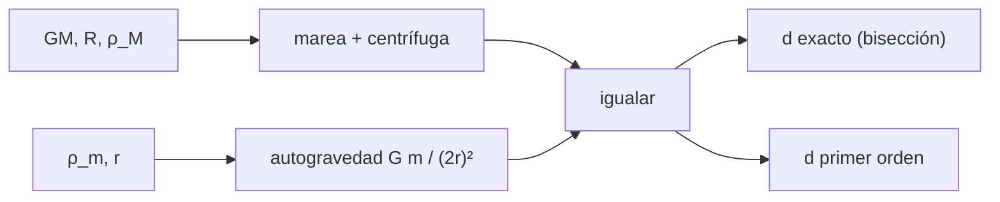

# B52-C12 — Anillos planetarios

<!-- nav:top -->
[🏠 Programa](../../../../README.md) · [📚 Bloque B52](../../../tronco-comun/B52-formacion-y-dinamica-de-sistemas-planetarios.md) · [← Anterior: B52-C11 — Formación de satélites naturales](../B52-C11-formacion-de-satelites-naturales/CLASE.md) · [Siguiente: B52-C13 — Pequeños cuerpos remanentes →](../B52-C13-pequenos-cuerpos-remanentes/CLASE.md)
<!-- /nav -->

## 1. Ubicación, nivel y alcance

Clase 12 del bloque B52. Nivel N3. Dentro de cierta distancia al planeta, las mareas impiden que las partículas se agrupen en un satélite y el material permanece como anillo. Calculas el **límite de Roche** de un modelo de **dos esferas en contacto** alrededor de Saturno (con datos de la NASA) por dos vías: la ecuación exacta resuelta por bisección y la aproximación de primer orden. Retoma [B52-C11](../B52-C11-formacion-de-satelites-naturales/CLASE.md). Usas [B09](../../../tronco-comun/B09-calculo-diferencial-e-integral.md).

## 2. Por qué esta clase existe

El límite de Roche separa el régimen de anillos del de satélites. La decisión central: **¿a qué distancia del planeta se separan dos partículas en contacto y cómo depende de la densidad?**

## 3. Lo que podrás hacer al terminar

1. Plantear la aceleración de marea más la diferencia centrífuga entre dos esferas.
2. Igualarla con la autogravedad `Gm/(2r)²`.
3. Resolver la ecuación exacta por bisección.
4. Obtener la aproximación `d = R (24 ρ_M/ρ_m)^(1/3)`.
5. Verificar la escala `d ∝ ρ^(−1/3)`.
6. Distinguir este modelo de los coeficientes clásicos, que no se consultaron.

La evidencia es la **ficha del límite de Roche** del ejercicio 12 (sección 20).

## 4. Con qué llegas y cómo comprobarlo

1. ¿Qué es una tabla de resultados?
2. ¿Qué es una verificación?
3. ¿Qué es una tolerancia numérica?
4. ¿Qué es la tercera ley de Kepler?
5. ¿Qué es un valor ilustrativo?

<details>
<summary>Ver respuestas</summary>

1. Un resumen ordenado de cálculos. 2. Comparar un cálculo con un caso independiente. 3. La diferencia máxima aceptada entre dos resultados. 4. El cuadrado del periodo crece con el cubo del semieje. 5. Un valor propuesto para el ejemplo, no medido.
</details>

Con cuatro o cinco aciertos, sigue; si no, repasa los prerrequisitos.

## 5. Un caso de contexto y casos de referencia

Con los datos de Saturno (`R = 60 268 km`, `687 kg/m³`), dos esferas de hielo de `920 kg/m³` se separan a `2.617 R` y las de `2000 kg/m³`, a `2.020 R`. La masa de la esfera de esa densidad supera en `11 %` la de la ficha porque el diámetro de la ficha es ecuatorial. Es el **ejemplo conductor**.

## 6. Vocabulario

El **límite de Roche** es la distancia dentro de la cual la marea supera la autogravedad de un cuerpo. La **aceleración de marea** es la diferencia de la gravedad del planeta entre dos puntos. Un **anillo** es un disco delgado de partículas. El **modelo de dos esferas** es una simplificación didáctica de un cuerpo extendido.

## 7. Modelo mental

Como dos imanes pegados que una corriente trata de separar: si la corriente es más fuerte que la atracción, se separan. Límite: dos esferas idénticas, rotación sincrónica, sin deformación y sin cohesión.



*Descripción textual:* la marea y la diferencia centrífuga se igualan con la autogravedad; la ecuación se resuelve exactamente y a primer orden.

## 8. La explicación, paso a paso

### 8.1 Modelo

Dos esferas de radio `r` y masa `m` en contacto, con el eje radial. La aceleración relativa es `GM/(d−r)² − GM/(d+r)² + (GM/d³)·2r` y la autogravedad `Gm/(2r)²`. El límite `d` es la raíz de su diferencia.

### 8.2 Aproximación

A primer orden en `r/d`, `3GM·2r/d³ = Gm/(4r²)`, es decir `d³ = 24 M r³/m` y `d = R(24 ρ_M/ρ_m)^(1/3)`.

### 8.3 Resultados

| ρ de la partícula [kg/m³] | d exacto / R | d primer orden / R | dif. rel. |
|---|---|---|---|
| 920 | 2.6169 | 2.6169 | 6.5e-08 |
| 1000 | 2.5452 | 2.5452 | 6.9e-08 |
| 2000 | 2.0201 | 2.0201 | 1.1e-07 |
| 7360 | 1.3085 | 1.3085 | 2.6e-07 |

El cociente `d(8ρ)/d(ρ) = 0.500000`, igual a `1/2` salvo `10⁻⁷`.

### 8.4 Lectura

Los coeficientes de este modelo (`≈ 2,9` con `ρ_M/ρ_m = 1`) no coinciden con los clásicos para satélites rígidos y fluidos; esos otros valores no se consultaron y no se afirman aquí. El modelo muestra la dependencia `ρ^(−1/3)`, que es la parte robusta. Para partículas de hielo, el límite resulta en torno de `2,6 R`, un orden de magnitud acorde con la extensión de los anillos, pero **no** se afirma que los anillos reales se expliquen con este cálculo.

## 9. Magnitudes, símbolos y unidades

| Símbolo | Qué es | Unidad | Valor / nota |
|---|---|---|---|
| `R` | radio ecuatorial de Saturno | km | 60 268 (ficha) |
| `ρ_M` | densidad media de Saturno | kg/m³ | 687 (ficha) |
| `ρ_m` | densidad de la partícula | kg/m³ | 920 a 7360 (ilustrativo) |
| `d/R` | límite de Roche | — | 2.617 (hielo) |

## 10. Convenciones y referencias

SI. Marco rotante sincrónico. Tolerancias: exacto frente a primer orden `5·10⁻³`, escala `10⁻¹²` en la fórmula de primer orden.

## 11. De dónde sale lo que afirmamos

| ID | Fuente | Localizador | Respalda | Estado |
|---|---|---|---|---|
| S1 | NIST, *Fundamental Physical Constants — Complete Listing* (CODATA 2022) | https://physics.nist.gov/cuu/Constants/Table/allascii.txt | `G`, `k_B`, `m_p` | Consultada el 2026-11-09 |
| S3 | NASA/NSSDC, *Planetary Fact Sheet* (tabla métrica) | https://nssdc.gsfc.nasa.gov/planetary/factsheet/index.html | Diámetro, densidad y masa de Saturno | Consultada el 2026-11-09 |
| S4 | Crida y Charnoz, *Formation of Regular Satellites from Ancient Massive Rings in the Solar System*, arXiv:1301.3808 | https://arxiv.org/abs/1301.3808 | Los discos que se extienden más allá del radio de Roche pueden formar satélites | Descripción obtenida con un buscador el 2026-11-09; no se leyó el texto |

Límites: la ficha no da incertidumbres y su diámetro es ecuatorial (por eso la masa de la esfera difiere de la masa de la ficha); de S4 no se leyó el texto; los coeficientes clásicos del límite de Roche no se consultaron; las densidades de las partículas son ilustrativas.

## 12. Cómo verlo

| Magnitud | Valor |
|---|---|
| d/R, hielo (920) | 2.617 |
| d/R (2000) | 2.020 |
| dif. exacto/1er orden | 6.5e-08 |
| d(8ρ)/d(ρ) | 0.500000 |

Descripción larga: el límite baja al aumentar la densidad de la partícula como `ρ^(−1/3)` y la aproximación de primer orden coincide con el cálculo exacto hasta `10⁻⁷`.

## 13. Ejemplo trabajado

**Paso 1 · Cociente.** `24·ρ_M/ρ_m = 24·687/920 = 17.922`.

**Paso 2 · Raíz cúbica.** `2.6169`.

**Paso 3 · Límite.** `d = 2.6169 R`, que coincide con la tabla.

## 14. Distintas formas de describirlo

**Por fórmula:** `d = R(24ρ_M/ρ_m)^(1/3)`. **Por raíz:** bisección. **Por tabla:** 8.3.

## 15. Práctica guiada

**Ejercicio 1 · con los pasos indicados.** Calcula `d/R` si `ρ_m = ρ_M`. *Pasos:* `24^(1/3)`.

<details><summary>Solución comentada</summary>

`2,884`.
</details>

**Ejercicio 2 · con una pista.** Si `ρ_m` se multiplica por 8, ¿cómo cambia `d`? *Pista:* `ρ^(−1/3)`.

<details><summary>Solución comentada</summary>

Se reduce a la mitad.
</details>

**Ejercicio 3 · casi autónomo.** ¿Cuál es la autogravedad para `r = 1 m` y `ρ_m = 920`?

<details><summary>Solución comentada</summary>

`G m/(2r)² = 6,674·10⁻¹¹·3854/4 ≈ 6,4·10⁻⁸ m/s²`.
</details>

## 16. Práctica autónoma, transferencia e integrador

**Ejercicio 4.** `d/R` para 920 kg/m³.

<details><summary>Solución comentada</summary>

`2.6169`.
</details>

**Ejercicio 5.** `d/R` para 7360 kg/m³.

<details><summary>Solución comentada</summary>

`1.3085`.
</details>

**Ejercicio 6.** Diferencia exacto–primer orden en 2000 kg/m³.

<details><summary>Solución comentada</summary>

`1.1e-07`.
</details>

**Ejercicio 7.** Masa de Saturno de la ficha.

<details><summary>Solución comentada</summary>

`5,68·10²⁶ kg`.
</details>

**Ejercicio 8.** ¿Por qué la masa de la esfera difiere de la de la ficha?

<details><summary>Solución comentada</summary>

Porque el diámetro de la ficha es ecuatorial y Saturno está achatado.
</details>

**Ejercicio 9 · transferencia.** **Transferencia.** **Transferencia.** Un colega dice que el cálculo prueba el tamaño de los anillos. Responde.

<details><summary>Solución comentada</summary>

No: el modelo es de enseñanza y no se contrastó con la extensión medida de los anillos.
</details>

**Ejercicio 10 · transferencia.** **Transferencia.** **Transferencia.** ¿Qué cambia con partículas con cohesión?

<details><summary>Solución comentada</summary>

El límite baja: la cohesión resiste la marea.
</details>

**Ejercicio 11 · transferencia.** **Transferencia.** **Transferencia.** ¿Qué otro modelo daría otro coeficiente?

<details><summary>Solución comentada</summary>

Un cuerpo fluido deformable, cuyo coeficiente clásico no se consultó.
</details>

**Ejercicio 12 · integrador.** **Integrador.** **Integrador.** Elabora tu *ficha del límite de Roche*: modelo, tabla 8.3, escala y límites.

<details><summary>Solución modelo</summary>

Secciones 8.1–8.4 y 12.
</details>

## 17. Laboratorio: límite de Roche de dos esferas

El script [roche.py](roche.py) resuelve por bisección la ecuación exacta de dos esferas en contacto, la compara con la aproximación de primer orden y comprueba la escala con la densidad (**comprueba** `5·10⁻³` y `10⁻¹²`).

**Datos:** diámetro, densidad y masa de Saturno de la ficha de la NASA/NSSDC y `G` de NIST, consultados el 2026-11-09; las densidades de las partículas son **ilustrativas**. **Predice antes de ejecutar:** ¿Aumenta el límite si la partícula es menos densa? (Sí, como `ρ^(−1/3)`.) **Ejecución del 2026-11-09 (Python 3.12.9):**

```text
Python 3.12.9 (biblioteca estandar)
Saturno (ficha NASA/NSSDC, 2026-11-09): R = 60268 km ; densidad = 687 kg/m^3 ; masa de la ficha = 5.680e+26 kg ; masa de la esfera = 6.299e+26 kg (+10.91%)
 rho particula  d exacto / R  d 1er orden / R  dif. rel.
           920        2.6169           2.6169   6.49e-08
          1000        2.5452           2.5452   6.86e-08
          2000        2.0201           2.0201   1.09e-07
          7360        1.3085           1.3085   2.60e-07
Cociente d(8 rho)/d(rho) = 0.500000097 (esperado 0.5 por d ~ rho^(-1/3))
Pruebas superadas.
```

```bash
python programa/clases/B52/B52-C12-anillos-planetarios/roche.py
```

**Límites:** dos esferas idénticas, rotación sincrónica, sin cohesión; no es el coeficiente clásico.

## 18. Errores frecuentes y cómo corregirlos

**Confundir el límite con la extensión real de los anillos.** Se corrige con 8.4.

**Usar el diámetro ecuatorial como medio sin decirlo.** Se corrige con la sección 11.

**Citar los coeficientes clásicos sin haberlos consultado.** Se corrige con la sección 11.

**Olvidar la rotación sincrónica.** Se corrige con 8.1.

## 19. Cómo sabrás que vas bien

Tras la sección 8: ¿qué resultado esperabas y cuál obtuviste? Si dudas, repasa el ejemplo de la sección 13. Tras el laboratorio: ¿qué comprueba? (ver la sección 17).

## 20. Qué entregas y cómo se evalúa

El producto es tu **ficha del límite de Roche** (ejercicio 12).

| Criterio | Inicial | En desarrollo | Logrado | Destacado |
|---|---|---|---|---|
| Conceptos | Los confunde | Parciales | Conceptos de la clase | Explica los límites |
| Cálculo | Sin unidades | Con errores | Tablas completas | Calcula casos nuevos |
| Numérico | Sin comprobar | Un caso | Contraste con el análisis | Interpreta las diferencias |
| Fuentes | Sin fuente | Sin fecha | Fuentes con fecha | Declara lo ilustrativo |
| Límites | No los nombra | Uno | Tres | Discute qué falta del modelo |

**Condiciones críticas (no se compensan con promedio):** rotular lo sintético e ilustrativo; no presentar un resultado simulado como observado; citar solo lo consultado.

## 21. Ética, seguridad y límites

Clase educativa: los modelos son simplificados y no sustituyen a la literatura primaria ni a los códigos de producción. Lo simulado no es lo observado. Accesibilidad: tablas equivalentes a las gráficas, fórmulas en texto, ejercicios sin conexión.

## 22. Para cerrar y seguir

El modelo da `d ≈ 2.62 R` para hielo y la ley `ρ^(−1/3)`. Queda una pregunta: ¿qué cuerpos pequeños quedan tras la formación?

**Glosario español–inglés.** límite de Roche · *Roche limit*; marea · *tide*; autogravedad · *self-gravity*; anillo planetario · *planetary ring*.

**Continuidad.** [B52-C13](../B52-C13-pequenos-cuerpos-remanentes/CLASE.md) estudia los cuerpos remanentes.

**Referencias:** ver sección 11.

<!-- nav:bottom -->
---

[← Anterior: B52-C11 — Formación de satélites naturales](../B52-C11-formacion-de-satelites-naturales/CLASE.md) · [📚 Bloque B52](../../../tronco-comun/B52-formacion-y-dinamica-de-sistemas-planetarios.md) · [Siguiente: B52-C13 — Pequeños cuerpos remanentes →](../B52-C13-pequenos-cuerpos-remanentes/CLASE.md)
<!-- /nav -->
