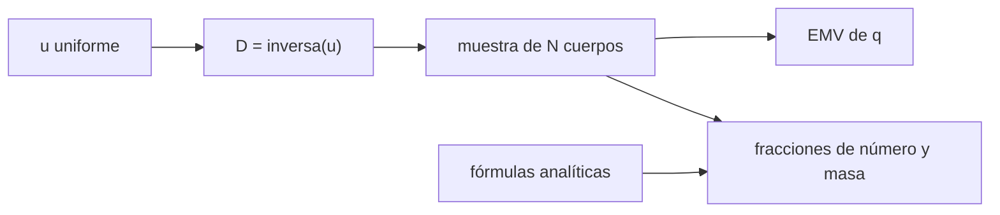

# B52-C13 — Pequeños cuerpos remanentes

<!-- nav:top -->
[🏠 Programa](../../../../README.md) · [📚 Bloque B52](../../../tronco-comun/B52-formacion-y-dinamica-de-sistemas-planetarios.md) · [← Anterior: B52-C12 — Anillos planetarios](../B52-C12-anillos-planetarios/CLASE.md) · [Siguiente: B52-C14 — Cinturones de asteroides →](../B52-C14-cinturones-de-asteroides/CLASE.md)
<!-- /nav -->

## 1. Ubicación, nivel y alcance

Clase 13 del bloque B52. Nivel N3. Lo que no se incorporó a los planetas quedó como asteroides, cometas y objetos transneptunianos. Su rasgo más medible es la **distribución de tamaños**, que suele describirse con una ley de potencias. Generas una población **sintética** con exponente conocido, la muestreas por transformada inversa, estimas el exponente por máxima verosimilitud y calculas qué fracción de la masa está en los cuerpos grandes. Usas [B12](../../../tronco-comun/B12-probabilidad-estadistica-e-incertidumbre.md). No hay datos observados en esta clase.

## 2. Por qué esta clase existe

Cómo se reparte la masa entre tamaños indica qué cuerpos dominan una población y qué mide un censo incompleto. La decisión central: **¿cómo se estima el exponente de una ley de potencias y qué tan fiable es la masa que implica?**

## 3. Lo que podrás hacer al terminar

1. Definir una distribución acumulada de ley de potencias truncada.
2. Muestrearla por transformada inversa con semilla fija.
3. Estimar el exponente por máxima verosimilitud resolviendo la ecuación de score.
4. Comparar fracciones de número y de masa con las analíticas.
5. Explicar por qué la masa la dominan pocos cuerpos grandes.
6. Declarar que la población es sintética.

La evidencia es la **ficha de la distribución de tamaños** del ejercicio 12 (sección 20).

## 4. Con qué llegas y cómo comprobarlo

1. ¿Qué es una tabla de resultados?
2. ¿Qué es una verificación?
3. ¿Qué es una tolerancia numérica?
4. ¿Qué es la tercera ley de Kepler?
5. ¿Qué es un valor ilustrativo?

<details>
<summary>Ver respuestas</summary>

1. Un resumen ordenado de cálculos. 2. Comparar un cálculo con un caso independiente. 3. La diferencia máxima aceptada entre dos resultados. 4. El cuadrado del periodo crece con el cubo del semieje. 5. Un valor propuesto para el ejemplo, no medido.
</details>

Con cuatro o cinco aciertos, sigue; si no, repasa los prerrequisitos.

## 5. Un caso de contexto y casos de referencia

Una población **sintética** de `100000` cuerpos de 1 a 50 km con `q = 2,5` da, por máxima verosimilitud, `q̂ = 2.4876` (error estándar `0.0079`). El `32 %` de la masa está en los cuerpos de más de 20 km, que son solo el `0.045 %` del número. Es el **ejemplo conductor**; no es un censo de asteroides.

## 6. Vocabulario

Una **ley de potencias** acumulada es `N(>D) ∝ D^(−q)`. La **transformada inversa** genera una muestra aplicando la inversa de la acumulada a números uniformes. El **estimador de máxima verosimilitud** (EMV) elige el exponente que hace más probable la muestra. La **fracción de masa** usa `m ∝ D³`. Una distribución es **truncada** si tiene tamaños mínimo y máximo.

## 7. Modelo mental

Como una ciudad con muchos pueblos pequeños y pocas metrópolis: casi toda la población vive en estas pocas. Límite: exponente único, truncamiento brusco y muestra independiente.



*Descripción textual:* números uniformes se transforman en tamaños; la muestra permite estimar el exponente y calcular fracciones de número y de masa que se comparan con las analíticas.

## 8. La explicación, paso a paso

### 8.1 Distribución

Con tamaños en `[D_min, D_max]` y `R = D_max/D_min`, la densidad es `f(x) = q x^(−q−1)/(1 − R^(−q))`, `x = D/D_min`. La inversa de la acumulada es `D = D_min [1 − u(1 − R^(−q))]^(−1/q)`.

### 8.2 Estimación

El score es `N/q − N R^(−q) ln R/(1 − R^(−q)) − Σ ln x_i`; su raíz (bisección) da `q̂ = 2.4876` para `q = 2,5`, a `1.56` errores estándar (`q/√N` aproximado).

### 8.3 Fracciones

| D > [km] | número muestra | número analítico | masa muestra | masa analítica |
|---|---|---|---|---|
| 5 | 0.018630 | 0.017833 | 0.7658 | 0.7964 |
| 10 | 0.003210 | 0.003106 | 0.5798 | 0.6438 |
| 20 | 0.000450 | 0.000502 | 0.3166 | 0.4281 |

El número concuerda dentro del ruido de Poisson; la masa muestral queda algo por debajo de la analítica porque los cuerpos más grandes son pocos (el mayor de la muestra es `39.2 km`).

### 8.4 Lectura

Con `q < 3` la masa la dominan los cuerpos grandes, de modo que un censo incompleto en los tamaños grandes subestima la masa. Con la masa total sintética de `2.77e+18 kg` (densidad ilustrativa de 2000 kg/m³) se aprecia el orden de magnitud, no la masa de ninguna población real.

## 9. Magnitudes, símbolos y unidades

| Símbolo | Qué es | Unidad | Valor / nota |
|---|---|---|---|
| `q` | exponente acumulado | — | 2,5 (sintético) |
| `D_min`, `D_max` | límites de tamaño | km | 1 y 50 |
| `N` | número de cuerpos | — | 100 000 |
| `ρ` | densidad | kg/m³ | 2000 (ilustrativo) |

## 10. Convenciones y referencias

Población sintética; semilla `20261109`. Unidades: km para tamaños, kg para masas. Tolerancias: `q̂` dentro de 3 errores estándar; fracciones de número dentro de 3 σ de Poisson; masa dentro de `0,15` absoluto.

## 11. De dónde sale lo que afirmamos

| ID | Fuente | Localizador | Respalda | Estado |
|---|---|---|---|---|
| — | Sin fuente externa | — | relaciones estándar que verifica el laboratorio | No se consultó una fuente para esta clase |

Límites: no se consultó ninguna fuente; el exponente de equilibrio colisional de la literatura no se consultó; la población es sintética.

## 12. Cómo verlo

| Magnitud | Valor |
|---|---|
| q verdadero | 2,5 |
| q estimado | 2.4876 |
| masa en D > 20 km | 0.317 |
| número en D > 20 km | 0.00045 |

Descripción larga: el exponente se recupera a menos de dos errores estándar y la masa se concentra en una fracción minúscula de los cuerpos.

## 13. Ejemplo trabajado

**Paso 1 · Cociente.** `R = 50`.

**Paso 2 · Score.** Se resuelve `N/q − N R^(−q) ln R/(1 − R^(−q)) = Σ ln x_i`.

**Paso 3 · Raíz.** `q̂ = 2.4876`.

**Paso 4 · Error.** `q/√N = 0.0079`.

## 14. Distintas formas de describirlo

**Por fórmula:** densidad y acumulada. **Por tabla:** 8.3. **Por muestra:** transformada inversa. **Por estimación:** EMV.

## 15. Práctica guiada

**Ejercicio 1 · con los pasos indicados.** Si `q = 2`, ¿cuántos cuerpos más grandes que `2 D_min`? *Pasos:* `N 2^(−q)` sin truncar.

<details><summary>Solución comentada</summary>

`N/4`.
</details>

**Ejercicio 2 · con una pista.** ¿Qué pasa con la masa si `q > 3`?

<details><summary>Solución comentada</summary>

La domina el extremo pequeño.
</details>

**Ejercicio 3 · casi autónomo.** ¿Por qué se usa `m ∝ D³`?

<details><summary>Solución comentada</summary>

Porque la masa de un cuerpo de densidad constante es proporcional al volumen.
</details>

## 16. Práctica autónoma, transferencia e integrador

**Ejercicio 4.** `q̂` obtenido.

<details><summary>Solución comentada</summary>

`2.4876`.
</details>

**Ejercicio 5.** Error estándar aproximado.

<details><summary>Solución comentada</summary>

`0.0079`.
</details>

**Ejercicio 6.** Fracción de masa en `D > 10 km` (analítica).

<details><summary>Solución comentada</summary>

`0.6438`.
</details>

**Ejercicio 7.** Número de cuerpos con `D > 20 km` esperado.

<details><summary>Solución comentada</summary>

`50`.
</details>

**Ejercicio 8.** Mayor cuerpo muestral.

<details><summary>Solución comentada</summary>

`39.2 km`.
</details>

**Ejercicio 9 · transferencia.** **Transferencia.** **Transferencia.** Un colega usa `q̂` para predecir la masa de un cinturón real. Responde.

<details><summary>Solución comentada</summary>

No: la población es sintética; para un cinturón real habría que usar datos medidos con su completitud.
</details>

**Ejercicio 10 · transferencia.** **Transferencia.** **Transferencia.** ¿Qué cambia con un censo incompleto a tamaños pequeños?

<details><summary>Solución comentada</summary>

Se subestima `N` pequeño y el EMV sesgado de `q` salvo que se modele la completitud.
</details>

**Ejercicio 11 · transferencia.** **Transferencia.** **Transferencia.** ¿Y si hay un codo en la distribución?

<details><summary>Solución comentada</summary>

El exponente único falla; hay que ajustar dos tramos.
</details>

**Ejercicio 12 · integrador.** **Integrador.** **Integrador.** Elabora tu *ficha de la distribución de tamaños*: EMV, tabla 8.3, interpretación y límites.

<details><summary>Solución modelo</summary>

Secciones 8.1–8.4 y 12.
</details>

## 17. Laboratorio: muestreo y estimación de una ley de potencias

El script [tamanos.py](tamanos.py) genera la muestra sintética por transformada inversa, estima `q` por máxima verosimilitud y compara fracciones de número y de masa con las analíticas (**comprueba** 3 errores estándar y `0,15`).

**Datos:** no usa constantes físicas ni datos externos; población **sintética**, semilla `20261109`. **Predice antes de ejecutar:** ¿Se recupera `q`? (Sí, a menos de dos errores estándar.) **Ejecución del 2026-11-09 (Python 3.12.9):**

```text
Python 3.12.9 (biblioteca estandar)
Poblacion SINTETICA: N = 100000, D en [1, 50] km, q verdadero = 2.5, densidad 2000 kg/m^3, semilla 20261109
q estimado (maxima verosimilitud) = 2.4876 ; error estandar aproximado = 0.0079 ; desviacion = 1.56 errores estandar
 D > [km]  num. muestra  num. analitico  masa muestra  masa analitica
        5      0.018630        0.017833        0.7658          0.7964
       10      0.003210        0.003106        0.5798          0.6438
       20      0.000450        0.000502        0.3166          0.4281
Mayor cuerpo de la muestra = 39.2 km ; escala D_min N^(1/q) sin truncar = 100.0 km ; masa total sintetica = 2.774e+18 kg
Pruebas superadas.
```

```bash
python programa/clases/B52/B52-C13-pequenos-cuerpos-remanentes/tamanos.py
```

**Límites:** exponente único, truncamiento brusco, muestra independiente y masa dominada por pocos cuerpos.

## 18. Errores frecuentes y cómo corregirlos

**Estimar `q` por regresión en el histograma.** Se corrige con 8.2: usar máxima verosimilitud.

**Olvidar el truncamiento.** Se corrige con 8.1.

**Creer que la masa muestral coincide con la esperada.** Se corrige con 8.3.

**Presentar la población sintética como asteroides reales.** Se corrige con la sección 10.

## 19. Cómo sabrás que vas bien

Tras la sección 8: ¿qué resultado esperabas y cuál obtuviste? Si dudas, repasa el ejemplo de la sección 13. Tras el laboratorio: ¿qué comprueba? (ver la sección 17).

## 20. Qué entregas y cómo se evalúa

El producto es tu **ficha de la distribución de tamaños** (ejercicio 12).

| Criterio | Inicial | En desarrollo | Logrado | Destacado |
|---|---|---|---|---|
| Conceptos | Los confunde | Parciales | Conceptos de la clase | Explica los límites |
| Cálculo | Sin unidades | Con errores | Tablas completas | Calcula casos nuevos |
| Numérico | Sin comprobar | Un caso | Contraste con el análisis | Interpreta las diferencias |
| Fuentes | Sin fuente | Sin fecha | Fuentes con fecha | Declara lo ilustrativo |
| Límites | No los nombra | Uno | Tres | Discute qué falta del modelo |

**Condiciones críticas (no se compensan con promedio):** rotular lo sintético e ilustrativo; no presentar un resultado simulado como observado; citar solo lo consultado.

## 21. Ética, seguridad y límites

Clase educativa: los modelos son simplificados y no sustituyen a la literatura primaria ni a los códigos de producción. Lo simulado no es lo observado. Accesibilidad: tablas equivalentes a las gráficas, fórmulas en texto, ejercicios sin conexión.

## 22. Para cerrar y seguir

La máxima verosimilitud recupera `q = 2.488` y la masa se concentra en los cuerpos grandes. Queda una pregunta: ¿dónde están hoy esos cuerpos en el Sistema Solar interior?

**Glosario español–inglés.** distribución de tamaños · *size distribution*; máxima verosimilitud · *maximum likelihood*; transformada inversa · *inverse transform sampling*; ley de potencias · *power law*.

**Continuidad.** [B52-C14](../B52-C14-cinturones-de-asteroides/CLASE.md) estudia los cinturones de asteroides.

**Referencias:** ver sección 11.

<!-- nav:bottom -->
---

[← Anterior: B52-C12 — Anillos planetarios](../B52-C12-anillos-planetarios/CLASE.md) · [📚 Bloque B52](../../../tronco-comun/B52-formacion-y-dinamica-de-sistemas-planetarios.md) · [Siguiente: B52-C14 — Cinturones de asteroides →](../B52-C14-cinturones-de-asteroides/CLASE.md)
<!-- /nav -->
