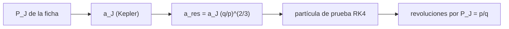

# B52-C14 — Cinturones de asteroides

<!-- nav:top -->
[🏠 Programa](../../../../README.md) · [📚 Bloque B52](../../../tronco-comun/B52-formacion-y-dinamica-de-sistemas-planetarios.md) · [← Anterior: B52-C13 — Pequeños cuerpos remanentes](../B52-C13-pequenos-cuerpos-remanentes/CLASE.md) · [Siguiente: B52-C15 — Cinturón de Kuiper →](../../../tronco-comun/B52-formacion-y-dinamica-de-sistemas-planetarios.md#b52-c15)
<!-- /nav -->

## 1. Ubicación, nivel y alcance

Clase 14 del bloque B52. Nivel N3. En el cinturón de asteroides las resonancias de movimiento medio con Júpiter marcan distancias especiales, donde se observan lagunas en la distribución de los semiejes. Calculas en qué semieje cae cada resonancia `p:q` con el periodo de Júpiter de una ficha de la NASA y lo verificas integrando numéricamente una partícula de prueba y contando sus revoluciones en un periodo de Júpiter. Retoma las resonancias de [B52-C07](../B52-C07-resonancias-orbitales/CLASE.md). Usas [B11](../../../tronco-comun/B11-ecuaciones-diferenciales-y-simulacion-numerica.md). No se compara con ningún catálogo de asteroides.

## 2. Por qué esta clase existe

Las posiciones de las resonancias fijan dónde mirar en un cinturón. La decisión central: **¿en qué semiejes están las resonancias de Júpiter y cómo se comprueba el cálculo?**

## 3. Lo que podrás hacer al terminar

1. Calcular el semieje de Júpiter con la tercera ley de Kepler y su periodo.
2. Obtener `a_res = a_J (q/p)^(2/3)` para varias `p:q`.
3. Integrar una partícula de prueba con RK4 y medir sus revoluciones.
4. Comparar con `p/q`.
5. Decidir qué resonancias caen en un intervalo ilustrativo del cinturón.
6. Reconocer que esto no demuestra las lagunas observadas.

La evidencia es la **ficha de las lagunas de Kirkwood** del ejercicio 12 (sección 20).

## 4. Con qué llegas y cómo comprobarlo

1. ¿Qué es una tabla de resultados?
2. ¿Qué es una verificación?
3. ¿Qué es una tolerancia numérica?
4. ¿Qué es la tercera ley de Kepler?
5. ¿Qué es un valor ilustrativo?

<details>
<summary>Ver respuestas</summary>

1. Un resumen ordenado de cálculos. 2. Comparar un cálculo con un caso independiente. 3. La diferencia máxima aceptada entre dos resultados. 4. El cuadrado del periodo crece con el cubo del semieje. 5. Un valor propuesto para el ejemplo, no medido.
</details>

Con cuatro o cinco aciertos, sigue; si no, repasa los prerrequisitos.

## 5. Un caso de contexto y casos de referencia

Con `P_J = 4331 d` (ficha), el semieje de Kepler es `5.1999 ua` y las resonancias 4:1, 3:1, 5:2, 7:3 y 2:1 caen en `2.064`, `2.500`, `2.823`, `2.956` y `3.276 ua`. Es el **ejemplo conductor**; son posiciones calculadas, no comparadas con un catálogo.

## 6. Vocabulario

Una **resonancia `p:q`** ocurre cuando el asteroide da `p` vueltas por cada `q` de Júpiter. Una **laguna de Kirkwood** es una zona con pocos asteroides cerca de una resonancia. Una **partícula de prueba** es un cuerpo sin masa que sigue el campo de otro. El **cinturón principal** es la región entre Marte y Júpiter.

## 7. Modelo mental

Como empujar un columpio siempre en el mismo punto del vaivén: las resonancias son los lugares donde los empujes de Júpiter se repiten y se acumulan. Límite: aquí solo se calculan las posiciones; los efectos de la resonancia no se simulan.



*Descripción textual:* el periodo de Júpiter da su semieje; cada resonancia fija un semieje que se verifica contando revoluciones de una partícula de prueba.

## 8. La explicación, paso a paso

### 8.1 Júpiter

La ficha da `P = 4331 d`. La tercera ley con `(GM)☉` da `a_J = 5.1999 ua`, `7.8e-04` por debajo de la «distancia al Sol» de la ficha (`5,2040 ua`).

### 8.2 Resonancias

`a_res = a_J (q/p)^(2/3)`, porque `P ∝ a^(3/2)`:

| p:q | a_res [ua] | revoluciones numéricas por P_J | p/q | en 2,0–3,3 ua |
|---|---|---|---|---|
| 4:1 | 2.0636 | 4.000000000 | 4.0000 | sí |
| 3:1 | 2.4998 | 3.000000000 | 3.0000 | sí |
| 5:2 | 2.8229 | 2.500000000 | 2.5000 | sí |
| 7:3 | 2.9558 | 2.333333333 | 2.3333 | sí |
| 2:1 | 3.2757 | 2.000000000 | 2.0000 | sí |
| 3:2 | 3.9682 | 1.500000000 | 1.5000 | no |
| 1:1 | 5.1999 | 1.000000000 | 1.0000 | no |

La integración RK4 reproduce `p/q` con error menor de `10⁻¹⁰`.

### 8.3 Lectura

Cinco resonancias caen dentro del intervalo ilustrativo de 2,0 a 3,3 ua (que no se consultó). Que haya lagunas en esas posiciones es un resultado observacional y dinámico que no se verifica aquí: haría falta un catálogo de asteroides y integraciones con Júpiter. El cálculo solo localiza las resonancias.

## 9. Magnitudes, símbolos y unidades

| Símbolo | Qué es | Unidad | Valor / nota |
|---|---|---|---|
| `P_J` | periodo de Júpiter | días | 4331 (ficha) |
| `a_J` | semieje de Kepler de Júpiter | ua | 5.1999 |
| `p:q` | resonancia | — | 4:1, 3:1, 5:2, 7:3, 2:1 |
| `a_res` | semieje resonante | ua | 2.500 (3:1) |

## 10. Convenciones y referencias

SI. Órbitas circulares coplanares. Tolerancia `10⁻⁶` en las revoluciones.

## 11. De dónde sale lo que afirmamos

| ID | Fuente | Localizador | Respalda | Estado |
|---|---|---|---|---|
| S2 | Mamajek et al., *IAU 2015 Resolution B3*, arXiv:1510.07674 | https://arxiv.org/abs/1510.07674 | `(GM)☉`, `(GM)⊕`, `(GM)_J` nominales | Texto del PDF extraído el 2026-11-09 |
| S3 | NASA/NSSDC, *Planetary Fact Sheet* (tabla métrica) | https://nssdc.gsfc.nasa.gov/planetary/factsheet/index.html | Periodo orbital y distancia al Sol de Júpiter | Consultada el 2026-11-09 |

Límites: la ficha no da incertidumbres; no se consultó ningún catálogo de asteroides ni las posiciones publicadas de las lagunas; el intervalo del cinturón es ilustrativo.

## 12. Cómo verlo

| Magnitud | Valor |
|---|---|
| a_J (Kepler) | 5.1999 ua |
| 3:1 | 2.4998 ua |
| 2:1 | 3.2757 ua |
| error de revoluciones | menor de 1e-10 |

Descripción larga: las resonancias se ordenan de adentro hacia afuera 4:1, 3:1, 5:2, 7:3, 2:1 y el cálculo numérico reproduce la razón de periodos con alta precisión.

## 13. Ejemplo trabajado

**Paso 1 · Cociente.** Para 3:1, `q/p = 1/3`.

**Paso 2 · Potencia.** `(1/3)^(2/3) = 0.48075`.

**Paso 3 · Semieje.** `a = 5.1999·0.48075 = 2.4998 ua`.

## 14. Distintas formas de describirlo

**Por fórmula:** `a_res`. **Por tabla:** 8.2. **Por simulación:** revoluciones.

## 15. Práctica guiada

**Ejercicio 1 · con los pasos indicados.** Calcula `a_res` de 2:1 si `a_J = 5,2`. *Pasos:* `5,2·(1/2)^(2/3)`.

<details><summary>Solución comentada</summary>

`3,28 ua`.
</details>

**Ejercicio 2 · con una pista.** ¿Qué resonancia queda más adentro, 3:1 o 5:2?

<details><summary>Solución comentada</summary>

La 3:1, porque `p/q` mayor significa periodo menor.
</details>

**Ejercicio 3 · casi autónomo.** ¿Qué `p/q` tiene 7:3?

<details><summary>Solución comentada</summary>

`2,333`.
</details>

## 16. Práctica autónoma, transferencia e integrador

**Ejercicio 4.** `a_res` de 4:1.

<details><summary>Solución comentada</summary>

`2.0636 ua`.
</details>

**Ejercicio 5.** `a_res` de 5:2.

<details><summary>Solución comentada</summary>

`2.8229 ua`.
</details>

**Ejercicio 6.** Revoluciones numéricas para 3:2.

<details><summary>Solución comentada</summary>

`1.500000`.
</details>

**Ejercicio 7.** ¿Qué resonancias caen entre 2,0 y 3,3 ua?

<details><summary>Solución comentada</summary>

4:1, 3:1, 5:2, 7:3 y 2:1.
</details>

**Ejercicio 8.** ¿Por qué la 1:1 es `a_J`?

<details><summary>Solución comentada</summary>

Porque el periodo es igual al de Júpiter.
</details>

**Ejercicio 9 · transferencia.** **Transferencia.** **Transferencia.** Un colega afirma que el cálculo explica las lagunas observadas. Responde.

<details><summary>Solución comentada</summary>

Solo localiza resonancias; las lagunas requieren catálogos e integraciones que aquí no se hicieron.
</details>

**Ejercicio 10 · transferencia.** **Transferencia.** **Transferencia.** ¿Qué cambia si Júpiter tuviera la mitad de periodo?

<details><summary>Solución comentada</summary>

Todas las `a_res` se reducen por `(1/2)^(2/3)`.
</details>

**Ejercicio 11 · transferencia.** **Transferencia.** **Transferencia.** ¿Qué agrega Júpiter a la integración que aquí falta?

<details><summary>Solución comentada</summary>

Su perturbación, que acumula efectos resonantes y modifica la excentricidad.
</details>

**Ejercicio 12 · integrador.** **Integrador.** **Integrador.** Elabora tu *ficha de las lagunas de Kirkwood*: tabla 8.2, verificación y límites.

<details><summary>Solución modelo</summary>

Secciones 8.1–8.3 y 12.
</details>

## 17. Laboratorio: posiciones de las resonancias con Júpiter

El script [kirkwood.py](kirkwood.py) calcula el semieje de Júpiter y de cada resonancia y cuenta con RK4 las revoluciones de una partícula de prueba en un periodo de Júpiter (**comprueba** `10⁻⁶`).

**Datos:** periodo y distancia de Júpiter de la ficha de la NASA/NSSDC y `(GM)☉` de la IAU 2015, consultados el 2026-11-09; el intervalo del cinturón es **ilustrativo**. **Predice antes de ejecutar:** ¿Cuántas vueltas da el asteroide en 3:1? (Tres por cada una de Júpiter.) **Ejecución del 2026-11-09 (Python 3.12.9):**

```text
Python 3.12.9 (biblioteca estandar)
Jupiter: distancia de la ficha = 5.2040 ua ; semieje de Kepler con P = 4331 d = 5.1999 ua ; dif. rel. = -7.83e-04
  p:q  a_res [ua]  revol. numericas en P_J      p/q  dif. rel.  en 2.0-3.3 ua
4:1        2.0636              4.000000000   4.0000    4.1e-11             si
3:1        2.4998              3.000000000   3.0000    1.2e-11             si
5:2        2.8229              2.500000000   2.5000    5.8e-12             si
7:3        2.9558              2.333333333   2.3333    4.0e-12             si
2:1        3.2757              2.000000000   2.0000    2.3e-12             si
3:2        3.9682              1.500000000   1.5000    7.2e-13             no
1:1        5.1999              1.000000000   1.0000    1.5e-13             no
Pruebas superadas.
```

```bash
python programa/clases/B52/B52-C14-cinturones-de-asteroides/kirkwood.py
```

**Límites:** solo posiciones; sin perturbación de Júpiter ni catálogo.

## 18. Errores frecuentes y cómo corregirlos

**Confundir `p:q` con `q:p`.** Se corrige con 8.2.

**Usar la distancia de la ficha en lugar del semieje de Kepler sin decirlo.** Se corrige con 8.1.

**Afirmar las lagunas sin catálogo.** Se corrige con 8.3.

**Olvidar que el intervalo es ilustrativo.** Se corrige con la sección 10.

## 19. Cómo sabrás que vas bien

Tras la sección 8: ¿qué resultado esperabas y cuál obtuviste? Si dudas, repasa el ejemplo de la sección 13. Tras el laboratorio: ¿qué comprueba? (ver la sección 17).

## 20. Qué entregas y cómo se evalúa

El producto es tu **ficha de las lagunas de Kirkwood** (ejercicio 12).

| Criterio | Inicial | En desarrollo | Logrado | Destacado |
|---|---|---|---|---|
| Conceptos | Los confunde | Parciales | Conceptos de la clase | Explica los límites |
| Cálculo | Sin unidades | Con errores | Tablas completas | Calcula casos nuevos |
| Numérico | Sin comprobar | Un caso | Contraste con el análisis | Interpreta las diferencias |
| Fuentes | Sin fuente | Sin fecha | Fuentes con fecha | Declara lo ilustrativo |
| Límites | No los nombra | Uno | Tres | Discute qué falta del modelo |

**Condiciones críticas (no se compensan con promedio):** rotular lo sintético e ilustrativo; no presentar un resultado simulado como observado; citar solo lo consultado.

## 21. Ética, seguridad y límites

Clase educativa: los modelos son simplificados y no sustituyen a la literatura primaria ni a los códigos de producción. Lo simulado no es lo observado. Accesibilidad: tablas equivalentes a las gráficas, fórmulas en texto, ejercicios sin conexión.

## 22. Para cerrar y seguir

Las resonancias 4:1, 3:1, 5:2, 7:3 y 2:1 están en `2.06`–`3.28 ua`. Queda una pregunta: ¿qué ocurre más allá de Neptuno?

**Glosario español–inglés.** laguna de Kirkwood · *Kirkwood gap*; cinturón principal · *main belt*; partícula de prueba · *test particle*; resonancia · *resonance*.

**Continuidad.** [B52-C15](../B52-C15-cinturon-de-kuiper/CLASE.md) estudia el cinturón de Kuiper.

**Referencias:** ver sección 11.

<!-- nav:bottom -->
---

[← Anterior: B52-C13 — Pequeños cuerpos remanentes](../B52-C13-pequenos-cuerpos-remanentes/CLASE.md) · [📚 Bloque B52](../../../tronco-comun/B52-formacion-y-dinamica-de-sistemas-planetarios.md) · [Siguiente: B52-C15 — Cinturón de Kuiper →](../../../tronco-comun/B52-formacion-y-dinamica-de-sistemas-planetarios.md#b52-c15)
<!-- /nav -->
