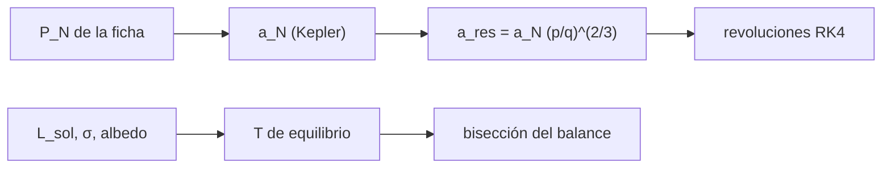

# B52-C15 — Cinturón de Kuiper

<!-- nav:top -->
[🏠 Programa](../../../../README.md) · [📚 Bloque B52](../../../tronco-comun/B52-formacion-y-dinamica-de-sistemas-planetarios.md) · [← Anterior: B52-C14 — Cinturones de asteroides](../B52-C14-cinturones-de-asteroides/CLASE.md) · [Siguiente: B52-C16 — Nube de Oort →](../B52-C16-nube-de-oort/CLASE.md)
<!-- /nav -->

## 1. Ubicación, nivel y alcance

Clase 15 del bloque B52. Nivel N3. Más allá de Neptuno queda un cinturón de cuerpos de hielo, y parte de ellos se encuentra en resonancias con el planeta. Calculas el semieje de las resonancias exteriores 3:2, 2:1, 5:3, 4:3 y 5:2 con el periodo de Neptuno de una ficha de la NASA, las verificas contando revoluciones con RK4 y estimas la temperatura de equilibrio a 40 ua con la luminosidad nominal de la IAU y la constante de Stefan–Boltzmann del NIST. Retoma [B52-C14](../B52-C14-cinturones-de-asteroides/CLASE.md). Usas [B13](../../../tronco-comun/B13-metrologia-tiempo-y-mediciones-cientificas.md). No se compara con ningún catálogo.

## 2. Por qué esta clase existe

Las resonancias con Neptuno protegen a cuerpos cuyos perihelios cruzan su órbita, y la temperatura fija qué hielos sobreviven. La decisión central: **¿en qué semiejes están las resonancias exteriores y qué temperatura tiene el cinturón?**

## 3. Lo que podrás hacer al terminar

1. Calcular el semieje de Neptuno con la tercera ley de Kepler.
2. Obtener `a_res = a_N (p/q)^(2/3)` para resonancias exteriores.
3. Verificar con RK4 las revoluciones del objeto por periodo de Neptuno.
4. Calcular el perihelio de un objeto hipotético en 3:2 con `e = 0,25`.
5. Calcular la temperatura de equilibrio por fórmula y por bisección del balance de energía.
6. Declarar lo que no se consultó: catálogos y la dinámica de captura.

La evidencia es la **ficha del cinturón de Kuiper** del ejercicio 12 (sección 20).

## 4. Con qué llegas y cómo comprobarlo

1. ¿Qué es una tabla de resultados?
2. ¿Qué es una verificación?
3. ¿Qué es una tolerancia numérica?
4. ¿Qué es la tercera ley de Kepler?
5. ¿Qué es un valor ilustrativo?

<details>
<summary>Ver respuestas</summary>

1. Un resumen ordenado de cálculos. 2. Comparar un cálculo con un caso independiente. 3. La diferencia máxima aceptada entre dos resultados. 4. El cuadrado del periodo crece con el cubo del semieje. 5. Un valor propuesto para el ejemplo, no medido.
</details>

Con cuatro o cinco aciertos, sigue; si no, repasa los prerrequisitos.

## 5. Un caso de contexto y casos de referencia

Con `P_N = 59 800 d` (ficha), la resonancia 3:2 está en `39.22 ua` y la 2:1 en `47.51 ua`. A 40 ua, con albedo `0,1`, la temperatura de equilibrio es `42.9 K`. Un objeto **hipotético** en 3:2 con `e = 0,25` tiene perihelio `29.41 ua`, menor que el semieje de Neptuno. Es el **ejemplo conductor**.

## 6. Vocabulario

Una **resonancia exterior `p:q`** liga el periodo del objeto `P = (p/q) P_N`. Un **plutino** es un objeto en 3:2 con Neptuno; esta clase no usa su catálogo. La **temperatura de equilibrio** `T = [L(1−A)/(16πσd²)]^(1/4)` es la de un cuerpo esférico de rotación rápida. El **albedo de Bond** `A` es la fracción de luz reflejada.

## 7. Modelo mental

Como un corredor que da dos vueltas mientras otro da tres: se cruzan siempre en la misma parte de la pista y por eso nunca chocan. Límite: solo posiciones calculadas; la captura y la protección dinámica no se simulan.



*Descripción textual:* el periodo de Neptuno da su semieje y el de cada resonancia, verificado con RK4; la luminosidad y el albedo dan la temperatura, verificada con el balance de energía.

## 8. La explicación, paso a paso

### 8.1 Neptuno

`a_N = 29.9274 ua` con Kepler; la ficha da `30,1809 ua` («distancia al Sol»), una diferencia de `8.4e-03`.

### 8.2 Resonancias

| p:q | a_res [ua] | revoluciones por P_N | q/p |
|---|---|---|---|
| 3:2 | 39.2159 | 0.666666667 | 0.6667 |
| 2:1 | 47.5067 | 0.500000000 | 0.5000 |
| 5:3 | 42.0695 | 0.600000000 | 0.6000 |
| 4:3 | 36.2544 | 0.750000000 | 0.7500 |
| 5:2 | 55.1267 | 0.400000000 | 0.4000 |

### 8.3 Perihelio

Un objeto hipotético en 3:2 con `e = 0,25` tiene perihelio `29.412 ua` y afelio `49.020 ua`: cruza la órbita de Neptuno, pero la resonancia lo mantiene lejos del planeta en cada encuentro (la protección dinámica no se simula aquí).

### 8.4 Temperatura

| d [ua] | albedo | T fórmula [K] | T bisección [K] |
|---|---|---|---|
| 1 | 0.1 | 271.0944 | 271.0944 |
| 1 | 0.3 | 254.5859 | 254.5859 |
| 30 | 0.1 | 49.4948 | 49.4948 |
| 30 | 0.3 | 46.4808 | 46.4808 |
| 40 | 0.1 | 42.8638 | 42.8638 |
| 40 | 0.3 | 40.2536 | 40.2536 |
| 48 | 0.1 | 39.1291 | 39.1291 |
| 48 | 0.3 | 36.7463 | 36.7463 |

La fórmula y la bisección del balance coinciden. A 1 ua con albedo `0,3` resulta `254.6 K`, un orden de magnitud estándar para comprobar el cálculo.

### 8.5 Lectura

Que existan objetos en esas resonancias, y su número, es un resultado observacional que no se consultó (S5 se conoce solo como registro). La relación con la migración de Neptuno aparece en el resumen de S4. La temperatura es la de equilibrio de un cuerpo ideal: las superficies reales difieren.

## 9. Magnitudes, símbolos y unidades

| Símbolo | Qué es | Unidad | Valor / nota |
|---|---|---|---|
| `P_N` | periodo de Neptuno | días | 59 800 (ficha) |
| `a_N` | semieje de Kepler | ua | 29.9274 |
| `L☉` | luminosidad nominal | W | 3,828·10²⁶ (IAU) |
| `σ` | Stefan–Boltzmann | W m⁻² K⁻⁴ | 5,670374419·10⁻⁸ (NIST) |
| `A` | albedo de Bond | — | 0,1 y 0,3 (ilustrativo) |

## 10. Convenciones y referencias

SI. Órbitas circulares coplanares para las resonancias; cuerpo esférico de rotación rápida para la temperatura. Tolerancias: `10⁻⁶` en revoluciones y `10⁻⁹` en temperatura.

## 11. De dónde sale lo que afirmamos

| ID | Fuente | Localizador | Respalda | Estado |
|---|---|---|---|---|
| S1 | NIST, *Fundamental Physical Constants — Complete Listing* (CODATA 2022) | https://physics.nist.gov/cuu/Constants/Table/allascii.txt | `G`, `k_B`, `m_p` | Consultada el 2026-11-09 |
| S2 | Mamajek et al., *IAU 2015 Resolution B3*, arXiv:1510.07674 | https://arxiv.org/abs/1510.07674 | `(GM)☉`, `(GM)⊕`, `(GM)_J` nominales | Texto del PDF extraído el 2026-11-09 |
| S3 | NASA/NSSDC, *Planetary Fact Sheet* (tabla métrica) | https://nssdc.gsfc.nasa.gov/planetary/factsheet/index.html | Periodo orbital y distancia al Sol de Neptuno | Consultada el 2026-11-09 |
| S4 | Nesvorný, *Dynamical Evolution of the Early Solar System*, arXiv:1807.06647 | https://arxiv.org/abs/1807.06647 | La estructura del cinturón de Kuiper respalda la migración de Neptuno | Solo resumen, consultado el 2026-11-09 |
| S5 | Gladman y Volk, *Transneptunian Space*, Annu. Rev. Astron. Astrophys. 59 (2021) 203, bibcode 2021ARA&A..59..203G | https://ui.adsabs.harvard.edu/abs/2021ARA%26A..59..203G/abstract | Revisión de la estructura del cinturón de Kuiper | Registro de ADS descrito por un buscador el 2026-11-09; no se leyó el texto |

Límites: de S4 solo se leyó el resumen y de S5 no se leyó el texto; la ficha no da incertidumbres; no se consultó ningún catálogo transneptuniano; el albedo y la excentricidad son ilustrativos.

## 12. Cómo verlo

| Magnitud | Valor |
|---|---|
| 3:2 | 39.22 ua |
| 2:1 | 47.51 ua |
| T a 40 ua, A = 0,1 | 42.9 K |
| perihelio hipotético | 29.41 ua |

Descripción larga: las resonancias exteriores se ubican entre 36 y 55 ua y a 40 ua la temperatura de equilibrio ronda los 40 K.

## 13. Ejemplo trabajado

**Paso 1 · Cociente.** Para 3:2, `p/q = 1,5`.

**Paso 2 · Potencia.** `1,5^(2/3) = 1.31037`.

**Paso 3 · Semieje.** `a = 29.9274·1.31037 = 39.216 ua`.

## 14. Distintas formas de describirlo

**Por fórmula:** `a_res`, `T`. **Por tabla:** 8.2 y 8.4. **Por simulación:** revoluciones; bisección del balance.

## 15. Práctica guiada

**Ejercicio 1 · con los pasos indicados.** Calcula `a_res` de 2:1 con `a_N = 30`. *Pasos:* `30·2^(2/3)`.

<details><summary>Solución comentada</summary>

`47,6 ua`.
</details>

**Ejercicio 2 · con una pista.** Si `d` se duplica, ¿cómo cambia `T`? *Pista:* `T ∝ d^(−1/2)`.

<details><summary>Solución comentada</summary>

Baja por `√2`.
</details>

**Ejercicio 3 · casi autónomo.** ¿Cuántas vueltas da un objeto en 3:2 por cada periodo de Neptuno?

<details><summary>Solución comentada</summary>

`2/3`.
</details>

## 16. Práctica autónoma, transferencia e integrador

**Ejercicio 4.** `a_res` de 3:2.

<details><summary>Solución comentada</summary>

`39.216 ua`.
</details>

**Ejercicio 5.** `T` a 30 ua con albedo 0,3.

<details><summary>Solución comentada</summary>

`46.48 K`.
</details>

**Ejercicio 6.** Perihelio hipotético.

<details><summary>Solución comentada</summary>

`29.412 ua`.
</details>

**Ejercicio 7.** ¿Cruza la órbita de Neptuno?

<details><summary>Solución comentada</summary>

Sí, porque su perihelio es menor que `a_N`.
</details>

**Ejercicio 8.** Revoluciones numéricas para 5:2.

<details><summary>Solución comentada</summary>

`0.400000`.
</details>

**Ejercicio 9 · transferencia.** **Transferencia.** **Transferencia.** Un colega usa el cálculo para afirmar cuántos plutinos hay. Responde.

<details><summary>Solución comentada</summary>

No: aquí solo se calculan posiciones; el número requiere un catálogo y su completitud.
</details>

**Ejercicio 10 · transferencia.** **Transferencia.** **Transferencia.** ¿Qué cambia si el albedo sube a 0,6?

<details><summary>Solución comentada</summary>

`T` baja por `((1−0,6)/(1−0,1))^(1/4) = 0,82`.
</details>

**Ejercicio 11 · transferencia.** **Transferencia.** **Transferencia.** ¿Qué dinámica falta?

<details><summary>Solución comentada</summary>

La captura en resonancia durante la migración de Neptuno y la libración del ángulo resonante.
</details>

**Ejercicio 12 · integrador.** **Integrador.** **Integrador.** Elabora tu *ficha del cinturón de Kuiper*: tablas 8.2 y 8.4, perihelio y límites.

<details><summary>Solución modelo</summary>

Secciones 8.1–8.5 y 12.
</details>

## 17. Laboratorio: resonancias exteriores y temperatura

El script [kuiper.py](kuiper.py) calcula los semiejes de las resonancias con Neptuno, cuenta con RK4 las revoluciones y compara la temperatura de equilibrio por fórmula y por bisección (**comprueba** `10⁻⁶` y `10⁻⁹`).

**Datos:** periodo y distancia de Neptuno de la ficha de la NASA/NSSDC, `(GM)☉` y `L☉` de la IAU 2015 y `σ` de NIST, consultados el 2026-11-09; albedos y excentricidad **ilustrativos**. **Predice antes de ejecutar:** ¿Cruza la órbita de Neptuno un objeto de 3:2 con `e = 0,25`? (Sí.) **Ejecución del 2026-11-09 (Python 3.12.9):**

```text
Python 3.12.9 (biblioteca estandar)
Neptuno: distancia de la ficha = 30.1809 ua ; semieje de Kepler con P = 59 800 d = 29.9274 ua ; dif. rel. = -8.40e-03
  p:q  a_res [ua] revol. del objeto por P_N      q/p  dif. rel.
3:2       39.2159              0.666666667   0.6667    3.6e-14
2:1       47.5067              0.500000000   0.5000    1.1e-14
5:3       42.0695              0.600000000   0.6000    2.8e-14
4:3       36.2544              0.750000000   0.7500    3.7e-14
5:2       55.1267              0.400000000   0.4000    1.3e-15
Objeto hipotetico (ilustrativo) en 3:2 con e = 0.25: perihelio = 29.412 ua (< a_N = 29.927 ua: cruza la orbita de Neptuno), afelio = 49.020 ua
 d [ua]  albedo  T formula [K]  T biseccion [K]
    1.0     0.1       271.0944         271.0944
    1.0     0.3       254.5859         254.5859
   30.0     0.1        49.4948          49.4948
   30.0     0.3        46.4808          46.4808
   40.0     0.1        42.8638          42.8638
   40.0     0.3        40.2536          40.2536
   48.0     0.1        39.1291          39.1291
   48.0     0.3        36.7463          36.7463
Pruebas superadas.
```

```bash
python programa/clases/B52/B52-C15-cinturon-de-kuiper/kuiper.py
```

**Límites:** solo posiciones y equilibrio ideal; sin dinámica de captura ni catálogo.

## 18. Errores frecuentes y cómo corregirlos

**Invertir `p/q` en las resonancias exteriores.** Se corrige con 8.2.

**Tomar `T` de equilibrio como temperatura superficial medida.** Se corrige con 8.5.

**Afirmar poblaciones sin catálogo.** Se corrige con 8.5.

**Olvidar que el perihelio hipotético es ilustrativo.** Se corrige con la sección 10.

## 19. Cómo sabrás que vas bien

Tras la sección 8: ¿qué resultado esperabas y cuál obtuviste? Si dudas, repasa el ejemplo de la sección 13. Tras el laboratorio: ¿qué comprueba? (ver la sección 17).

## 20. Qué entregas y cómo se evalúa

El producto es tu **ficha del cinturón de Kuiper** (ejercicio 12).

| Criterio | Inicial | En desarrollo | Logrado | Destacado |
|---|---|---|---|---|
| Conceptos | Los confunde | Parciales | Conceptos de la clase | Explica los límites |
| Cálculo | Sin unidades | Con errores | Tablas completas | Calcula casos nuevos |
| Numérico | Sin comprobar | Un caso | Contraste con el análisis | Interpreta las diferencias |
| Fuentes | Sin fuente | Sin fecha | Fuentes con fecha | Declara lo ilustrativo |
| Límites | No los nombra | Uno | Tres | Discute qué falta del modelo |

**Condiciones críticas (no se compensan con promedio):** rotular lo sintético e ilustrativo; no presentar un resultado simulado como observado; citar solo lo consultado.

## 21. Ética, seguridad y límites

Clase educativa: los modelos son simplificados y no sustituyen a la literatura primaria ni a los códigos de producción. Lo simulado no es lo observado. Accesibilidad: tablas equivalentes a las gráficas, fórmulas en texto, ejercicios sin conexión.

## 22. Para cerrar y seguir

Las resonancias exteriores caen entre `36` y `55 ua` y la temperatura de equilibrio a 40 ua es de unos `43 K`. Queda una pregunta: ¿qué hay mucho más lejos?

**Glosario español–inglés.** cinturón de Kuiper · *Kuiper belt*; plutino · *plutino*; temperatura de equilibrio · *equilibrium temperature*; albedo de Bond · *Bond albedo*.

**Continuidad.** [B52-C16](../B52-C16-nube-de-oort/CLASE.md) estudia la nube de Oort.

**Referencias:** ver sección 11.

<!-- nav:bottom -->
---

[← Anterior: B52-C14 — Cinturones de asteroides](../B52-C14-cinturones-de-asteroides/CLASE.md) · [📚 Bloque B52](../../../tronco-comun/B52-formacion-y-dinamica-de-sistemas-planetarios.md) · [Siguiente: B52-C16 — Nube de Oort →](../B52-C16-nube-de-oort/CLASE.md)
<!-- /nav -->
