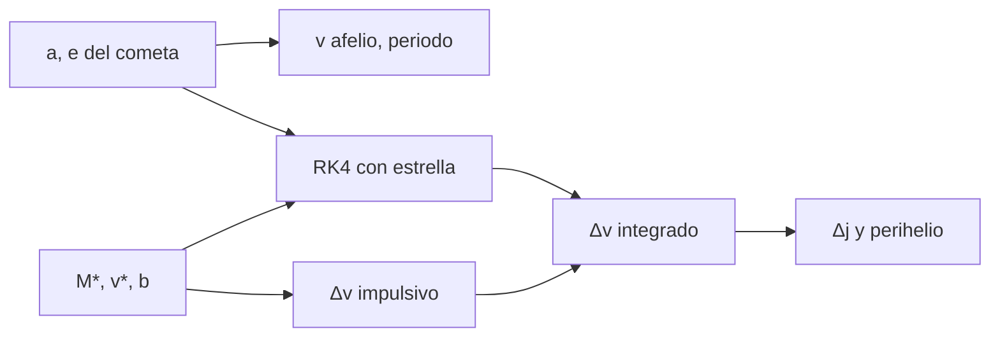

# B52-C16 — Nube de Oort

<!-- nav:top -->
[🏠 Programa](../../../../README.md) · [📚 Bloque B52](../../../tronco-comun/B52-formacion-y-dinamica-de-sistemas-planetarios.md) · [← Anterior: B52-C15 — Cinturón de Kuiper](../B52-C15-cinturon-de-kuiper/CLASE.md) · [Siguiente: B52-C17 — Colisiones y evolución térmica →](../B52-C17-colisiones-y-evolucion-termica/CLASE.md)
<!-- /nav -->

## 1. Ubicación, nivel y alcance

Clase 16 del bloque B52. Nivel N3. Los cuerpos de la nube de Oort están tan poco ligados al Sol que una estrella que pasa a decenas de miles de unidades astronómicas puede cambiar su órbita. Calculas la ligadura y el periodo de un cometa **ilustrativo**, estimas el impulso que le da una estrella con la **aproximación impulsiva** y lo contrastas integrando el cometa y la estrella con RK4, incluyendo el término indirecto del movimiento del Sol. Retoma [B52-C15](../B52-C15-cinturon-de-kuiper/CLASE.md). Usas [B11](../../../tronco-comun/B11-ecuaciones-diferenciales-y-simulacion-numerica.md). El encuentro es **sintético**.

## 2. Por qué esta clase existe

Las perturbaciones estelares explican cómo cometas casi circulares en la nube pasan a órbitas que cruzan el Sistema Solar interior. La decisión central: **¿cuánto cambia la velocidad de un cometa de la nube con el paso de una estrella y qué efecto tiene en su perihelio?**

## 3. Lo que podrás hacer al terminar

1. Calcular el periodo y la energía específica de un cometa de `2·10⁴ ua`.
2. Calcular la velocidad en el afelio para `e = 0,999`.
3. Calcular el impulso diferencial `2GM*/v (1/b_c − 1/b_☉)`.
4. Integrarlo con RK4 incluyendo el término indirecto y comparar.
5. Relacionar el impulso con el cambio del momento angular y del perihelio.
6. Distinguir un encuentro sintético de uno real.

La evidencia es la **ficha de las perturbaciones de la nube de Oort** del ejercicio 12 (sección 20).

## 4. Con qué llegas y cómo comprobarlo

1. ¿Qué es una tabla de resultados?
2. ¿Qué es una verificación?
3. ¿Qué es una tolerancia numérica?
4. ¿Qué es la tercera ley de Kepler?
5. ¿Qué es un valor ilustrativo?

<details>
<summary>Ver respuestas</summary>

1. Un resumen ordenado de cálculos. 2. Comparar un cálculo con un caso independiente. 3. La diferencia máxima aceptada entre dos resultados. 4. El cuadrado del periodo crece con el cubo del semieje. 5. Un valor propuesto para el ejemplo, no medido.
</details>

Con cuatro o cinco aciertos, sigue; si no, repasa los prerrequisitos.

## 5. Un caso de contexto y casos de referencia

Un cometa **hipotético** de `2·10⁴ ua` y `e = 0,999` tiene periodo `2.83e+06` años y velocidad de afelio `4.7 m/s`. Una estrella de `0,5 M☉` a `30 km/s` y `3·10⁴ ua` le da un impulso de `0.563 m/s`, `12 %` de su velocidad. Es el **ejemplo conductor**; no es un encuentro estelar real.

## 6. Vocabulario

La **nube de Oort** es el reservorio hipotético de cometas a decenas de miles de ua. La **aproximación impulsiva** reemplaza el encuentro por un cambio instantáneo de velocidad. El **término indirecto** es la aceleración del Sol por la estrella, que debe restarse en el marco heliocéntrico. El **perihelio** es la mínima distancia al Sol.

## 7. Modelo mental

Como un empujón a un niño en un columpio casi detenido en lo más alto: un empujón pequeño cambia mucho su trayectoria porque su velocidad es mínima. Límite: estrella en línea recta, cometa de prueba, sin marea galáctica.



*Descripción textual:* el cometa fija su velocidad de afelio y la estrella el impulso; la integración con RK4 verifica la aproximación y el impulso se traduce en cambio de momento angular y de perihelio.

## 8. La explicación, paso a paso

### 8.1 El cometa

`a = 2·10⁴ ua`, `e = 0,999`: periodo `2.828e+06 años`, energía `-2.22e+04 J/kg`, perihelio `20.00 ua`, velocidad de afelio `4.71 m/s` (la circular a esa distancia es `210.6 m/s`).

### 8.2 Impulso

Para una estrella de masa `M*` que pasa a distancia `b_c` del cometa y `b_☉` del Sol con velocidad `v`, `Δv = (2GM*/v)(1/b_c − 1/b_☉)` hacia la estrella. Con `b_c = 3·10⁴ ua` y `b_☉ = 5·10⁴ ua`, `Δv = 0.5631 m/s`.

### 8.3 Integración

Con RK4 (`h = 2·10⁹ s`, ventana `±12 b/v`) el impulso integrado es `(0.5673, -0.0018, -0.0001) m/s`; la componente en la dirección de la estrella difiere del valor impulsivo en `7.4e-03`. El control sin estrella conserva el momento angular a `3e-15`.

### 8.4 Efecto en el perihelio

Aquí el impulso es radial y `Δj/j = -0.001`. Si fuese tangencial, `Δj/j = Δv/v_afelio = 0.120` y el perihelio (`q ≈ j²/2GM`) cambiaría un `+25 %` o `−22 %`. La dirección del impulso importa tanto como su módulo.

### 8.5 Lectura

Con velocidades de afelio de pocos m/s, impulsos de décimas de m/s bastan para cambiar `j` en decenas por ciento. El cálculo no estima tasas de encuentros reales ni la marea galáctica, que no se trataron.

## 9. Magnitudes, símbolos y unidades

| Símbolo | Qué es | Unidad | Valor / nota |
|---|---|---|---|
| `a` | semieje del cometa | ua | 2·10⁴ (ilustrativo) |
| `e` | excentricidad | — | 0,999 (ilustrativo) |
| `v_afelio` | velocidad en el afelio | m/s | 4.71 |
| `M*`, `v`, `b` | estrella del encuentro | — | 0,5 M☉, 30 km/s, 3·10⁴ ua (ilustrativo) |
| `Δv` | impulso | m/s | 0.563 |

## 10. Convenciones y referencias

SI, marco heliocéntrico con término indirecto. Estrella en línea recta. Tolerancia `5 %` entre el impulso integrado y el impulsivo.

## 11. De dónde sale lo que afirmamos

| ID | Fuente | Localizador | Respalda | Estado |
|---|---|---|---|---|
| S2 | Mamajek et al., *IAU 2015 Resolution B3*, arXiv:1510.07674 | https://arxiv.org/abs/1510.07674 | `(GM)☉`, `(GM)⊕`, `(GM)_J` nominales | Texto del PDF extraído el 2026-11-09 |
| S3 | Vokrouhlický, Nesvorný y Dones, *Origin and evolution of long-period comets*, AJ 157 (2019) 181, arXiv:1904.00728 | https://arxiv.org/abs/1904.00728 | Los cometas de largo periodo observados tienen semiejes de unos 10⁴ ua o más y proceden de la nube externa | Descripción obtenida con un buscador el 2026-11-09; no se leyó el texto |
| S4 | Nesvorný, *Dynamical Evolution of the Early Solar System*, arXiv:1807.06647 | https://arxiv.org/abs/1807.06647 | Una instabilidad temprana de los planetas gigantes dispersó planetesimales | Solo resumen, consultado el 2026-11-09 |

Límites: de S3 no se leyó el texto y de S4 solo el resumen; no se consultó ningún catálogo de estrellas ni cometas; el cometa y el encuentro son ilustrativos; la marea galáctica no se trata.

## 12. Cómo verlo

| Magnitud | Valor |
|---|---|
| periodo | 2.83e+06 años |
| v afelio | 4.71 m/s |
| Δv impulsivo | 0.563 m/s |
| Δv integrado (x) | 0.567 m/s |
| Δj/j tangencial | 0.12 |

Descripción larga: el impulso estimado coincide con el integrado a menos del 1 % y equivale a más de un décimo de la velocidad del cometa en el afelio.

## 13. Ejemplo trabajado

**Paso 1 · Velocidad del afelio.** `v = √(GM(1−e)/(a(1+e))) = 4.71 m/s`.

**Paso 2 · Impulso.** `Δv = 0.5631 m/s`.

**Paso 3 · Relación.** `Δv/v_afelio = 0.120`.

## 14. Distintas formas de describirlo

**Por fórmula:** `Δv`. **Por simulación:** RK4. **Por razón:** `Δv/v_afelio`.

## 15. Práctica guiada

**Ejercicio 1 · con los pasos indicados.** Si `v*` se duplica, ¿cómo cambia `Δv`? *Pista:* `Δv ∝ 1/v`.

<details><summary>Solución comentada</summary>

Baja a la mitad.
</details>

**Ejercicio 2 · con una pista.** ¿Y si `M*` se duplica?

<details><summary>Solución comentada</summary>

Se duplica.
</details>

**Ejercicio 3 · casi autónomo.** ¿Por qué se resta el término del Sol?

<details><summary>Solución comentada</summary>

Porque se trabaja en el marco heliocéntrico y la estrella también acelera al Sol.
</details>

## 16. Práctica autónoma, transferencia e integrador

**Ejercicio 4.** Periodo del cometa.

<details><summary>Solución comentada</summary>

`2.828e+06 años`.
</details>

**Ejercicio 5.** Velocidad de afelio.

<details><summary>Solución comentada</summary>

`4.71 m/s`.
</details>

**Ejercicio 6.** `Δv` impulsivo.

<details><summary>Solución comentada</summary>

`0.5631 m/s`.
</details>

**Ejercicio 7.** Diferencia entre integrado e impulsivo.

<details><summary>Solución comentada</summary>

`7.4e-03`.
</details>

**Ejercicio 8.** Cambio relativo de `j` si fuera tangencial.

<details><summary>Solución comentada</summary>

`0.120`.
</details>

**Ejercicio 9 · transferencia.** **Transferencia.** **Transferencia.** Un colega usa este encuentro para decir que una estrella pasará cerca. Responde.

<details><summary>Solución comentada</summary>

No: es un encuentro sintético; no se consultó ninguna predicción de estrellas cercanas.
</details>

**Ejercicio 10 · transferencia.** **Transferencia.** **Transferencia.** ¿Qué pasa con un cometa de `a = 5000 ua`?

<details><summary>Solución comentada</summary>

Su velocidad de afelio es mayor y el mismo impulso cambia `j` menos.
</details>

**Ejercicio 11 · transferencia.** **Transferencia.** **Transferencia.** ¿Qué efecto no incluye el modelo?

<details><summary>Solución comentada</summary>

La marea galáctica y el movimiento de la nube.
</details>

**Ejercicio 12 · integrador.** **Integrador.** **Integrador.** Elabora tu *ficha de las perturbaciones de la nube de Oort*: cometa, impulso, integración y límites.

<details><summary>Solución modelo</summary>

Secciones 8.1–8.5 y 12.
</details>

## 17. Laboratorio: encuentro estelar con un cometa

El script [oort.py](oort.py) calcula el periodo y la velocidad de afelio, el impulso impulsivo y lo contrasta con una integración RK4 con término indirecto (**comprueba** `5 %`).

**Datos:** `(GM)☉` de la IAU 2015, consultado el 2026-11-09; el cometa y la estrella son **ilustrativos**. **Predice antes de ejecutar:** ¿Coinciden el impulso integrado y el impulsivo? (Sí, a menos de 1 %.) **Ejecución del 2026-11-09 (Python 3.12.9):**

```text
Python 3.12.9 (biblioteca estandar)
Cometa ilustrativo: a = 20000 ua, e = 0.999 ; periodo = 2.828e+06 anios ; energia especifica = -2.218e+04 J/kg
Perihelio = 20.00 ua ; velocidad en el afelio = 4.71 m/s ; velocidad circular a = 210.6 m/s
Encuentro ilustrativo: 0.5 M_sol, 30 km/s, b = 3e+04 ua
Delta v impulsivo (hacia la estrella) = 0.5631 m/s ; Delta v integrado = (0.5673, -0.0018, -0.0001) m/s
Cambio relativo de j sin estrella (control) = 2.7e-15 ; con estrella = -0.001
Perihelio aproximado antes = 19.99 ua ; despues = 19.97 ua (q ~ j^2/(2GM))
Si el mismo impulso fuese tangencial: Delta j / j = 0.120 y el perihelio (q ~ j^2) cambiaria +25 % (o -22 %)
Diferencia relativa entre el impulso integrado (componente x) y el impulsivo = 7.41e-03
Pruebas superadas.
```

```bash
python programa/clases/B52/B52-C16-nube-de-oort/oort.py
```

**Límites:** estrella en línea recta, sin marea galáctica, cometa de prueba.

## 18. Errores frecuentes y cómo corregirlos

**Olvidar el término indirecto.** Se corrige con 8.2.

**Creer que todo impulso cambia el perihelio.** Se corrige con 8.4.

**Usar un paso demasiado grande cerca del perihelio.** La ventana del laboratorio se limita al afelio.

**Presentar el encuentro como real.** Se corrige con la sección 10.

## 19. Cómo sabrás que vas bien

Tras la sección 8: ¿qué resultado esperabas y cuál obtuviste? Si dudas, repasa el ejemplo de la sección 13. Tras el laboratorio: ¿qué comprueba? (ver la sección 17).

## 20. Qué entregas y cómo se evalúa

El producto es tu **ficha de las perturbaciones de la nube de Oort** (ejercicio 12).

| Criterio | Inicial | En desarrollo | Logrado | Destacado |
|---|---|---|---|---|
| Conceptos | Los confunde | Parciales | Conceptos de la clase | Explica los límites |
| Cálculo | Sin unidades | Con errores | Tablas completas | Calcula casos nuevos |
| Numérico | Sin comprobar | Un caso | Contraste con el análisis | Interpreta las diferencias |
| Fuentes | Sin fuente | Sin fecha | Fuentes con fecha | Declara lo ilustrativo |
| Límites | No los nombra | Uno | Tres | Discute qué falta del modelo |

**Condiciones críticas (no se compensan con promedio):** rotular lo sintético e ilustrativo; no presentar un resultado simulado como observado; citar solo lo consultado.

## 21. Ética, seguridad y límites

Clase educativa: los modelos son simplificados y no sustituyen a la literatura primaria ni a los códigos de producción. Lo simulado no es lo observado. Accesibilidad: tablas equivalentes a las gráficas, fórmulas en texto, ejercicios sin conexión.

## 22. Para cerrar y seguir

Una estrella sintética da `0.56 m/s` a un cometa que va a `4.7 m/s`: suficiente para cambiar su órbita. Queda una pregunta: ¿cómo se calientan y enfrían los cuerpos tras las colisiones?

**Glosario español–inglés.** nube de Oort · *Oort cloud*; aproximación impulsiva · *impulse approximation*; afelio · *aphelion*; perihelio · *perihelion*.

**Continuidad.** [B52-C17](../B52-C17-colisiones-y-evolucion-termica/CLASE.md) estudia las colisiones y la evolución térmica.

**Referencias:** ver sección 11.

<!-- nav:bottom -->
---

[← Anterior: B52-C15 — Cinturón de Kuiper](../B52-C15-cinturon-de-kuiper/CLASE.md) · [📚 Bloque B52](../../../tronco-comun/B52-formacion-y-dinamica-de-sistemas-planetarios.md) · [Siguiente: B52-C17 — Colisiones y evolución térmica →](../B52-C17-colisiones-y-evolucion-termica/CLASE.md)
<!-- /nav -->
