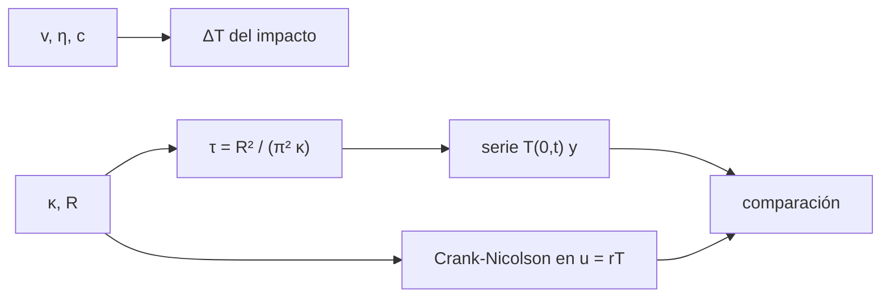

# B52-C17 — Colisiones y evolución térmica

<!-- nav:top -->
[🏠 Programa](../../../../README.md) · [📚 Bloque B52](../../../tronco-comun/B52-formacion-y-dinamica-de-sistemas-planetarios.md) · [← Anterior: B52-C16 — Nube de Oort](../B52-C16-nube-de-oort/CLASE.md) · [Siguiente: B52-C18 — Diferenciación planetaria →](../B52-C18-diferenciacion-planetaria/CLASE.md)
<!-- /nav -->

## 1. Ubicación, nivel y alcance

Clase 17 del bloque B52. Nivel N3. Las colisiones calientan los cuerpos y la conducción los enfría. Estimas cuánto sube la temperatura por la energía cinética de un impacto (con una fracción termalizada **ilustrativa**) y resuelves el enfriamiento de una esfera con borde frío por dos vías: una serie analítica y una integración de diferencias finitas con Crank–Nicolson en la variable `u = rT`. Usas [B21](../../../tronco-comun/B21-metodos-numericos-para-edp-y-fluidos-computacionales.md). El cuerpo y los parámetros son **ilustrativos**.

## 2. Por qué esta clase existe

El calor determina si un cuerpo funde, se diferencia o se enfría rápido. La decisión central: **¿cuánto tarda un cuerpo en perder su calor y cuánto lo calienta un impacto?**

## 3. Lo que podrás hacer al terminar

1. Estimar `ΔT = η v²/(2c)` por un impacto.
2. Definir la escala de enfriamiento `τ = R²/(π²κ)`.
3. Escribir la serie de la temperatura central y media de una esfera.
4. Integrar la ecuación del calor con Crank–Nicolson y `u = rT`.
5. Comparar ambas vías con tolerancia de `10⁻³`.
6. Declarar los parámetros como ilustrativos.

La evidencia es la **ficha del enfriamiento de un cuerpo** del ejercicio 12 (sección 20).

## 4. Con qué llegas y cómo comprobarlo

1. ¿Qué es una tabla de resultados?
2. ¿Qué es una verificación?
3. ¿Qué es una tolerancia numérica?
4. ¿Qué es la tercera ley de Kepler?
5. ¿Qué es un valor ilustrativo?

<details>
<summary>Ver respuestas</summary>

1. Un resumen ordenado de cálculos. 2. Comparar un cálculo con un caso independiente. 3. La diferencia máxima aceptada entre dos resultados. 4. El cuadrado del periodo crece con el cubo del semieje. 5. Un valor propuesto para el ejemplo, no medido.
</details>

Con cuatro o cinco aciertos, sigue; si no, repasa los prerrequisitos.

## 5. Un caso de contexto y casos de referencia

Un cuerpo ilustrativo de 50 km con `κ = 10⁻⁶ m²/s` tiene `τ = 8.0` Ma. Un impacto a 5 km/s con 10 % de termalización lo calienta `1250 K`. A `t = τ` el centro conserva el `70 %` de su exceso de temperatura y la media, el `23 %`. Es el **ejemplo conductor**; nada es un cuerpo real.

## 6. Vocabulario

La **difusividad térmica** `κ` mide qué tan rápido se difunde el calor. La **escala de enfriamiento** es `τ = R²/(π²κ)`. La **energía de impacto específica** es `v²/2`. La **fracción termalizada** `η` es la parte que se convierte en calor. **Crank–Nicolson** es un esquema implícito de segundo orden.

## 7. Modelo mental

Como una olla de sopa que se enfría desde la pared: el centro tarda en enterarse. Límite: conducción pura, simetría esférica, `κ` constante y sin fuentes internas.



*Descripción textual:* el impacto da el salto de temperatura; `κ` y `R` dan la escala de enfriamiento, que se evalúa con una serie y con diferencias finitas y se comparan.

## 8. La explicación, paso a paso

### 8.1 Impacto

`v²/2 = 1.250e+07 J/kg`; con `η = 0,1` y `c = 1000 J/(kg K)`, `ΔT = 1250 K`.

### 8.2 Enfriamiento

Para una esfera de radio `R` con borde a 0 y temperatura inicial uniforme `T₀`, `u = rT` cumple la ecuación del calor 1D. La temperatura central es `T(0,t)/T₀ = 2Σ(−1)^(n+1) exp(−n²π²κt/R²)` y la media `⟨T⟩/T₀ = 6Σ exp(−n²π²κt/R²)/(n²π²)`. La escala es `τ = 2.533e+14 s`.

### 8.3 Comparación

| t/τ | T(0) serie | T(0) CN | ⟨T⟩ serie | ⟨T⟩ CN |
|---|---|---|---|---|
| 0.1 | 1.000000 | 1.000000 | 0.689654 | 0.689643 |
| 0.5 | 0.963945 | 0.963937 | 0.390058 | 0.390055 |
| 1.0 | 0.699374 | 0.699366 | 0.226436 | 0.226435 |
| 2.0 | 0.270000 | 0.269998 | 0.082325 | 0.082325 |

Las dos vías coinciden a menos de `10⁻³`.

### 8.4 Lectura

El centro tarda unos `τ/2` en empezar a enfriarse apreciablemente, mientras que la media ya perdió más de la mitad. Las escalas reales dependen de `κ`, que varía con la temperatura y la porosidad; aquí es una constante ilustrativa.

## 9. Magnitudes, símbolos y unidades

| Símbolo | Qué es | Unidad | Valor / nota |
|---|---|---|---|
| `R` | radio | km | 50 (ilustrativo) |
| `κ` | difusividad térmica | m²/s | 10⁻⁶ (ilustrativo) |
| `τ` | escala de enfriamiento | Ma | 8.0 |
| `η` | fracción termalizada | — | 0,1 (ilustrativo) |
| `ΔT` | calentamiento por impacto | K | 1250 |

## 10. Convenciones y referencias

SI. Esfera con simetría radial y borde a temperatura cero. Tolerancia `10⁻³` entre serie y Crank–Nicolson.

## 11. De dónde sale lo que afirmamos

| ID | Fuente | Localizador | Respalda | Estado |
|---|---|---|---|---|
| — | Sin fuente externa | — | relaciones estándar que verifica el laboratorio | No se consultó una fuente para esta clase |

Límites: no se consultó ninguna fuente; los valores de `κ`, `c`, `η` y la velocidad de impacto son sintéticos; el borde frío y la ausencia de fuentes internas son idealizaciones.

## 12. Cómo verlo

| Magnitud | Valor |
|---|---|
| ΔT por impacto | 1250 K |
| τ | 8.0 Ma |
| T(0)/T₀ en τ | 0.699 |
| ⟨T⟩/T₀ en τ | 0.226 |

Descripción larga: el centro conserva casi todo su calor durante medio `τ` mientras la media baja a un 39 % y a `2τ` solo queda el 27 % en el centro.

## 13. Ejemplo trabajado

**Paso 1 · Escala.** `τ = R²/(π²κ) = (5·10⁴)²/(9,87·10⁻⁶) = 2.533e+14 s`.

**Paso 2 · Impacto.** `ΔT = 0,1·1,25·10⁷/1000 = 1250 K`.

**Paso 3 · Centro a `t = τ`.** `T(0)/T₀ = 0.6994`.

## 14. Distintas formas de describirlo

**Por serie:** analítico. **Por tabla:** 8.3. **Por simulación:** Crank–Nicolson.

## 15. Práctica guiada

**Ejercicio 1 · con los pasos indicados.** Si `R` se duplica, ¿cómo cambia `τ`? *Pista:* `τ ∝ R²`.

<details><summary>Solución comentada</summary>

Se cuadruplica.
</details>

**Ejercicio 2 · con una pista.** Calcula `v²/2` para `v = 3 km/s`.

<details><summary>Solución comentada</summary>

`4,5·10⁶ J/kg`.
</details>

**Ejercicio 3 · casi autónomo.** ¿Por qué se usa `u = rT`?

<details><summary>Solución comentada</summary>

Porque convierte la ecuación del calor esférica en una unidimensional.
</details>

## 16. Práctica autónoma, transferencia e integrador

**Ejercicio 4.** `ΔT` del ejemplo.

<details><summary>Solución comentada</summary>

`1250 K`.
</details>

**Ejercicio 5.** `τ` en años.

<details><summary>Solución comentada</summary>

`8.027e+06`.
</details>

**Ejercicio 6.** `T(0)/T₀` en `0,5 τ`.

<details><summary>Solución comentada</summary>

`0.9639`.
</details>

**Ejercicio 7.** `⟨T⟩/T₀` en `2 τ`.

<details><summary>Solución comentada</summary>

`0.0823`.
</details>

**Ejercicio 8.** Diferencia entre serie y CN en la media a `τ`.

<details><summary>Solución comentada</summary>

`4.6e-06`.
</details>

**Ejercicio 9 · transferencia.** **Transferencia.** **Transferencia.** Un colega usa estos años para un asteroide real. Responde.

<details><summary>Solución comentada</summary>

No: `κ`, `R` y `η` son ilustrativos.
</details>

**Ejercicio 10 · transferencia.** **Transferencia.** **Transferencia.** ¿Qué cambia si `κ` se reduce diez veces?

<details><summary>Solución comentada</summary>

`τ` crece diez veces.
</details>

**Ejercicio 11 · transferencia.** **Transferencia.** **Transferencia.** ¿Qué hipótesis cae si el cuerpo es poroso?

<details><summary>Solución comentada</summary>

La de `κ` constante: la conducción efectiva es menor.
</details>

**Ejercicio 12 · integrador.** **Integrador.** **Integrador.** Elabora tu *ficha del enfriamiento de un cuerpo*: impacto, serie, Crank–Nicolson y límites.

<details><summary>Solución modelo</summary>

Secciones 8.1–8.4 y 12.
</details>

## 17. Laboratorio: enfriamiento de una esfera

El script [enfriamiento.py](enfriamiento.py) calcula el calentamiento por impacto y la temperatura central y media de una esfera que se enfría, por serie y por Crank–Nicolson (**comprueba** `10⁻³`).

**Datos:** sin constantes físicas consultadas; todos los parámetros son **ilustrativos**. **Predice antes de ejecutar:** ¿Se enfría antes la media que el centro? (Sí.) **Ejecución del 2026-11-09 (Python 3.12.9):**

```text
Python 3.12.9 (biblioteca estandar)
Cuerpo ilustrativo: R = 50 km, kappa = 1e-06 m^2/s ; escala tau = R^2/(pi^2 kappa) = 2.533e+14 s = 8.03 Ma
Impacto a 5 km/s, fraccion termalizada 0.1: energia cinetica especifica = 1.250e+07 J/kg ; Delta T = 1250 K
 t/tau  T(0)/T0 serie   T(0)/T0 CN  <T>/T0 serie   <T>/T0 CN
  0.10       1.000000     1.000000      0.689654    0.689643
  0.50       0.963945     0.963937      0.390058    0.390055
  1.00       0.699374     0.699366      0.226436    0.226435
  2.00       0.270000     0.269998      0.082325    0.082325
Pruebas superadas.
```

```bash
python programa/clases/B52/B52-C17-colisiones-y-evolucion-termica/enfriamiento.py
```

**Límites:** conducción pura, `κ` constante, borde frío y sin fuentes internas.

## 18. Errores frecuentes y cómo corregirlos

**Olvidar que el centro tarda más en enfriarse.** Se corrige con 8.3.

**Confundir `τ` con el tiempo total de enfriamiento.** Se corrige con 8.4.

**Tomar `η` como medido.** Se corrige con la sección 10.

**Usar el borde frío para un cuerpo con corteza aislante.** Se corrige con 8.4.

## 19. Cómo sabrás que vas bien

Tras la sección 8: ¿qué resultado esperabas y cuál obtuviste? Si dudas, repasa el ejemplo de la sección 13. Tras el laboratorio: ¿qué comprueba? (ver la sección 17).

## 20. Qué entregas y cómo se evalúa

El producto es tu **ficha del enfriamiento de un cuerpo** (ejercicio 12).

| Criterio | Inicial | En desarrollo | Logrado | Destacado |
|---|---|---|---|---|
| Conceptos | Los confunde | Parciales | Conceptos de la clase | Explica los límites |
| Cálculo | Sin unidades | Con errores | Tablas completas | Calcula casos nuevos |
| Numérico | Sin comprobar | Un caso | Contraste con el análisis | Interpreta las diferencias |
| Fuentes | Sin fuente | Sin fecha | Fuentes con fecha | Declara lo ilustrativo |
| Límites | No los nombra | Uno | Tres | Discute qué falta del modelo |

**Condiciones críticas (no se compensan con promedio):** rotular lo sintético e ilustrativo; no presentar un resultado simulado como observado; citar solo lo consultado.

## 21. Ética, seguridad y límites

Clase educativa: los modelos son simplificados y no sustituyen a la literatura primaria ni a los códigos de producción. Lo simulado no es lo observado. Accesibilidad: tablas equivalentes a las gráficas, fórmulas en texto, ejercicios sin conexión.

## 22. Para cerrar y seguir

Un impacto de 5 km/s calienta `1250 K` y el cuerpo ilustrativo se enfría con escala `8 Ma`. Queda una pregunta: ¿qué ocurre cuando una fuente interna lo calienta?

**Glosario español–inglés.** difusividad térmica · *thermal diffusivity*; conducción · *conduction*; calentamiento por impacto · *impact heating*; escala de enfriamiento · *cooling timescale*.

**Continuidad.** [B52-C18](../B52-C18-diferenciacion-planetaria/CLASE.md) estudia la diferenciación.

**Referencias:** ver sección 11.

<!-- nav:bottom -->
---

[← Anterior: B52-C16 — Nube de Oort](../B52-C16-nube-de-oort/CLASE.md) · [📚 Bloque B52](../../../tronco-comun/B52-formacion-y-dinamica-de-sistemas-planetarios.md) · [Siguiente: B52-C18 — Diferenciación planetaria →](../B52-C18-diferenciacion-planetaria/CLASE.md)
<!-- /nav -->
