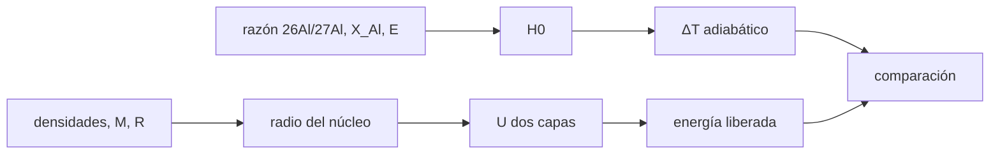

# B52-C18 — Diferenciación planetaria

<!-- nav:top -->
[🏠 Programa](../../../../README.md) · [📚 Bloque B52](../../../tronco-comun/B52-formacion-y-dinamica-de-sistemas-planetarios.md) · [← Anterior: B52-C17 — Colisiones y evolución térmica](../B52-C17-colisiones-y-evolucion-termica/CLASE.md) · [Siguiente: B52-C19 — Estabilidad a largo plazo de sistemas →](../../../tronco-comun/B52-formacion-y-dinamica-de-sistemas-planetarios.md#b52-c19)
<!-- /nav -->

## 1. Ubicación, nivel y alcance

Clase 18 del bloque B52. Nivel N3. Un cuerpo se diferencia cuando se funde lo bastante para que el material denso se hunda en un núcleo. Dos fuentes de energía lo permiten: la desintegración de radionúclidos de vida corta y la energía gravitatoria del hundimiento. Calculas ambas con parámetros **ilustrativos** y las verificas: el calor radiactivo (cota adiabática) con una solución analítica y RK4, y la energía gravitatoria de un cuerpo de dos capas con una fórmula cerrada y una integral de Simpson. Retoma [B52-C17](../B52-C17-colisiones-y-evolucion-termica/CLASE.md). Usas [B05](../../../tronco-comun/B05-fisica-fundamental-para-el-espacio.md).

## 2. Por qué esta clase existe

La energía disponible decide si un cuerpo funde y se diferencia o permanece primitivo. La decisión central: **¿cuánto calor aporta un radionúclido sin pérdidas y cuánta energía libera la diferenciación?**

## 3. Lo que podrás hacer al terminar

1. Calcular el calor específico `H₀` de un radionúclido con vida media corta.
2. Integrar `dT/dt = H₀e^(−λt)/c` y compararla con la solución analítica.
3. Calcular el radio de un núcleo de dos capas con masa y radio dados.
4. Calcular la energía gravitatoria de una esfera homogénea y de dos capas.
5. Verificar la de dos capas con integración de Simpson.
6. Reconocer los parámetros ilustrativos y el carácter de cota.

La evidencia es la **ficha del calor y la energía de diferenciación** del ejercicio 12 (sección 20).

## 4. Con qué llegas y cómo comprobarlo

1. ¿Qué es una tabla de resultados?
2. ¿Qué es una verificación?
3. ¿Qué es una tolerancia numérica?
4. ¿Qué es la tercera ley de Kepler?
5. ¿Qué es un valor ilustrativo?

<details>
<summary>Ver respuestas</summary>

1. Un resumen ordenado de cálculos. 2. Comparar un cálculo con un caso independiente. 3. La diferencia máxima aceptada entre dos resultados. 4. El cuadrado del periodo crece con el cubo del semieje. 5. Un valor propuesto para el ejemplo, no medido.
</details>

Con cuatro o cinco aciertos, sigue; si no, repasa los prerrequisitos.

## 5. Un caso de contexto y casos de referencia

Con un cuerpo del tamaño de la Tierra (masa de la IAU), un núcleo de `11 000 kg/m³` y un manto de `4500 kg/m³` resulta un radio de núcleo de `3412 km`; la diferenciación libera `1.82e+31 J`, equivalentes a `3053 K` si todo se convirtiera en calor del cuerpo entero. El calor radiactivo ilustrativo suma `5575 K` sin pérdidas. Es el **ejemplo conductor**; los dos números son cotas de modelo.

## 6. Vocabulario

La **diferenciación** es la separación de un cuerpo en capas de distinta densidad. Un **radionúclido de vida corta** (como el 26Al) aporta calor mientras decae. La **energía de ligadura gravitatoria** de una esfera uniforme es `3GM²/(5R)`. El **régimen adiabático** supone que el calor no escapa y da, por eso, una cota superior de la temperatura.

## 7. Modelo mental

Como una olla de agua y aceite: el aceite sube y el agua baja, y al reordenarse libera energía. Límite: sin pérdidas de calor, sin proceso de fusión explícito, densidades constantes por capa.



*Descripción textual:* el calor radiactivo da una cota de temperatura; las densidades y la masa fijan el radio del núcleo y la energía gravitatoria liberada; ambas se comparan.

## 8. La explicación, paso a paso

### 8.1 Calor radiactivo

Con razón inicial 26Al/27Al `= 5·10⁻⁵`, fracción de Al `0,01`, vida media `0,717 Ma` y `3,12 MeV` por decaimiento (todo ilustrativo y **no consultado**), el calor específico inicial es `H₀ = 1.708e-07 W/kg`. Sin pérdidas, `T(t) − T₀ = H₀/(λc)·(1 − e^(−λt))`. El máximo es `5575 K`; tras 10 vidas medias, `5569.264 K` (analítico) y `5569.264 K` (RK4, diferencia `5e-14`). En una vida media se libera el `50.0 %`.

### 8.2 Cuerpo de dos capas

Con `M = 5,9722·10²⁴ kg` y `R = 6378,1 km` (IAU, radio ecuatorial), `ρ̄ = 5495 kg/m³`; el radio del núcleo sale de `ρ_c r_c³ + ρ_m(R³ − r_c³) = ρ̄ R³`: `3411.9 km`.

### 8.3 Energía

`U_hom = −3GM²/(5R) = -2.2394e+32 J`. Para dos capas, `U = −(16π²G/15)ρ_c² r_c⁵ − (16π²G/3)ρ_m[ρ_m(R⁵−r_c⁵)/5 + (ρ_c−ρ_m) r_c³(R²−r_c²)/2] = -2.4217e+32 J`; la integral de Simpson de `−G m dm/r` da `-2.4217e+32 J` (diferencia `3e-15`). La diferenciación libera `1.8236e+31 J`.

### 8.4 Lectura

Dividida por `Mc`, esa energía equivale a `3053 K` si toda se convirtiera en calor y no escapara. Son cotas: parte se disipa, parte se pierde, y la diferenciación no es instantánea. Los valores de los radionúclidos no se consultaron.

## 9. Magnitudes, símbolos y unidades

| Símbolo | Qué es | Unidad | Valor / nota |
|---|---|---|---|
| `H₀` | calor inicial | W/kg | 1.71e-07 |
| `λ` | constante de decaimiento | s⁻¹ | ln 2 / 0,717 Ma (ilustrativo) |
| `r_c` | radio del núcleo | km | 3411.9 |
| `ΔU` | energía liberada | J | 1.824e+31 |
| `ρ_c`, `ρ_m` | densidades | kg/m³ | 11 000 y 4500 (ilustrativo) |

## 10. Convenciones y referencias

SI. Simetría esférica; masa y radio ecuatorial de la IAU 2015; `u` y `eV` de NIST. Tolerancias: `10⁻⁹` en la ODE y `10⁻⁶` en la energía.

## 11. De dónde sale lo que afirmamos

| ID | Fuente | Localizador | Respalda | Estado |
|---|---|---|---|---|
| S1 | NIST, *Fundamental Physical Constants — Complete Listing* (CODATA 2022) | https://physics.nist.gov/cuu/Constants/Table/allascii.txt | `G`, `k_B`, `m_p` | Consultada el 2026-11-09 |
| S2 | Mamajek et al., *IAU 2015 Resolution B3*, arXiv:1510.07674 | https://arxiv.org/abs/1510.07674 | `(GM)☉`, `(GM)⊕`, `(GM)_J` nominales | Texto del PDF extraído el 2026-11-09 |

Límites: la vida media del 26Al, la energía por decaimiento, la abundancia inicial y la fracción de aluminio no se consultaron; las densidades de las capas son ilustrativas; se usa el radio ecuatorial de la IAU como radio medio.

## 12. Cómo verlo

| Magnitud | Valor |
|---|---|
| ΔT adiabático máximo | 5575 K |
| calor en una vida media | 50.0 % |
| r_c | 3412 km |
| ΔU | 1.82e+31 J |
| ΔT gravitatorio | 3053 K |

Descripción larga: la mitad del calor radiactivo sale en una vida media y la diferenciación libera una energía comparable a un calentamiento de miles de kelvin del cuerpo entero, ambas cotas superiores.

## 13. Ejemplo trabajado

**Paso 1 · `λ`.** `λ = ln 2/(0,717 Ma) = 3.063e-14 s⁻¹`.

**Paso 2 · Máximo.** `H₀/(λc) = 5575 K`.

**Paso 3 · Núcleo.** `r_c = R((ρ̄−ρ_m)/(ρ_c−ρ_m))^(1/3) = 3411.9 km`.

**Paso 4 · Energía.** `ΔU = 1.824e+31 J`.

## 14. Distintas formas de describirlo

**Por fórmula:** cierre analítico. **Por simulación:** RK4 y Simpson. **Por razón:** fracción de calor por vida media.

## 15. Práctica guiada

**Ejercicio 1 · con los pasos indicados.** ¿Qué fracción del calor se libera en dos vidas medias? *Pasos:* `1 − 2^(−2)`.

<details><summary>Solución comentada</summary>

`0,75`.
</details>

**Ejercicio 2 · con una pista.** Si `c` se duplica, ¿cómo cambia el máximo `ΔT`? *Pista:* `ΔT ∝ 1/c`.

<details><summary>Solución comentada</summary>

Baja a la mitad.
</details>

**Ejercicio 3 · casi autónomo.** ¿Por qué el resultado es una cota?

<details><summary>Solución comentada</summary>

Porque no hay pérdida de calor.
</details>

## 16. Práctica autónoma, transferencia e integrador

**Ejercicio 4.** `H₀`.

<details><summary>Solución comentada</summary>

`1.708e-07 W/kg`.
</details>

**Ejercicio 5.** Máximo `ΔT`.

<details><summary>Solución comentada</summary>

`5575 K`.
</details>

**Ejercicio 6.** Radio del núcleo.

<details><summary>Solución comentada</summary>

`3411.9 km`.
</details>

**Ejercicio 7.** `U_hom`.

<details><summary>Solución comentada</summary>

`-2.2394e+32 J`.
</details>

**Ejercicio 8.** Energía liberada.

<details><summary>Solución comentada</summary>

`1.8236e+31 J`.
</details>

**Ejercicio 9 · transferencia.** **Transferencia.** **Transferencia.** Un colega dice que estos números explican la diferenciación de la Tierra. Responde.

<details><summary>Solución comentada</summary>

No: son cotas con parámetros ilustrativos; la Tierra real requiere pérdidas, fusión y datos que no se consultaron.
</details>

**Ejercicio 10 · transferencia.** **Transferencia.** **Transferencia.** ¿Qué pasa en un cuerpo pequeño?

<details><summary>Solución comentada</summary>

Pierde calor más rápido (clase C17) y el calentamiento adiabático no se alcanza.
</details>

**Ejercicio 11 · transferencia.** **Transferencia.** **Transferencia.** ¿Qué cambia si la abundancia de 26Al se reduce a la mitad?

<details><summary>Solución comentada</summary>

El máximo `ΔT` se reduce a la mitad.
</details>

**Ejercicio 12 · integrador.** **Integrador.** **Integrador.** Elabora tu *ficha del calor y la energía de diferenciación*: parte A, parte B y límites.

<details><summary>Solución modelo</summary>

Secciones 8.1–8.4 y 12.
</details>

## 17. Laboratorio: calor radiactivo y energía gravitatoria

El script [diferenciacion.py](diferenciacion.py) integra el calentamiento adiabático con RK4 y lo compara con la solución analítica, y calcula la energía gravitatoria de un cuerpo de dos capas con una fórmula cerrada y una integral de Simpson (**comprueba** `10⁻⁹` y `10⁻⁶`).

**Datos:** `G`, `u` y `eV` de NIST y `(GM)⊕` y radio ecuatorial de la IAU 2015, consultados el 2026-11-09; los parámetros radiactivos y las densidades son **ilustrativos**. **Predice antes de ejecutar:** ¿Libera energía la diferenciación? (Sí, `U` se hace más negativa.) **Ejecución del 2026-11-09 (Python 3.12.9):**

```text
Python 3.12.9 (biblioteca estandar)
Parte A (ilustrativa): H0 = 1.708e-07 W/kg ; aumento adiabatico maximo H0/(lambda c) = 5575 K
  tras 10 vidas medias: analitico = 5569.264 K ; RK4 = 5569.264 K ; dif. rel. = 5.0e-14
  fraccion del calor liberada en una vida media = 0.5005
Parte B: cuerpo con M = 5.9722e+24 kg y R = 6378.1 km ; densidad media = 5495.0 kg/m^3 ; radio del nucleo = 3411.9 km (0.535 R)
  U homogeneo = -2.2394e+32 J ; U dos capas analitica = -2.4217e+32 J ; Simpson = -2.4217e+32 J ; dif. rel. = 3.0e-15
  energia liberada por la diferenciacion = 1.8236e+31 J ; calentamiento medio si todo fuera calor = 3053 K
Pruebas superadas.
```

```bash
python programa/clases/B52/B52-C18-diferenciacion-planetaria/diferenciacion.py
```

**Límites:** cota adiabática, densidades por capa constantes, sin fusión explícita.

## 18. Errores frecuentes y cómo corregirlos

**Tomar la cota adiabática como temperatura real.** Se corrige con 8.4.

**Olvidar que los parámetros radiactivos no se consultaron.** Se corrige con la sección 11.

**Confundir `U` con energía liberada.** Se corrige con 8.3.

**Usar el radio ecuatorial como medio sin decirlo.** Se corrige con la sección 11.

## 19. Cómo sabrás que vas bien

Tras la sección 8: ¿qué resultado esperabas y cuál obtuviste? Si dudas, repasa el ejemplo de la sección 13. Tras el laboratorio: ¿qué comprueba? (ver la sección 17).

## 20. Qué entregas y cómo se evalúa

El producto es tu **ficha del calor y la energía de diferenciación** (ejercicio 12).

| Criterio | Inicial | En desarrollo | Logrado | Destacado |
|---|---|---|---|---|
| Conceptos | Los confunde | Parciales | Conceptos de la clase | Explica los límites |
| Cálculo | Sin unidades | Con errores | Tablas completas | Calcula casos nuevos |
| Numérico | Sin comprobar | Un caso | Contraste con el análisis | Interpreta las diferencias |
| Fuentes | Sin fuente | Sin fecha | Fuentes con fecha | Declara lo ilustrativo |
| Límites | No los nombra | Uno | Tres | Discute qué falta del modelo |

**Condiciones críticas (no se compensan con promedio):** rotular lo sintético e ilustrativo; no presentar un resultado simulado como observado; citar solo lo consultado.

## 21. Ética, seguridad y límites

Clase educativa: los modelos son simplificados y no sustituyen a la literatura primaria ni a los códigos de producción. Lo simulado no es lo observado. Accesibilidad: tablas equivalentes a las gráficas, fórmulas en texto, ejercicios sin conexión.

## 22. Para cerrar y seguir

La diferenciación libera `1.8e+31 J` en el modelo y el calor radiactivo ilustrativo llega a una cota de `5575 K`. Queda una pregunta: ¿cómo se comprueba que un sistema integrado permanece estable?

**Glosario español–inglés.** diferenciación · *differentiation*; radionúclido · *radionuclide*; energía de ligadura gravitatoria · *gravitational binding energy*; núcleo · *core*; manto · *mantle*.

**Continuidad.** [B52-C19](../B52-C19-estabilidad-a-largo-plazo-de-sistemas/CLASE.md) estudia la estabilidad a largo plazo.

**Referencias:** ver sección 11.

<!-- nav:bottom -->
---

[← Anterior: B52-C17 — Colisiones y evolución térmica](../B52-C17-colisiones-y-evolucion-termica/CLASE.md) · [📚 Bloque B52](../../../tronco-comun/B52-formacion-y-dinamica-de-sistemas-planetarios.md) · [Siguiente: B52-C19 — Estabilidad a largo plazo de sistemas →](../../../tronco-comun/B52-formacion-y-dinamica-de-sistemas-planetarios.md#b52-c19)
<!-- /nav -->
