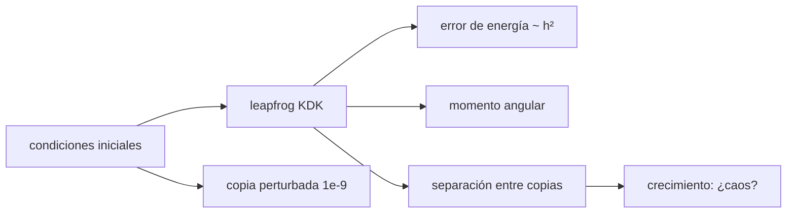

# B52-C19 — Estabilidad a largo plazo de sistemas

<!-- nav:top -->
[🏠 Programa](../../../../README.md) · [📚 Bloque B52](../../../tronco-comun/B52-formacion-y-dinamica-de-sistemas-planetarios.md) · [← Anterior: B52-C18 — Diferenciación planetaria](../B52-C18-diferenciacion-planetaria/CLASE.md) · [Siguiente: B52-C20 — Simulación de formación planetaria simplificada →](../B52-C20-simulacion-de-formacion-planetaria-simplificada/CLASE.md)
<!-- /nav -->

## 1. Ubicación, nivel y alcance

Clase 19 del bloque B52. Nivel N3. Decidir si un sistema planetario es estable a largo plazo es un problema de ingeniería de simulación: requisitos (qué se conserva), componentes (integrador, paso, condiciones iniciales) y criterios de comprobación. Implementas un integrador de N cuerpos de segundo orden (leapfrog), compruebas su error de energía y su conservación del momento angular, y mides la sensibilidad a las condiciones iniciales de dos sistemas **sintéticos** de tres planetas con espaciados de 4 y 8 radios de Hill mutuos. Retoma [B52-C10](../B52-C10-arquitecturas-de-sistemas-exoplanetarios/CLASE.md). Usas [B16](../../../tronco-comun/B16-sistemas-dinamicos-y-control-automatico.md) y [B23](../../../tronco-comun/B23-verificacion-y-validacion-de-software-cientifico.md).

## 2. Por qué esta clase existe

Una simulación solo es creíble si conserva lo que debe conservar y si se sabe qué tan sensible es a los datos de partida. La decisión central: **¿cuándo se puede confiar en una integración de largo plazo y cómo se mide el caos?**

## 3. Lo que podrás hacer al terminar

1. Escribir un integrador leapfrog kick–drift–kick en coordenadas baricéntricas.
2. Medir el error de energía y su escalado con el paso.
3. Comprobar la conservación del momento angular.
4. Medir la deriva de fase tras muchos periodos.
5. Medir la separación de dos copias con una perturbación inicial pequeña.
6. Interpretar el resultado como simulación de un sistema sintético, no como predicción.

La evidencia es la **ficha de la estabilidad de un sistema** del ejercicio 12 (sección 20).

## 4. Con qué llegas y cómo comprobarlo

1. ¿Qué es una tabla de resultados?
2. ¿Qué es una verificación?
3. ¿Qué es una tolerancia numérica?
4. ¿Qué es la tercera ley de Kepler?
5. ¿Qué es un valor ilustrativo?

<details>
<summary>Ver respuestas</summary>

1. Un resumen ordenado de cálculos. 2. Comparar un cálculo con un caso independiente. 3. La diferencia máxima aceptada entre dos resultados. 4. El cuadrado del periodo crece con el cubo del semieje. 5. Un valor propuesto para el ejemplo, no medido.
</details>

Con cuatro o cinco aciertos, sigue; si no, repasa los prerrequisitos.

## 5. Un caso de contexto y casos de referencia

Con un integrador de segundo orden, el error de energía de una órbita de `e = 0,1` pasa de `4.3e-04` a `1.1e-04` al duplicar los pasos (cociente `4.0`). En el sistema **sintético** con `Δ = 4`, dos copias separadas `10⁻⁹ ua` divergen a `1.33 ua` en 1000 órbitas; con `Δ = 8` solo a `6.7e-06 ua`. Es el **ejemplo conductor**; no se predice ningún sistema real.

## 6. Vocabulario

Un integrador **simpléctico** conserva una energía modificada y, por tanto, no deriva en energía a largo plazo. El **leapfrog** (kick–drift–kick) es el de segundo orden más sencillo. El **caos** es la sensibilidad exponencial a las condiciones iniciales. La **deriva de fase** es el error acumulado de posición angular. Un **espaciado** `Δ` pequeño en radios de Hill mutuos favorece los encuentros cercanos.

## 7. Modelo mental

Como dos bolas casi iguales lanzadas por una pista con obstáculos: en una pista despejada llegan juntas; en una con muchos obstáculos terminan lejos. Límite: tres planetas coplanares, un paso fijo y una sola perturbación; sin relatividad ni mareas.



*Descripción textual:* las condiciones iniciales alimentan el integrador, que se verifica con la energía y el momento angular; una copia perturbada muestra cómo crece la separación.

## 8. La explicación, paso a paso

### 8.1 Integrador

Kick–drift–kick con paso `h`: media patada de velocidad, deriva de posición, media patada. En unidades ua–año, `GM☉ = 39.476926 ua³/año²` (IAU 2015 y conversiones de unidades no consultadas).

### 8.2 Verificación en un planeta

Con `e = 0,1` y 100 órbitas, el error máximo de energía es `4.253e-04` (100 pasos/órbita) y `1.057e-04` (200), cociente `4.02`: error `∝ h²`. La distancia a la posición inicial tras 100 periodos exactos es `1.03 ua` y `0.27 ua`: la deriva de fase también escala como `h²` (cociente `3.79`).

### 8.3 Sistemas de tres planetas

| Δ | semiejes [ua] | máx \|dL/L\| | máx \|dE/E\| | separación a 100 órbitas | a 1000 órbitas |
|---|---|---|---|---|---|
| 4 | 1.000 1.115 1.243 | 2.4e-14 | 1.8e-05 | 4.39e-07 ua | 1.33e+00 ua |
| 8 | 1.000 1.244 1.547 | 1.6e-14 | 3.6e-06 | 6.85e-07 ua | 6.74e-06 ua |

El momento angular se conserva al nivel del redondeo (`10⁻¹⁴`). Con `Δ = 4`, la separación crece de `4.4e-07` a `1.33 ua`: crecimiento exponencial (caótico) en este modelo. Con `Δ = 8`, de `6.8e-07` a `6.7e-06 ua`: crecimiento mucho más lento.

### 8.4 Lectura

Es una **simulación** de un sistema sintético con una semilla de fases: no hay un umbral analítico verificado aquí y el resultado no se generaliza. Una integración caótica no es una predicción de la posición futura de un planeta, solo del tipo de comportamiento.

## 9. Magnitudes, símbolos y unidades

| Símbolo | Qué es | Unidad | Valor / nota |
|---|---|---|---|
| `h` | paso | años | P/100 y P/200 |
| `Δ` | espaciado | R_H mutuos | 4 y 8 (sintético) |
| `m` | masa de cada planeta | M☉ | 3·10⁻⁵ (ilustrativo) |
| `δ₀` | perturbación inicial | ua | 10⁻⁹ |

## 10. Convenciones y referencias

Unidades ua–año; marco baricéntrico inercial plano. Tolerancias: cociente de errores de energía y de deriva entre 3 y 5; momento angular `10⁻¹²`.

## 11. De dónde sale lo que afirmamos

| ID | Fuente | Localizador | Respalda | Estado |
|---|---|---|---|---|
| S2 | Mamajek et al., *IAU 2015 Resolution B3*, arXiv:1510.07674 | https://arxiv.org/abs/1510.07674 | `(GM)☉`, `(GM)⊕`, `(GM)_J` nominales | Texto del PDF extraído el 2026-11-09 |
| S3 | Laskar y Gastineau, *Existence of collisional trajectories of Mercury, Mars and Venus with the Earth*, Nature 459 (2009) 817 | https://doi.org/10.1038/nature08096 | Simulaciones de unos 2500 sistemas solares a 5 mil millones de años: en cerca del 1 % la excentricidad de Mercurio crece lo bastante para permitir colisiones | Descripción obtenida con un buscador el 2026-11-09; no se leyó el texto |

Límites: de S3 no se leyó el texto; no se consultó ningún umbral de estabilidad publicado; el sistema, las masas, las fases y el espaciado son sintéticos; los resultados de caos son de este modelo y paso.

## 12. Cómo verlo

| Magnitud | Valor |
|---|---|
| cociente de energía | 4.02 |
| cociente de deriva de fase | 3.79 |
| separación Δ=4 a 1000 órbitas | 1.33 ua |
| separación Δ=8 a 1000 órbitas | 6.7e-06 ua |

Descripción larga: el integrador es de segundo orden y conserva el momento angular; el sistema más apretado amplifica la perturbación inicial unos cinco órdenes de magnitud más que el más holgado.

## 13. Ejemplo trabajado

**Paso 1 · Cociente.** `4.253e-04 / 1.057e-04 = 4.02`.

**Paso 2 · Orden.** `2^2 = 4`, de modo que el integrador es de segundo orden.

**Paso 3 · Amplificación.** Para Δ = 4, `1.33 ua / 10⁻⁹ ua ≈ 1.3e+09`.

## 14. Distintas formas de describirlo

**Por conservación:** `E`, `L`. **Por escalado:** error `∝ h²`. **Por divergencia:** separación de copias.

## 15. Práctica guiada

**Ejercicio 1 · con los pasos indicados.** Si el paso se reduce a la mitad, ¿cómo cambia el error de energía en un integrador de segundo orden? *Pista:* `h²`.

<details><summary>Solución comentada</summary>

Baja a la cuarta parte.
</details>

**Ejercicio 2 · con una pista.** ¿Qué magnitud se conserva a nivel de redondeo?

<details><summary>Solución comentada</summary>

El momento angular.
</details>

**Ejercicio 3 · casi autónomo.** ¿Qué significa que la separación crezca exponencialmente?

<details><summary>Solución comentada</summary>

Que el sistema es caótico en ese intervalo.
</details>

## 16. Práctica autónoma, transferencia e integrador

**Ejercicio 4.** Cociente de errores de energía.

<details><summary>Solución comentada</summary>

`4.02`.
</details>

**Ejercicio 5.** Separación a 100 órbitas para `Δ = 4`.

<details><summary>Solución comentada</summary>

`4.39e-07 ua`.
</details>

**Ejercicio 6.** Separación a 1000 órbitas para `Δ = 8`.

<details><summary>Solución comentada</summary>

`6.74e-06 ua`.
</details>

**Ejercicio 7.** `|dL/L|` máximo para `Δ = 4`.

<details><summary>Solución comentada</summary>

`2.4e-14`.
</details>

**Ejercicio 8.** Amplificación para `Δ = 4`.

<details><summary>Solución comentada</summary>

`1.3e+09`.
</details>

**Ejercicio 9 · transferencia.** **Transferencia.** **Transferencia.** Un colega afirma que `Δ = 8` es estable para siempre. Responde.

<details><summary>Solución comentada</summary>

No: 1000 órbitas no prueban estabilidad para 10⁹ años; la simulación solo muestra un crecimiento lento.
</details>

**Ejercicio 10 · transferencia.** **Transferencia.** **Transferencia.** ¿Qué pasa si se usa un integrador no simpléctico?

<details><summary>Solución comentada</summary>

La energía derivaría sistemáticamente y la comparación de estabilidad quedaría contaminada.
</details>

**Ejercicio 11 · transferencia.** **Transferencia.** **Transferencia.** ¿Qué diría un resultado con otras fases iniciales?

<details><summary>Solución comentada</summary>

Podría cambiar; un estudio serio usa muchas condiciones iniciales.
</details>

**Ejercicio 12 · integrador.** **Integrador.** **Integrador.** Elabora tu *ficha de la estabilidad de un sistema*: verificación, tabla 8.3 y límites.

<details><summary>Solución modelo</summary>

Secciones 8.1–8.4 y 12.
</details>

## 17. Laboratorio: leapfrog, conservación y sensibilidad

El script [estabilidad.py](estabilidad.py) integra órbitas con un leapfrog, mide el escalado del error de energía y de la deriva de fase, la conservación del momento angular y la separación de dos copias en sistemas sintéticos de tres planetas (**comprueba** cocientes entre 3 y 5 y `10⁻¹²`).

**Datos:** `(GM)☉` de la IAU 2015, consultado el 2026-11-09; los sistemas son **sintéticos** (masas, fases y espaciado ilustrativos). **Predice antes de ejecutar:** ¿Cuál de los dos sistemas amplifica más la perturbación? (El de `Δ = 4`.) **Ejecución del 2026-11-09 (Python 3.12.9):**

```text
Python 3.12.9 (biblioteca estandar)
GM_sol = 39.476926 ua^3/anio^2 ; planetas SINTETICOS de 3e-05 M_sol
Planeta excentrico (e = 0.1), 100 orbitas: error maximo de energia con 100 pasos/orbita = 4.253e-04 ; con 200 pasos/orbita = 1.057e-04 ; cociente = 4.02 (esperado ~4)
  distancia a la posicion inicial tras 100 periodos exactos (deriva de fase): 1.03e+00 ua (100 pasos) ; 2.71e-01 ua (200 pasos) ; cociente = 3.79
Sistema SINTETICO de 3 planetas con espaciado 4 R_H mutuos, semiejes 1.0000 1.1148 1.2428 ua:
  conservacion en 1000 orbitas: max |dL/L| = 2.4e-14 ; max |dE/E| = 1.8e-05
  separacion de dos copias (perturbacion inicial 1e-9 ua): 4.386e-07 ua a 100 orbitas ; 1.333e+00 ua a 1000 orbitas
Sistema SINTETICO de 3 planetas con espaciado 8 R_H mutuos, semiejes 1.0000 1.2436 1.5465 ua:
  conservacion en 1000 orbitas: max |dL/L| = 1.6e-14 ; max |dE/E| = 3.6e-06
  separacion de dos copias (perturbacion inicial 1e-9 ua): 6.850e-07 ua a 100 orbitas ; 6.739e-06 ua a 1000 orbitas
Pruebas superadas.
```

```bash
python programa/clases/B52/B52-C19-estabilidad-a-largo-plazo-de-sistemas/estabilidad.py
```

**Límites:** tres planetas coplanares, paso fijo, una sola perturbación y una condición inicial.

## 18. Errores frecuentes y cómo corregirlos

**Creer que un integrador estable es un integrador exacto.** Se corrige con 8.2: la fase deriva como `h²`.

**Inferir estabilidad eterna de 1000 órbitas.** Se corrige con 8.4.

**Usar un solo conjunto de fases.** Se corrige en la pregunta de transferencia 11.

**Presentar el sistema sintético como real.** Se corrige con la sección 10.

## 19. Cómo sabrás que vas bien

Tras la sección 8: ¿qué resultado esperabas y cuál obtuviste? Si dudas, repasa el ejemplo de la sección 13. Tras el laboratorio: ¿qué comprueba? (ver la sección 17).

## 20. Qué entregas y cómo se evalúa

El producto es tu **ficha de la estabilidad de un sistema** (ejercicio 12).

| Criterio | Inicial | En desarrollo | Logrado | Destacado |
|---|---|---|---|---|
| Conceptos | Los confunde | Parciales | Conceptos de la clase | Explica los límites |
| Cálculo | Sin unidades | Con errores | Tablas completas | Calcula casos nuevos |
| Numérico | Sin comprobar | Un caso | Contraste con el análisis | Interpreta las diferencias |
| Fuentes | Sin fuente | Sin fecha | Fuentes con fecha | Declara lo ilustrativo |
| Límites | No los nombra | Uno | Tres | Discute qué falta del modelo |

**Condiciones críticas (no se compensan con promedio):** rotular lo sintético e ilustrativo; no presentar un resultado simulado como observado; citar solo lo consultado.

## 21. Ética, seguridad y límites

Clase educativa: los modelos son simplificados y no sustituyen a la literatura primaria ni a los códigos de producción. Lo simulado no es lo observado. Accesibilidad: tablas equivalentes a las gráficas, fórmulas en texto, ejercicios sin conexión.

## 22. Para cerrar y seguir

El leapfrog es de segundo orden y conserva el momento angular; el sistema sintético con `Δ = 4` amplifica `10⁻⁹ ua` hasta `1.3 ua` en 1000 órbitas. Queda una pregunta: ¿cómo se junta todo en una simulación de formación?

**Glosario español–inglés.** integrador simpléctico · *symplectic integrator*; leapfrog · *leapfrog*; caos · *chaos*; deriva de fase · *phase drift*; estabilidad · *stability*.

**Continuidad.** [B52-C20](../B52-C20-simulacion-de-formacion-planetaria-simplificada/CLASE.md) integra estas ideas en una simulación de formación.

**Referencias:** ver sección 11.

<!-- nav:bottom -->
---

[← Anterior: B52-C18 — Diferenciación planetaria](../B52-C18-diferenciacion-planetaria/CLASE.md) · [📚 Bloque B52](../../../tronco-comun/B52-formacion-y-dinamica-de-sistemas-planetarios.md) · [Siguiente: B52-C20 — Simulación de formación planetaria simplificada →](../B52-C20-simulacion-de-formacion-planetaria-simplificada/CLASE.md)
<!-- /nav -->
