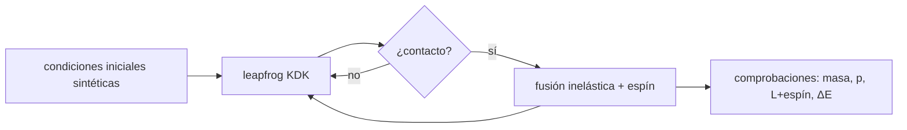

# B52-C20 — Simulación de formación planetaria simplificada

<!-- nav:top -->
[🏠 Programa](../../../../README.md) · [📚 Bloque B52](../../../tronco-comun/B52-formacion-y-dinamica-de-sistemas-planetarios.md) · [← Anterior: B52-C19 — Estabilidad a largo plazo de sistemas](../B52-C19-estabilidad-a-largo-plazo-de-sistemas/CLASE.md) · [Siguiente: B53-C01 — Interior de planetas rocosos →](../../B53/B53-C01-interior-de-planetas-rocosos/CLASE.md)
<!-- /nav -->

## 1. Ubicación, nivel y alcance

Clase 20 del bloque B52. Nivel N3. Cierra el bloque con una **simulación simplificada**: doce embriones de masa lunar alrededor de una estrella, integrados con el leapfrog de [B52-C19](../B52-C19-estabilidad-a-largo-plazo-de-sistemas/CLASE.md), que se fusionan al acercarse. Más que el resultado, importan las comprobaciones: la masa y el momento lineal se conservan, el momento angular orbital más el espín del cuerpo fusionado también, y la variación de energía en cada fusión se predice con una fórmula y se verifica. Usas [B14](../../../tronco-comun/B14-computacion-cientifica-y-ciencia-abierta.md) y [B23](../../../tronco-comun/B23-verificacion-y-validacion-de-software-cientifico.md). Todo es **sintético**: no se simula el Sistema Solar.

## 2. Por qué esta clase existe

Una simulación de formación sin sus controles de conservación no es evidencia de nada. La decisión central: **¿qué comprobaciones demuestran que la simulación se ejecutó correctamente antes de interpretar su resultado?**

## 3. Lo que podrás hacer al terminar

1. Plantear las condiciones iniciales de una simulación sintética con espaciado en radios de Hill mutuos.
2. Integrar con leapfrog y fusionar cuerpos en contacto con una regla perfectamente inelástica.
3. Verificar la conservación de la masa y el momento lineal.
4. Contabilizar el espín y verificar la conservación de `L` orbital más espín.
5. Predecir y verificar la variación de energía en cada fusión.
6. Interpretar el resultado como sintético y no como una predicción.

La evidencia es la **ficha de la simulación de formación** del ejercicio 12 (sección 20).

## 4. Con qué llegas y cómo comprobarlo

1. ¿Qué es una tabla de resultados?
2. ¿Qué es una verificación?
3. ¿Qué es una tolerancia numérica?
4. ¿Qué es la tercera ley de Kepler?
5. ¿Qué es un valor ilustrativo?

<details>
<summary>Ver respuestas</summary>

1. Un resumen ordenado de cálculos. 2. Comparar un cálculo con un caso independiente. 3. La diferencia máxima aceptada entre dos resultados. 4. El cuadrado del periodo crece con el cubo del semieje. 5. Un valor propuesto para el ejemplo, no medido.
</details>

Con cuatro o cinco aciertos, sigue; si no, repasa los prerrequisitos.

## 5. Un caso de contexto y casos de referencia

Doce embriones de `0.1 M⊕` desde `0,8 ua`, con `Δ = 3,5`, se reducen en 1500 años a `5` cuerpos tras `7` fusiones; las masas finales van de `0.2` a `0.3 M⊕`. La masa se conserva exactamente y `L + espín` a `1e-14`. Es el **ejemplo conductor**: una simulación sintética con radios de fusión inflados.

## 6. Vocabulario

Una **fusión perfectamente inelástica** une dos cuerpos en el centro de masa del par con la velocidad del centro de masa. El **espín** es el momento angular interno que absorbe el orbital relativo. El **radio de fusión inflado** multiplica el radio físico para acelerar la simulación. La **comprobación de conservación** compara magnitudes antes y después de cada evento.

## 7. Modelo mental

Como un juego de billar con bolas pegajosas: al chocar quedan unidas, el movimiento total se mantiene, el giro de la pareja queda como espín y parte de la energía desaparece. Límite: planar, circular al inicio, sin gas, fragmentación ni migración.



*Descripción textual:* las condiciones iniciales se integran con leapfrog; si dos cuerpos entran en contacto se fusionan y cada evento se comprueba contra las leyes de conservación y una predicción de energía.

## 8. La explicación, paso a paso

### 8.1 Condiciones iniciales

Doce embriones de `0.1 M⊕` (ilustrativo) alrededor de `1 M☉`, el primero a `0,8 ua` y cada siguiente a `Δ = 3,5` radios de Hill mutuos, en órbitas circulares coplanares con fases aleatorias de semilla `20261109`. Semiejes: 0.800 0.817 0.833 0.851 0.868 0.886 0.905 0.923 0.942 0.962 0.982 1.002 ua. Paso `h = 0,012 años`.

### 8.2 Fusión

Dos cuerpos se fusionan si `d < 100 (R_i + R_j)` (radio físico para `3000 kg/m³`). El cuerpo nuevo tiene `m = m_i + m_j`, posición y velocidad del centro de masa del par.

### 8.3 Resultados

Tras 1500 años: `5` cuerpos, `7` fusiones (primeras: año 33, año 177, año 348, año 648). Masas finales [M⊕]: 0.3 0.2 0.3 0.2 0.2. Semiejes osculadores finales [ua]: 0.811 0.862 0.908 0.952 0.993.

### 8.4 Comprobaciones

| magnitud | resultado |
|---|---|
| masa total | cambio relativo `0.0e+00` |
| momento lineal | `5.6e-19 M☉ ua/año` |
| `L` orbital + espín | cambio relativo `1.0e-14` |
| espín acumulado | `1.6e-05` de `L` |
| variación de energía por fusión | error de la predicha `7.8e-16` (de `|E₀|`) |
| energía total | `-3.3e-05` de `|E₀|` |

La variación de energía de cada fusión se predice como `−½μ v_rel² + G m_i m_j/d` más el cambio de la energía potencial con los demás cuerpos; la medida coincide a `10⁻¹⁵`. La energía total cambia `-3.3e-05`, que son fusiones más el error del integrador.

### 8.5 Lectura

Que 12 embriones dejen 5 cuerpos en 1500 años depende de `Δ`, de las fases y de los radios inflados: **es un resultado de este modelo sintético**. No se afirma nada sobre el Sistema Solar ni sobre el tiempo real de formación.

## 9. Magnitudes, símbolos y unidades

| Símbolo | Qué es | Unidad | Valor / nota |
|---|---|---|---|
| `N` | embriones iniciales | — | 12 (sintético) |
| `m` | masa inicial | M⊕ | 0.1 |
| `Δ` | espaciado inicial | R_H mutuos | 3,5 |
| `h` | paso | años | 0,012 |
| `f` | inflado del radio de fusión | — | 100 |

## 10. Convenciones y referencias

Unidades ua–año; marco baricéntrico plano. Tolerancias: masa `10⁻¹⁴`, momento lineal `10⁻¹²`, `L` más espín `10⁻⁹`, predicción de energía `10⁻⁹` de `|E₀|`.

## 11. De dónde sale lo que afirmamos

| ID | Fuente | Localizador | Respalda | Estado |
|---|---|---|---|---|
| S1 | NIST, *Fundamental Physical Constants — Complete Listing* (CODATA 2022) | https://physics.nist.gov/cuu/Constants/Table/allascii.txt | `G`, `k_B`, `m_p` | Consultada el 2026-11-09 |
| S2 | Mamajek et al., *IAU 2015 Resolution B3*, arXiv:1510.07674 | https://arxiv.org/abs/1510.07674 | `(GM)☉`, `(GM)⊕`, `(GM)_J` nominales | Texto del PDF extraído el 2026-11-09 |
| S3 | Morbidelli y Raymond, *Challenges in Planet Formation*, arXiv:1610.07202 | https://arxiv.org/abs/1610.07202 | Los modelos de formación, aun los más exitosos, siguen siendo inciertos | Solo resumen, consultado el 2026-11-09 |

Límites: de S3 solo se leyó el resumen; la regla de fusión, el inflado de radios, la densidad y la masa de los embriones son de enseñanza; no hay gas ni fragmentación; la unidad astronómica y el año juliano no se consultaron.

## 12. Cómo verlo

| Magnitud | Valor |
|---|---|
| cuerpos finales | 5 |
| fusiones | 7 |
| L + espín | 1e-14 |
| error de energía por fusión | 8e-16 |

Descripción larga: doce embriones se reducen a cinco y todas las comprobaciones de conservación y de energía por fusión se cumplen a precisión de máquina.

## 13. Ejemplo trabajado

**Paso 1 · Fusión.** Los dos cuerpos más cercanos se unen en el año `33`.

**Paso 2 · Masa.** `m = 0.2 M⊕`.

**Paso 3 · Espín.** El `L` orbital relativo pasa al espín; `L + espín` cambia `1e-14`.

**Paso 4 · Energía.** La variación medida coincide con la predicha a `8e-16`.

## 14. Distintas formas de describirlo

**Por conservación:** masa, `p`, `L`+espín. **Por predicción:** `ΔE` por fusión. **Por tabla:** 8.4.

## 15. Práctica guiada

**Ejercicio 1 · con los pasos indicados.** ¿Cuánta masa tiene el cuerpo que resulta de fusionar dos de `0,1 M⊕`? *Pasos:* suma.

<details><summary>Solución comentada</summary>

`0,2 M⊕`.
</details>

**Ejercicio 2 · con una pista.** ¿Por qué no se conserva la energía al fusionar?

<details><summary>Solución comentada</summary>

Porque la fusión inelástica disipa energía cinética relativa y elimina la potencial mutua.
</details>

**Ejercicio 3 · casi autónomo.** ¿Qué pasa con el momento angular orbital relativo?

<details><summary>Solución comentada</summary>

Pasa al espín del cuerpo fusionado.
</details>

## 16. Práctica autónoma, transferencia e integrador

**Ejercicio 4.** Número de cuerpos finales.

<details><summary>Solución comentada</summary>

`5`.
</details>

**Ejercicio 5.** Número de fusiones.

<details><summary>Solución comentada</summary>

`7`.
</details>

**Ejercicio 6.** Masa máxima final.

<details><summary>Solución comentada</summary>

`0.3 M⊕`.
</details>

**Ejercicio 7.** Cambio de `L` más espín.

<details><summary>Solución comentada</summary>

`1e-14`.
</details>

**Ejercicio 8.** Cambio de la masa total.

<details><summary>Solución comentada</summary>

`0e+00`.
</details>

**Ejercicio 9 · transferencia.** **Transferencia.** **Transferencia.** Un colega dice que la simulación muestra cómo se formó la Tierra. Responde.

<details><summary>Solución comentada</summary>

No: es sintética, planar, con radios inflados y sin gas; solo ilustra cómo comprobar una simulación.
</details>

**Ejercicio 10 · transferencia.** **Transferencia.** **Transferencia.** ¿Qué cambiaría con otra semilla?

<details><summary>Solución comentada</summary>

Otro orden y número de fusiones; un estudio usa muchas semillas.
</details>

**Ejercicio 11 · transferencia.** **Transferencia.** **Transferencia.** ¿Qué cambia si el inflado de radios es 10?

<details><summary>Solución comentada</summary>

Menos fusiones en el mismo tiempo.
</details>

**Ejercicio 12 · integrador.** **Integrador.** **Integrador.** Elabora tu *ficha de la simulación de formación*: condiciones, resultado, tabla 8.4 y límites.

<details><summary>Solución modelo</summary>

Secciones 8.1–8.5 y 12.
</details>

## 17. Laboratorio: simulación sintética de fusión de embriones

El script [formacion.py](formacion.py) integra doce embriones con leapfrog, los fusiona al contacto y comprueba masa, momento lineal, `L` más espín y la variación de energía por fusión (**comprueba** `10⁻¹⁴`, `10⁻¹²`, `10⁻⁹` y `10⁻⁹`).

**Datos:** `G` de NIST y `(GM)☉`, `(GM)⊕` de la IAU 2015, consultados el 2026-11-09; masas, espaciado, fases (semilla `20261109`) y radios de fusión son **sintéticos**. **Predice antes de ejecutar:** ¿Qué se conserva en una fusión inelástica? (Masa, momento lineal y L orbital más espín; la energía no.) **Ejecución del 2026-11-09 (Python 3.12.9):**

```text
Python 3.12.9 (biblioteca estandar)
Condiciones SINTETICAS: 12 embriones de 0.10 M_Tierra desde 0.8 ua con espaciado 3.5 R_H mutuos ; semilla de fases 20261109 ; radio de fusion = 100 x suma de radios fisicos
Semiejes iniciales [ua]: 0.800 0.817 0.833 0.851 0.868 0.886 0.905 0.923 0.942 0.962 0.982 1.002
Tras 1500 anios: 5 cuerpos (7 fusiones)
Masas finales [M_Tierra]: 0.30 0.20 0.30 0.20 0.20
Semiejes osculadores finales [ua]: 0.811 0.862 0.908 0.952 0.993
Primeras fusiones (anio, cuerpos restantes): (33, 11), (177, 10), (348, 9), (648, 8), (736, 7), (1037, 6)
Conservacion: |d masa total/masa| = 0.0e+00 ; |d momento lineal| = 5.6e-19 M_sol ua/anio ; |d (L+espin)/L| = 1.0e-14 ; espin acumulado / L = 1.6e-05 ; error de la variacion de energia predicha por fusion = 7.8e-16 ; dE/|E0| total = -3.3e-05
Pruebas superadas.
```

```bash
python programa/clases/B52/B52-C20-simulacion-de-formacion-planetaria-simplificada/formacion.py
```

**Límites:** planar, sin gas, sin fragmentación, radios inflados y una sola semilla.

## 18. Errores frecuentes y cómo corregirlos

**Esperar que la energía se conserve en una fusión.** Se corrige con 8.4.

**Olvidar el espín.** Se corrige con 8.2 y 8.4.

**Interpretar una simulación sin comprobaciones.** Se corrige con la pregunta central.

**Presentar el resultado sintético como real.** Se corrige con 8.5 y la sección 10.

## 19. Cómo sabrás que vas bien

Tras la sección 8: ¿qué resultado esperabas y cuál obtuviste? Si dudas, repasa el ejemplo de la sección 13. Tras el laboratorio: ¿qué comprueba? (ver la sección 17).

## 20. Qué entregas y cómo se evalúa

El producto es tu **ficha de la simulación de formación** (ejercicio 12).

| Criterio | Inicial | En desarrollo | Logrado | Destacado |
|---|---|---|---|---|
| Conceptos | Los confunde | Parciales | Conceptos de la clase | Explica los límites |
| Cálculo | Sin unidades | Con errores | Tablas completas | Calcula casos nuevos |
| Numérico | Sin comprobar | Un caso | Contraste con el análisis | Interpreta las diferencias |
| Fuentes | Sin fuente | Sin fecha | Fuentes con fecha | Declara lo ilustrativo |
| Límites | No los nombra | Uno | Tres | Discute qué falta del modelo |

**Condiciones críticas (no se compensan con promedio):** rotular lo sintético e ilustrativo; no presentar un resultado simulado como observado; citar solo lo consultado.

## 21. Ética, seguridad y límites

Clase educativa: los modelos son simplificados y no sustituyen a la literatura primaria ni a los códigos de producción. Lo simulado no es lo observado. Accesibilidad: tablas equivalentes a las gráficas, fórmulas en texto, ejercicios sin conexión.

## 22. Para cerrar y seguir

La simulación sintética reduce doce embriones a `5` cuerpos, con todas las comprobaciones en verde. Con esto se completa el bloque B52: del colapso de la nebulosa a una simulación con controles.

**Glosario español–inglés.** fusión inelástica · *inelastic merger*; espín · *spin*; conservación · *conservation*; radio de fusión · *merger radius*; simulación de N cuerpos · *N-body simulation*.

**Continuidad.** Con ella se completa B52; el siguiente bloque del área A05 es [B53](../../../tronco-comun/B53-astrogeologia-y-geodesia-planetaria.md).

**Referencias:** ver sección 11.

<!-- nav:bottom -->
---

[← Anterior: B52-C19 — Estabilidad a largo plazo de sistemas](../B52-C19-estabilidad-a-largo-plazo-de-sistemas/CLASE.md) · [📚 Bloque B52](../../../tronco-comun/B52-formacion-y-dinamica-de-sistemas-planetarios.md) · [Siguiente: B53-C01 — Interior de planetas rocosos →](../../B53/B53-C01-interior-de-planetas-rocosos/CLASE.md)
<!-- /nav -->
