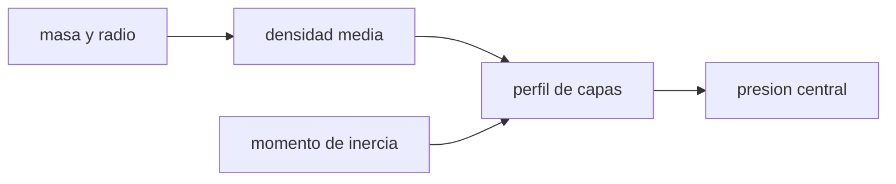

# B53-C01 — Interior de planetas rocosos

<!-- nav:top -->
[🏠 Programa](../../../../README.md) · [📚 Bloque B53](../../../tronco-comun/B53-astrogeologia-y-geodesia-planetaria.md) · [← Anterior: B52-C20 — Simulación de formación planetaria simplificada](../../B52/B52-C20-simulacion-de-formacion-planetaria-simplificada/CLASE.md) · [Siguiente: B53-C02 — Sismología planetaria →](../B53-C02-sismologia-planetaria/CLASE.md)
<!-- /nav -->

## 1. Ubicación, nivel y alcance

Clase 1 del bloque B53. Nivel N3. El interior de un planeta rocoso no se ve: se infiere de su masa, su radio y su momento de inercia. Aquí construyes un modelo **sintético** de dos capas (núcleo y manto), integras la masa y la presión hidrostática capa a capa y obtienes el factor de momento de inercia `C/(MR²)`. Contrastas la integración numérica con las fórmulas analíticas de la esfera uniforme. Los valores son inventados para el ejemplo; no son los de ningún planeta.

## 2. Por qué esta clase existe

Dos cuerpos con la misma masa y radio pueden tener interiores distintos. La decisión central: **¿qué observable separa un cuerpo homogéneo de uno diferenciado?** La respuesta es el momento de inercia, que pesa más a las capas externas.

## 3. Lo que podrás hacer al terminar

1. Integrar la masa de un modelo de capas concéntricas.
2. Calcular la presión hidrostática central por integración.
3. Obtener el factor de momento de inercia del modelo.
4. Contrastar la integral numérica con el caso analítico uniforme.
5. Explicar por qué un núcleo denso baja el factor por debajo de 0,4.
6. Distinguir lo observado (masa, radio, inercia) de lo inferido (capas).

La evidencia es la **ficha del interior de un planeta sintético** del ejercicio 12 (sección 20).

## 4. Con qué llegas y cómo comprobarlo

1. ¿Qué es la densidad media?
2. ¿Qué es una presión hidrostática?
3. ¿Qué es un momento de inercia?
4. ¿Qué es un valor sintético?
5. ¿Qué es una verificación numérica?

<details>
<summary>Ver respuestas</summary>

1. Masa dividida por volumen. 2. El peso de la columna de material que está encima, por unidad de área. 3. La resistencia a cambiar la rotación; pesa con el cuadrado de la distancia al eje. 4. Uno inventado para el ejemplo, no medido. 5. Comparar un cálculo con un caso de solución conocida.
</details>

Con cuatro o cinco aciertos, sigue; si no, repasa los prerrequisitos.

## 5. Un caso de contexto y casos de referencia

Un planeta sintético de radio `R = 6,0 × 10⁶ m`, con un núcleo de `3,0 × 10⁶ m` y densidad `11 000 kg/m³` bajo un manto de `4 500 kg/m³`. Su densidad media es `5312,5 kg/m³`, su factor de inercia `0,3541` (numérico `0,3541`) y su presión central `2,655 × 10¹¹ Pa`. Es el **ejemplo conductor**. Todo es **sintético o ilustrativo** y así se rotula.

## 6. Vocabulario

Una **capa** es un cascarón de densidad uniforme. La **diferenciación** es la separación de un cuerpo en capas de distinta densidad. El **factor de momento de inercia** `C/(MR²)` vale `0,4` para una esfera uniforme y menos si la masa se concentra hacia el centro. La **ecuación hidrostática** es `dP/dr = −ρ g`.

## 7. Modelo mental

Analogía: una cebolla con un hueso de durazno dentro: la mezcla de capas cambia cómo gira, aunque desde fuera pese lo mismo.



*Descripción textual:* La masa y el radio dan la densidad media; el momento de inercia restringe el perfil de capas; el perfil permite integrar la presión.

Límite de la analogía: el modelo ignora temperatura, composición, rotación y compresibilidad: la densidad de cada capa es constante.

## 8. La explicación, paso a paso

### 8,1 Masa e inercia de capas

Cada cascarón contribuye con `dm = 4π r² ρ dr` y `dI = (2/3) r² dm`. Para dos capas, `C = (8π/15)[ρ_n r_n⁵ + ρ_m (R⁵ − r_n⁵)]`.

| Magnitud | Numérico | Analítico |
|---|---|---|
| masa [kg] | 4,8066 × 10²⁴ | 4,8066 × 10²⁴ |
| `C/(MR²)` | 0,35412 | 0,35412 |

### 8,2 Presión hidrostática

`P(r) = ∫ g ρ dr` con `g = G m(r)/r²`. Prueba de la integral: para una esfera uniforme el resultado analítico es `3GM²/(8πR⁴)`.

| Caso | Presión central [Pa] |
|---|---|
| uniforme, numérico | 1,2581 × 10¹¹ |
| uniforme, analítico | 1,2581 × 10¹¹ |
| dos capas | 2,6546 × 10¹¹ |
| en el límite núcleo-manto | 1,1323 × 10¹¹ |

El error relativo del caso uniforme es `1,50 × 10⁻⁵`.

### 8,3 Lectura

El factor `0,3541` es menor que `0,4`: la masa se concentra en el centro. Un observable solo (el factor) admite varios perfiles; el modelo es **una** solución, no **la** solución.

## 9. Magnitudes, símbolos y unidades

| Símbolo | Qué es | Unidad | Valor / nota |
|---|---|---|---|
| `G` | constante gravitatoria | m³ kg⁻¹ s⁻² | 6,67430 × 10⁻¹¹ (NIST, CODATA 2022) |
| `R` | radio del planeta | m | 6,0 × 10⁶ (sintético) |
| `ρ` | densidad de capa | kg/m³ | 11 000 y 4 500 (sintético) |
| `C/(MR²)` | factor de inercia | — | 0,3541 |
| `P` | presión | Pa | 2,655 × 10¹¹ en el centro |

## 10. Convenciones y referencias

Esfera sin rotación, centro en el origen, SI; `G = 6,67430 × 10⁻¹¹` (NIST); integración por punto medio con 200 000 cascarones; tolerancia 10⁻⁴ en ambos casos.

## 11. De dónde sale lo que afirmamos

| ID | Fuente | Localizador | Respalda | Estado |
|---|---|---|---|---|
| S1 | NIST, *Fundamental Physical Constants*: constante gravitatoria newtoniana (CODATA 2022) | https://physics.nist.gov/cgi-bin/cuu/Value?bg | valor de `G` usado en el laboratorio | Consultada el 2026-11-09 |

Límites: no se consultó ninguna fuente sobre interiores planetarios; el modelo es sintético.

## 12. Cómo ver el resultado

| Magnitud | Valor |
|---|---|
| masa | 4,807 × 10²⁴ kg |
| densidad media | 5312,5 kg/m³ |
| `C/(MR²)` | 0,3541 |
| presión central | 2,655 × 10¹¹ Pa |
| error del caso uniforme | 1,5 × 10⁻⁵ |

Descripción larga: el perfil es de dos escalones de densidad; la presión crece hacia el centro y supera `1,13 × 10¹¹ Pa` en el límite núcleo-manto.

## 13. Ejemplo trabajado

**Paso 1.** Datos: `R = 6,0 × 10⁶ m`, `r_n = 3,0 × 10⁶ m`, `ρ_n = 11 000`, `ρ_m = 4 500`.

**Paso 2.** Masa: `M = (4π/3)[ρ_n r_n³ + ρ_m (R³ − r_n³)] = 4,8066 × 10²⁴ kg`.

**Paso 3.** Inercia: `C = (8π/15)[…] ` y `C/(MR²) = 0,35412`.

**Paso 4.** Comprobación: el numérico da `0,35412`.

## 14. Distintas formas de describirlo

**Por tabla:** capas y densidades. **Por fórmula:** `C/(MR²)`. **Por integral:** `P(r)`. **Por gráfica:** `ρ(r)` en escalones.

## 15. Práctica guiada

**Ejercicio 1 · con los pasos indicados.** Calcula la densidad media a partir de `M` y `R`.

<details><summary>Solución comentada</summary>

`5312,5 kg/m³`.
</details>

**Ejercicio 2 · con una pista.** ¿Cuánto vale `C/(MR²)` de una esfera uniforme?

<details><summary>Solución comentada</summary>

`0,4`.
</details>

**Ejercicio 3 · casi autónomo.** ¿Por qué el factor del modelo es menor que 0,4?

<details><summary>Solución comentada</summary>

La masa está concentrada en el centro.
</details>

## 16. Práctica autónoma, transferencia e integrador

**Ejercicio 4 · autónomo.** Calcula el error relativo de la presión uniforme.

<details><summary>Solución comentada</summary>

`1,50 × 10⁻⁵`.
</details>

**Ejercicio 5 · autónomo.** ¿Qué pasa con el factor si el núcleo aumenta su densidad?

<details><summary>Solución comentada</summary>

Disminuye.
</details>

**Ejercicio 6 · autónomo.** ¿Qué pasa con la masa si el manto es 10 % más denso?

<details><summary>Solución comentada</summary>

Aumenta; recalcula con la fórmula analítica.
</details>

**Ejercicio 7 · autónomo.** ¿Qué presión hay en el límite núcleo-manto?

<details><summary>Solución comentada</summary>

`1,132 × 10¹¹ Pa`.
</details>

**Ejercicio 8 · autónomo.** ¿Qué mide la masa que no mida el factor de inercia?

<details><summary>Solución comentada</summary>

La masa total; el factor mide su distribución.
</details>

**Ejercicio 9 · transferencia.** Un cuerpo tiene factor 0,33. ¿Qué infieres y qué no?

<details><summary>Solución comentada</summary>

Infieres concentración central; no la composición ni el tamaño del núcleo (hay varios perfiles).
</details>

**Ejercicio 10 · transferencia.** ¿Por qué no basta la densidad media?

<details><summary>Solución comentada</summary>

Cualquier distribución con la misma masa total la reproduce.
</details>

**Ejercicio 11 · transferencia.** ¿Qué cambia si el planeta rota rápido?

<details><summary>Solución comentada</summary>

Se aplana y el factor se interpreta con un modelo de equilibrio.
</details>

**Ejercicio 12 · integrador.** Elabora tu *ficha del interior de un planeta sintético*: capas, masa, factor, presión y límites.

<details><summary>Solución modelo</summary>

Secciones 8,1 a 8,3 con unidades y rótulo de sintético.
</details>

## 17. Laboratorio: un planeta sintético de dos capas

El script [interior.py](interior.py) integra un planeta de dos capas con 200 000 cascarones y lo compara con las fórmulas analíticas (**comprueba** error relativo < 10⁻⁴).

**Datos:** `G` de NIST; capas **sintéticas**. **Predice antes de ejecutar:** ¿será el factor menor o mayor que 0,4? (menor, núcleo denso). **Ejecución del 2026-11-09 (Python 3,12,9):**

```text
Python 3.12.9 (biblioteca estandar)
masa: numerica 4.80664e+24 kg ; analitica 4.80664e+24 kg ; densidad media 5312.5 kg/m3
C/(M R^2): numerico 0.35412 ; analitico 0.35412
presion central: dos capas 2.6546e+11 Pa ; limite nucleo-manto 1.1323e+11 Pa
esfera uniforme: P numerica 1.2581e+11 ; analitica 1.2581e+11 ; error relativo 1.50e-05
Pruebas superadas.
```

```bash
python programa/clases/B53/B53-C01-interior-de-planetas-rocosos/interior.py
```

**Límites:** un solo modelo de capas de densidad constante; sin temperatura ni compresibilidad.

## 18. Errores frecuentes y cómo corregirlos

**Confundir densidad media con perfil.** se corrige con 8,3

**Creer que el factor identifica el interior.** se corrige con 8,3

**Presentar el planeta como real.** se corrige con la sección 10

## 19. Cómo sabrás que vas bien

Tras la sección 8: ¿qué resultado esperabas y cuál obtuviste? Si dudas, repasa el ejemplo de la sección 13. Tras el laboratorio: ¿qué comprueba? (ver la sección 17).

## 20. Qué entregas y cómo se evalúa

El producto es tu **ficha del interior de un planeta sintético** (ejercicio 12).

| Criterio | Inicial | En desarrollo | Logrado | Destacado |
|---|---|---|---|---|
| Conceptos | Los confunde | Parciales | Conceptos de la clase | Explica los límites |
| Cálculo | Sin unidades | Con errores | Tablas completas | Calcula casos nuevos |
| Numérico | Sin comprobar | Un caso | Contraste con el análisis | Interpreta las diferencias |
| Fuentes | Sin fuente | Sin fecha | Fuentes con fecha | Declara lo sintético |
| Límites | No los nombra | Uno | Tres | Discute qué falta del modelo |

**Condiciones críticas (no se compensan con promedio):** rotular el planeta como sintético; no atribuir el modelo a un planeta real; citar solo lo consultado.

## 21. Ética, seguridad y límites

Clase educativa: los modelos son simplificados y no sustituyen a los productos de una misión ni a la literatura primaria. Ningún dato simulado se presenta como observado. Accesibilidad: tablas equivalentes a las gráficas, fórmulas en texto, ejercicios sin conexión.

## 22. Para cerrar y seguir

El modelo de dos capas reproduce la masa analítica y da `C/(MR²) = 0,3541` con presión central `2,65 × 10¹¹ Pa`. Queda una pregunta: ¿cómo se observa el interior directamente?

**Glosario español–inglés.** capa · *layer*; diferenciación · *differentiation*; momento de inercia · *moment of inertia*; presión hidrostática · *hydrostatic pressure*.

**Continuidad.** [B53-C02](../B53-C02-sismologia-planetaria/CLASE.md) estudia la sismología planetaria.

**Referencias:** ver sección 11.

<!-- nav:bottom -->
---

[← Anterior: B52-C20 — Simulación de formación planetaria simplificada](../../B52/B52-C20-simulacion-de-formacion-planetaria-simplificada/CLASE.md) · [📚 Bloque B53](../../../tronco-comun/B53-astrogeologia-y-geodesia-planetaria.md) · [Siguiente: B53-C02 — Sismología planetaria →](../B53-C02-sismologia-planetaria/CLASE.md)
<!-- /nav -->
