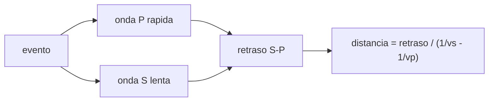

# B53-C02 — Sismología planetaria

<!-- nav:top -->
[🏠 Programa](../../../../README.md) · [📚 Bloque B53](../../../tronco-comun/B53-astrogeologia-y-geodesia-planetaria.md) · [← Anterior: B53-C01 — Interior de planetas rocosos](../B53-C01-interior-de-planetas-rocosos/CLASE.md) · [Siguiente: B53-C03 — Campo gravitatorio planetario →](../B53-C03-campo-gravitatorio-planetario/CLASE.md)
<!-- /nav -->

## 1. Ubicación, nivel y alcance

Clase 2 del bloque B53. Nivel N3. Un sismómetro registra ondas **P** (compresionales) y **S** (de corte) que viajan por el interior. Aquí trazas el rayo en una esfera homogénea con el parámetro de rayo, comparas la integral numérica con el resultado geométrico y estimas la distancia a un evento con el retraso S−P, con su incertidumbre por Monte Carlo. Las velocidades y los tiempos son **sintéticos**.

## 2. Por qué esta clase existe

Un solo sismómetro no da la posición completa de un evento. La decisión central: **¿cuánto vale la distancia al evento y con qué incertidumbre, si solo se leen los tiempos de llegada P y S?** La misión InSight puso un sismómetro en Marte para estudiar su estructura interna (NASA, consultada); aquí no se usan sus datos.

## 3. Lo que podrás hacer al terminar

1. Definir el parámetro de rayo y el punto más profundo del rayo.
2. Integrar numéricamente la distancia angular y el tiempo de viaje.
3. Contrastarlos con la solución geométrica de la cuerda.
4. Calcular la distancia a un evento con el retraso S−P.
5. Propagar el error de lectura a la distancia, analítica y por Monte Carlo.
6. Separar lo medido (tiempos) de lo inferido (distancia).

La evidencia es la **ficha de la distancia sísmica y su incertidumbre** del ejercicio 12 (sección 20).

## 4. Con qué llegas y cómo comprobarlo

1. ¿Qué es una onda P?
2. ¿Qué es una onda S?
3. ¿Qué es el tiempo de viaje?
4. ¿Qué es una desviación estándar?
5. ¿Qué es un dato sintético?

<details>
<summary>Ver respuestas</summary>

1. Una onda compresional, la más rápida. 2. Una onda de corte, más lenta; no atraviesa fluidos. 3. El tiempo entre la fuente y la estación. 4. Una medida de la dispersión de un valor. 5. Uno generado por el modelo, no registrado por un instrumento.
</details>

Con cuatro o cinco aciertos, sigue; si no, repasa los prerrequisitos.

## 5. Un caso de contexto y casos de referencia

Una esfera homogénea de `R = 3000 km` con `v_P = 8,0 km/s`. Un rayo con parámetro `p` baja hasta `r_min = p v`. Un evento a `1200 km` con `v_P = 8,0` y `v_S = 4,5 km/s` da un retraso S−P de `116,67 s`; con lecturas ruidosas (σ = 0,5 s) la distancia se estima en `1200,0 ± 7,4 km`. Es el **ejemplo conductor**. Todo es **sintético o ilustrativo** y así se rotula.

## 6. Vocabulario

El **parámetro de rayo** `p = r sin(i)/v` es constante a lo largo del rayo en una esfera. El **retraso S−P** es `t_S − t_P`. La **distancia epicentral** `Δ` es el ángulo en el centro entre fuente y estación. Una **fase** es una llegada identificable.

## 7. Modelo mental

Analogía: el trueno y el relámpago: la luz llega antes que el sonido, y el retraso dice a qué distancia cayó el rayo.



*Descripción textual:* El evento emite P y S; la diferencia de llegada convierte en distancia con las dos velocidades.

Límite de la analogía: el trueno viaja por aire homogéneo; en un planeta las velocidades varían con la profundidad y el retraso solo da una distancia, no un rumbo.

## 8. La explicación, paso a paso

### 8,1 Rayo en una esfera homogénea

Con `v` constante, el punto más profundo es `r_min = p v`. Con `r = r_min cosh s` la distancia angular es `Δ = 2 ∫ ds / cosh s` y el tiempo `t = (2/v) r_min sinh s_max`.

| Magnitud | Numérico (Simpson) | Geométrico |
|---|---|---|
| `Δ` [rad] | 2,60172706 | 2,60172706 |
| `t` [s] | 722,84161 | 722,84161 |

para `p v = 800 km`.

### 8,2 Distancia por S−P

`d = (t_S − t_P)/(1/v_S − 1/v_P)`. El error de lectura de cada fase es `σ = 0,5 s`, así que `σ_Δt = √2 σ` y `σ_d = σ_Δt/(1/v_S − 1/v_P)`.

| Magnitud | Valor |
|---|---|
| retraso exacto [s] | 116,667 |
| `σ_d` analítica [km] | 7,27 |
| `σ_d` Monte Carlo [km] | 7,35 |
| sesgo (media − verdadera) [km] | 0,020 |

### 8,3 Lectura

La distancia es una **inferencia** con una incertidumbre calculable. Con una sola estación queda un círculo de posibles epicentros, no un punto.

## 9. Magnitudes, símbolos y unidades

| Símbolo | Qué es | Unidad | Valor / nota |
|---|---|---|---|
| `p` | parámetro de rayo | s/rad | r_min / v |
| `v_P`, `v_S` | velocidades | km/s | 8,0 y 4,5 (sintéticas) |
| `Δ` | distancia angular | rad | 2,6017 |
| `σ` | error de lectura de fase | s | 0,5 (sintético) |
| `d` | distancia epicentral | km | 1200 |

## 10. Convenciones y referencias

Esfera homogénea sin rotación, `R = 3000 km`, velocidades constantes; semilla `20261109`; 20 000 sorteos; tolerancias: integral 10⁻⁷ relativa y Monte Carlo dentro de 3 errores típicos.

## 11. De dónde sale lo que afirmamos

| ID | Fuente | Localizador | Respalda | Estado |
|---|---|---|---|---|
| S1 | NASA Science, misión InSight | https://science.nasa.gov/mission/insight/ | contexto: el sismómetro de InSight estudia la estructura interna de Marte | Página consultada el 2026-11-09 (no da detalle de núcleo ni corteza) |

Límites: solo se leyó la página institucional de la misión; no se usaron datos ni modelos de velocidad reales.

## 12. Cómo ver el resultado

| Magnitud | Valor |
|---|---|
| `Δ` numérica | 2,601727 rad |
| `t` numérico | 722,8416 s |
| retraso S−P | 116,667 s |
| distancia estimada | 1200,0 km |
| `σ_d` Monte Carlo | 7,35 km |

Descripción larga: la distancia estimada coincide con la verdadera dentro de su incertidumbre.

## 13. Ejemplo trabajado

**Paso 1.** Datos: `v_P = 8,0`, `v_S = 4,5 km/s`, `σ = 0,5 s`.

**Paso 2.** Factor: `1/v_S − 1/v_P = 0,0972 s/km`, es decir `10,29 km/s` de conversión.

**Paso 3.** Incertidumbre: `σ_Δt = 0,707 s`, `σ_d = 7,27 km`.

**Paso 4.** Comparación: Monte Carlo da `7,35 km`.

## 14. Distintas formas de describirlo

**Por fórmula:** `d = Δt/(1/vs − 1/vp)`. **Por tabla:** tiempos. **Por integral:** `Δ(p)` y `t(p)`. **Por simulación:** Monte Carlo.

## 15. Práctica guiada

**Ejercicio 1 · con los pasos indicados.** Calcula `r_min` para `p = 100 s/rad` y `v = 8 km/s`.

<details><summary>Solución comentada</summary>

`r_min = 800 km`.
</details>

**Ejercicio 2 · con una pista.** Calcula la conversión retraso→distancia.

<details><summary>Solución comentada</summary>

`1/(1/4,5 − 1/8) = 10,29 km/s`.
</details>

**Ejercicio 3 · casi autónomo.** Calcula `σ_Δt` con `σ = 0,5 s`.

<details><summary>Solución comentada</summary>

`0,707 s`.
</details>

## 16. Práctica autónoma, transferencia e integrador

**Ejercicio 4 · autónomo.** ¿Qué onda llega primero y por qué?

<details><summary>Solución comentada</summary>

La P, por ser más rápida.
</details>

**Ejercicio 5 · autónomo.** ¿Qué distancia da un retraso de 60 s?

<details><summary>Solución comentada</summary>

`60 × 10,29 = 617 km`.
</details>

**Ejercicio 6 · autónomo.** ¿Cómo cambia `σ_d` si `σ` se duplica?

<details><summary>Solución comentada</summary>

Se duplica.
</details>

**Ejercicio 7 · autónomo.** ¿Qué indica el sesgo del Monte Carlo?

<details><summary>Solución comentada</summary>

Que el estimador es insesgado si es cercano a cero: `0,020 km`.
</details>

**Ejercicio 8 · autónomo.** ¿Qué distancia angular tiene un rayo que toca la superficie (`p = 0`)?

<details><summary>Solución comentada</summary>

Atraviesa el centro: `Δ = π`.
</details>

**Ejercicio 9 · transferencia.** Una sola estación, un evento: ¿qué falta para ubicarlo?

<details><summary>Solución comentada</summary>

El acimut o más estaciones.
</details>

**Ejercicio 10 · transferencia.** ¿Qué onda no atraviesa un núcleo líquido?

<details><summary>Solución comentada</summary>

La S.
</details>

**Ejercicio 11 · transferencia.** ¿Por qué las velocidades reales varían con la profundidad?

<details><summary>Solución comentada</summary>

Cambian presión, temperatura y composición.
</details>

**Ejercicio 12 · integrador.** Elabora tu *ficha de la distancia sísmica y su incertidumbre*: retraso, conversión, `σ_d` y límites.

<details><summary>Solución modelo</summary>

Secciones 8,2 y 8,3.
</details>

## 17. Laboratorio: trayectoria sísmica y distancia por S−P

El script [sismologia.py](sismologia.py) traza el rayo con integración de Simpson (2000 puntos) y simula 20 000 lecturas ruidosas (**comprueba** error relativo < 10⁻⁷ y media dentro de 3 errores típicos).

**Datos:** velocidades y ruido **sintéticos**; semilla `20261109`. **Predice antes de ejecutar:** ¿será la `σ_d` de Monte Carlo igual a la analítica? (sí, dentro de 2 %). **Ejecución del 2026-11-09 (Python 3,12,9):**

```text
Python 3.12.9 (biblioteca estandar)
rayo con r_min = 800 km: Delta numerica 2.60172706 rad ; geometrica 2.60172706 rad
tiempo de viaje: numerico 722.84161 s ; geometrico 722.84161 s
evento a 1200 km: retraso S-P exacto = 116.667 s
Monte Carlo (20000): distancia = 1200.02 +- 7.35 km ; sigma analitica = 7.27 km ; sesgo = 0.020 km
Pruebas superadas.
```

```bash
python programa/clases/B53/B53-C02-sismologia-planetaria/sismologia.py
```

**Límites:** velocidad constante, sin rotación ni capas; datos sintéticos, no sismos registrados.

## 18. Errores frecuentes y cómo corregirlos

**Creer que S−P da la posición.** da solo la distancia (8,3)

**Olvidar que los dos errores se suman en cuadratura.** se corrige con 8,2

**Presentar el sismo como observado.** se corrige con la sección 10

## 19. Cómo sabrás que vas bien

Tras la sección 8: ¿qué resultado esperabas y cuál obtuviste? Si dudas, repasa el ejemplo de la sección 13. Tras el laboratorio: ¿qué comprueba? (ver la sección 17).

## 20. Qué entregas y cómo se evalúa

El producto es tu **ficha de la distancia sísmica y su incertidumbre** (ejercicio 12).

| Criterio | Inicial | En desarrollo | Logrado | Destacado |
|---|---|---|---|---|
| Conceptos | Los confunde | Parciales | Conceptos de la clase | Explica los límites |
| Cálculo | Sin unidades | Con errores | Tablas completas | Calcula casos nuevos |
| Numérico | Sin comprobar | Un caso | Contraste con el análisis | Interpreta las diferencias |
| Fuentes | Sin fuente | Sin fecha | Fuentes con fecha | Declara lo sintético |
| Límites | No los nombra | Uno | Tres | Discute qué falta del modelo |

**Condiciones críticas (no se compensan con promedio):** rotular los tiempos como sintéticos; no presentar la distancia como localización; citar solo lo consultado.

## 21. Ética, seguridad y límites

Clase educativa: los modelos son simplificados y no sustituyen a los productos de una misión ni a la literatura primaria. Ningún dato simulado se presenta como observado. Accesibilidad: tablas equivalentes a las gráficas, fórmulas en texto, ejercicios sin conexión.

## 22. Para cerrar y seguir

La integral numérica reproduce la cuerda (`Δ = 2,601727`), y la distancia por S−P llega con `σ_d = 7,35 km`. Queda una pregunta: ¿cómo se representa el campo de gravedad del cuerpo?

**Glosario español–inglés.** onda P · *P wave*; onda S · *S wave*; parámetro de rayo · *ray parameter*; retraso S−P · *S-P time*.

**Continuidad.** [B53-C03](../B53-C03-campo-gravitatorio-planetario/CLASE.md) introduce el campo gravitatorio.

**Referencias:** ver sección 11.

<!-- nav:bottom -->
---

[← Anterior: B53-C01 — Interior de planetas rocosos](../B53-C01-interior-de-planetas-rocosos/CLASE.md) · [📚 Bloque B53](../../../tronco-comun/B53-astrogeologia-y-geodesia-planetaria.md) · [Siguiente: B53-C03 — Campo gravitatorio planetario →](../B53-C03-campo-gravitatorio-planetario/CLASE.md)
<!-- /nav -->
