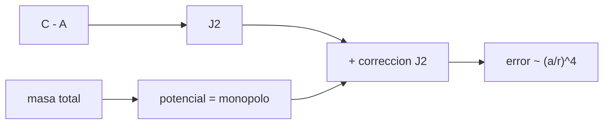

# B53-C03 — Campo gravitatorio planetario

<!-- nav:top -->
[🏠 Programa](../../../../README.md) · [📚 Bloque B53](../../../tronco-comun/B53-astrogeologia-y-geodesia-planetaria.md) · [← Anterior: B53-C02 — Sismología planetaria](../B53-C02-sismologia-planetaria/CLASE.md) · [Siguiente: B53-C04 — Geoides y elipsoides →](../B53-C04-geoides-y-elipsoides/CLASE.md)
<!-- /nav -->

## 1. Ubicación, nivel y alcance

Clase 3 del bloque B53. Nivel N3. El campo gravitatorio de un cuerpo no esférico se escribe como una serie de multipolos: el monopolo `GM/r` y correcciones como `J2`, que mide el achatamiento de la distribución de masa. Aquí modelas un cuerpo **sintético** (masa central más un anillo ecuatorial), calculas su potencial por **suma directa** de 720 masas puntuales y lo comparas con la serie truncada en `J2`. Muestras que el error baja como `(a/r)⁴`.

## 2. Por qué esta clase existe

Las trayectorias de una sonda dependen del campo. La decisión central: **¿hasta qué término de la serie hay que llegar a una distancia dada?** La respuesta depende de cuánto cae cada término con `r`.

## 3. Lo que podrás hacer al terminar

1. Escribir el potencial como monopolo más `J2`.
2. Obtener `J2` desde los momentos de inercia.
3. Calcular el potencial exacto por suma directa.
4. Medir cómo cae el error de truncar la serie con la distancia.
5. Estimar la diferencia de gravedad entre ecuador y polo.
6. Explicar por qué `J2` se asocia al achatamiento.

La evidencia es la **ficha del campo gravitatorio de un cuerpo sintético** del ejercicio 12 (sección 20).

## 4. Con qué llegas y cómo comprobarlo

1. ¿Qué es un potencial gravitatorio?
2. ¿Qué es un momento de inercia?
3. ¿Qué es una serie truncada?
4. ¿Qué es un polinomio de Legendre P2?
5. ¿Qué es un dato sintético?

<details>
<summary>Ver respuestas</summary>

1. Una función cuya pendiente da la fuerza por unidad de masa. 2. La resistencia a la rotación; depende de cómo se reparte la masa. 3. Una suma de la que se descartan los términos de orden alto. 4. `(3x² − 1)/2`. 5. Uno inventado para el ejemplo.
</details>

Con cuatro o cinco aciertos, sigue; si no, repasa los prerrequisitos.

## 5. Un caso de contexto y casos de referencia

Un cuerpo sintético con masa central `M0` y un anillo ecuatorial de masa `m = 0,02 M0` y radio `a`. Su `J2` es `0,00980`. A `r = 3a` la serie con `J2` difiere de la suma directa en `3,69 × 10⁻⁵` en relación; a `r = 10a`, en `2,78 × 10⁻⁷`. La pendiente del error en escala logarítmica es `-4,11`. Es el **ejemplo conductor**. Todo es **sintético o ilustrativo** y así se rotula.

## 6. Vocabulario

El **monopolo** es el término `−GM/r`. `J2` es el coeficiente zonal de segundo grado: `J2 = (C − A)/(M a²)`. La **suma directa** suma `−G m_i/d_i` sobre todas las masas. El **multipolo** de orden `n` cae como `(a/r)ⁿ`.

## 7. Modelo mental

Analogía: enfocar una foto borrosa: el monopolo es la mancha, `J2` le da la forma ovalada y los términos siguientes afinan el contorno.



*Descripción textual:* El monopolo y la corrección `J2` forman la serie truncada; el error crece al acercarse al cuerpo.

Límite de la analogía: la serie diverge dentro de la esfera que contiene toda la masa; el análisis vale solo para `r > a`.

## 8. La explicación, paso a paso

### 8,1 El modelo

`V(r, φ) = −(GM/r)[1 − J2 (a/r)² P2(sin φ)]`, con `P2(x) = (3x² − 1)/2` y `φ` la latitud. Para un anillo ecuatorial de masa `m` sobre una masa central, `C = m a²`, `A = m a²/2` y `J2 = m/(2M)`.

### 8,2 Error de la serie

| `r/a` | latitud | `V` directo [`GM0/a`] | error relativo del truncamiento |
|---|---|---|---|
| 2 | 0° | -0,510732 | 2,09 × 10⁻⁴ |
| 3 | 0° | -0,340198 | 3,69 × 10⁻⁵ |
| 5 | 0° | -0,204041 | 4,54 × 10⁻⁶ |
| 10 | 0° | -0,102005 | 2,78 × 10⁻⁷ |

La pendiente ajustada de `log(error)` frente a `log(r/a)` es `-4,11`, cerca de `−4`: el primer término omitido es de orden `(a/r)⁴`.

### 8,3 Ecuador y polo

A `r = 3a`, `V_eq − V_polo = -5,398 × 10⁻⁴ GM0/a` (el ecuador es más profundo porque hay masa más cerca).

## 9. Magnitudes, símbolos y unidades

| Símbolo | Qué es | Unidad | Valor / nota |
|---|---|---|---|
| `G M0` | parámetro gravitatorio | unidades de `GM0/a` = 1 | adimensional |
| `m/M0` | masa del anillo | — | 0,02 |
| `J2` | coeficiente zonal | — | 0,00980 |
| `a` | radio del anillo | unidad de longitud | 1 |
| `V` | potencial | `GM0/a` | ver 8,2 |

## 10. Convenciones y referencias

Adimensional (`G M0 = 1`, `a = 1`); anillo de 720 masas puntuales; marco principal del cuerpo, `z` por el eje de simetría; tolerancia: pendiente entre −4,5 y −3,5.

## 11. De dónde sale lo que afirmamos

| ID | Fuente | Localizador | Respalda | Estado |
|---|---|---|---|---|
| — | Sin fuente externa | — | relaciones estándar que verifica el laboratorio | No se consultó una fuente para esta clase |

Límites: no se consultó ninguna fuente; el modelo es un ejemplo de laboratorio.

## 12. Cómo ver el resultado

| Magnitud | Valor |
|---|---|
| `J2` | 0,00980 |
| error a `r = 3a` | 3,69 × 10⁻⁵ |
| error a `r = 10a` | 2,78 × 10⁻⁷ |
| pendiente del error | -4,11 |
| `V_eq − V_polo` a `3a` | -5,398 × 10⁻⁴ `GM0/a` |

Descripción larga: el error del truncamiento baja unas 4 décadas por cada década de distancia en `r`.

## 13. Ejemplo trabajado

**Paso 1.** Datos: `m/M0 = 0,02`, `M = 1,02 M0`.

**Paso 2.** `J2 = m/(2M) = 0,02/(2 × 1,02) = 0,00980`.

**Paso 3.** A `r = 3a`: `V` directo `-0,340198`.

**Paso 4.** Error relativo de la serie: `3,69 × 10⁻⁵`.

## 14. Distintas formas de describirlo

**Por fórmula:** serie en `J2`. **Por suma:** 720 masas. **Por tabla:** errores. **Por pendiente:** ley de potencias.

## 15. Práctica guiada

**Ejercicio 1 · con los pasos indicados.** Calcula `J2` para `m/M0 = 0,02`.

<details><summary>Solución comentada</summary>

`0,00980`.
</details>

**Ejercicio 2 · con una pista.** ¿Cuánto vale `P2` en el ecuador y en el polo?

<details><summary>Solución comentada</summary>

`−1/2` y `1`.
</details>

**Ejercicio 3 · casi autónomo.** ¿Qué término se omite al truncar en `J2`?

<details><summary>Solución comentada</summary>

El de orden `(a/r)⁴`.
</details>

## 16. Práctica autónoma, transferencia e integrador

**Ejercicio 4 · autónomo.** ¿Cuánto debe cambiar el error al duplicar `r`?

<details><summary>Solución comentada</summary>

Un factor `2⁻⁴ = 1/16`.
</details>

**Ejercicio 5 · autónomo.** Lee el error a `r = 5a`.

<details><summary>Solución comentada</summary>

`4,54 × 10⁻⁶`.
</details>

**Ejercicio 6 · autónomo.** ¿Por qué el ecuador tiene un potencial más negativo?

<details><summary>Solución comentada</summary>

Hay masa más cerca.
</details>

**Ejercicio 7 · autónomo.** ¿Qué pasa si `m` se duplica?

<details><summary>Solución comentada</summary>

`J2` casi se duplica.
</details>

**Ejercicio 8 · autónomo.** ¿Qué pasa con el error si `r < a`?

<details><summary>Solución comentada</summary>

La serie no es válida.
</details>

**Ejercicio 9 · transferencia.** Una sonda pasa a `r = 2a`. ¿Basta `J2`?

<details><summary>Solución comentada</summary>

El error es `2,1 × 10⁻⁴`; depende de la tolerancia pedida.
</details>

**Ejercicio 10 · transferencia.** ¿Cómo se obtiene `J2` desde la trayectoria?

<details><summary>Solución comentada</summary>

Se ajusta a las perturbaciones del movimiento; aquí no se hace.
</details>

**Ejercicio 11 · transferencia.** ¿Qué cambia si la masa no tiene simetría axial?

<details><summary>Solución comentada</summary>

Aparecen términos tesserales y sectoriales.
</details>

**Ejercicio 12 · integrador.** Elabora tu *ficha del campo gravitatorio de un cuerpo sintético*: `J2`, errores, pendiente y límites.

<details><summary>Solución modelo</summary>

Secciones 8,1 a 8,3.
</details>

## 17. Laboratorio: monopolo y J2 frente a la suma directa

El script [gravedad.py](gravedad.py) calcula el potencial exacto por suma de 720 masas y lo compara con la serie truncada en `J2` (**comprueba** pendiente entre −4,5 y −3,5).

**Datos:** adimensionales, **sintéticos**. **Predice antes de ejecutar:** ¿qué pendiente esperas? (−4). **Ejecución del 2026-11-09 (Python 3,12,9):**

```text
Python 3.12.9 (biblioteca estandar)
J2 = m/(2M) = 0.009804
r =  2 a: V directo = -0.51073182 ; error relativo de la serie con J2 = 2.092e-04
r =  3 a: V directo = -0.34019774 ; error relativo de la serie con J2 = 3.689e-05
r =  5 a: V directo = -0.20404093 ; error relativo de la serie con J2 = 4.537e-06
r = 10 a: V directo = -0.10200503 ; error relativo de la serie con J2 = 2.777e-07
pendiente de log(error) frente a log(r/a) = -4.109
V(ecuador) - V(polo) a r=3a = -5.3985e-04 (GM0/a)
Pruebas superadas.
```

```bash
python programa/clases/B53/B53-C03-campo-gravitatorio-planetario/gravedad.py
```

**Límites:** axisimétrico y adimensional; sin rotación ni datos de misión.

## 18. Errores frecuentes y cómo corregirlos

**Tratar la serie como válida dentro del cuerpo.** se corrige con la sección 6

**Confundir `J2` con la forma geométrica.** se corrige con 8,1

**Presentar el cuerpo como real.** se corrige con la sección 10

## 19. Cómo sabrás que vas bien

Tras la sección 8: ¿qué resultado esperabas y cuál obtuviste? Si dudas, repasa el ejemplo de la sección 13. Tras el laboratorio: ¿qué comprueba? (ver la sección 17).

## 20. Qué entregas y cómo se evalúa

El producto es tu **ficha del campo gravitatorio de un cuerpo sintético** (ejercicio 12).

| Criterio | Inicial | En desarrollo | Logrado | Destacado |
|---|---|---|---|---|
| Conceptos | Los confunde | Parciales | Conceptos de la clase | Explica los límites |
| Cálculo | Sin unidades | Con errores | Tablas completas | Calcula casos nuevos |
| Numérico | Sin comprobar | Un caso | Contraste con el análisis | Interpreta las diferencias |
| Fuentes | Sin fuente | Sin fecha | Fuentes con fecha | Declara lo sintético |
| Límites | No los nombra | Uno | Tres | Discute qué falta del modelo |

**Condiciones críticas (no se compensan con promedio):** rotular el cuerpo como sintético; no atribuir `J2` a un planeta real; citar solo lo consultado.

## 21. Ética, seguridad y límites

Clase educativa: los modelos son simplificados y no sustituyen a los productos de una misión ni a la literatura primaria. Ningún dato simulado se presenta como observado. Accesibilidad: tablas equivalentes a las gráficas, fórmulas en texto, ejercicios sin conexión.

## 22. Para cerrar y seguir

La serie con `J2` reproduce el potencial con un error que cae como `(a/r)⁴` (pendiente `-4,11`). Queda una pregunta: ¿cómo se define una superficie de referencia?

**Glosario español–inglés.** coeficiente zonal · *zonal coefficient*; potencial · *potential*; suma directa · *direct summation*.

**Continuidad.** [B53-C04](../B53-C04-geoides-y-elipsoides/CLASE.md) define geoide y elipsoide.

**Referencias:** ver sección 11.

<!-- nav:bottom -->
---

[← Anterior: B53-C02 — Sismología planetaria](../B53-C02-sismologia-planetaria/CLASE.md) · [📚 Bloque B53](../../../tronco-comun/B53-astrogeologia-y-geodesia-planetaria.md) · [Siguiente: B53-C04 — Geoides y elipsoides →](../B53-C04-geoides-y-elipsoides/CLASE.md)
<!-- /nav -->
