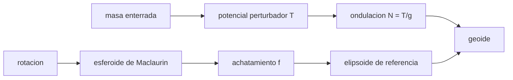

# B53-C04 — Geoides y elipsoides

<!-- nav:top -->
[🏠 Programa](../../../../README.md) · [📚 Bloque B53](../../../tronco-comun/B53-astrogeologia-y-geodesia-planetaria.md) · [← Anterior: B53-C03 — Campo gravitatorio planetario](../B53-C03-campo-gravitatorio-planetario/CLASE.md) · [Siguiente: B53-C05 — Sistemas de coordenadas lunares →](../B53-C05-sistemas-de-coordenadas-lunares/CLASE.md)
<!-- /nav -->

## 1. Ubicación, nivel y alcance

Clase 4 del bloque B53. Nivel N3. El **elipsoide** es la superficie matemática de referencia; el **geoide** es la equipotencial que coincide con el nivel medio del mar o su análogo en otro cuerpo. Aquí resuelves el esferoide de Maclaurin (un cuerpo homogéneo en rotación) para un cuerpo **sintético**, lo comparas con la aproximación lineal `f ≈ 5q/4` y calculas la ondulación del geoide que produce una masa enterrada con la relación de Bruns. Los valores son ilustrativos.

## 2. Por qué esta clase existe

Una altura solo tiene sentido respecto de una superficie de referencia. La decisión central: **¿contra qué superficie se mide la altura y cuánto se aparta el geoide de ella?**

## 3. Lo que podrás hacer al terminar

1. Distinguir elipsoide, geoide y superficie topográfica.
2. Resolver la excentricidad del esferoide de Maclaurin por bisección.
3. Comparar con la aproximación `f ≈ 5q/4`.
4. Aplicar la relación de Bruns `N = T/g`.
5. Verificar `N` resolviendo la equipotencial numéricamente.
6. Explicar por qué el geoide ondula.

La evidencia es la **ficha de la figura de equilibrio y su ondulación** del ejercicio 12 (sección 20).

## 4. Con qué llegas y cómo comprobarlo

1. ¿Qué es una superficie equipotencial?
2. ¿Qué es el achatamiento?
3. ¿Qué es la fuerza centrífuga?
4. ¿Qué es una bisección?
5. ¿Qué es un valor ilustrativo?

<details>
<summary>Ver respuestas</summary>

1. Una superficie donde el potencial es constante. 2. `f = (a − c)/a`. 3. La fuerza aparente en un sistema que rota. 4. Un método para hallar una raíz acotándola por mitades. 5. Uno propuesto para el ejemplo, no medido.
</details>

Con cuatro o cinco aciertos, sigue; si no, repasa los prerrequisitos.

## 5. Un caso de contexto y casos de referencia

Un cuerpo homogéneo sintético de densidad `5500 kg/m³` y período de rotación `24 h`. El parámetro `ω²/(πGρ)` vale `0,00459`, la excentricidad de Maclaurin `0,09267`, el achatamiento `f = 0,004303` (`1/232,4`) y la aproximación lineal `0,004299`. Una masa enterrada de `10¹⁶ kg` a `10 km` de profundidad ondula el geoide `7,234 m` con Bruns y `7,229 m` por la equipotencial. Es el **ejemplo conductor**. Todo es **sintético o ilustrativo** y así se rotula.

## 6. Vocabulario

El **geoide** es una equipotencial de gravedad (atracción más centrífuga). El **elipsoide de referencia** es una figura de revolución elegida por convención. La **ondulación** `N` es la altura del geoide sobre el elipsoide. La **fórmula de Bruns** es `N = T/g` con `T` el potencial perturbador.

## 7. Modelo mental

Analogía: una gota de agua girando: se achata por la rotación y se abomba sobre una piedra pesada que está debajo.



*Descripción textual:* La rotación define el elipsoide; las anomalías de masa ondulan el geoide sobre él.

Límite de la analogía: un cuerpo real no es homogéneo; el esferoide de Maclaurin da solo el orden de magnitud.

## 8. La explicación, paso a paso

### 8,1 Esferoide de Maclaurin

La excentricidad cumple `ω²/(πGρ) = (2√(1−e²)/e³)(3 − 2e²) asin e − 6(1−e²)/e²`. Se resuelve por bisección y `f = 1 − √(1−e²)`. La aproximación de Clairaut para un cuerpo homogéneo es `f ≈ 5q/4` con `q = ω²R³/(GM) = 3ω²/(4πGρ)`.

| Magnitud | Valor |
|---|---|
| `ω` [rad/s] | 7,2722 × 10⁻⁵ |
| `x = ω²/(πGρ)` | 0,004586 |
| `e` (Maclaurin) | 0,092670 |
| `f` (Maclaurin) | 0,0043032 |
| `f ≈ 5q/4` | 0,0042992 |
| diferencia relativa | 9,27 × 10⁻⁴ |

### 8,2 Ondulación del geoide

Con una masa puntual enterrada `Δm` a profundidad `d`, `T = GΔm/√(x² + d²)` y `N = T/g`. Resolviendo en cambio la equipotencial `GM/(R + h) + T = GM/R` por bisección resulta lo siguiente.

| Magnitud | Valor |
|---|---|
| `g = GM/R²` [m/s²] | 9,2259 |
| `N` (Bruns) [m] | 7,2343 |
| `N` (equipotencial) [m] | 7,2291 |

### 8,3 Lectura

El geoide queda **por encima** del elipsoide sobre la masa extra. La altura ortométrica y la elipsoidal difieren en `N`; confundirlas introduce errores de metros.

## 9. Magnitudes, símbolos y unidades

| Símbolo | Qué es | Unidad | Valor / nota |
|---|---|---|---|
| `G` | constante gravitatoria | m³ kg⁻¹ s⁻² | 6,67430 × 10⁻¹¹ (NIST) |
| `ρ` | densidad | kg/m³ | 5500 (ilustrativo) |
| `ω` | velocidad angular | rad/s | 7,272 × 10⁻⁵ |
| `f` | achatamiento | — | 0,004303 |
| `N` | ondulación del geoide | m | 7,229 |

## 10. Convenciones y referencias

Cuerpo homogéneo sintético, rotación rígida; `G` de NIST (CODATA 2022); radio medio ilustrativo `R = 6,0 × 10⁶ m`; bisección con tolerancia 10⁻¹²; tolerancia de Bruns frente a la equipotencial: 10⁻³ relativa.

## 11. De dónde sale lo que afirmamos

| ID | Fuente | Localizador | Respalda | Estado |
|---|---|---|---|---|
| S1 | NIST, *Fundamental Physical Constants*: constante gravitatoria newtoniana (CODATA 2022) | https://physics.nist.gov/cgi-bin/cuu/Value?bg | valor de `G` | Consultada el 2026-11-09 |

Límites: no se consultó ninguna fuente sobre figuras de planetas reales; el cuerpo es sintético.

## 12. Cómo ver el resultado

| Magnitud | Valor |
|---|---|
| excentricidad | 0,09267 |
| achatamiento | 0,004303 |
| aproximación lineal | 0,004299 |
| `N` por Bruns | 7,234 m |
| `N` por equipotencial | 7,229 m |

Descripción larga: el esferoide queda levemente achatado y la ondulación del geoide es de unos metros en este ejemplo.

## 13. Ejemplo trabajado

**Paso 1.** Datos: `ρ = 5500`, período `24 h`, `ω = 2π/86400`.

**Paso 2.** Parámetro: `x = ω²/(πGρ) = 0,004586`.

**Paso 3.** Bisección: `e = 0,092670`, `f = 0,004303`.

**Paso 4.** Aproximación: `f ≈ 5q/4 = 0,004299`.

## 14. Distintas formas de describirlo

**Por fórmula:** Maclaurin. **Por aproximación:** `5q/4`. **Por tabla:** valores. **Por equipotencial:** resolución numérica.

## 15. Práctica guiada

**Ejercicio 1 · con los pasos indicados.** Calcula `ω` para un período de `24 h`.

<details><summary>Solución comentada</summary>

`7,2722 × 10⁻⁵ rad/s`.
</details>

**Ejercicio 2 · con una pista.** ¿Cuánto vale `f` si `e = 0,1`?

<details><summary>Solución comentada</summary>

`1 − √0,99 = 0,005013`.
</details>

**Ejercicio 3 · casi autónomo.** ¿Por qué `f ≈ e²/2` para `e` pequeña?

<details><summary>Solución comentada</summary>

Porque `1 − √(1−e²) ≈ e²/2`.
</details>

## 16. Práctica autónoma, transferencia e integrador

**Ejercicio 4 · autónomo.** Calcula la diferencia relativa entre `f` y su aproximación.

<details><summary>Solución comentada</summary>

`9,27 × 10⁻⁴`.
</details>

**Ejercicio 5 · autónomo.** ¿Cuánto vale `g` en el modelo?

<details><summary>Solución comentada</summary>

`9,226 m/s²`.
</details>

**Ejercicio 6 · autónomo.** ¿Qué pasa con `N` si la masa se duplica?

<details><summary>Solución comentada</summary>

Se duplica.
</details>

**Ejercicio 7 · autónomo.** ¿Qué pasa con `N` si la profundidad se duplica?

<details><summary>Solución comentada</summary>

Baja unas 2 veces (decae como `1/d`).
</details>

**Ejercicio 8 · autónomo.** ¿Qué es mayor, la altura ortométrica o la elipsoidal?

<details><summary>Solución comentada</summary>

Depende del signo de `N`; la elipsoidal es `H + N`.
</details>

**Ejercicio 9 · transferencia.** Una sonda mide altura sobre el elipsoide. ¿Qué falta para dar altura respecto del geoide?

<details><summary>Solución comentada</summary>

Un modelo de `N`.
</details>

**Ejercicio 10 · transferencia.** ¿Qué cambia si el cuerpo gira más rápido?

<details><summary>Solución comentada</summary>

`x` y `f` crecen; más allá de un límite el modelo deja de ser válido.
</details>

**Ejercicio 11 · transferencia.** ¿Por qué un planeta real tiene `f` menor que el homogéneo?

<details><summary>Solución comentada</summary>

Tiene la masa concentrada hacia el centro.
</details>

**Ejercicio 12 · integrador.** Elabora tu *ficha de la figura de equilibrio y su ondulación*: `e`, `f`, `N` y límites.

<details><summary>Solución modelo</summary>

Secciones 8,1 a 8,3.
</details>

## 17. Laboratorio: esferoide de Maclaurin y ondulación del geoide

El script [figura.py](figura.py) resuelve el esferoide de Maclaurin por bisección y la equipotencial con una masa enterrada (**comprueba** la aproximación lineal dentro de 1 % y Bruns dentro de 10⁻³).

**Datos:** `G` de NIST; cuerpo **sintético**. **Predice antes de ejecutar:** ¿será `f` mayor o menor que la aproximación `5q/4`? (ligeramente distinta). **Ejecución del 2026-11-09 (Python 3,12,9):**

```text
Python 3.12.9 (biblioteca estandar)
omega = 7.27221e-05 rad/s ; x = w^2/(pi G rho) = 0.0045858
Maclaurin: e = 0.0926705 ; f = 0.00430317 (1/232.39) ; aproximacion 5q/4 = 0.00429918 ; dif. relativa = 9.274e-04
g = 9.2259 m/s2 ; N Bruns = 7.23432 m ; N equipotencial = 7.22910 m
Pruebas superadas.
```

```bash
python programa/clases/B53/B53-C04-geoides-y-elipsoides/figura.py
```

**Límites:** cuerpo homogéneo, rotación rígida, masa puntual enterrada.

## 18. Errores frecuentes y cómo corregirlos

**Confundir geoide con elipsoide.** se corrige con 8,3

**Mezclar alturas ortométricas y elipsoidales.** se corrige con 8,3

**Presentar el cuerpo como real.** se corrige con la sección 10

## 19. Cómo sabrás que vas bien

Tras la sección 8: ¿qué resultado esperabas y cuál obtuviste? Si dudas, repasa el ejemplo de la sección 13. Tras el laboratorio: ¿qué comprueba? (ver la sección 17).

## 20. Qué entregas y cómo se evalúa

El producto es tu **ficha de la figura de equilibrio y su ondulación** (ejercicio 12).

| Criterio | Inicial | En desarrollo | Logrado | Destacado |
|---|---|---|---|---|
| Conceptos | Los confunde | Parciales | Conceptos de la clase | Explica los límites |
| Cálculo | Sin unidades | Con errores | Tablas completas | Calcula casos nuevos |
| Numérico | Sin comprobar | Un caso | Contraste con el análisis | Interpreta las diferencias |
| Fuentes | Sin fuente | Sin fecha | Fuentes con fecha | Declara lo sintético |
| Límites | No los nombra | Uno | Tres | Discute qué falta del modelo |

**Condiciones críticas (no se compensan con promedio):** rotular el cuerpo como sintético; no mezclar alturas sin declarar la superficie de referencia; citar solo lo consultado.

## 21. Ética, seguridad y límites

Clase educativa: los modelos son simplificados y no sustituyen a los productos de una misión ni a la literatura primaria. Ningún dato simulado se presenta como observado. Accesibilidad: tablas equivalentes a las gráficas, fórmulas en texto, ejercicios sin conexión.

## 22. Para cerrar y seguir

Maclaurin da `f = 0,004303` y Bruns reproduce la equipotencial (`7,234` frente a `7,229 m`). Queda una pregunta: ¿cómo se ubica un punto en la Luna?

**Glosario español–inglés.** geoide · *geoid*; elipsoide · *ellipsoid*; achatamiento · *flattening*; ondulación · *geoid undulation*.

**Continuidad.** [B53-C05](../B53-C05-sistemas-de-coordenadas-lunares/CLASE.md) estudia los sistemas de coordenadas lunares.

**Referencias:** ver sección 11.

<!-- nav:bottom -->
---

[← Anterior: B53-C03 — Campo gravitatorio planetario](../B53-C03-campo-gravitatorio-planetario/CLASE.md) · [📚 Bloque B53](../../../tronco-comun/B53-astrogeologia-y-geodesia-planetaria.md) · [Siguiente: B53-C05 — Sistemas de coordenadas lunares →](../B53-C05-sistemas-de-coordenadas-lunares/CLASE.md)
<!-- /nav -->
