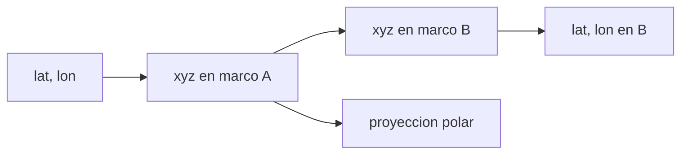

# B53-C05 — Sistemas de coordenadas lunares

<!-- nav:top -->
[🏠 Programa](../../../../README.md) · [📚 Bloque B53](../../../tronco-comun/B53-astrogeologia-y-geodesia-planetaria.md) · [← Anterior: B53-C04 — Geoides y elipsoides](../B53-C04-geoides-y-elipsoides/CLASE.md) · [Siguiente: B53-C06 — Geodesia de Marte →](../../../tronco-comun/B53-astrogeologia-y-geodesia-planetaria.md#b53-c06)
<!-- /nav -->

## 1. Ubicación, nivel y alcance

Clase 5 del bloque B53. Nivel N3. Un mapa lunar necesita un **marco de referencia** (ejes del cuerpo), una **figura de referencia** (aquí una esfera) y una **convención** de latitud y longitud. Aquí implementas la conversión entre latitud/longitud y coordenadas cartesianas, la rotación pequeña entre dos marcos del cuerpo (uno de ejes principales y otro de ejes de rotación media, con un desfase **ilustrativo**), la distancia sobre la esfera y una proyección estereográfica polar sur. Verificas inversas, normas y la escala local de la proyección.

## 2. Por qué esta clase existe

Dos productos en marcos distintos no se superponen sin corregir. La decisión central: **¿en qué marco, con qué figura y con qué convención está cada coordenada, y cuánto se desplaza un punto al cambiar de marco?**

## 3. Lo que podrás hacer al terminar

1. Convertir latitud/longitud (este positivo) a cartesianas y viceversa.
2. Aplicar y deshacer una rotación entre marcos del cuerpo.
3. Acotar el desplazamiento en superficie por un desfase angular.
4. Calcular distancias sobre la esfera.
5. Proyectar al polo sur y medir la escala local.
6. Declarar marco, figura y convención en una ficha.

La evidencia es la **ficha del sistema de coordenadas lunar** del ejercicio 12 (sección 20).

## 4. Con qué llegas y cómo comprobarlo

1. ¿Qué es la latitud planetocéntrica?
2. ¿Qué es una matriz de rotación?
3. ¿Qué es una proyección?
4. ¿Qué es un marco de referencia?
5. ¿Qué es un valor ilustrativo?

<details>
<summary>Ver respuestas</summary>

1. El ángulo entre el radio vector y el plano ecuatorial. 2. Una matriz ortogonal que gira vectores sin cambiar su norma. 3. Una regla que pasa puntos de la esfera al plano. 4. Un conjunto de ejes con origen definido. 5. Uno propuesto para el ejemplo, no medido.
</details>

Con cuatro o cinco aciertos, sigue; si no, repasa los prerrequisitos.

## 5. Un caso de contexto y casos de referencia

Una esfera ilustrativa de `R = 1737,4 km` (valor de uso común, **no consultado** en una fuente). Un desfase de marcos de `(0,02°, 0,03°, 0,01°)` desplaza un punto hasta `1,1346 km` (cota `1,1346 km`). Los errores de ida y vuelta son de `6,5 × 10⁻¹² km`, la distancia entre dos puntos de prueba es `2612,44 km` y la escala de la proyección a 85° S es `1,00191` (numérica `1,00191`). Es el **ejemplo conductor**. Todo es **sintético o ilustrativo** y así se rotula.

## 6. Vocabulario

El **marco ME** y el **marco PA** son dos conjuntos de ejes ligados al cuerpo que difieren en una rotación pequeña. La **longitud este** crece hacia el este. La **proyección estereográfica** es conforme: conserva ángulos y cambia la escala con la latitud. Una **cota** es un valor que no se supera.

## 7. Modelo mental

Analogía: dos mapas del mismo pueblo dibujados con el norte ligeramente girado: sin conocer el giro, los edificios no coinciden.



*Descripción textual:* Las coordenadas geográficas se convierten a cartesianas, se rotan entre marcos y se vuelven a convertir o se proyectan.

Límite de la analogía: los marcos reales se definen con modelos de rotación y se refinan con datos; aquí el desfase es inventado.

## 8. La explicación, paso a paso

### 8,1 Conversión y rotación

`x = R cos φ cos λ`, `y = R cos φ sin λ`, `z = R sin φ`, con `λ` este positiva. La rotación pequeña entre marcos es `R = Rz Ry Rx`.

| Prueba (2000 puntos aleatorios) | Resultado |
|---|---|
| error máximo de ida y vuelta lat/lon | 6,46 × 10⁻¹² km |
| error máximo de norma tras rotar | 4,55 × 10⁻¹³ km |
| desplazamiento máximo por el desfase | 1,13455 km |
| cota `R·|θ|` | 1,13460 km |

### 8,2 Distancia y proyección

La distancia entre dos puntos se calcula con la fórmula de haversine: `2612,442 km`. En la proyección estereográfica polar sur `ρ = 2R tan((90° − |φ|)/2)` y la escala radial es `k = 2/(1 + sin|φ|)`.

| Latitud | `k` analítica | `k` numérica |
|---|---|---|
| 85° S | 1,001906 | 1,001906 |

### 8,3 Lectura

Un desfase de `0,04°` equivale a unos `1,13 km` en superficie. Si el marco no se declara, ese error pasa inadvertido.

## 9. Magnitudes, símbolos y unidades

| Símbolo | Qué es | Unidad | Valor / nota |
|---|---|---|---|
| `R` | radio de la esfera de referencia | km | 1737,4 (ilustrativo) |
| `φ`, `λ` | latitud y longitud este | grados | — |
| `θ` | desfase angular | grados | 0,02; 0,03; 0,01 (ilustrativos) |
| `k` | escala de la proyección | — | 1,00191 a 85° S |
| `d` | distancia en superficie | km | 2612,44 |

## 10. Convenciones y referencias

Esfera de `R = 1737,4 km` (ilustrativo, no consultado); latitud planetocéntrica, longitud este positiva, rango −180° a 180°; semilla `20261109`; tolerancias: ida y vuelta 10⁻⁹ km, escala 10⁻⁴.

## 11. De dónde sale lo que afirmamos

| ID | Fuente | Localizador | Respalda | Estado |
|---|---|---|---|---|
| S1 | Archinal et al., informe del grupo de trabajo IAU sobre coordenadas cartográficas y elementos de rotación (2018) | https://doi.org/10.1007/s10569-017-9805-5 | modelos de rotación y marcos cartográficos de los cuerpos (referencia para el estudiante) | No consultada (la página redirige a un inicio de sesión) |
| S2 | NASA Science, misión Lunar Reconnaissance Orbiter | https://science.nasa.gov/mission/lro/ | contexto: LOLA mide la elevación de la Luna y LROC se nombra en la galería | Página consultada el 2026-11-09 (LROC solo se nombra) |

Límites: no se leyó el informe de la IAU: ni el radio ni el desfase proceden de él. La página de la misión no da marcos ni valores.

## 12. Cómo ver el resultado

| Magnitud | Valor |
|---|---|
| error de ida y vuelta | 6,5 × 10⁻¹² km |
| desplazamiento máximo | 1,1346 km |
| cota | 1,1346 km |
| distancia de prueba | 2612,44 km |
| escala 85° S | 1,00191 |

Descripción larga: el desplazamiento máximo se mantiene por debajo de la cota.

## 13. Ejemplo trabajado

**Paso 1.** Datos: `θ = (0,02°, 0,03°, 0,01°)`, `|θ| = 0,0374°`.

**Paso 2.** Cota: `R |θ| = 1737,4 × 6,53 × 10⁻⁴ = 1,1346 km`.

**Paso 3.** Medido sobre 2000 puntos: `1,1346 km`.

**Paso 4.** Conclusión: el desfase no supera la cota.

## 14. Distintas formas de describirlo

**Por fórmula:** `x, y, z`. **Por matriz:** rotación. **Por tabla:** pruebas. **Por mapa:** proyección polar.

## 15. Práctica guiada

**Ejercicio 1 · con los pasos indicados.** Convierte `φ = 0°, λ = 90°` a cartesianas (km).

<details><summary>Solución comentada</summary>

`(0, 1737,4, 0)`.
</details>

**Ejercicio 2 · con una pista.** ¿Cuánto vale `R·θ` para `θ = 0,01°`?

<details><summary>Solución comentada</summary>

`0,303 km`.
</details>

**Ejercicio 3 · casi autónomo.** ¿Qué propiedad tiene una matriz de rotación?

<details><summary>Solución comentada</summary>

Es ortogonal y de determinante 1.
</details>

## 16. Práctica autónoma, transferencia e integrador

**Ejercicio 4 · autónomo.** Calcula `k` en el polo.

<details><summary>Solución comentada</summary>

`k = 2/(1 + 1) = 1`.
</details>

**Ejercicio 5 · autónomo.** ¿Cuánto cambia `k` de 85° S a 70° S?

<details><summary>Solución comentada</summary>

Pasa de `1,0019` a `2/(1+sin70°) = 1,0311` aprox.
</details>

**Ejercicio 6 · autónomo.** ¿Qué distancia hay entre dos puntos del ecuador separados 1°?

<details><summary>Solución comentada</summary>

`R × 0,017453 = 30,32 km`.
</details>

**Ejercicio 7 · autónomo.** ¿Por qué la proyección estereográfica no conserva áreas?

<details><summary>Solución comentada</summary>

Es conforme; el factor `k` cambia con la latitud.
</details>

**Ejercicio 8 · autónomo.** Convierte longitud oeste 30° a este.

<details><summary>Solución comentada</summary>

`−30°` este (o `330°`).
</details>

**Ejercicio 9 · transferencia.** Dos productos usan marcos con 0,03° de diferencia. ¿Qué haces?

<details><summary>Solución comentada</summary>

Declaro los marcos y transformo uno al otro.
</details>

**Ejercicio 10 · transferencia.** ¿Qué pasa si se mezclan latitud planetográfica y planetocéntrica?

<details><summary>Solución comentada</summary>

En una esfera coinciden; en un elipsoide difieren (clase siguiente).
</details>

**Ejercicio 11 · transferencia.** ¿Por qué conviene una proyección polar cerca del polo?

<details><summary>Solución comentada</summary>

Evita la distorsión extrema de las cilíndricas.
</details>

**Ejercicio 12 · integrador.** Elabora tu *ficha del sistema de coordenadas lunar*: marco, figura, convención, desfase y escala.

<details><summary>Solución modelo</summary>

Secciones 8,1 a 8,3 con unidades.
</details>

## 17. Laboratorio: transformaciones de coordenadas sobre una esfera lunar

El script [lunar.py](lunar.py) verifica con 2000 puntos aleatorios las inversas, la conservación de la norma y la cota del desplazamiento (**comprueba** 10⁻⁹ km y escala 10⁻⁴).

**Datos:** esfera y desfase **ilustrativos**; semilla `20261109`. **Predice antes de ejecutar:** ¿el desplazamiento máximo superará la cota? (no). **Ejecución del 2026-11-09 (Python 3,12,9):**

```text
Python 3.12.9 (biblioteca estandar)
ida y vuelta lat/lon (2000 puntos): error maximo 6.46e-12 km
norma tras rotar: error maximo 4.55e-13 km
desplazamiento por el desfase: maximo 1.13455 km ; cota R*|theta| = 1.13460 km
distancia haversine (20S,10E)-(35N,80E): 2612.442 km
escala de la estereografica a 85S: analitica 1.001906 ; numerica 1.001906
Pruebas superadas.
```

```bash
python programa/clases/B53/B53-C05-sistemas-de-coordenadas-lunares/lunar.py
```

**Límites:** esfera, sin elipsoide ni topografía; los desfases no son los de ningún marco real.

## 18. Errores frecuentes y cómo corregirlos

**No declarar el marco.** se corrige con la sección 10

**Mezclar longitud este y oeste.** se corrige con 8,1

**Tomar el desfase ilustrativo como el real.** se corrige con la sección 11

## 19. Cómo sabrás que vas bien

Tras la sección 8: ¿qué resultado esperabas y cuál obtuviste? Si dudas, repasa el ejemplo de la sección 13. Tras el laboratorio: ¿qué comprueba? (ver la sección 17).

## 20. Qué entregas y cómo se evalúa

El producto es tu **ficha del sistema de coordenadas lunar** (ejercicio 12).

| Criterio | Inicial | En desarrollo | Logrado | Destacado |
|---|---|---|---|---|
| Conceptos | Los confunde | Parciales | Conceptos de la clase | Explica los límites |
| Cálculo | Sin unidades | Con errores | Tablas completas | Calcula casos nuevos |
| Numérico | Sin comprobar | Un caso | Contraste con el análisis | Interpreta las diferencias |
| Fuentes | Sin fuente | Sin fecha | Fuentes con fecha | Declara lo sintético |
| Límites | No los nombra | Uno | Tres | Discute qué falta del modelo |

**Condiciones críticas (no se compensan con promedio):** declarar marco, figura y convención; rotular los valores como ilustrativos; citar solo lo consultado.

## 21. Ética, seguridad y límites

Clase educativa: los modelos son simplificados y no sustituyen a los productos de una misión ni a la literatura primaria. Ningún dato simulado se presenta como observado. Accesibilidad: tablas equivalentes a las gráficas, fórmulas en texto, ejercicios sin conexión.

## 22. Para cerrar y seguir

Las transformaciones se invierten con error `6 × 10⁻¹² km` y el desfase ilustrativo desplaza hasta `1,135 km`. Queda una pregunta: ¿qué cambia en Marte, donde la figura es un elipsoide?

**Glosario español–inglés.** longitud este · *east longitude*; marco de referencia · *reference frame*; proyección conforme · *conformal projection*.

**Continuidad.** [B53-C06](../B53-C06-geodesia-de-marte/CLASE.md) estudia la geodesia de Marte.

**Referencias:** ver sección 11.

<!-- nav:bottom -->
---

[← Anterior: B53-C04 — Geoides y elipsoides](../B53-C04-geoides-y-elipsoides/CLASE.md) · [📚 Bloque B53](../../../tronco-comun/B53-astrogeologia-y-geodesia-planetaria.md) · [Siguiente: B53-C06 — Geodesia de Marte →](../../../tronco-comun/B53-astrogeologia-y-geodesia-planetaria.md#b53-c06)
<!-- /nav -->
