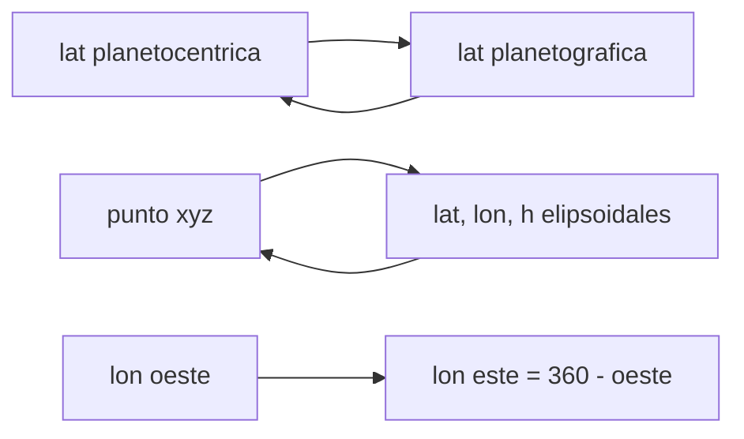

# B53-C06 — Geodesia de Marte

<!-- nav:top -->
[🏠 Programa](../../../../README.md) · [📚 Bloque B53](../../../tronco-comun/B53-astrogeologia-y-geodesia-planetaria.md) · [← Anterior: B53-C05 — Sistemas de coordenadas lunares](../B53-C05-sistemas-de-coordenadas-lunares/CLASE.md) · [Siguiente: B53-C07 — Topografía por altimetría →](../B53-C07-topografia-por-altimetria/CLASE.md)
<!-- /nav -->

## 1. Ubicación, nivel y alcance

Clase 6 del bloque B53. Nivel N3. En un cuerpo achatado, la **latitud planetocéntrica** (ángulo desde el centro) y la **planetográfica** (ángulo de la normal al elipsoide) no coinciden. Aquí trabajas con un elipsoide de revolución **ilustrativo** del tamaño de Marte: conviertes entre ambas latitudes, localizas la diferencia máxima con su fórmula exacta, calculas la altura sobre el elipsoide de un punto en el espacio por iteración, y conviertes entre longitud este y oeste. La topografía de Marte se mide con el altímetro láser MOLA (página del PDS consultada); aquí no se usan sus datos.

## 2. Por qué esta clase existe

Una altura de 1 km no significa lo mismo sobre una esfera que sobre un elipsoide. La decisión central: **¿qué latitud y qué referencia usa cada producto, y cuánto difieren?**

## 3. Lo que podrás hacer al terminar

1. Convertir latitud planetocéntrica y planetográfica.
2. Calcular la diferencia máxima y dónde ocurre.
3. Calcular la altura sobre el elipsoide de un punto 3D.
4. Convertir longitudes este y oeste.
5. Medir el efecto de confundir ambas latitudes.
6. Documentar la convención de un conjunto de datos.

La evidencia es la **ficha de la geodesia sobre un elipsoide** del ejercicio 12 (sección 20).

## 4. Con qué llegas y cómo comprobarlo

1. ¿Qué es un elipsoide de revolución?
2. ¿Qué es la normal a una superficie?
3. ¿Qué es una iteración de punto fijo?
4. ¿Qué es la longitud oeste?
5. ¿Qué es un valor ilustrativo?

<details>
<summary>Ver respuestas</summary>

1. Una superficie con dos semiejes iguales (`a`) y uno distinto (`c`). 2. La dirección perpendicular a ella. 3. Repetir una fórmula hasta que el valor no cambie. 4. La que crece hacia el oeste. 5. Uno propuesto para el ejemplo, no medido.
</details>

Con cuatro o cinco aciertos, sigue; si no, repasa los prerrequisitos.

## 5. Un caso de contexto y casos de referencia

Un elipsoide ilustrativo con `a = 3396,2 km` y achatamiento `1/170` (**no consultados** en una fuente). Las dos latitudes difieren como máximo `0,33803°` (fórmula exacta `0,33803°`) cerca de los `44,83°`. Un punto a 100 km de altura se recupera con error de `0,0 × 10⁰ km`. Es el **ejemplo conductor**. Todo es **sintético o ilustrativo** y así se rotula.

## 6. Vocabulario

La **latitud planetográfica** `φg` mide el ángulo de la normal al elipsoide con el plano ecuatorial; la **planetocéntrica** `φc`, del radio vector. Se relacionan por `tan φg = (a/c)² tan φc`. La **altura elipsoidal** `h` es la distancia a lo largo de la normal. Un **areoide** es el geoide de Marte.

## 7. Modelo mental

Analogía: una naranja achatada: la plomada no apunta al centro, y su ángulo con el suelo difiere del que da el hilo desde el centro.



*Descripción textual:* Se convierte entre las dos latitudes con una tangente, se pasa de xyz a lat, lon, h por iteración y se ajusta el sentido de la longitud.

Límite de la analogía: Marte real tiene un campo y una forma más complejos que un elipsoide de revolución.

## 8. La explicación, paso a paso

### 8,1 Latitudes

`tan φg = (a/c)² tan φc`, con `c = a(1 − f)`. La diferencia `φg − φc` es máxima en `tan φc = c/a` y vale `sin Δmax = (a² − c²)/(a² + c²)`.

| Magnitud | Valor |
|---|---|
| `a` [km] | 3396,2 |
| `c` [km] | 3376,222 |
| diferencia máxima, barrido numérico | 0,338027° |
| diferencia máxima, fórmula exacta | 0,338027° |
| latitud planetocéntrica del máximo | 44,831° |

### 8,2 Altura elipsoidal

Dado `(x, y, z)`, se itera `φ` y `N = a/√(1 − e² sin²φ)` hasta que `φ` cambia menos de `10⁻¹²` rad; entonces `h = p/cos φ − N`.

| Prueba | Resultado |
|---|---|
| altura recuperada de un punto a 100 km | 100,000000000 km |
| error | 0,0 × 10⁰ km |
| error de latitud | 3,6 × 10⁻¹⁵° |

### 8,3 Efecto de confundir las latitudes

A 45° la diferencia es `0,33802°`, es decir `20,04 km` en superficie. Son unos 20 km: una diferencia grande y sistemática.

## 9. Magnitudes, símbolos y unidades

| Símbolo | Qué es | Unidad | Valor / nota |
|---|---|---|---|
| `a` | semieje ecuatorial | km | 3396,2 (ilustrativo) |
| `f` | achatamiento | — | 1/170 (ilustrativo) |
| `c` | semieje polar | km | 3376,222 |
| `φc`, `φg` | latitudes | grados | — |
| `h` | altura elipsoidal | km | ver 8,2 |

## 10. Convenciones y referencias

Elipsoide de revolución ilustrativo, centro en el origen del cuerpo; longitud este positiva (la oeste se convierte restando de 360°); iteración con tolerancia 10⁻¹² rad; tolerancia de altura 10⁻⁹ km.

## 11. De dónde sale lo que afirmamos

| ID | Fuente | Localizador | Respalda | Estado |
|---|---|---|---|---|
| S1 | NASA PDS Geosciences Node, página de datos de MOLA (Mars Global Surveyor) | https://pds-geosciences.wustl.edu/missions/mgs/mola.html | contexto: MOLA generó los perfiles altimétricos usados para mapas topográficos globales de Marte | Página consultada el 2026-11-09 (no declara resolución vertical) |
| S2 | Archinal et al., informe del grupo de trabajo IAU sobre coordenadas cartográficas y elementos de rotación (2018) | https://doi.org/10.1007/s10569-017-9805-5 | convenciones de latitud y longitud de los cuerpos | No consultada (la página redirige a un inicio de sesión) |

Límites: el radio y el achatamiento no vienen de una fuente consultada; no se leyó el informe de la IAU; la página de MOLA no declara resolución vertical.

## 12. Cómo ver el resultado

| Magnitud | Valor |
|---|---|
| diferencia máxima | 0,33803° |
| latitud del máximo | 44,83° |
| diferencia a 45° | 0,33802° |
| error de altura | 0,0 × 10⁰ km |
| longitud oeste 250° → este | 110° |

Descripción larga: la diferencia entre latitudes es nula en el ecuador y los polos y máxima a latitudes medias.

## 13. Ejemplo trabajado

**Paso 1.** Datos: `a = 3396,2`, `f = 1/170`, `c = 3376,222 km`.

**Paso 2.** Cociente: `(a² − c²)/(a² + c²)` da `sin Δmax`.

**Paso 3.** `Δmax = 0,33803°`.

**Paso 4.** El barrido numérico da `0,33803°`.

## 14. Distintas formas de describirlo

**Por fórmula:** `tan φg = (a/c)² tan φc`. **Por barrido:** diferencia vs latitud. **Por iteración:** `h`. **Por tabla:** convenciones.

## 15. Práctica guiada

**Ejercicio 1 · con los pasos indicados.** Calcula `c` con `a = 3396,2` y `f = 1/170`.

<details><summary>Solución comentada</summary>

`3376,222 km`.
</details>

**Ejercicio 2 · con una pista.** ¿Qué diferencia hay en el ecuador?

<details><summary>Solución comentada</summary>

Cero.
</details>

**Ejercicio 3 · casi autónomo.** ¿Dónde es máxima la diferencia?

<details><summary>Solución comentada</summary>

Cerca de `44,8°`.
</details>

## 16. Práctica autónoma, transferencia e integrador

**Ejercicio 4 · autónomo.** Convierte longitud oeste 250° a este.

<details><summary>Solución comentada</summary>

`110°`.
</details>

**Ejercicio 5 · autónomo.** ¿Qué diferencia hay en el polo?

<details><summary>Solución comentada</summary>

Cero.
</details>

**Ejercicio 6 · autónomo.** Calcula `(a/c)²`.

<details><summary>Solución comentada</summary>

`1,011869`.
</details>

**Ejercicio 7 · autónomo.** ¿Qué ocurre con `Δmax` si `f` se duplica?

<details><summary>Solución comentada</summary>

Casi se duplica.
</details>

**Ejercicio 8 · autónomo.** ¿Qué latitud usa un producto "planetográfica"?

<details><summary>Solución comentada</summary>

La de la normal al elipsoide.
</details>

**Ejercicio 9 · transferencia.** Un conjunto de datos no declara la latitud. ¿Qué haces?

<details><summary>Solución comentada</summary>

Compruebo con puntos de control y lo anoto como incierto.
</details>

**Ejercicio 10 · transferencia.** ¿Por qué la longitud planetográfica crece al oeste en algunos productos?

<details><summary>Solución comentada</summary>

Por convención histórica: crece con el sentido contrario a la rotación.
</details>

**Ejercicio 11 · transferencia.** ¿Qué altura da el altímetro: elipsoidal o sobre areoide?

<details><summary>Solución comentada</summary>

Depende del producto; hay que leer el metadato.
</details>

**Ejercicio 12 · integrador.** Elabora tu *ficha de la geodesia sobre un elipsoide*: elipsoide, latitudes, `Δmax` y convención.

<details><summary>Solución modelo</summary>

Secciones 8,1 a 8,3.
</details>

## 17. Laboratorio: latitudes y alturas sobre un elipsoide

El script [marte.py](marte.py) barre la diferencia de latitudes, recupera `(φ, h)` de un punto 3D por iteración y convierte longitudes (**comprueba** `Δmax` dentro de 10⁻⁶° y altura 10⁻⁹ km).

**Datos:** elipsoide **ilustrativo**. **Predice antes de ejecutar:** ¿dónde es máxima la diferencia? (a latitudes medias). **Ejecución del 2026-11-09 (Python 3,12,9):**

```text
Python 3.12.9 (biblioteca estandar)
c = 3376.2224 km ; (a/c)^2 = 1.0118693
diferencia maxima de latitudes: barrido 0.338027 grados en 44.831 ; formula 0.338027 grados
a 45 grados: diferencia 0.338021 grados = 20.036 km
altura recuperada = 100.0000000000 km (error 0.00e+00) ; error de latitud 3.55e-15 grados
longitud oeste 250 -> este 110
Pruebas superadas.
```

```bash
python programa/clases/B53/B53-C06-geodesia-de-marte/marte.py
```

**Límites:** elipsoide de revolución sin topografía ni areoide.

## 18. Errores frecuentes y cómo corregirlos

**Mezclar las dos latitudes.** se corrige con 8,3

**Confundir altura elipsoidal con sobre el areoide.** se corrige con la sección 6

**Atribuir los valores a Marte.** se corrige con la sección 11

## 19. Cómo sabrás que vas bien

Tras la sección 8: ¿qué resultado esperabas y cuál obtuviste? Si dudas, repasa el ejemplo de la sección 13. Tras el laboratorio: ¿qué comprueba? (ver la sección 17).

## 20. Qué entregas y cómo se evalúa

El producto es tu **ficha de la geodesia sobre un elipsoide** (ejercicio 12).

| Criterio | Inicial | En desarrollo | Logrado | Destacado |
|---|---|---|---|---|
| Conceptos | Los confunde | Parciales | Conceptos de la clase | Explica los límites |
| Cálculo | Sin unidades | Con errores | Tablas completas | Calcula casos nuevos |
| Numérico | Sin comprobar | Un caso | Contraste con el análisis | Interpreta las diferencias |
| Fuentes | Sin fuente | Sin fecha | Fuentes con fecha | Declara lo sintético |
| Límites | No los nombra | Uno | Tres | Discute qué falta del modelo |

**Condiciones críticas (no se compensan con promedio):** rotular el elipsoide como ilustrativo; declarar la latitud usada; citar solo lo consultado.

## 21. Ética, seguridad y límites

Clase educativa: los modelos son simplificados y no sustituyen a los productos de una misión ni a la literatura primaria. Ningún dato simulado se presenta como observado. Accesibilidad: tablas equivalentes a las gráficas, fórmulas en texto, ejercicios sin conexión.

## 22. Para cerrar y seguir

El máximo de la diferencia, `0,33803°`, coincide con la fórmula exacta y la altura se recupera con error `0 × 10⁰ km`. Queda una pregunta: ¿cómo se mide una topografía?

**Glosario español–inglés.** latitud planetográfica · *planetographic latitude*; areoide · *areoid*; altura elipsoidal · *ellipsoidal height*.

**Continuidad.** [B53-C07](../B53-C07-topografia-por-altimetria/CLASE.md) estudia la topografía por altimetría.

**Referencias:** ver sección 11.

<!-- nav:bottom -->
---

[← Anterior: B53-C05 — Sistemas de coordenadas lunares](../B53-C05-sistemas-de-coordenadas-lunares/CLASE.md) · [📚 Bloque B53](../../../tronco-comun/B53-astrogeologia-y-geodesia-planetaria.md) · [Siguiente: B53-C07 — Topografía por altimetría →](../B53-C07-topografia-por-altimetria/CLASE.md)
<!-- /nav -->
