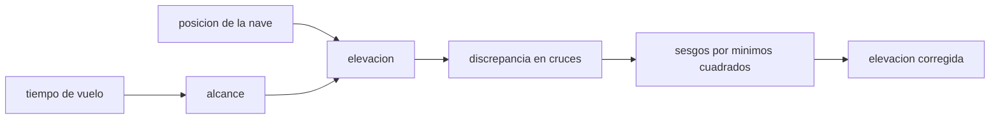

# B53-C07 — Topografía por altimetría

<!-- nav:top -->
[🏠 Programa](../../../../README.md) · [📚 Bloque B53](../../../tronco-comun/B53-astrogeologia-y-geodesia-planetaria.md) · [← Anterior: B53-C06 — Geodesia de Marte](../B53-C06-geodesia-de-marte/CLASE.md) · [Siguiente: B53-C08 — Cartografía de cráteres →](../B53-C08-cartografia-de-crateres/CLASE.md)
<!-- /nav -->

## 1. Ubicación, nivel y alcance

Clase 7 del bloque B53. Nivel N3. Un altímetro láser mide el tiempo de ida y vuelta de un pulso; la elevación sale de restar el alcance a la posición de la nave. Un error de órbita desplaza toda una pasada. Aquí simulas ocho pasadas verticales y ocho horizontales sobre un terreno **sintético**, con sesgos radiales de órbita y ruido de alcance, y estimas los sesgos con la discrepancia en los cruces. Esta técnica es la base de modelos como el de MOLA en Marte (página del PDS consultada) y LOLA en la Luna (página de LRO consultada); aquí no se usan sus datos.

## 2. Por qué esta clase existe

Las pasadas se cruzan y deben coincidir en ese punto. La decisión central: **¿cuánto del desacuerdo en los cruces es error de órbita que se puede estimar y corregir, y cuánto queda como ruido?**

## 3. Lo que podrás hacer al terminar

1. Convertir tiempo de vuelo en alcance.
2. Formar las discrepancias en los cruces de pasadas.
3. Estimar los sesgos por mínimos cuadrados con una restricción.
4. Medir la mejora de la discrepancia tras corregir.
5. Separar sesgo, ruido e interpolación.
6. Explicar por qué el sesgo global no se identifica.

La evidencia es la **ficha del ajuste por cruces de pasadas** del ejercicio 12 (sección 20).

## 4. Con qué llegas y cómo comprobarlo

1. ¿Qué es el tiempo de vuelo?
2. ¿Qué es un sesgo?
3. ¿Qué son los mínimos cuadrados?
4. ¿Qué es la interpolación lineal?
5. ¿Qué es un dato sintético?

<details>
<summary>Ver respuestas</summary>

1. El tiempo de ida y vuelta de un pulso. 2. Un desplazamiento constante. 3. Un ajuste que minimiza la suma de cuadrados de los residuos. 4. Estimar un valor entre dos muestras con una recta. 5. Uno generado por el modelo.
</details>

Con cuatro o cinco aciertos, sigue; si no, repasa los prerrequisitos.

## 5. Un caso de contexto y casos de referencia

Ocho pasadas verticales y ocho horizontales sobre `z = 500 m·sin(2πx/20 km)·cos(2πy/20 km)` (sintético), con sesgos de órbita de σ = 20 m y ruido de alcance de 1 m. Hay `64` cruces. La discrepancia RMS baja de `35,92 m` a `1,42 m` y los sesgos se recuperan con un RMS de `0,39 m`. Un error de `1 ns` en el tiempo equivale a `0,150 m` de alcance. Es el **ejemplo conductor**. Todo es **sintético o ilustrativo** y así se rotula.

## 6. Vocabulario

El **alcance** es `ρ = c Δt/2`. Un **cruce** es el punto donde dos pasadas se intersecan. El **ajuste por cruces** estima correcciones que minimizan las discrepancias. La **huella** es el área iluminada por el pulso.

## 7. Modelo mental

Analogía: dos amigos que miden la altura de una mesa con reglas cuyo cero está mal puesto: al compararse en el punto donde se cruzan, descubren cuánto se desvía cada regla.



*Descripción textual:* El tiempo de vuelo da el alcance; con la órbita se obtiene la elevación; los cruces permiten estimar los sesgos y corregirla.

Límite de la analogía: la órbita real tiene errores que varían a lo largo de la pasada; aquí cada pasada tiene un sesgo constante.

## 8. La explicación, paso a paso

### 8,1 Del tiempo al alcance

`ρ = c Δt/2` con `c = 299 792 458 m/s` (exacta). Un `Δt` de 1 ns corresponde a `0,1499 m`.

### 8,2 Ajuste por cruces

En un cruce de la pasada vertical `i` con la horizontal `j`, la discrepancia es `d_ij = b_i − b_j + ruido`, y el terreno se cancela salvo por la interpolación lineal (muestras cada 1 km). Se resuelven los 16 sesgos por mínimos cuadrados con la restricción `Σ b = 0`, ya que un desplazamiento global de todas las pasadas no deja huella en los cruces.

| Magnitud | Valor |
|---|---|
| cruces | 64 |
| RMS de discrepancia antes [m] | 35,922 |
| RMS después [m] | 1,418 |
| RMS del error de sesgo [m] | 0,394 |
| ruido esperado por cruce, `√2 σ` [m] | 1,414 |

### 8,3 Lectura

Tras corregir, la discrepancia queda al nivel del ruido y de la interpolación; el sesgo promedio global no se puede estimar con cruces y requiere otra referencia.

## 9. Magnitudes, símbolos y unidades

| Símbolo | Qué es | Unidad | Valor / nota |
|---|---|---|---|
| `c` | velocidad de la luz | m/s | 299 792 458 (exacta, definición del SI) |
| `Δt` | tiempo de vuelo | s | — |
| `b` | sesgo radial de pasada | m | σ = 20 (sintético) |
| `σ` | ruido de alcance | m | 1 (sintético) |
| `N` | cruces | — | 64 |

## 10. Convenciones y referencias

Terreno sintético en un plano de 20 × 20 km; pasadas en `x = 2…16 km` y `y = 2…16 km` cada 2 km; muestras cada 1 km con interpolación lineal; semilla `20261109`; tolerancia: RMS final menor que 2 veces el ruido por cruce.

## 11. De dónde sale lo que afirmamos

| ID | Fuente | Localizador | Respalda | Estado |
|---|---|---|---|---|
| S1 | NASA PDS Geosciences Node, página de datos de MOLA (Mars Global Surveyor) | https://pds-geosciences.wustl.edu/missions/mgs/mola.html | contexto: MOLA produjo perfiles altimétricos para mapas topográficos globales | Página consultada el 2026-11-09 (no declara resolución vertical) |
| S2 | NASA Science, misión Lunar Reconnaissance Orbiter | https://science.nasa.gov/mission/lro/ | contexto: LOLA mide el perfil de elevación de la Luna | Página consultada el 2026-11-09 (LROC solo se nombra) |

Límites: no se usaron datos, huellas ni precisiones de esos instrumentos; las páginas no declaran la resolución vertical de MOLA.

## 12. Cómo ver el resultado

| Magnitud | Valor |
|---|---|
| cruces | 64 |
| RMS antes | 35,92 m |
| RMS después | 1,42 m |
| error de sesgo | 0,39 m |
| 1 ns | 0,1499 m |

Descripción larga: la discrepancia en los cruces cae de decenas de metros a unos pocos metros.

## 13. Ejemplo trabajado

**Paso 1.** Datos: ocho pasadas por dirección, `σ_b = 20 m`, `σ = 1 m`.

**Paso 2.** Cruces: `8 × 8 = 64`.

**Paso 3.** Resolución: 16 sesgos con `Σ b = 0`.

**Paso 4.** Resultado: RMS `35,92` → `1,42 m`.

## 14. Distintas formas de describirlo

**Por fórmula:** `ρ = cΔt/2`. **Por tabla:** discrepancias. **Por sistema lineal:** sesgos. **Por gráfica:** antes y después.

## 15. Práctica guiada

**Ejercicio 1 · con los pasos indicados.** Calcula el alcance para `Δt = 6,67 ms`.

<details><summary>Solución comentada</summary>

`ρ ≈ 1000 km`.
</details>

**Ejercicio 2 · con una pista.** ¿Cuántos cruces dan 8 pasadas por dirección?

<details><summary>Solución comentada</summary>

64.
</details>

**Ejercicio 3 · casi autónomo.** ¿Cuántos sesgos se estiman?

<details><summary>Solución comentada</summary>

16 (con 1 restricción).
</details>

## 16. Práctica autónoma, transferencia e integrador

**Ejercicio 4 · autónomo.** ¿Qué RMS esperas por cruce solo por ruido?

<details><summary>Solución comentada</summary>

`1,41 m`.
</details>

**Ejercicio 5 · autónomo.** ¿Por qué se necesita la restricción `Σ b = 0`?

<details><summary>Solución comentada</summary>

Sumar una constante a todos los sesgos no cambia las discrepancias.
</details>

**Ejercicio 6 · autónomo.** ¿Qué aporta la interpolación al error?

<details><summary>Solución comentada</summary>

Un error que depende de la curvatura del terreno.
</details>

**Ejercicio 7 · autónomo.** ¿Cuánto vale 0,5 ns en metros?

<details><summary>Solución comentada</summary>

`0,0749 m`.
</details>

**Ejercicio 8 · autónomo.** ¿Qué pasa si hay una sola pasada vertical?

<details><summary>Solución comentada</summary>

Su sesgo solo se estima respecto de las horizontales.
</details>

**Ejercicio 9 · transferencia.** Un cruce da 300 m de discrepancia. ¿Qué haces?

<details><summary>Solución comentada</summary>

Reviso si es un valor atípico antes de ajustar.
</details>

**Ejercicio 10 · transferencia.** ¿Por qué la órbita real exige un modelo más rico?

<details><summary>Solución comentada</summary>

Su error varía con el tiempo, no es una constante.
</details>

**Ejercicio 11 · transferencia.** ¿Cómo se fija el sesgo global?

<details><summary>Solución comentada</summary>

Con una referencia externa, como la posición de un punto de control.
</details>

**Ejercicio 12 · integrador.** Elabora tu *ficha del ajuste por cruces de pasadas*: cruces, sesgos, RMS y límites.

<details><summary>Solución modelo</summary>

Secciones 8,2 y 8,3.
</details>

## 17. Laboratorio: cruces de pasadas y error de órbita

El script [altimetria.py](altimetria.py) simula 16 pasadas con sesgos y ruido, forma las 64 discrepancias y resuelve el ajuste con eliminación gaussiana (**comprueba** RMS final < 2 veces el ruido por cruce).

**Datos:** terreno y sesgos **sintéticos**; semilla `20261109`. **Predice antes de ejecutar:** ¿quedará el RMS final más cerca del ruido o del sesgo inicial? (del ruido). **Ejecución del 2026-11-09 (Python 3,12,9):**

```text
Python 3.12.9 (biblioteca estandar)
1 ns de tiempo de vuelo = 0.14990 m de alcance
cruces: 64 ; RMS de discrepancia antes = 35.922 m ; despues = 1.418 m
error RMS de los sesgos estimados = 0.394 m ; ruido esperado por cruce = 1.414 m
Pruebas superadas.
```

```bash
python programa/clases/B53/B53-C07-topografia-por-altimetria/altimetria.py
```

**Límites:** sesgo constante por pasada, terreno suave, sin huella ni pendientes locales.

## 18. Errores frecuentes y cómo corregirlos

**Creer que los cruces fijan el sesgo global.** se corrige con 8,3

**Ignorar el error de interpolación.** se corrige con 8,2

**Presentar los datos como medidos.** se corrige con la sección 10

## 19. Cómo sabrás que vas bien

Tras la sección 8: ¿qué resultado esperabas y cuál obtuviste? Si dudas, repasa el ejemplo de la sección 13. Tras el laboratorio: ¿qué comprueba? (ver la sección 17).

## 20. Qué entregas y cómo se evalúa

El producto es tu **ficha del ajuste por cruces de pasadas** (ejercicio 12).

| Criterio | Inicial | En desarrollo | Logrado | Destacado |
|---|---|---|---|---|
| Conceptos | Los confunde | Parciales | Conceptos de la clase | Explica los límites |
| Cálculo | Sin unidades | Con errores | Tablas completas | Calcula casos nuevos |
| Numérico | Sin comprobar | Un caso | Contraste con el análisis | Interpreta las diferencias |
| Fuentes | Sin fuente | Sin fecha | Fuentes con fecha | Declara lo sintético |
| Límites | No los nombra | Uno | Tres | Discute qué falta del modelo |

**Condiciones críticas (no se compensan con promedio):** rotular el terreno y los sesgos como sintéticos; no presentar el resultado como el de una misión; citar solo lo consultado.

## 21. Ética, seguridad y límites

Clase educativa: los modelos son simplificados y no sustituyen a los productos de una misión ni a la literatura primaria. Ningún dato simulado se presenta como observado. Accesibilidad: tablas equivalentes a las gráficas, fórmulas en texto, ejercicios sin conexión.

## 22. Para cerrar y seguir

El ajuste lleva la discrepancia de `35,9` a `1,4 m`. Queda una pregunta: ¿cómo se catalogan las formas de la superficie, como los cráteres?

**Glosario español–inglés.** altímetro láser · *laser altimeter*; cruce · *crossover*; alcance · *range*; sesgo · *bias*.

**Continuidad.** [B53-C08](../B53-C08-cartografia-de-crateres/CLASE.md) estudia la cartografía de cráteres.

**Referencias:** ver sección 11.

<!-- nav:bottom -->
---

[← Anterior: B53-C06 — Geodesia de Marte](../B53-C06-geodesia-de-marte/CLASE.md) · [📚 Bloque B53](../../../tronco-comun/B53-astrogeologia-y-geodesia-planetaria.md) · [Siguiente: B53-C08 — Cartografía de cráteres →](../B53-C08-cartografia-de-crateres/CLASE.md)
<!-- /nav -->
