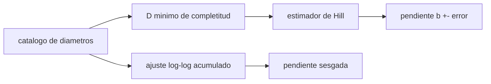

# B53-C08 — Cartografía de cráteres

<!-- nav:top -->
[🏠 Programa](../../../../README.md) · [📚 Bloque B53](../../../tronco-comun/B53-astrogeologia-y-geodesia-planetaria.md) · [← Anterior: B53-C07 — Topografía por altimetría](../B53-C07-topografia-por-altimetria/CLASE.md) · [Siguiente: B53-C09 — Estratigrafía planetaria →](../B53-C09-estratigrafia-planetaria/CLASE.md)
<!-- /nav -->

## 1. Ubicación, nivel y alcance

Clase 8 del bloque B53. Nivel N3. Contar cráteres es la base de la datación relativa de superficies. La **distribución acumulada** de diámetros sigue una ley de potencias `N(>D) ∝ D^(−b)`. Aquí generas catálogos **sintéticos** con `b = 2`, estimas la pendiente con el estimador de máxima verosimilitud (de Hill) y con un ajuste de mínimos cuadrados a la curva acumulada, y comparas su sesgo y su dispersión en 2000 catálogos. También ves qué ocurre si el diámetro mínimo de completitud se fija mal. USGS Astrogeology produce mapas planetarios (página consultada); aquí no se usa ninguno de sus catálogos.

## 2. Por qué esta clase existe

Un conteo no es un número, es una distribución con incertidumbre. La decisión central: **¿qué estimador de la pendiente es fiable y a partir de qué diámetro el catálogo es completo?**

## 3. Lo que podrás hacer al terminar

1. Muestrear diámetros de una ley de potencias.
2. Estimar la pendiente por máxima verosimilitud.
3. Estimar la incertidumbre de la pendiente.
4. Comparar con el ajuste de mínimos cuadrados acumulado.
5. Medir el sesgo por una completitud mal fijada.
6. Calcular una densidad de cráteres por área con su error.

La evidencia es la **ficha de la distribución de tamaños de cráteres** del ejercicio 12 (sección 20).

## 4. Con qué llegas y cómo comprobarlo

1. ¿Qué es una ley de potencias?
2. ¿Qué es una distribución acumulada?
3. ¿Qué es la máxima verosimilitud?
4. ¿Qué es un error de Poisson?
5. ¿Qué es un catálogo completo?

<details>
<summary>Ver respuestas</summary>

1. Una relación `y ∝ x^k`. 2. El número de elementos mayores que un valor. 3. Elegir el parámetro que hace más probables los datos. 4. `√N` para un conteo `N`. 5. Uno que contiene todos los objetos sobre un tamaño mínimo.
</details>

Con cuatro o cinco aciertos, sigue; si no, repasa los prerrequisitos.

## 5. Un caso de contexto y casos de referencia

Catálogos de 500 cráteres con `b = 2` y `D ≥ 1 km` (sintéticos). El estimador de máxima verosimilitud da `b = 2,004` en promedio con una dispersión de `0,090` (teórica `0,089`); el ajuste por mínimos cuadrados acumulado da `1,953` con dispersión `0,127`. Si se fija mal `D_min = 0,5 km`, el estimador cae a `0,838`. Es el **ejemplo conductor**. Todo es **sintético o ilustrativo** y así se rotula.

## 6. Vocabulario

La **distribución acumulada** `N(>D)` cuenta cráteres mayores que `D`. La **pendiente** `b` es el exponente. El **estimador de Hill** es `b̂ = n/Σ ln(D/D_min)`. La **completitud** es el diámetro por encima del cual no falta ningún cráter.

## 7. Modelo mental

Analogía: contar cuántas piedras hay mayores que cada tamaño en un río: si no se ven las pequeñas, la pendiente sale mal.



*Descripción textual:* Del catálogo se fija el diámetro de completitud y se estima la pendiente; el ajuste log-log acumulado es una alternativa más sesgada.

Límite de la analogía: la distribución real de cráteres puede cambiar de pendiente con el tamaño y la saturación altera el conteo.

## 8. La explicación, paso a paso

### 8,1 Estimador

Para `D ≥ D_min` con densidad `p(D) ∝ D^(−b−1)`, el máximo de verosimilitud es `b̂ = n/Σ ln(D_i/D_min)` y su error estándar es `b̂/√n`.

### 8,2 Comparación en 2000 catálogos

| Estimador | media de `b` | dispersión | sesgo |
|---|---|---|---|
| máxima verosimilitud | 2,0040 | 0,0895 | +0,0040 |
| mínimos cuadrados (acumulada) | 1,9526 | 0,1272 | -0,0474 |

La dispersión teórica de Hill es `b/√n = 0,0894`.

### 8,3 Completitud mal fijada

Si el catálogo ya es completo desde `1 km` pero se asume `D_min = 0,5 km`, el estimador sale `0,838`: **sesgado a la baja**.

### 8,4 Densidad

Con `500` cráteres en `10⁵ km²`, `N(>1 km) = 5,00 × 10⁻³ ± 2,2 × 10⁻⁴ km⁻²` (error de Poisson).

## 9. Magnitudes, símbolos y unidades

| Símbolo | Qué es | Unidad | Valor / nota |
|---|---|---|---|
| `b` | pendiente acumulada | — | 2 (sintética) |
| `D_min` | diámetro de completitud | km | 1 |
| `n` | cráteres | — | 500 |
| `A` | área contada | km² | 10⁵ (sintética) |
| `N(>D)` | conteo acumulado | km⁻² | 5,00 × 10⁻³ a 1 km |

## 10. Convenciones y referencias

Catálogos sintéticos de 500 cráteres, semilla `20261109`, 2000 repeticiones; diámetros muestreados por inversión `D = D_min U^(−1/b)`; tolerancia: sesgo de máxima verosimilitud menor que 2 errores típicos de la media.

## 11. De dónde sale lo que afirmamos

| ID | Fuente | Localizador | Respalda | Estado |
|---|---|---|---|---|
| S1 | USGS Astrogeology Science Center, página institucional | https://www.usgs.gov/centers/astrogeology-science-center | contexto: el centro de Astrogeología produce mapas y cartografía planetaria | Página consultada el 2026-11-09 (no menciona estándares de forma explícita) |

Límites: no se consultó ninguna fuente sobre cronologías de cráteres ni se usa ningún catálogo real.

## 12. Cómo ver el resultado

| Magnitud | Valor |
|---|---|
| `b` (máxima verosimilitud) | 2,004 ± 0,090 |
| `b` (mínimos cuadrados) | 1,953 ± 0,127 |
| `b` con `D_min` mal fijado | 0,838 |
| densidad `N(>1 km)` | 5,00 × 10⁻³ km⁻² |

Descripción larga: la máxima verosimilitud se centra en 2 y el ajuste acumulado queda sesgado.

## 13. Ejemplo trabajado

**Paso 1.** Datos: 500 diámetros con `b = 2`, `D_min = 1 km`.

**Paso 2.** Suma: `Σ ln(D/D_min)` del catálogo.

**Paso 3.** Estimación: `b̂ = n/Σ`, con error `b̂/√n ≈ 0,09`.

**Paso 4.** Conclusión: consistente con 2 dentro de 2 errores.

## 14. Distintas formas de describirlo

**Por fórmula:** Hill. **Por gráfica:** `N(>D)` log-log. **Por tabla:** estimadores. **Por simulación:** 2000 catálogos.

## 15. Práctica guiada

**Ejercicio 1 · con los pasos indicados.** Calcula el error teórico de `b̂` para `n = 500` y `b = 2`.

<details><summary>Solución comentada</summary>

`2/√500 = 0,0894`.
</details>

**Ejercicio 2 · con una pista.** ¿Cuántos cráteres mayores que 2 km espera la ley para `b = 2` si hay 500 sobre 1 km?

<details><summary>Solución comentada</summary>

`500 × 2⁻² = 125`.
</details>

**Ejercicio 3 · casi autónomo.** ¿Qué error de Poisson tiene un conteo de 100?

<details><summary>Solución comentada</summary>

10.
</details>

## 16. Práctica autónoma, transferencia e integrador

**Ejercicio 4 · autónomo.** ¿Qué estimador tiene menor dispersión?

<details><summary>Solución comentada</summary>

El de máxima verosimilitud: `0,090` frente a `0,127`.
</details>

**Ejercicio 5 · autónomo.** ¿Qué sesgo tiene el ajuste acumulado?

<details><summary>Solución comentada</summary>

`-0,047`.
</details>

**Ejercicio 6 · autónomo.** ¿Qué pasa si `D_min` real es 2 km y se asume 1 km?

<details><summary>Solución comentada</summary>

La pendiente sale demasiado baja.
</details>

**Ejercicio 7 · autónomo.** ¿Qué densidad sale con 800 cráteres en 2×10⁵ km²?

<details><summary>Solución comentada</summary>

`4,0 × 10⁻³ km⁻²`.
</details>

**Ejercicio 8 · autónomo.** ¿Por qué el ajuste acumulado viola las hipótesis?

<details><summary>Solución comentada</summary>

Los puntos acumulados no son independientes.
</details>

**Ejercicio 9 · transferencia.** Un colega cuenta hasta 300 m en una imagen de 100 m/píxel. ¿Qué dices?

<details><summary>Solución comentada</summary>

Son tres píxeles: el catálogo no será completo ahí.
</details>

**Ejercicio 10 · transferencia.** ¿Qué es la saturación?

<details><summary>Solución comentada</summary>

Cuando nuevos cráteres destruyen a los viejos y el conteo deja de crecer.
</details>

**Ejercicio 11 · transferencia.** ¿Se puede datar solo con `b`?

<details><summary>Solución comentada</summary>

No; la edad depende de la densidad, no de la pendiente.
</details>

**Ejercicio 12 · integrador.** Elabora tu *ficha de la distribución de tamaños de cráteres*: estimador, error, sesgo, completitud y densidad.

<details><summary>Solución modelo</summary>

Secciones 8,1 a 8,4.
</details>

## 17. Laboratorio: distribución de tamaños y estimación de la pendiente

El script [crateres.py](crateres.py) genera 2000 catálogos sintéticos de 500 cráteres y compara los dos estimadores (**comprueba** sesgo de Hill < 2 errores típicos y dispersión dentro de 5 % de `b/√n`).

**Datos:** catálogos **sintéticos**; semilla `20261109`. **Predice antes de ejecutar:** ¿cuál estimador tendrá menor sesgo? (el de máxima verosimilitud). **Ejecución del 2026-11-09 (Python 3,12,9):**

```text
Python 3.12.9 (biblioteca estandar)
Hill: b = 2.0040 +- 0.0895 (teorica 0.0894) ; sesgo +0.0040
minimos cuadrados acumulada: b = 1.9526 +- 0.1272 ; sesgo -0.0474
D_min mal fijado (0.5 km): b = 0.8384
densidad N(>1 km) = 5.000e-03 +- 2.2e-04 km^-2
Pruebas superadas.
```

```bash
python programa/clases/B53/B53-C08-cartografia-de-crateres/crateres.py
```

**Límites:** una sola ley de potencias sin saturación, erosión ni mezcla de poblaciones.

## 18. Errores frecuentes y cómo corregirlos

**Ajustar la acumulada por mínimos cuadrados sin cuidado.** se corrige con 8,2

**Ignorar la completitud.** se corrige con 8,3

**Presentar un catálogo sintético como real.** se corrige con la sección 10

## 19. Cómo sabrás que vas bien

Tras la sección 8: ¿qué resultado esperabas y cuál obtuviste? Si dudas, repasa el ejemplo de la sección 13. Tras el laboratorio: ¿qué comprueba? (ver la sección 17).

## 20. Qué entregas y cómo se evalúa

El producto es tu **ficha de la distribución de tamaños de cráteres** (ejercicio 12).

| Criterio | Inicial | En desarrollo | Logrado | Destacado |
|---|---|---|---|---|
| Conceptos | Los confunde | Parciales | Conceptos de la clase | Explica los límites |
| Cálculo | Sin unidades | Con errores | Tablas completas | Calcula casos nuevos |
| Numérico | Sin comprobar | Un caso | Contraste con el análisis | Interpreta las diferencias |
| Fuentes | Sin fuente | Sin fecha | Fuentes con fecha | Declara lo sintético |
| Límites | No los nombra | Uno | Tres | Discute qué falta del modelo |

**Condiciones críticas (no se compensan con promedio):** rotular los catálogos como sintéticos; declarar el diámetro de completitud; citar solo lo consultado.

## 21. Ética, seguridad y límites

Clase educativa: los modelos son simplificados y no sustituyen a los productos de una misión ni a la literatura primaria. Ningún dato simulado se presenta como observado. Accesibilidad: tablas equivalentes a las gráficas, fórmulas en texto, ejercicios sin conexión.

## 22. Para cerrar y seguir

La máxima verosimilitud recupera `b = 2,004` y el ajuste acumulado lo sesga a `1,953`. Queda una pregunta: ¿cómo se ordenan las unidades geológicas en el tiempo?

**Glosario español–inglés.** distribución acumulada · *cumulative distribution*; completitud · *completeness*; máxima verosimilitud · *maximum likelihood*; saturación · *saturation*.

**Continuidad.** [B53-C09](../B53-C09-estratigrafia-planetaria/CLASE.md) estudia la estratigrafía planetaria.

**Referencias:** ver sección 11.

<!-- nav:bottom -->
---

[← Anterior: B53-C07 — Topografía por altimetría](../B53-C07-topografia-por-altimetria/CLASE.md) · [📚 Bloque B53](../../../tronco-comun/B53-astrogeologia-y-geodesia-planetaria.md) · [Siguiente: B53-C09 — Estratigrafía planetaria →](../B53-C09-estratigrafia-planetaria/CLASE.md)
<!-- /nav -->
