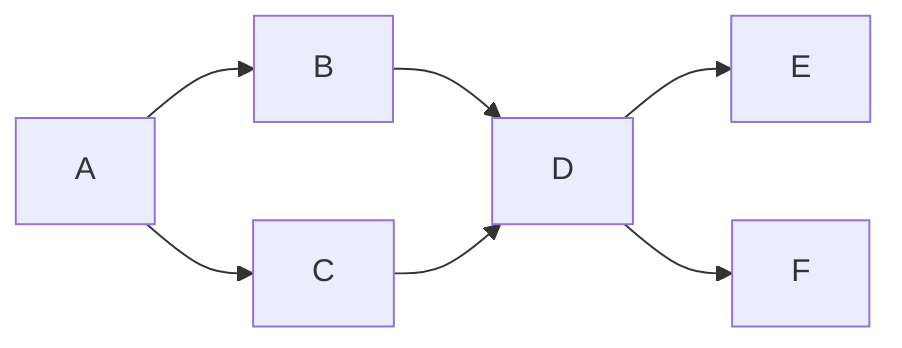

# B53-C09 — Estratigrafía planetaria

<!-- nav:top -->
[🏠 Programa](../../../../README.md) · [📚 Bloque B53](../../../tronco-comun/B53-astrogeologia-y-geodesia-planetaria.md) · [← Anterior: B53-C08 — Cartografía de cráteres](../B53-C08-cartografia-de-crateres/CLASE.md) · [Siguiente: B53-C10 — Geología de impacto →](../../../tronco-comun/B53-astrogeologia-y-geodesia-planetaria.md#b53-c10)
<!-- /nav -->

## 1. Ubicación, nivel y alcance

Clase 9 del bloque B53. Nivel N3. La estratigrafía ordena las unidades por **superposición** (lo que está encima es más joven) y por **relaciones de corte**. Aquí modelas seis unidades **sintéticas** como un grafo dirigido, cuentas los órdenes totales compatibles, detectas una contradicción cuando se agrega una relación imposible y contrastas el orden estratigráfico con el que sugiere la densidad de cráteres (conteos de Poisson), para ver cuándo los cráteres no resuelven edades cercanas. Las edades son unidades arbitrarias (ua).

## 2. Por qué esta clase existe

Un mapa geológico es una hipótesis sobre el tiempo. La decisión central: **¿qué parte del orden temporal está fijada por contacto y qué parte solo sugerida por conteos con incertidumbre?**

## 3. Lo que podrás hacer al terminar

1. Representar las relaciones de superposición como un grafo.
2. Obtener un orden compatible por ordenamiento topológico.
3. Contar los órdenes totales compatibles.
4. Detectar una contradicción como un ciclo.
5. Estimar edades y errores desde conteos de Poisson.
6. Decidir cuándo los cráteres resuelven dos unidades.

La evidencia es la **ficha de la secuencia estratigráfica** del ejercicio 12 (sección 20).

## 4. Con qué llegas y cómo comprobarlo

1. ¿Qué es la superposición?
2. ¿Qué es un grafo dirigido?
3. ¿Qué es un ciclo?
4. ¿Qué es un conteo de Poisson?
5. ¿Qué es una edad relativa?

<details>
<summary>Ver respuestas</summary>

1. Lo que está encima se formó después. 2. Nodos con flechas que indican un sentido. 3. Un camino que vuelve al punto de partida. 4. Un conteo con desviación `√N`. 5. Un orden, sin años absolutos.
</details>

Con cuatro o cinco aciertos, sigue; si no, repasa los prerrequisitos.

## 5. Un caso de contexto y casos de referencia

Seis unidades `A…F` con edades verdaderas `3,9; 3,6; 3,3; 2,5; 1,2; 0,4 ua` (sintéticas). Las relaciones de contacto admiten `4` órdenes totales. Al agregar «F más antigua que A» aparece un ciclo (`True`). Con 5000 km² por unidad y tasa de `0,002` cráteres/km²/ua, la densidad ordena bien a `A` y `F` en `1,000` de los sorteos, pero a `B` y `C` solo en `0,618`. Es el **ejemplo conductor**. Todo es **sintético o ilustrativo** y así se rotula.

## 6. Vocabulario

Una **relación de superposición** `X → Y` dice que `X` es más antigua que `Y`. Un **orden topológico** respeta todas las flechas. Un **ciclo** es una contradicción. La **edad de modelo** es `N/(tasa·área)`.

## 7. Modelo mental

Analogía: capas de una torta: la de abajo se hizo primero; el recuento de migas por capa ayuda, pero no distingue dos capas casi iguales.



*Descripción textual:* La unidad A es la más antigua; B y C son posteriores y no están ordenadas entre sí; D las cubre y E y F son las más jóvenes.

Límite de la analogía: las capas planetarias pueden ser discontinuas y los contactos, ambiguos.

## 8. La explicación, paso a paso

### 8,1 Orden compatible

El ordenamiento topológico de Kahn da `A B C D E F`. Con las seis unidades hay `4` órdenes totales que respetan las flechas: el orden **no** es único porque `B` y `C` no están en contacto, ni `E` y `F`.

### 8,2 Contradicción

Agregar la relación «`F` es más antigua que `A`» crea un ciclo; el algoritmo detecta que quedan nodos sin ordenar: contradicción = `True`.

### 8,3 Cráteres frente a estratigrafía

La densidad esperada es `tasa × edad` y el conteo es de Poisson.

| Par | diferencia de edad [ua] | fracción en que la densidad ordena bien |
|---|---|---|
| `A`–`F` | 3,5 | 1,000 |
| `B`–`C` | 0,3 | 0,618 |

La edad de modelo cubre la edad verdadera dentro de 2σ en `0,942` de los casos.

### 8,4 Lectura

La estratigrafía fija el orden donde hay contacto; los cráteres lo complementan donde las edades difieren mucho. Para `B` y `C` el orden depende del contacto, no del conteo.

## 9. Magnitudes, símbolos y unidades

| Símbolo | Qué es | Unidad | Valor / nota |
|---|---|---|---|
| `A_u` | área de cada unidad | km² | 5000 (sintética) |
| `λ` | tasa de cráteres | cráteres km⁻² ua⁻¹ | 0,002 (sintética) |
| `T` | edad | ua | 0,4 a 3,9 |
| `N` | conteo | — | Poisson |
| `P` | fracción de aciertos | — | ver 8,3 |

## 10. Convenciones y referencias

Seis unidades, semilla `20261109`, 20 000 sorteos por par; las edades están en unidades arbitrarias (ua) y no representan años; tolerancia: cobertura 2σ entre 0,90 y 0,99.

## 11. De dónde sale lo que afirmamos

| ID | Fuente | Localizador | Respalda | Estado |
|---|---|---|---|---|
| S1 | USGS Astrogeology Science Center, página institucional | https://www.usgs.gov/centers/astrogeology-science-center | contexto: el centro produce mapas geológicos | Página consultada el 2026-11-09 (no menciona estándares de forma explícita) |

Límites: no se consultó ninguna fuente sobre cronologías; la tasa y las edades son sintéticas.

## 12. Cómo ver el resultado

| Magnitud | Valor |
|---|---|
| órdenes compatibles | 4 |
| orden topológico | A B C D E F |
| ciclo detectado | True |
| acierto A–F | 1,000 |
| acierto B–C | 0,618 |
| cobertura 2σ | 0,942 |

Descripción larga: la estratigrafía deja dos grados de libertad (B/C y E/F) que los cráteres resuelven mal si las edades son cercanas.

## 13. Ejemplo trabajado

**Paso 1.** Relaciones: `A→B, A→C, B→D, C→D, D→E, D→F`.

**Paso 2.** Kahn: `A`, luego `B` y `C`, luego `D`, luego `E` y `F`.

**Paso 3.** Órdenes totales: `2 × 2 = 4`; el programa cuenta `4`.

**Paso 4.** Contradicción: `F→A` cierra un ciclo.

## 14. Distintas formas de describirlo

**Por grafo:** flechas. **Por lista:** orden topológico. **Por conteo:** `N`. **Por tabla:** probabilidades de acierto.

## 15. Práctica guiada

**Ejercicio 1 · con los pasos indicados.** ¿Cuántos órdenes totales admite `A→B, A→C`?

<details><summary>Solución comentada</summary>

Dos: `A,B,C` y `A,C,B`.
</details>

**Ejercicio 2 · con una pista.** ¿Qué indica un ciclo?

<details><summary>Solución comentada</summary>

Una contradicción en las relaciones.
</details>

**Ejercicio 3 · casi autónomo.** Calcula la densidad esperada de `A`.

<details><summary>Solución comentada</summary>

`tasa × 3,9`.
</details>

## 16. Práctica autónoma, transferencia e integrador

**Ejercicio 4 · autónomo.** Calcula el error relativo de un conteo de 40.

<details><summary>Solución comentada</summary>

`1/√40 = 16 %`.
</details>

**Ejercicio 5 · autónomo.** ¿Por qué `B` y `C` no se resuelven?

<details><summary>Solución comentada</summary>

Sus edades difieren 0,3 ua, cercanas al ruido.
</details>

**Ejercicio 6 · autónomo.** ¿Cuántos nodos quedan sin ordenar en un ciclo?

<details><summary>Solución comentada</summary>

Los del ciclo y los que dependen de ellos.
</details>

**Ejercicio 7 · autónomo.** ¿Qué pasa si se duplica el área contada?

<details><summary>Solución comentada</summary>

El error relativo baja `√2` veces.
</details>

**Ejercicio 8 · autónomo.** ¿Qué diferencia hay entre edad relativa y absoluta?

<details><summary>Solución comentada</summary>

La relativa es orden; la absoluta exige calibración.
</details>

**Ejercicio 9 · transferencia.** Un contacto es ambiguo. ¿Qué haces?

<details><summary>Solución comentada</summary>

Lo marco como incierto y no fuerzo la flecha.
</details>

**Ejercicio 10 · transferencia.** ¿Qué limita datar con cráteres superficies pequeñas?

<details><summary>Solución comentada</summary>

El número de cráteres es bajo y el error de Poisson, grande.
</details>

**Ejercicio 11 · transferencia.** ¿Puede la densidad contradecir la superposición?

<details><summary>Solución comentada</summary>

Sí, por azar o por cráteres secundarios; manda el contacto.
</details>

**Ejercicio 12 · integrador.** Elabora tu *ficha de la secuencia estratigráfica*: grafo, orden, contradicciones y evidencia de cráteres.

<details><summary>Solución modelo</summary>

Secciones 8,1 a 8,4.
</details>

## 17. Laboratorio: orden relativo, contradicciones y densidad de cráteres

El script [estratigrafia.py](estratigrafia.py) ordena el grafo, cuenta los órdenes por fuerza bruta (720 permutaciones), detecta el ciclo y simula 20 000 conteos por par (**comprueba** cobertura 2σ entre 0,90 y 0,99).

**Datos:** edades y tasa **sintéticas**; semilla `20261109`. **Predice antes de ejecutar:** ¿qué par se resuelve mejor, A–F o B–C? (A–F). **Ejecución del 2026-11-09 (Python 3,12,9):**

```text
Python 3.12.9 (biblioteca estandar)
orden topologico (Kahn): A B C D E F
ordenes totales compatibles (fuerza bruta, 720 permutaciones): 4
con la relacion F->A agregada, ciclo detectado: True
densidad ordena bien A-F: 1.0000 ; B-C: 0.6182
cobertura de la edad de modelo a 2 sigma: 0.9415
Pruebas superadas.
```

```bash
python programa/clases/B53/B53-C09-estratigrafia-planetaria/estratigrafia.py
```

**Límites:** contactos perfectos, tasa constante, sin saturación ni cráteres secundarios.

## 18. Errores frecuentes y cómo corregirlos

**Tratar la densidad como edad exacta.** se corrige con 8,3

**Forzar un orden donde no hay contacto.** se corrige con 8,1

**Presentar las ua como años.** se corrige con la sección 10

## 19. Cómo sabrás que vas bien

Tras la sección 8: ¿qué resultado esperabas y cuál obtuviste? Si dudas, repasa el ejemplo de la sección 13. Tras el laboratorio: ¿qué comprueba? (ver la sección 17).

## 20. Qué entregas y cómo se evalúa

El producto es tu **ficha de la secuencia estratigráfica** (ejercicio 12).

| Criterio | Inicial | En desarrollo | Logrado | Destacado |
|---|---|---|---|---|
| Conceptos | Los confunde | Parciales | Conceptos de la clase | Explica los límites |
| Cálculo | Sin unidades | Con errores | Tablas completas | Calcula casos nuevos |
| Numérico | Sin comprobar | Un caso | Contraste con el análisis | Interpreta las diferencias |
| Fuentes | Sin fuente | Sin fecha | Fuentes con fecha | Declara lo sintético |
| Límites | No los nombra | Uno | Tres | Discute qué falta del modelo |

**Condiciones críticas (no se compensan con promedio):** rotular las edades como sintéticas y en unidades arbitrarias; no declarar una cronología real; citar solo lo consultado.

## 21. Ética, seguridad y límites

Clase educativa: los modelos son simplificados y no sustituyen a los productos de una misión ni a la literatura primaria. Ningún dato simulado se presenta como observado. Accesibilidad: tablas equivalentes a las gráficas, fórmulas en texto, ejercicios sin conexión.

## 22. Para cerrar y seguir

El grafo admite `4` órdenes y los cráteres resuelven `A–F` (`1,00`) pero no `B–C` (`0,62`). Queda una pregunta: ¿cómo se forma un cráter?

**Glosario español–inglés.** superposición · *superposition*; relación de corte · *cross-cutting relation*; orden topológico · *topological order*; edad de modelo · *model age*.

**Continuidad.** [B53-C10](../B53-C10-geologia-de-impacto/CLASE.md) estudia la geología de impacto.

**Referencias:** ver sección 11.

<!-- nav:bottom -->
---

[← Anterior: B53-C08 — Cartografía de cráteres](../B53-C08-cartografia-de-crateres/CLASE.md) · [📚 Bloque B53](../../../tronco-comun/B53-astrogeologia-y-geodesia-planetaria.md) · [Siguiente: B53-C10 — Geología de impacto →](../../../tronco-comun/B53-astrogeologia-y-geodesia-planetaria.md#b53-c10)
<!-- /nav -->
