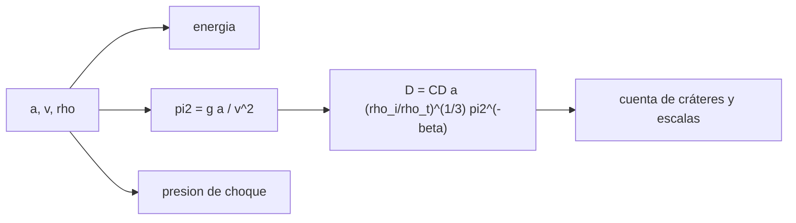

# B53-C10 — Geología de impacto

<!-- nav:top -->
[🏠 Programa](../../../../README.md) · [📚 Bloque B53](../../../tronco-comun/B53-astrogeologia-y-geodesia-planetaria.md) · [← Anterior: B53-C09 — Estratigrafía planetaria](../B53-C09-estratigrafia-planetaria/CLASE.md) · [Siguiente: B53-C11 — Vulcanismo extraterrestre →](../B53-C11-vulcanismo-extraterrestre/CLASE.md)
<!-- /nav -->

## 1. Ubicación, nivel y alcance

Clase 10 del bloque B53. Nivel N3. El tamaño de un cráter depende del proyectil, la velocidad y la gravedad. El **escalamiento adimensional** (análisis de grupos π) reúne esa dependencia en una ley de potencias. Aquí aplicas una ley de **forma** estándar con coeficientes **ilustrativos** (no consultados) para el régimen de gravedad, calculas energía y diámetro transitorio para tres gravedades, estimas la presión de choque por adaptación de impedancias con una relación lineal `Us = c + s·up` y, con experimentos **sintéticos** con ruido, recuperas el exponente por regresión log-log.

## 2. Por qué esta clase existe

Un cráter es una medida indirecta del impacto. La decisión central: **¿cómo cambia el diámetro del cráter con la gravedad y qué incertidumbre tiene un exponente ajustado a pocos experimentos?**

## 3. Lo que podrás hacer al terminar

1. Calcular energía cinética y masa de un proyectil.
2. Aplicar el escalamiento de grupos π en el régimen de gravedad.
3. Comparar el cráter para distintas gravedades.
4. Estimar la presión de choque por impedancias.
5. Recuperar el exponente por regresión.
6. Explicar por qué los coeficientes dependen del material.

La evidencia es la **ficha del escalamiento de un impacto** del ejercicio 12 (sección 20).

## 4. Con qué llegas y cómo comprobarlo

1. ¿Qué es la energía cinética?
2. ¿Qué es un grupo adimensional?
3. ¿Qué es una regresión log-log?
4. ¿Qué es la presión de choque?
5. ¿Qué es un valor ilustrativo?

<details>
<summary>Ver respuestas</summary>

1. `½ m v²`. 2. Un cociente sin unidades de magnitudes del problema. 3. Un ajuste lineal de logaritmos que recupera exponentes. 4. La presión del frente de una onda de choque. 5. Uno propuesto para el ejemplo.
</details>

Con cuatro o cinco aciertos, sigue; si no, repasa los prerrequisitos.

## 5. Un caso de contexto y casos de referencia

Un proyectil de `a = 100 m`, `v = 20 km/s`, densidad `3000 kg/m³` sobre un blanco de `2700 kg/m³` libera `600,7` megatones de TNT (con `4,184 × 10⁹ J` por tonelada). El diámetro transitorio ilustrativo es `2640 m` con `g = 1,62`, `2200 m` con `g = 3,71` y `1776 m` con `g = 9,81`. La presión de choque ilustrativa es `475 GPa`. La regresión sobre 200 experimentos sintéticos recupera `β = 0,222 ± 0,002` (verdadero 0,22). Es el **ejemplo conductor**. Todo es **sintético o ilustrativo** y así se rotula.

## 6. Vocabulario

El **grupo** `π₂ = g a / v²` mide la importancia de la gravedad. El **diámetro transitorio** `D_tc` es el del cráter justo tras la excavación. La **adaptación de impedancias** impone igualdad de presión y velocidad de partícula en el contacto. `Us = c + s up` es la relación lineal entre velocidad del choque y de partícula.

## 7. Modelo mental

Analogía: una piedra lanzada a arena: a más gravedad, el cráter es más pequeño porque cuesta más levantar el material.



*Descripción textual:* Los parámetros del proyectil dan la energía, el grupo de gravedad y, con la ley de escala, el diámetro del cráter; aparte se estima la presión de choque.

Límite de la analogía: el cráter real depende de la porosidad, la resistencia, el ángulo y el tamaño; la ley es una síntesis empírica.

## 8. La explicación, paso a paso

### 8,1 Energía

`m = (4/3)π ρ_i a³` y `E = ½ m v²`. En unidades de megatón de TNT (`4,184 × 10¹⁵ J`) resultan `600,69 Mt`.

### 8,2 Diámetro transitorio

`D_tc = C_D · a · (ρ_i/ρ_t)^(1/3) · (g a / v²)^(−β)`, con `C_D = 1,0` y `β = 0,22` **ilustrativos**.

| Gravedad | `g` [m/s²] | `D_tc` [m] | razón con la Luna |
|---|---|---|---|
| Luna | 1,62 | 2640 | 1,00 |
| Marte | 3,71 | 2200 | 0,833 |
| Tierra | 9,81 | 1776 | 0,673 |

La razón teórica es `(g₁/g₂)^β`: para Marte `0,833`.

### 8,3 Presión de choque

Con blanco y proyectil iguales, `u_p = v/2` y `P = ρ (c + s u_p) u_p`, con `c = 2,6 km/s` y `s = 1,5` ilustrativos: `475,2 GPa`.

### 8,4 Regresión

Con 200 experimentos sintéticos de ruido logarítmico 5 %, la pendiente de `ln(D/a)` frente a `ln π₂` es `−0,222 ± 0,002`.

## 9. Magnitudes, símbolos y unidades

| Símbolo | Qué es | Unidad | Valor / nota |
|---|---|---|---|
| `a` | radio del proyectil | m | 100 |
| `v` | velocidad de impacto | km/s | 20 |
| `g` | gravedad superficial | m/s² | 1,62; 3,71; 9,81 (redondeos de uso común) |
| `β` | exponente de gravedad | — | 0,22 (ilustrativo) |
| `E` | energía | Mt TNT | 600,7 |

## 10. Convenciones y referencias

Impacto vertical, blanco homogéneo y sin cohesión; coeficientes ilustrativos no consultados; `1 t TNT = 4,184 × 10⁹ J` (convención); semilla `20261109`; tolerancia: pendiente dentro de 3 errores típicos de 0,22.

## 11. De dónde sale lo que afirmamos

| ID | Fuente | Localizador | Respalda | Estado |
|---|---|---|---|---|
| — | Sin fuente externa | — | relaciones estándar que verifica el laboratorio | No se consultó una fuente para esta clase |

Límites: no se consultó ninguna fuente de escalamiento de impactos: el exponente, `C_D`, `c` y `s` son ilustrativos y no deben usarse como valores publicados.

## 12. Cómo ver el resultado

| Magnitud | Valor |
|---|---|
| energía | 600,7 Mt |
| `D_tc` Luna | 2640 m |
| `D_tc` Marte | 2200 m |
| `D_tc` Tierra | 1776 m |
| presión de choque | 475 GPa |
| exponente recuperado | 0,222 ± 0,002 |

Descripción larga: a mayor gravedad el cráter es menor, con la razón predicha por el exponente.

## 13. Ejemplo trabajado

**Paso 1.** Masa: `m = (4/3)π·3000·100³ = 1,257 × 10¹⁰ kg`.

**Paso 2.** Energía: `½ m v² = 2,513 × 10¹⁸ J`, es decir `600,7 Mt`.

**Paso 3.** Grupo: `π₂ = 1,62·100/(2×10⁴)² = 4,05 × 10⁻⁷`.

**Paso 4.** Diámetro: `D_tc` según la fórmula `= 2640 m`.

## 14. Distintas formas de describirlo

**Por fórmula:** ley de potencias. **Por tabla:** gravedades. **Por regresión:** exponente. **Por impedancias:** presión.

## 15. Práctica guiada

**Ejercicio 1 · con los pasos indicados.** Calcula la masa del proyectil.

<details><summary>Solución comentada</summary>

`1,257 × 10¹⁰ kg`.
</details>

**Ejercicio 2 · con una pista.** ¿Cuánto vale `π₂` en la Luna?

<details><summary>Solución comentada</summary>

`4,05 × 10⁻⁷`.
</details>

**Ejercicio 3 · casi autónomo.** ¿Qué razón de diámetros Marte/Luna predice la ley?

<details><summary>Solución comentada</summary>

`(1,62/3,71)^0,22 = 0,833`.
</details>

## 16. Práctica autónoma, transferencia e integrador

**Ejercicio 4 · autónomo.** ¿Cuántas toneladas de TNT equivalen a `2,51 × 10¹⁸ J`?

<details><summary>Solución comentada</summary>

`2,51 × 10¹⁸/4,184 × 10⁹`.
</details>

**Ejercicio 5 · autónomo.** ¿Qué pasa si `v` se duplica?

<details><summary>Solución comentada</summary>

`π₂` baja 4 veces y el cráter crece.
</details>

**Ejercicio 6 · autónomo.** ¿Qué pasa si `ρ_t` se duplica?

<details><summary>Solución comentada</summary>

`D` cae por el factor `2^(−1/3)`.
</details>

**Ejercicio 7 · autónomo.** ¿Qué presión da `v = 10 km/s`?

<details><summary>Solución comentada</summary>

Con `u_p = 5 km/s`, `P = 2700 × (2600+7500) × 5000 = 136,3 GPa`.
</details>

**Ejercicio 8 · autónomo.** ¿Qué error de `β` esperas con 200 puntos?

<details><summary>Solución comentada</summary>

`0,002`.
</details>

**Ejercicio 9 · transferencia.** Un colega usa los coeficientes de este ejemplo para un cráter real. ¿Qué dices?

<details><summary>Solución comentada</summary>

Son ilustrativos y no consultados.
</details>

**Ejercicio 10 · transferencia.** ¿Qué cambia si el blanco es poroso?

<details><summary>Solución comentada</summary>

Parte de la energía compacta el material y el cráter es menor.
</details>

**Ejercicio 11 · transferencia.** ¿Qué cambia con un impacto oblicuo?

<details><summary>Solución comentada</summary>

Baja la eficiencia; cuenta la componente normal.
</details>

**Ejercicio 12 · integrador.** Elabora tu *ficha del escalamiento de un impacto*: energía, `D_tc` por gravedad, presión y límites.

<details><summary>Solución modelo</summary>

Secciones 8,1 a 8,4.
</details>

## 17. Laboratorio: escalamiento de cráteres y presión de choque

El script [impacto.py](impacto.py) calcula energía y diámetros para tres gravedades, la presión de choque y la regresión sobre 200 experimentos sintéticos (**comprueba** pendiente dentro de 3 errores típicos).

**Datos:** coeficientes **ilustrativos**; semilla `20261109`. **Predice antes de ejecutar:** ¿qué cráter es mayor, el lunar o el terrestre? (el lunar). **Ejecución del 2026-11-09 (Python 3,12,9):**

```text
Python 3.12.9 (biblioteca estandar)
masa = 1.2566e+10 kg ; energia = 2.5133e+18 J = 600.69 Mt TNT
D_tc: Luna 2640.1 m ; Marte 2200.1 m ; Tierra 1776.4 m
razon Marte/Luna = 0.8334 (teorica 0.8334) ; Tierra/Luna = 0.6729
presion de choque = 475.2 GPa (v = 20 km/s) ; 136.3 GPa (v = 10 km/s)
regresion log-log (200 experimentos sinteticos): beta = 0.2221 +- 0.0021 (verdadero 0.22)
Pruebas superadas.
```

```bash
python programa/clases/B53/B53-C10-geologia-de-impacto/impacto.py
```

**Límites:** ley de potencias simple, sin regímenes de resistencia ni transición simple-compleja.

## 18. Errores frecuentes y cómo corregirlos

**Usar coeficientes ilustrativos como publicados.** se corrige con la sección 11

**Olvidar la gravedad al comparar planetas.** se corrige con 8,2

**Confundir diámetro transitorio con final.** se corrige con la sección 6

## 19. Cómo sabrás que vas bien

Tras la sección 8: ¿qué resultado esperabas y cuál obtuviste? Si dudas, repasa el ejemplo de la sección 13. Tras el laboratorio: ¿qué comprueba? (ver la sección 17).

## 20. Qué entregas y cómo se evalúa

El producto es tu **ficha del escalamiento de un impacto** (ejercicio 12).

| Criterio | Inicial | En desarrollo | Logrado | Destacado |
|---|---|---|---|---|
| Conceptos | Los confunde | Parciales | Conceptos de la clase | Explica los límites |
| Cálculo | Sin unidades | Con errores | Tablas completas | Calcula casos nuevos |
| Numérico | Sin comprobar | Un caso | Contraste con el análisis | Interpreta las diferencias |
| Fuentes | Sin fuente | Sin fecha | Fuentes con fecha | Declara lo sintético |
| Límites | No los nombra | Uno | Tres | Discute qué falta del modelo |

**Condiciones críticas (no se compensan con promedio):** rotular los coeficientes como ilustrativos; no atribuir un impacto a un cráter real; citar solo lo consultado.

## 21. Ética, seguridad y límites

Clase educativa: los modelos son simplificados y no sustituyen a los productos de una misión ni a la literatura primaria. Ningún dato simulado se presenta como observado. Accesibilidad: tablas equivalentes a las gráficas, fórmulas en texto, ejercicios sin conexión.

## 22. Para cerrar y seguir

La ley ilustrativa da cráteres menores a mayor gravedad y la regresión recupera `β = 0,22`. Queda una pregunta: ¿qué construye el vulcanismo?

**Glosario español–inglés.** grupo π · *pi group*; diámetro transitorio · *transient crater diameter*; adaptación de impedancias · *impedance matching*.

**Continuidad.** [B53-C11](../B53-C11-vulcanismo-extraterrestre/CLASE.md) estudia el vulcanismo extraterrestre.

**Referencias:** ver sección 11.

<!-- nav:bottom -->
---

[← Anterior: B53-C09 — Estratigrafía planetaria](../B53-C09-estratigrafia-planetaria/CLASE.md) · [📚 Bloque B53](../../../tronco-comun/B53-astrogeologia-y-geodesia-planetaria.md) · [Siguiente: B53-C11 — Vulcanismo extraterrestre →](../B53-C11-vulcanismo-extraterrestre/CLASE.md)
<!-- /nav -->
