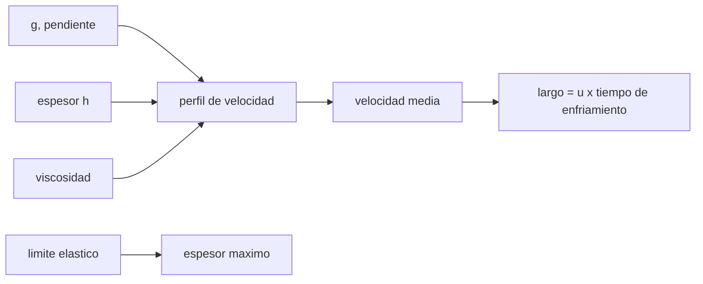

# B53-C11 — Vulcanismo extraterrestre

<!-- nav:top -->
[🏠 Programa](../../../../README.md) · [📚 Bloque B53](../../../tronco-comun/B53-astrogeologia-y-geodesia-planetaria.md) · [← Anterior: B53-C10 — Geología de impacto](../B53-C10-geologia-de-impacto/CLASE.md) · [Siguiente: B53-C12 — Tectónica planetaria →](../B53-C12-tectonica-planetaria/CLASE.md)
<!-- /nav -->

## 1. Ubicación, nivel y alcance

Clase 11 del bloque B53. Nivel N3. Una colada de lava es un fluido viscoso sobre una pendiente. Para un fluido newtoniano en una lámina, la velocidad crece con la gravedad y con el cuadrado del espesor (relación de Jeffreys); si el material tiene un **límite elástico**, el espesor máximo queda fijado por él. Aquí integras el perfil de velocidad con Simpson y lo comparas con la fórmula, comparas tres gravedades (redondeos de uso común, **no consultados**) y estimas un largo de colada con un tiempo de enfriamiento ilustrativo de 3 × 10⁴ s. La viscosidad y la pendiente son **sintéticas**. NASA describe actividad volcánica y calor interno en lunas heladas (página de Encélado consultada), pero aquí no se usa ningún dato de misión.

## 2. Por qué esta clase existe

La forma de un edificio volcánico delata la reología de la lava y la gravedad del cuerpo. La decisión central: **¿cómo cambian la velocidad, el espesor y el largo de una colada al cambiar de planeta?**

## 3. Lo que podrás hacer al terminar

1. Obtener el perfil de velocidad de una lámina newtoniana.
2. Calcular la velocidad media y compararla con Jeffreys.
3. Escalar la velocidad con la gravedad.
4. Aplicar el espesor máximo de un fluido con límite elástico.
5. Estimar un largo limitado por el enfriamiento.
6. Distinguir fluido newtoniano y de Bingham.

La evidencia es la **ficha del flujo de lava y la gravedad** del ejercicio 12 (sección 20).

## 4. Con qué llegas y cómo comprobarlo

1. ¿Qué es la viscosidad?
2. ¿Qué es una pendiente?
3. ¿Qué es un límite elástico?
4. ¿Qué es una integral numérica?
5. ¿Qué es un valor sintético?

<details>
<summary>Ver respuestas</summary>

1. La resistencia de un fluido a fluir. 2. El ángulo del terreno con la horizontal. 3. El esfuerzo bajo el cual el material no fluye. 4. Una suma de áreas pequeñas que aproxima la integral. 5. Uno inventado para el ejemplo.
</details>

Con cuatro o cinco aciertos, sigue; si no, repasa los prerrequisitos.

## 5. Un caso de contexto y casos de referencia

Lámina de `2 m` de espesor, `η = 10³ Pa·s`, `ρ = 2700 kg/m³` y pendiente de `2°`. La velocidad media en la Tierra es `1,233 m/s` (numérica `1,233`). La razón Luna/Tierra es `0,165`. Con límite elástico `τ_y = 10⁴ Pa`, el espesor máximo en la Tierra es `10,82 m` y en la Luna `65,51 m`. El largo ilustrativo es `36975 m`. Es el **ejemplo conductor**. Todo es **sintético o ilustrativo** y así se rotula.

## 6. Vocabulario

La **ecuación de Jeffreys** para la velocidad media es `ū = ρ g h² sin α/(3η)`. Un fluido de **Bingham** necesita un esfuerzo mínimo `τ_y`; el espesor máximo estable es `h = τ_y/(ρ g sin α)`. El **tiempo de enfriamiento** `t_c` limita el largo: `L = ū t_c`.

## 7. Modelo mental

Analogía: miel sobre un plato inclinado: más inclinación o menos viscosidad, más rápida; una pasta espesa se queda en un montón y no fluye.



*Descripción textual:* La gravedad, el espesor y la viscosidad determinan la velocidad; el límite elástico fija el espesor máximo y el enfriamiento limita el largo.

Límite de la analogía: la lava real cambia de viscosidad al enfriarse y cristalizar.

## 8. La explicación, paso a paso

### 8,1 Perfil y velocidad media

`u(z) = (ρ g sin α/η)(h z − z²/2)` y `ū = (1/h)∫u dz = ρ g h² sin α/(3η)`.

| Magnitud | Numérico | Analítico |
|---|---|---|
| `ū` Tierra [m/s] | 1,23251 | 1,23251 |

### 8,2 Gravedad

| Cuerpo | `g` [m/s²] | `ū` [m/s] | razón |
|---|---|---|---|
| Tierra | 9,81 | 1,2325 | 1,000 |
| Marte | 3,71 | 0,4661 | 0,378 |
| Luna | 1,62 | 0,2035 | 0,165 |

La razón es `g/g_Tierra`, porque `ū ∝ g`.

### 8,3 Espesor máximo con límite elástico

`h = τ_y/(ρ g sin α)`: Tierra `10,82 m`, Marte `28,61 m`, Luna `65,51 m`. A menor gravedad, la lava con límite elástico puede apilarse más.

### 8,4 Largo ilustrativo

Con un tiempo de enfriamiento ilustrativo `t_c = 3 × 10⁴ s` (unas 8 h), `L = ū t_c = 36975 m`.

## 9. Magnitudes, símbolos y unidades

| Símbolo | Qué es | Unidad | Valor / nota |
|---|---|---|---|
| `η` | viscosidad | Pa·s | 10³ (sintética) |
| `ρ` | densidad | kg/m³ | 2700 (ilustrativa) |
| `α` | pendiente | grados | 2 (sintética) |
| `τ_y` | límite elástico | Pa | 10⁴ (sintético) |
| `ū` | velocidad media | m/s | 1,233 en la Tierra |

## 10. Convenciones y referencias

Lámina infinita newtoniana (y de Bingham para el espesor), sin enfriamiento en el perfil; `g` redondeada (no consultada); Simpson con 2000 intervalos; tolerancia 10⁻⁹ relativa.

## 11. De dónde sale lo que afirmamos

| ID | Fuente | Localizador | Respalda | Estado |
|---|---|---|---|---|
| S1 | NASA Science, Cassini: Enceladus | https://science.nasa.gov/mission/cassini/science/enceladus/ | contexto: el calor interno y la actividad en lunas heladas | Página consultada el 2026-11-09 |

Límites: las propiedades de la lava son sintéticas e ilustrativas; no se usó ninguna medida de colada real.

## 12. Cómo ver el resultado

| Magnitud | Valor |
|---|---|
| `ū` Tierra | 1,233 m/s |
| razón Luna/Tierra | 0,165 |
| `h` máx Tierra | 10,82 m |
| `h` máx Luna | 65,51 m |
| largo | 36975 m |

Descripción larga: la velocidad es proporcional a la gravedad y el espesor máximo es inversamente proporcional.

## 13. Ejemplo trabajado

**Paso 1.** Datos: `h = 2 m`, `η = 10³`, `α = 2°`.

**Paso 2.** `ū = 2700·9,81·sin2°·4/(3·10³) = 1,233 m/s`.

**Paso 3.** Numérica: `1,233 m/s`.

**Paso 4.** Luna: `ū = 0,204 m/s`.

## 14. Distintas formas de describirlo

**Por fórmula:** Jeffreys. **Por integral:** Simpson. **Por tabla:** cuerpos. **Por razón:** `g/g_T`.

## 15. Práctica guiada

**Ejercicio 1 · con los pasos indicados.** Calcula `sin 2°`.

<details><summary>Solución comentada</summary>

`0,0349`.
</details>

**Ejercicio 2 · con una pista.** ¿Cómo cambia `ū` si `h` se duplica?

<details><summary>Solución comentada</summary>

Se cuadruplica.
</details>

**Ejercicio 3 · casi autónomo.** ¿Cómo cambia `ū` si `η` se duplica?

<details><summary>Solución comentada</summary>

Se reduce a la mitad.
</details>

## 16. Práctica autónoma, transferencia e integrador

**Ejercicio 4 · autónomo.** ¿Cuál es la razón de velocidades Marte/Tierra?

<details><summary>Solución comentada</summary>

`0,378`.
</details>

**Ejercicio 5 · autónomo.** ¿Qué espesor máximo da `τ_y = 10⁴` en la Luna?

<details><summary>Solución comentada</summary>

`65,51 m`.
</details>

**Ejercicio 6 · autónomo.** ¿Por qué las coladas lunares podrían ser más gruesas?

<details><summary>Solución comentada</summary>

La gravedad baja permite mayor espesor estable.
</details>

**Ejercicio 7 · autónomo.** ¿Cómo cambia el largo si el tiempo de enfriamiento se duplica?

<details><summary>Solución comentada</summary>

Se duplica.
</details>

**Ejercicio 8 · autónomo.** ¿Qué falta en el perfil newtoniano para lava real?

<details><summary>Solución comentada</summary>

Cambio de viscosidad con la temperatura y la cristalinidad.
</details>

**Ejercicio 9 · transferencia.** Dos coladas con igual `h` y distinto `η`. ¿Cuál es más larga?

<details><summary>Solución comentada</summary>

La menos viscosa.
</details>

**Ejercicio 10 · transferencia.** ¿Qué relación tiene el espesor máximo con la pendiente?

<details><summary>Solución comentada</summary>

Es inversamente proporcional a `sin α`.
</details>

**Ejercicio 11 · transferencia.** ¿Qué observable remoto da el espesor?

<details><summary>Solución comentada</summary>

La altura de los bordes (topografía).
</details>

**Ejercicio 12 · integrador.** Elabora tu *ficha del flujo de lava y la gravedad*: perfil, `ū`, razón de gravedades, `h` máximo y límites.

<details><summary>Solución modelo</summary>

Secciones 8,1 a 8,4.
</details>

## 17. Laboratorio: flujo de lava en una pendiente

El script [lava.py](lava.py) integra el perfil de velocidad con Simpson y calcula velocidades, espesores y largo (**comprueba** error relativo < 10⁻⁹).

**Datos:** propiedades de la lava **sintéticas**; `g` redondeada. **Predice antes de ejecutar:** ¿será mayor la velocidad en la Luna o en la Tierra? (en la Tierra). **Ejecución del 2026-11-09 (Python 3,12,9):**

```text
Python 3.12.9 (biblioteca estandar)
velocidad media (Tierra): analitica 1.232511 m/s ; Simpson 1.232511 m/s ; error relativo 1.80e-16
tierra  g =  9.81: u = 1.23251 m/s ; razon 1.0000 ; h maximo (Bingham) = 10.818 m
marte   g =  3.71: u = 0.46612 m/s ; razon 0.3782 ; h maximo (Bingham) = 28.605 m
luna    g =  1.62: u = 0.20353 m/s ; razon 0.1651 ; h maximo (Bingham) = 65.509 m
largo ilustrativo (u * t_c) = 36975 m
Pruebas superadas.
```

```bash
python programa/clases/B53/B53-C11-vulcanismo-extraterrestre/lava.py
```

**Límites:** viscosidad constante, sin enfriamiento acoplado ni canales.

## 18. Errores frecuentes y cómo corregirlos

**Tratar la viscosidad como constante.** se corrige con la sección 6

**Olvidar la gravedad en las comparaciones.** se corrige con 8,2

**Presentar la lava sintética como medida.** se corrige con la sección 10

## 19. Cómo sabrás que vas bien

Tras la sección 8: ¿qué resultado esperabas y cuál obtuviste? Si dudas, repasa el ejemplo de la sección 13. Tras el laboratorio: ¿qué comprueba? (ver la sección 17).

## 20. Qué entregas y cómo se evalúa

El producto es tu **ficha del flujo de lava y la gravedad** (ejercicio 12).

| Criterio | Inicial | En desarrollo | Logrado | Destacado |
|---|---|---|---|---|
| Conceptos | Los confunde | Parciales | Conceptos de la clase | Explica los límites |
| Cálculo | Sin unidades | Con errores | Tablas completas | Calcula casos nuevos |
| Numérico | Sin comprobar | Un caso | Contraste con el análisis | Interpreta las diferencias |
| Fuentes | Sin fuente | Sin fecha | Fuentes con fecha | Declara lo sintético |
| Límites | No los nombra | Uno | Tres | Discute qué falta del modelo |

**Condiciones críticas (no se compensan con promedio):** rotular las propiedades como sintéticas; no presentar un largo como de una colada real; citar solo lo consultado.

## 21. Ética, seguridad y límites

Clase educativa: los modelos son simplificados y no sustituyen a los productos de una misión ni a la literatura primaria. Ningún dato simulado se presenta como observado. Accesibilidad: tablas equivalentes a las gráficas, fórmulas en texto, ejercicios sin conexión.

## 22. Para cerrar y seguir

Jeffreys reproduce la integral numérica y la velocidad escala con la gravedad (`0,17` en la Luna). Queda una pregunta: ¿qué deforma la corteza?

**Glosario español–inglés.** viscosidad · *viscosity*; límite elástico · *yield strength*; colada · *lava flow*; fluido de Bingham · *Bingham fluid*.

**Continuidad.** [B53-C12](../B53-C12-tectonica-planetaria/CLASE.md) estudia la tectónica planetaria.

**Referencias:** ver sección 11.

<!-- nav:bottom -->
---

[← Anterior: B53-C10 — Geología de impacto](../B53-C10-geologia-de-impacto/CLASE.md) · [📚 Bloque B53](../../../tronco-comun/B53-astrogeologia-y-geodesia-planetaria.md) · [Siguiente: B53-C12 — Tectónica planetaria →](../B53-C12-tectonica-planetaria/CLASE.md)
<!-- /nav -->
