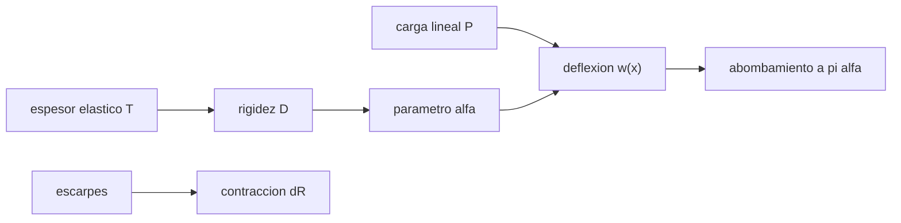

# B53-C12 — Tectónica planetaria

<!-- nav:top -->
[🏠 Programa](../../../../README.md) · [📚 Bloque B53](../../../tronco-comun/B53-astrogeologia-y-geodesia-planetaria.md) · [← Anterior: B53-C11 — Vulcanismo extraterrestre](../B53-C11-vulcanismo-extraterrestre/CLASE.md) · [Siguiente: B53-C13 — Geomorfología de hielos →](../B53-C13-geomorfologia-de-hielos/CLASE.md)
<!-- /nav -->

## 1. Ubicación, nivel y alcance

Clase 12 del bloque B53. Nivel N3. La corteza responde a cargas doblándose y a la contracción térmica fracturándose en escarpes. Aquí resuelves por diferencias finitas la flexión de una placa elástica sobre un sustrato (viga sobre fundación de Winkler) bajo una carga lineal, y la comparas con la solución analítica `w = w₀ e^(−x/α)(cos + sen)`; además estimas el acortamiento global de un cuerpo contraído a partir de una población **sintética** de escarpes. Parámetros **ilustrativos**.

## 2. Por qué esta clase existe

La flexión revela el espesor elástico de la litosfera y la contracción, el balance térmico global. La decisión central: **¿qué espesor elástico y qué acortamiento explican la deformación observada?**

## 3. Lo que podrás hacer al terminar

1. Plantear la ecuación de flexión de una placa elástica.
2. Resolverla por diferencias finitas con un sistema pentadiagonal.
3. Comparar con la solución analítica y localizar el abombamiento periférico.
4. Calcular el parámetro flexural.
5. Estimar el cambio de radio por escarpes.
6. Interpretar el espesor elástico.

La evidencia es la **ficha de la flexión de la litosfera y la contracción** del ejercicio 12 (sección 20).

## 4. Con qué llegas y cómo comprobarlo

1. ¿Qué es una placa elástica?
2. ¿Qué es una ecuación diferencial?
3. ¿Qué es una diferencia finita?
4. ¿Qué es un escarpe de cabalgamiento?
5. ¿Qué es un valor ilustrativo?

<details>
<summary>Ver respuestas</summary>

1. Una lámina que se deforma y recupera su forma. 2. Una relación entre una función y sus derivadas. 3. Una derivada aproximada con valores vecinos. 4. Un relieve escalonado causado por una falla inversa. 5. Uno propuesto para el ejemplo.
</details>

Con cuatro o cinco aciertos, sigue; si no, repasa los prerrequisitos.

## 5. Un caso de contexto y casos de referencia

Una placa de espesor elástico `T = 20 km`, `E = 10¹¹ Pa`, `ν = 0,25`, sobre un manto de `3300 kg/m³` con `g = 3,71 m/s²` (ilustrativos). El parámetro flexural es `α = 69,4 km`. Para una carga lineal de `10¹¹ N/m`, la deflexión máxima es `58,8 m` (analítica `58,8 m`) y el abombamiento periférico está a `219 km` (teórico `218 km`). Con 300 escarpes de `1 km` de acortamiento y `100 km` de largo, el radio de un cuerpo de `2440 km` se contrae `0,49 km`. Es el **ejemplo conductor**. Todo es **sintético o ilustrativo** y así se rotula.

## 6. Vocabulario

La **rigidez flexural** es `D = E T³/(12(1 − ν²))`. El **parámetro flexural** es `α = (4D/(Δρ g))^(1/4)`. El **abombamiento periférico** es el máximo secundario a distancia `≈ π α` de la carga. La **contracción global** reduce el radio `ΔR/R = ε/2`, con `ε` la deformación areal.

## 7. Modelo mental

Analogía: una regla de madera apoyada sobre una cama de resortes: la carga la hunde y, más lejos, la levanta un poco.



*Descripción textual:* El espesor elástico fija la rigidez y el parámetro flexural, que con la carga dan la deflexión y su abombamiento; aparte, los escarpes dan la contracción.

Límite de la analogía: la litosfera real es de espesor variable y no es perfectamente elástica.

## 8. La explicación, paso a paso

### 8,1 Flexión

`D w'''' + Δρ g w = P δ(x)`. La solución analítica de placa infinita es `w(x) = (P α³/(8D)) e^(−|x|/α)(cos(x/α) + sen(|x|/α))`.

| Magnitud | Diferencias finitas | Analítico |
|---|---|---|
| `D` [N m] | — | 7,1111 × 10²² |
| `α` [km] | — | 69,43 |
| `w₀` [m] | 58,83 | 58,82 |
| posición del abombamiento [km] | 218,7 | 218,1 |
| error máximo relativo a `w₀` | 4,36 × 10⁻⁴ | — |

### 8,2 Contracción

`ε = Σ s_i l_i/(4π R²)` y `ΔR = R ε/2`. Con 300 escarpes de `s = 1 km` y `l = 100 km` en `R = 2440 km`: `ε = 4,010 × 10⁻⁴`, `ΔR = 0,489 km`.

### 8,3 Lectura

El espesor elástico se ajusta a partir de la distancia del abombamiento. La contracción es un orden de magnitud: depende de cuántos escarpes se cuenten.

## 9. Magnitudes, símbolos y unidades

| Símbolo | Qué es | Unidad | Valor / nota |
|---|---|---|---|
| `T` | espesor elástico | km | 20 (ilustrativo) |
| `E` | módulo de Young | Pa | 10¹¹ (ilustrativo) |
| `Δρ g` | restitución del sustrato | N/m³ | 3300 × 3,71 |
| `α` | parámetro flexural | km | 69,4 |
| `ΔR` | contracción | km | 0,49 |

## 10. Convenciones y referencias

Placa elástica unidimensional, ±8 α con 40 puntos por α, extremos con deflexión nula; carga lineal central; semilla no necesaria; tolerancia: error máximo menor que 1 % de `w₀`.

## 11. De dónde sale lo que afirmamos

| ID | Fuente | Localizador | Respalda | Estado |
|---|---|---|---|---|
| — | Sin fuente externa | — | relaciones estándar que verifica el laboratorio | No se consultó una fuente para esta clase |

Límites: no se consultó ninguna fuente sobre litosferas; parámetros ilustrativos.

## 12. Cómo ver el resultado

| Magnitud | Valor |
|---|---|
| `α` | 69,4 km |
| `w₀` | 58,8 m |
| abombamiento | 219 km |
| error | 4,36 × 10⁻⁴ |
| `ΔR` | 0,49 km |

Descripción larga: la deflexión es máxima bajo la carga y el abombamiento queda a unos `π α`.

## 13. Ejemplo trabajado

**Paso 1.** Rigidez: `D = 7,111 × 10²² N m`.

**Paso 2.** Parámetro: `α = (4D/Δρ g)^(1/4) = 69,4 km`.

**Paso 3.** Deflexión: `w₀ = P α³/(8D) = 58,8 m`.

**Paso 4.** Abombamiento teórico: `x = π α = 218 km`.

## 14. Distintas formas de describirlo

**Por fórmula:** `w(x)`. **Por diferencias finitas:** sistema pentadiagonal. **Por tabla:** parámetros. **Por contracción:** `ΔR`.

## 15. Práctica guiada

**Ejercicio 1 · con los pasos indicados.** Calcula `D`.

<details><summary>Solución comentada</summary>

`7,111 × 10²² N m`.
</details>

**Ejercicio 2 · con una pista.** ¿Cómo cambia `α` si `T` se duplica?

<details><summary>Solución comentada</summary>

Crece `2^(3/4) = 1,68` veces.
</details>

**Ejercicio 3 · casi autónomo.** ¿Dónde está el abombamiento?

<details><summary>Solución comentada</summary>

A `π α ≈ 218 km`.
</details>

## 16. Práctica autónoma, transferencia e integrador

**Ejercicio 4 · autónomo.** ¿Qué signo tiene `w` allí?

<details><summary>Solución comentada</summary>

Negativo (hacia arriba).
</details>

**Ejercicio 5 · autónomo.** ¿Cuánto vale el cociente entre el abombamiento y `w₀`?

<details><summary>Solución comentada</summary>

`−0,0432`.
</details>

**Ejercicio 6 · autónomo.** Calcula la deformación areal de la población de escarpes.

<details><summary>Solución comentada</summary>

`4,010 × 10⁻⁴`.
</details>

**Ejercicio 7 · autónomo.** ¿Cuánto baja el radio si se duplica el número de escarpes?

<details><summary>Solución comentada</summary>

El doble: `0,98 km`.
</details>

**Ejercicio 8 · autónomo.** ¿Qué pasa con `α` si el sustrato es más denso?

<details><summary>Solución comentada</summary>

Disminuye.
</details>

**Ejercicio 9 · transferencia.** Se observa un abombamiento a 100 km. ¿Qué infieres del espesor?

<details><summary>Solución comentada</summary>

Que `α ≈ 100/π = 32 km`, y de allí `T`.
</details>

**Ejercicio 10 · transferencia.** ¿Por qué el modelo infinito falla cerca de los bordes de una carga extensa?

<details><summary>Solución comentada</summary>

No considera su geometría finita.
</details>

**Ejercicio 11 · transferencia.** ¿Qué escarpes faltan en el recuento?

<details><summary>Solución comentada</summary>

Los no detectados por resolución.
</details>

**Ejercicio 12 · integrador.** Elabora tu *ficha de la flexión de la litosfera y la contracción*: `D`, `α`, `w₀`, abombamiento y `ΔR`.

<details><summary>Solución modelo</summary>

Secciones 8,1 a 8,3.
</details>

## 17. Laboratorio: flexión de la litosfera y contracción global

El script [tectonica.py](tectonica.py) resuelve la flexión con un sistema pentadiagonal (641 nodos) y la compara con la analítica (**comprueba** error máximo < 1 % de `w₀`).

**Datos:** parámetros **ilustrativos**. **Predice antes de ejecutar:** ¿a qué distancia estará el abombamiento? (a unos `π α`). **Ejecución del 2026-11-09 (Python 3,12,9):**

```text
Python 3.12.9 (biblioteca estandar)
D = 7.1111e+22 N m ; alfa = 69.427 km
w0: diferencias finitas 58.833 m ; analitica 58.824 m ; error maximo relativo a w0 = 4.36e-04
abombamiento periferico: x = 218.7 km (pi*alfa = 218.1 km) ; w(pi alfa)/w0 = -0.0432
contraccion: eps = 4.010e-04 ; dR = 0.489 km
Pruebas superadas.
```

```bash
python programa/clases/B53/B53-C12-tectonica-planetaria/tectonica.py
```

**Límites:** placa unidimensional infinita, espesor constante, elástica.

## 18. Errores frecuentes y cómo corregirlos

**Confundir deflexión con espesor.** se corrige con 8,1

**Tomar la contracción como medida.** se corrige con 8,3

**Presentar los parámetros como reales.** se corrige con la sección 10

## 19. Cómo sabrás que vas bien

Tras la sección 8: ¿qué resultado esperabas y cuál obtuviste? Si dudas, repasa el ejemplo de la sección 13. Tras el laboratorio: ¿qué comprueba? (ver la sección 17).

## 20. Qué entregas y cómo se evalúa

El producto es tu **ficha de la flexión de la litosfera y la contracción** (ejercicio 12).

| Criterio | Inicial | En desarrollo | Logrado | Destacado |
|---|---|---|---|---|
| Conceptos | Los confunde | Parciales | Conceptos de la clase | Explica los límites |
| Cálculo | Sin unidades | Con errores | Tablas completas | Calcula casos nuevos |
| Numérico | Sin comprobar | Un caso | Contraste con el análisis | Interpreta las diferencias |
| Fuentes | Sin fuente | Sin fecha | Fuentes con fecha | Declara lo sintético |
| Límites | No los nombra | Uno | Tres | Discute qué falta del modelo |

**Condiciones críticas (no se compensan con promedio):** rotular los parámetros como ilustrativos; no atribuir el espesor elástico a un cuerpo real; citar solo lo consultado.

## 21. Ética, seguridad y límites

Clase educativa: los modelos son simplificados y no sustituyen a los productos de una misión ni a la literatura primaria. Ningún dato simulado se presenta como observado. Accesibilidad: tablas equivalentes a las gráficas, fórmulas en texto, ejercicios sin conexión.

## 22. Para cerrar y seguir

La solución numérica reproduce la analítica (`4,4 × 10⁻⁴` de `w₀`) y los escarpes contraen `0,49 km`. Queda una pregunta: ¿cómo se comportan los hielos?

**Glosario español–inglés.** flexión · *flexure*; rigidez flexural · *flexural rigidity*; escarpe · *scarp*; contracción global · *global contraction*.

**Continuidad.** [B53-C13](../B53-C13-geomorfologia-de-hielos/CLASE.md) estudia la geomorfología de hielos.

**Referencias:** ver sección 11.

<!-- nav:bottom -->
---

[← Anterior: B53-C11 — Vulcanismo extraterrestre](../B53-C11-vulcanismo-extraterrestre/CLASE.md) · [📚 Bloque B53](../../../tronco-comun/B53-astrogeologia-y-geodesia-planetaria.md) · [Siguiente: B53-C13 — Geomorfología de hielos →](../B53-C13-geomorfologia-de-hielos/CLASE.md)
<!-- /nav -->
