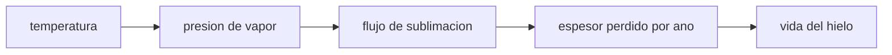

# B53-C13 — Geomorfología de hielos

<!-- nav:top -->
[🏠 Programa](../../../../README.md) · [📚 Bloque B53](../../../tronco-comun/B53-astrogeologia-y-geodesia-planetaria.md) · [← Anterior: B53-C12 — Tectónica planetaria](../B53-C12-tectonica-planetaria/CLASE.md) · [Siguiente: B53-C14 — Geología de Europa →](../B53-C14-geologia-de-europa/CLASE.md)
<!-- /nav -->

## 1. Ubicación, nivel y alcance

Clase 13 del bloque B53. Nivel N3. El hielo de agua en la superficie de un cuerpo sin atmósfera se conserva solo donde hace suficiente frío: su presión de vapor cae de forma exponencial con la temperatura (Clausius–Clapeyron). Aquí calculas la presión de vapor de equilibrio, el flujo de sublimación de Hertz–Knudsen y cuánto tarda en perderse un metro de hielo a distintas temperaturas, para explicar por qué existen **trampas frías**. Las constantes del hielo son valores de uso común **no consultados** y la temperatura es un parámetro **ilustrativo**.

## 2. Por qué esta clase existe

Una forma de hielo (un depósito, un glaciar, un cráter sombreado) persiste o desaparece según su temperatura. La decisión central: **¿a qué temperatura el hielo expuesto sobrevive miles de millones de años y a cuál se pierde en días?**

## 3. Lo que podrás hacer al terminar

1. Calcular la presión de vapor del hielo con Clausius–Clapeyron.
2. Verificar numéricamente la pendiente de `ln p` frente a `1/T`.
3. Calcular el flujo de sublimación de Hertz–Knudsen.
4. Convertir el flujo en espesor perdido por unidad de tiempo.
5. Comparar una trampa fría con una superficie templada.
6. Declarar los límites de un modelo de equilibrio.

La evidencia es la **ficha de la estabilidad del hielo superficial** del ejercicio 12 (sección 20).

## 4. Con qué llegas y cómo comprobarlo

1. ¿Qué es la presión de vapor?
2. ¿Qué es la sublimación?
3. ¿Qué es una exponencial?
4. ¿Qué es una trampa fría?
5. ¿Qué es un valor ilustrativo?

<details>
<summary>Ver respuestas</summary>

1. La presión del gas en equilibrio con el sólido o líquido. 2. El paso directo de sólido a gas. 3. Una función `e^x`, que crece o decae muy rápido. 4. Una zona permanentemente fría donde los volátiles se acumulan. 5. Uno propuesto para el ejemplo.
</details>

Con cuatro o cinco aciertos, sigue; si no, repasa los prerrequisitos.

## 5. Un caso de contexto y casos de referencia

Con `L = 2,83 × 10⁶ J/kg` y el punto triple (`611,657 Pa` a `273,16 K`), todos de uso común y **no consultados**, el hielo a `100 K` tiene `p = 8,04 × 10⁻¹⁵ Pa` y tarda `1,95 × 10¹²` años en perder 1 m; a `200 K`, `p = 1,66 × 10⁻¹ Pa` y `1,33 × 10⁻¹` años; a `250 K`, `3,24 × 10⁻⁴` años. La pendiente numérica de `ln p` frente a `1/T` es `-6131,78 K` (analítica `-6131,78 K`). Es el **ejemplo conductor**. Todo es **sintético o ilustrativo** y así se rotula.

## 6. Vocabulario

La relación de **Clausius–Clapeyron** es `p = p_t exp[(L/R_v)(1/T_t − 1/T)]`. El **flujo de Hertz–Knudsen** es `J = p √(M/(2π R T))`. La **trampa fría** es un lugar con `T` tan baja que `J` es despreciable.

## 7. Modelo mental

Analogía: una taza de agua en el sol y otra en la sombra: la de la sombra tarda mucho más en secarse.



*Descripción textual:* La temperatura fija la presión de vapor, que da el flujo de sublimación, el espesor perdido por año y la vida del hielo.

Límite de la analogía: el modelo supone hielo puro, sin recondensación, sin atmósfera y a temperatura uniforme.

## 8. La explicación, paso a paso

### 8,1 Presión de vapor

`R_v = R/M = 8,314462618/0,018015 = 461,53 J/(kg·K)`. La pendiente de `ln p` frente a `1/T` es `−L/R_v`.

| Magnitud | Numérica | Analítica |
|---|---|---|
| pendiente [K] | -6131,779 | -6131,779 |

### 8,2 Sublimación

| `T` [K] | `p` [Pa] | `J` [kg m⁻² s⁻¹] | años por metro |
|---|---|---|---|
| 100 | 8,04 × 10⁻¹⁵ | 1,49 × 10⁻¹⁷ | 1,95 × 10¹² |
| 150 | 6,05 × 10⁻⁶ | 9,18 × 10⁻⁹ | 3,17 × 10³ |
| 200 | 1,66 × 10⁻¹ | 2,18 × 10⁻⁴ | 1,33 × 10⁻¹ |
| 250 | 7,64 × 10¹ | 8,98 × 10⁻² | 3,24 × 10⁻⁴ |

### 8,3 Lectura

El cociente de vidas entre 250 K y 100 K es de `1,7 × 10⁻¹⁶`. Por eso unos cientos de kelvin de diferencia separan el hielo estable del efímero.

## 9. Magnitudes, símbolos y unidades

| Símbolo | Qué es | Unidad | Valor / nota |
|---|---|---|---|
| `L` | calor latente de sublimación | J/kg | 2,83 × 10⁶ (uso común, no consultado) |
| `p_t`, `T_t` | punto triple | Pa, K | 611,657; 273,16 (uso común, no consultado) |
| `R` | constante de los gases | J/(mol K) | 8,314462618 (exacta, SI) |
| `M` | masa molar del agua | kg/mol | 0,018015 |
| `ρ` | densidad del hielo | kg/m³ | 917 (ilustrativa) |

## 10. Convenciones y referencias

Hielo puro de agua en equilibrio con su vapor, sin atmósfera; `T` uniforme; año = 3,156 × 10⁷ s; tolerancia: pendiente numérica dentro de 10⁻⁶ relativa.

## 11. De dónde sale lo que afirmamos

| ID | Fuente | Localizador | Respalda | Estado |
|---|---|---|---|---|
| — | Sin fuente externa | — | relaciones estándar que verifica el laboratorio | No se consultó una fuente para esta clase |

Límites: no se consultó ninguna fuente de propiedades del hielo; las constantes son de uso común y las temperaturas, ilustrativas. La página de Cassini sobre Encélado (consultada) no se usa para estas cifras.

## 12. Cómo ver el resultado

| Magnitud | Valor |
|---|---|
| `p` a 100 K | 8,04 × 10⁻¹⁵ Pa |
| años por metro a 100 K | 1,95 × 10¹² |
| años por metro a 200 K | 1,33 × 10⁻¹ |
| años por metro a 250 K | 3,24 × 10⁻⁴ |
| pendiente | -6131,78 K |

Descripción larga: la vida del hielo cae muchos órdenes de magnitud al subir unos pocos cientos de kelvin.

## 13. Ejemplo trabajado

**Paso 1.** Datos: `T = 200 K`, `L/R_v = -6131,8 K`.

**Paso 2.** Exponente: `(1/273,16 − 1/200) × -6131,8`.

**Paso 3.** Presión: `p = 1,66 × 10⁻¹ Pa`.

**Paso 4.** Flujo y vida: `J = 2,18 × 10⁻⁴`, `1,33 × 10⁻¹` años por metro.

## 14. Distintas formas de describirlo

**Por fórmula:** Clausius–Clapeyron. **Por tabla:** `T`, `p`, `J`. **Por pendiente:** Arrhenius. **Por vida:** años por metro.

## 15. Práctica guiada

**Ejercicio 1 · con los pasos indicados.** Calcula `R_v`.

<details><summary>Solución comentada</summary>

`461,53 J/(kg K)`.
</details>

**Ejercicio 2 · con una pista.** ¿Qué pendiente tiene `ln p` frente a `1/T`?

<details><summary>Solución comentada</summary>

`−L/R_v = −-6131,8 K`.
</details>

**Ejercicio 3 · casi autónomo.** ¿Qué pasa con `p` si `T` sube?

<details><summary>Solución comentada</summary>

Crece exponencialmente.
</details>

## 16. Práctica autónoma, transferencia e integrador

**Ejercicio 4 · autónomo.** Lee la vida del hielo a 150 K.

<details><summary>Solución comentada</summary>

`3,17 × 10³` años por metro.
</details>

**Ejercicio 5 · autónomo.** ¿Cuánto es 1 año en segundos?

<details><summary>Solución comentada</summary>

`3,156 × 10⁷ s`.
</details>

**Ejercicio 6 · autónomo.** ¿Qué pasa con la vida si la densidad del hielo baja?

<details><summary>Solución comentada</summary>

Baja en proporción.
</details>

**Ejercicio 7 · autónomo.** ¿Por qué una trampa fría conserva hielo?

<details><summary>Solución comentada</summary>

Porque `J` es mínimo.
</details>

**Ejercicio 8 · autónomo.** ¿Qué ignora el modelo respecto de una atmósfera?

<details><summary>Solución comentada</summary>

La recondensación y el transporte de vapor.
</details>

**Ejercicio 9 · transferencia.** Un cráter sombreado llega a 90 K. ¿Qué infieres?

<details><summary>Solución comentada</summary>

Que el hielo sería estable, si el modelo vale.
</details>

**Ejercicio 10 · transferencia.** ¿Qué observable remoto delata hielo en sombra?

<details><summary>Solución comentada</summary>

Albedo y datos de neutrones u otros, según la misión; aquí no se tratan.
</details>

**Ejercicio 11 · transferencia.** ¿Por qué el hielo puede persistir bajo regolito?

<details><summary>Solución comentada</summary>

El regolito aísla y limita la sublimación.
</details>

**Ejercicio 12 · integrador.** Elabora tu *ficha de la estabilidad del hielo superficial*: constantes, `p`, `J`, vida y límites.

<details><summary>Solución modelo</summary>

Secciones 8,1 a 8,3.
</details>

## 17. Laboratorio: presión de vapor y sublimación del hielo

El script [hielo.py](hielo.py) calcula `p`, `J` y la vida del hielo a cuatro temperaturas y verifica la pendiente de Clausius–Clapeyron (**comprueba** 10⁻⁶ relativa).

**Datos:** constantes **de uso común, no consultadas**; temperaturas ilustrativas. **Predice antes de ejecutar:** ¿cuántos órdenes de magnitud cambia la vida entre 100 y 250 K? (unos 16). **Ejecución del 2026-11-09 (Python 3,12,9):**

```text
Python 3.12.9 (biblioteca estandar)
R_v = 461.530 J/(kg K) ; pendiente de ln p frente a 1/T: numerica -6131.7793 K ; analitica -6131.7793 K
T = 100 K: p = 8.042e-15 Pa ; J = 1.493e-17 kg/m2/s ; anos por metro = 1.946e+12
T = 150 K: p = 6.054e-06 Pa ; J = 9.179e-09 kg/m2/s ; anos por metro = 3.165e+03
T = 200 K: p = 1.661e-01 Pa ; J = 2.181e-04 kg/m2/s ; anos por metro = 1.332e-01
T = 250 K: p = 7.645e+01 Pa ; J = 8.979e-02 kg/m2/s ; anos por metro = 3.236e-04
cociente de vidas 250 K / 100 K = 1.663e-16
Pruebas superadas.
```

```bash
python programa/clases/B53/B53-C13-geomorfologia-de-hielos/hielo.py
```

**Límites:** hielo puro en equilibrio, sin atmósfera ni radiación.

## 18. Errores frecuentes y cómo corregirlos

**Creer que la temperatura es lineal con la vida.** se corrige con 8,2

**Usar el modelo con atmósfera densa.** se corrige con la sección 10

**Tomar las constantes como consultadas.** se corrige con la sección 11

## 19. Cómo sabrás que vas bien

Tras la sección 8: ¿qué resultado esperabas y cuál obtuviste? Si dudas, repasa el ejemplo de la sección 13. Tras el laboratorio: ¿qué comprueba? (ver la sección 17).

## 20. Qué entregas y cómo se evalúa

El producto es tu **ficha de la estabilidad del hielo superficial** (ejercicio 12).

| Criterio | Inicial | En desarrollo | Logrado | Destacado |
|---|---|---|---|---|
| Conceptos | Los confunde | Parciales | Conceptos de la clase | Explica los límites |
| Cálculo | Sin unidades | Con errores | Tablas completas | Calcula casos nuevos |
| Numérico | Sin comprobar | Un caso | Contraste con el análisis | Interpreta las diferencias |
| Fuentes | Sin fuente | Sin fecha | Fuentes con fecha | Declara lo sintético |
| Límites | No los nombra | Uno | Tres | Discute qué falta del modelo |

**Condiciones críticas (no se compensan con promedio):** rotular las constantes como no consultadas y las temperaturas como ilustrativas; no afirmar hielo en un cráter real; citar solo lo consultado.

## 21. Ética, seguridad y límites

Clase educativa: los modelos son simplificados y no sustituyen a los productos de una misión ni a la literatura primaria. Ningún dato simulado se presenta como observado. Accesibilidad: tablas equivalentes a las gráficas, fórmulas en texto, ejercicios sin conexión.

## 22. Para cerrar y seguir

La vida del hielo pasa de `1,9 × 10¹²` años por metro a 100 K a `3,2 × 10⁻⁴` a 250 K. Queda una pregunta: ¿cómo fluye y se fractura el hielo?

**Glosario español–inglés.** presión de vapor · *vapor pressure*; sublimación · *sublimation*; trampa fría · *cold trap*.

**Continuidad.** [B53-C14](../B53-C14-geologia-de-europa/CLASE.md) estudia la mecánica del hielo.

**Referencias:** ver sección 11.

<!-- nav:bottom -->
---

[← Anterior: B53-C12 — Tectónica planetaria](../B53-C12-tectonica-planetaria/CLASE.md) · [📚 Bloque B53](../../../tronco-comun/B53-astrogeologia-y-geodesia-planetaria.md) · [Siguiente: B53-C14 — Geología de Europa →](../B53-C14-geologia-de-europa/CLASE.md)
<!-- /nav -->
