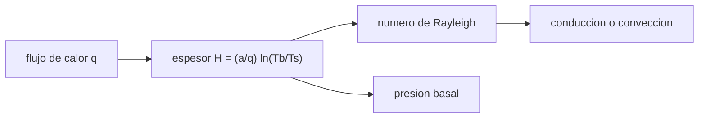

# B53-C14 — Geología de Europa

<!-- nav:top -->
[🏠 Programa](../../../../README.md) · [📚 Bloque B53](../../../tronco-comun/B53-astrogeologia-y-geodesia-planetaria.md) · [← Anterior: B53-C13 — Geomorfología de hielos](../B53-C13-geomorfologia-de-hielos/CLASE.md) · [Siguiente: B53-C15 — Geología de Encélado →](../B53-C15-geologia-de-encelado/CLASE.md)
<!-- /nav -->

## 1. Ubicación, nivel y alcance

Clase 14 del bloque B53. Nivel N3. Europa se estudia como una luna con una capa de hielo sobre un posible océano. La misión Europa Clipper lleva un radar para sondear la capa de hielo y un magnetómetro para confirmar el océano (página de NASA consultada). Aquí calculas, con parámetros **ilustrativos**, el espesor de una capa conductiva para distintos flujos de calor, con una conductividad que depende de la temperatura, el número de Rayleigh que indica si podría convectar y la presión en la base. No se usan datos de la misión.

## 2. Por qué esta clase existe

El espesor de la capa de hielo controla qué mide un radar, cómo se fractura la superficie y si el océano se comunica con ella. La decisión central: **¿qué espesor corresponde a un flujo de calor dado y si ese espesor sería conductivo o convectivo?**

## 3. Lo que podrás hacer al terminar

1. Integrar la conducción con conductividad `k = a/T`.
2. Comparar con la solución logarítmica.
3. Obtener el espesor para varios flujos de calor.
4. Calcular el número de Rayleigh y compararlo con un umbral.
5. Calcular la presión en la base de la capa.
6. Distinguir lo medible (radar, magnetómetro) de lo inferido.

La evidencia es la **ficha del espesor de la capa de hielo** del ejercicio 12 (sección 20).

## 4. Con qué llegas y cómo comprobarlo

1. ¿Qué es el flujo de calor?
2. ¿Qué es la conductividad térmica?
3. ¿Qué es la convección?
4. ¿Qué es una presión hidrostática?
5. ¿Qué es un valor ilustrativo?

<details>
<summary>Ver respuestas</summary>

1. Energía por unidad de área y de tiempo. 2. La capacidad de un material de conducir calor. 3. Transporte de calor por movimiento del material. 4. `ρ g h`. 5. Uno propuesto para el ejemplo.
</details>

Con cuatro o cinco aciertos, sigue; si no, repasa los prerrequisitos.

## 5. Un caso de contexto y casos de referencia

Con superficie a `100 K`, base a `273 K` y `k = 567/T W/(m K)` (relación de uso común, **no consultada**), un flujo de `20 mW/m²` da un espesor de `28,5 km` (numérico `28,5 km`); `10 mW/m²` da `56,9 km` y `50 mW/m²`, `11,4 km`. Para `20 mW/m²` el número de Rayleigh es `7,64 × 10⁶` con parámetros ilustrativos, y la presión en la base `34,1 MPa`. Es el **ejemplo conductor**. Todo es **sintético o ilustrativo** y así se rotula.

## 6. Vocabulario

La **conducción** cumple `q = k dT/dz`. Con `k = a/T`, `H = (a/q) ln(T_b/T_s)`. El **número de Rayleigh** `Ra = ρ g α ΔT H³/(κ η)` mide la tendencia a convectar. La **presión basal** es `ρ g H`.

## 7. Modelo mental

Analogía: un abrigo grueso: cuanto más calor sale del cuerpo, más grueso debe ser el abrigo para mantener la misma diferencia de temperatura.



*Descripción textual:* El flujo de calor fija el espesor; el espesor decide el número de Rayleigh y la presión basal.

Límite de la analogía: el flujo de calor de Europa no se conoce con certeza y puede ser variable; aquí se barre como parámetro.

## 8. La explicación, paso a paso

### 8,1 Conducción con `k = a/T`

`q = (a/T) dT/dz` implica `z = (a/q) ln(T/T_s)` y `H = (a/q) ln(T_b/T_s)` con `a = 567 W/m`.

| `q` [mW/m²] | `H` analítico [km] | `H` por Simpson [km] |
|---|---|---|
| 10 | 56,94 | 56,94 |
| 20 | 28,47 | 28,47 |
| 50 | 11,39 | 11,39 |

### 8,2 Rayleigh y presión

Con `ρ = 920`, `g = 1,3`, `α = 1,6 × 10⁻⁴ K⁻¹`, `κ = 10⁻⁶ m²/s`, `η = 10¹⁴ Pa s` (todos ilustrativos), `ΔT = 173 K`:

| `q` [mW/m²] | `Ra` | presión basal [MPa] |
|---|---|---|
| 10 | 6,11 × 10⁷ | 68,1 |
| 20 | 7,64 × 10⁶ | 34,1 |
| 50 | 4,89 × 10⁵ | 13,6 |

### 8,3 Lectura

`Ra` crece como `H³`; una capa gruesa se acerca más a convectar. El umbral exacto depende de la reología, que aquí no se modela.

## 9. Magnitudes, símbolos y unidades

| Símbolo | Qué es | Unidad | Valor / nota |
|---|---|---|---|
| `a` | constante de `k = a/T` | W/m | 567 (uso común, no consultada) |
| `T_s`, `T_b` | temperaturas de superficie y base | K | 100 y 273 (ilustrativas) |
| `q` | flujo de calor | W/m² | 0,010; 0,020; 0,050 (parámetro) |
| `g` | gravedad | m/s² | 1,3 (ilustrativa) |
| `η` | viscosidad | Pa s | 10¹⁴ (ilustrativa) |

## 10. Convenciones y referencias

Capa de hielo plana en régimen estacionario; parámetros ilustrativos; Simpson con 2000 intervalos; tolerancia 10⁻⁹ relativa entre la integración y la fórmula.

## 11. De dónde sale lo que afirmamos

| ID | Fuente | Localizador | Respalda | Estado |
|---|---|---|---|---|
| S1 | NASA Science, Europa Clipper: instrumentos | https://science.nasa.gov/mission/europa-clipper/spacecraft-instruments/ | contexto: Europa Clipper lleva un radar (REASON) para sondear el hielo y un magnetómetro (ECM) para confirmar el océano | Página consultada el 2026-11-09 (no da frecuencias) |

Límites: la página no da frecuencias ni espesores; el flujo de calor y las propiedades del hielo son ilustrativos y no proceden de ninguna fuente consultada.

## 12. Cómo ver el resultado

| Magnitud | Valor |
|---|---|
| `H` a 10 mW/m² | 56,9 km |
| `H` a 20 mW/m² | 28,5 km |
| `H` a 50 mW/m² | 11,4 km |
| `Ra` a 20 mW/m² | 7,64 × 10⁶ |
| presión basal a 20 | 34,1 MPa |

Descripción larga: el espesor es inversamente proporcional al flujo de calor.

## 13. Ejemplo trabajado

**Paso 1.** Datos: `q = 0,020 W/m²`, `a = 567`.

**Paso 2.** `ln(273/100) = 1,0043`.

**Paso 3.** `H = 567 × 1,0043/0,020 = 28,5 km`.

**Paso 4.** Rayleigh: `Ra = 7,64 × 10⁶`.

## 14. Distintas formas de describirlo

**Por fórmula:** `H = (a/q) ln`. **Por integral:** Simpson. **Por tabla:** `q`, `H`, `Ra`. **Por umbral:** Rayleigh.

## 15. Práctica guiada

**Ejercicio 1 · con los pasos indicados.** Calcula `ln(273/100)`.

<details><summary>Solución comentada</summary>

`1,0043`.
</details>

**Ejercicio 2 · con una pista.** ¿Cómo cambia `H` si `q` se duplica?

<details><summary>Solución comentada</summary>

Se reduce a la mitad.
</details>

**Ejercicio 3 · casi autónomo.** Calcula `H` para `q = 0,040`.

<details><summary>Solución comentada</summary>

`14,24 km`.
</details>

## 16. Práctica autónoma, transferencia e integrador

**Ejercicio 4 · autónomo.** ¿Qué presión da `H = 20 km`?

<details><summary>Solución comentada</summary>

`920 × 1,3 × 20000 = 23,9 MPa`.
</details>

**Ejercicio 5 · autónomo.** ¿Cómo cambia `Ra` si `H` se duplica?

<details><summary>Solución comentada</summary>

Se multiplica por 8.
</details>

**Ejercicio 6 · autónomo.** ¿Qué mide un radar de hielo?

<details><summary>Solución comentada</summary>

El tiempo de ida y vuelta a interfaces; da espesor si se conoce la velocidad (clase 24).
</details>

**Ejercicio 7 · autónomo.** ¿Qué mide un magnetómetro?

<details><summary>Solución comentada</summary>

El campo magnético inducido por un océano conductor (clase 27).
</details>

**Ejercicio 8 · autónomo.** ¿Por qué el flujo de calor es incierto?

<details><summary>Solución comentada</summary>

Depende del calentamiento de marea y de la historia térmica.
</details>

**Ejercicio 9 · transferencia.** Un modelo da `H = 5 km`. ¿Qué implica sobre `q`?

<details><summary>Solución comentada</summary>

Un flujo alto, `≈ 0,11 W/m²`.
</details>

**Ejercicio 10 · transferencia.** ¿Qué ignora una capa conductiva estacionaria?

<details><summary>Solución comentada</summary>

Convección, fracturas y variaciones laterales.
</details>

**Ejercicio 11 · transferencia.** ¿Puede el modelo decir que hay océano?

<details><summary>Solución comentada</summary>

No; solo relaciona espesor y flujo si hay agua en la base.
</details>

**Ejercicio 12 · integrador.** Elabora tu *ficha del espesor de la capa de hielo*: `q`, `H`, `Ra`, presión y límites.

<details><summary>Solución modelo</summary>

Secciones 8,1 a 8,3.
</details>

## 17. Laboratorio: espesor de la capa de hielo por conducción

El script [europa.py](europa.py) calcula `H(q)` por la fórmula y por Simpson, y `Ra` y presión basal (**comprueba** 10⁻⁹ relativa).

**Datos:** parámetros **ilustrativos**. **Predice antes de ejecutar:** ¿cuál flujo da la capa más gruesa? (el menor). **Ejecución del 2026-11-09 (Python 3,12,9):**

```text
Python 3.12.9 (biblioteca estandar)
q = 10 mW/m2: H = 56.944 km (Simpson 56.944) ; Ra = 6.113e+07 ; presion basal = 68.10 MPa
q = 20 mW/m2: H = 28.472 km (Simpson 28.472) ; Ra = 7.641e+06 ; presion basal = 34.05 MPa
q = 50 mW/m2: H = 11.389 km (Simpson 11.389) ; Ra = 4.890e+05 ; presion basal = 13.62 MPa
error relativo maximo de la integracion = 1.79e-14
Pruebas superadas.
```

```bash
python programa/clases/B53/B53-C14-geologia-de-europa/europa.py
```

**Límites:** régimen estacionario, sin convección ni calor de marea explícito.

## 18. Errores frecuentes y cómo corregirlos

**Confundir espesor con profundidad del océano.** se corrige con 8,3

**Usar `Ra` como predicción exacta.** se corrige con 8,2

**Presentar el espesor como medido.** se corrige con la sección 10

## 19. Cómo sabrás que vas bien

Tras la sección 8: ¿qué resultado esperabas y cuál obtuviste? Si dudas, repasa el ejemplo de la sección 13. Tras el laboratorio: ¿qué comprueba? (ver la sección 17).

## 20. Qué entregas y cómo se evalúa

El producto es tu **ficha del espesor de la capa de hielo** (ejercicio 12).

| Criterio | Inicial | En desarrollo | Logrado | Destacado |
|---|---|---|---|---|
| Conceptos | Los confunde | Parciales | Conceptos de la clase | Explica los límites |
| Cálculo | Sin unidades | Con errores | Tablas completas | Calcula casos nuevos |
| Numérico | Sin comprobar | Un caso | Contraste con el análisis | Interpreta las diferencias |
| Fuentes | Sin fuente | Sin fecha | Fuentes con fecha | Declara lo sintético |
| Límites | No los nombra | Uno | Tres | Discute qué falta del modelo |

**Condiciones críticas (no se compensan con promedio):** rotular los parámetros como ilustrativos; no afirmar un espesor de Europa; citar solo lo consultado.

## 21. Ética, seguridad y límites

Clase educativa: los modelos son simplificados y no sustituyen a los productos de una misión ni a la literatura primaria. Ningún dato simulado se presenta como observado. Accesibilidad: tablas equivalentes a las gráficas, fórmulas en texto, ejercicios sin conexión.

## 22. Para cerrar y seguir

La integral reproduce la fórmula y el espesor va de `11` a `57 km` según el flujo. Queda una pregunta: ¿qué mueve el material de un penacho en una luna pequeña?

**Glosario español–inglés.** capa de hielo · *ice shell*; flujo de calor · *heat flux*; número de Rayleigh · *Rayleigh number*.

**Continuidad.** [B53-C15](../B53-C15-geologia-de-encelado/CLASE.md) estudia la geología de Encélado.

**Referencias:** ver sección 11.

<!-- nav:bottom -->
---

[← Anterior: B53-C13 — Geomorfología de hielos](../B53-C13-geomorfologia-de-hielos/CLASE.md) · [📚 Bloque B53](../../../tronco-comun/B53-astrogeologia-y-geodesia-planetaria.md) · [Siguiente: B53-C15 — Geología de Encélado →](../B53-C15-geologia-de-encelado/CLASE.md)
<!-- /nav -->
