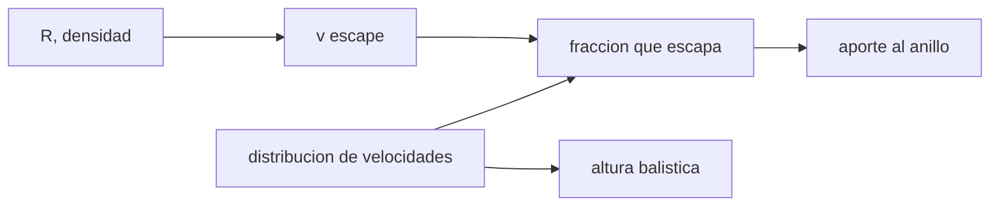

# B53-C15 — Geología de Encélado

<!-- nav:top -->
[🏠 Programa](../../../../README.md) · [📚 Bloque B53](../../../tronco-comun/B53-astrogeologia-y-geodesia-planetaria.md) · [← Anterior: B53-C14 — Geología de Europa](../B53-C14-geologia-de-europa/CLASE.md) · [Siguiente: B53-C16 — Superficies de asteroides →](../B53-C16-superficies-de-asteroides/CLASE.md)
<!-- /nav -->

## 1. Ubicación, nivel y alcance

Clase 15 del bloque B53. Nivel N3. Encélado es una luna de unos 500 km de diámetro con grietas en el polo sur de donde salen chorros de vapor de agua y partículas de hielo; parte del material cae de nuevo y parte alimenta el anillo E de Saturno (página de NASA sobre Cassini, consultada). Aquí modelas granos lanzados con una distribución de velocidades **sintética**: calculas la velocidad de escape con `G` de NIST y un radio y una densidad **ilustrativos**, la fracción de granos que escapa (Monte Carlo frente a la fórmula) y la altura balística de los que caen.

## 2. Por qué esta clase existe

La fracción que escapa decide cuánto material llega al anillo y cuánto se deposita en la superficie. La decisión central: **¿qué parte de los granos supera la velocidad de escape y a qué altura llegan los demás?**

## 3. Lo que podrás hacer al terminar

1. Calcular la velocidad de escape de un cuerpo pequeño.
2. Obtener la fracción que escapa para una distribución de Maxwell.
3. Verificarla por Monte Carlo.
4. Calcular la altura balística sin atmósfera.
5. Comprobar la altura con integración numérica de la órbita.
6. Explicar por qué el cuerpo pequeño favorece el escape.

La evidencia es la **ficha de la dinámica de un penacho** del ejercicio 12 (sección 20).

## 4. Con qué llegas y cómo comprobarlo

1. ¿Qué es la velocidad de escape?
2. ¿Qué es una distribución de Maxwell?
3. ¿Qué es una trayectoria balística?
4. ¿Qué es la integración numérica?
5. ¿Qué es un valor ilustrativo?

<details>
<summary>Ver respuestas</summary>

1. La velocidad mínima para alejarse sin volver: `√(2GM/R)`. 2. La distribución de velocidades de un gas en equilibrio. 3. La de un cuerpo que solo siente la gravedad. 4. Calcular una trayectoria paso a paso. 5. Uno propuesto para el ejemplo.
</details>

Con cuatro o cinco aciertos, sigue; si no, repasa los prerrequisitos.

## 5. Un caso de contexto y casos de referencia

Un cuerpo de `R = 252 km` y `ρ = 1600 kg/m³` (ilustrativos; la página consultada solo da «unos 500 km de diámetro») tiene `v_esc = 238,4 m/s`. Con granos de velocidad Maxwell de escala `σ = 100 m/s` (sintética), escapa `0,1282` (Monte Carlo `0,1277`). Un grano lanzado hacia arriba a `150 m/s` llega a `165,2 km` (numérico `165,2 km`). Es el **ejemplo conductor**. Todo es **sintético o ilustrativo** y así se rotula.

## 6. Vocabulario

La **velocidad de escape** es `v_esc = √(2GM/R)`. En una distribución de **Maxwell** con escala `σ` por componente, la fracción con `v > v_esc` es `erfc(x/√2) + √(2/π) x e^(−x²/2)` con `x = v_esc/σ`. La **altura balística** sale de la conservación de energía.

## 7. Modelo mental

Analogía: lanzar piedras al aire en una luna diminuta: con poco esfuerzo, algunas no vuelven.



*Descripción textual:* El radio y la densidad dan la velocidad de escape; con la distribución de velocidades se obtiene la fracción que escapa y la altura de los demás.

Límite de la analogía: los granos reales interactúan con el gas del chorro y con la rotación y la gravedad de Saturno; aquí no.

## 8. La explicación, paso a paso

### 8,1 Escape

`M = (4π/3) ρ R³`, `v_esc = √(2GM/R) = 238,35 m/s`, con `G = 6,67430 × 10⁻¹¹` (NIST).

### 8,2 Fracción que escapa

| Magnitud | Valor |
|---|---|
| `x = v_esc/σ` | 2,384 |
| fracción analítica | 0,12819 |
| fracción Monte Carlo (200 000) | 0,12769 |
| error estándar | 7,5 × 10⁻⁴ |

### 8,3 Altura balística

`h = R/(2GM/(R v²) − 1)` para `v < v_esc`. Con `v = 150 m/s`:

| Magnitud | Valor |
|---|---|
| `h` analítica [km] | 165,245 |
| `h` por integración de la órbita [km] | 165,245 |

### 8,4 Lectura

Una fracción apreciable escapa porque `v_esc` es solo unas pocas veces `σ`.

## 9. Magnitudes, símbolos y unidades

| Símbolo | Qué es | Unidad | Valor / nota |
|---|---|---|---|
| `G` | constante gravitatoria | m³ kg⁻¹ s⁻² | 6,67430 × 10⁻¹¹ (NIST) |
| `R` | radio | km | 252 (ilustrativo) |
| `ρ` | densidad media | kg/m³ | 1600 (ilustrativa) |
| `σ` | escala de velocidad | m/s | 100 (sintética) |
| `v_esc` | velocidad de escape | m/s | 238,4 |

## 10. Convenciones y referencias

Cuerpo esférico y homogéneo, sin atmósfera, sin rotación, sin Saturno; leapfrog con paso de 0,05 s; semilla `20261109`; tolerancias: altura 10⁻⁴ relativa y fracción dentro de 4 errores típicos.

## 11. De dónde sale lo que afirmamos

| ID | Fuente | Localizador | Respalda | Estado |
|---|---|---|---|---|
| S1 | NIST, *Fundamental Physical Constants*: constante gravitatoria newtoniana (CODATA 2022) | https://physics.nist.gov/cgi-bin/cuu/Value?bg | valor de `G` | Consultada el 2026-11-09 |
| S2 | NASA Science, Cassini: Enceladus | https://science.nasa.gov/mission/cassini/science/enceladus/ | contexto: geología del polo sur, chorros, y destino del material (reaparece en el anillo E) | Página consultada el 2026-11-09 |

Límites: de la página solo se usó el orden de magnitud del tamaño; la densidad, la escala de velocidad y la distribución son ilustrativas o sintéticas.

## 12. Cómo ver el resultado

| Magnitud | Valor |
|---|---|
| `v_esc` | 238,4 m/s |
| fracción que escapa | 0,1282 |
| Monte Carlo | 0,1277 |
| `h` a 150 m/s | 165,2 km |
| `h` numérica | 165,2 km |

Descripción larga: la fracción que escapa coincide con la analítica y la altura numérica con la energética.

## 13. Ejemplo trabajado

**Paso 1.** Masa: `M = (4π/3)·1600·(252000)³ = 1,073 × 10²⁰ kg`.

**Paso 2.** Escape: `v_esc = √(2GM/R) = 238,4 m/s`.

**Paso 3.** Razón: `x = 238,4/100 = 2,384`.

**Paso 4.** Fracción: `0,1282`.

## 14. Distintas formas de describirlo

**Por fórmula:** escape. **Por estadística:** Maxwell. **Por simulación:** Monte Carlo. **Por energía:** altura.

## 15. Práctica guiada

**Ejercicio 1 · con los pasos indicados.** Calcula la masa del cuerpo.

<details><summary>Solución comentada</summary>

`1,073 × 10²⁰ kg`.
</details>

**Ejercicio 2 · con una pista.** Calcula `v_esc`.

<details><summary>Solución comentada</summary>

`238,4 m/s`.
</details>

**Ejercicio 3 · casi autónomo.** ¿Qué pasa con `v_esc` si `ρ` se duplica?

<details><summary>Solución comentada</summary>

Crece `√2` veces.
</details>

## 16. Práctica autónoma, transferencia e integrador

**Ejercicio 4 · autónomo.** ¿Qué altura alcanza un grano a 100 m/s?

<details><summary>Solución comentada</summary>

`53,83 km`.
</details>

**Ejercicio 5 · autónomo.** ¿Qué fracción escapa si `σ` se duplica?

<details><summary>Solución comentada</summary>

Sube; recalcula con la fórmula.
</details>

**Ejercicio 6 · autónomo.** ¿Por qué la altura no crece linealmente con `v`?

<details><summary>Solución comentada</summary>

Porque la gravedad cambia con la altura y entra `v²`.
</details>

**Ejercicio 7 · autónomo.** ¿Qué falta para modelar el anillo E?

<details><summary>Solución comentada</summary>

Saturno, presión de radiación y colisiones.
</details>

**Ejercicio 8 · autónomo.** ¿Por qué las partículas de un chorro no son de un solo tamaño?

<details><summary>Solución comentada</summary>

Hay una distribución de tamaños y velocidades.
</details>

**Ejercicio 9 · transferencia.** Dos modelos dan `f = 0,10` y `0,40`. ¿Qué compruebas?

<details><summary>Solución comentada</summary>

La `σ` y la `v_esc` usadas.
</details>

**Ejercicio 10 · transferencia.** ¿Qué mide una nave que atraviesa el penacho?

<details><summary>Solución comentada</summary>

Composición y flujo local; aquí no se simula.
</details>

**Ejercicio 11 · transferencia.** ¿Se ve hielo caer a la superficie?

<details><summary>Solución comentada</summary>

Parte vuelve; el modelo da la altura, no el depósito.
</details>

**Ejercicio 12 · integrador.** Elabora tu *ficha de la dinámica de un penacho*: `v_esc`, fracción, altura y límites.

<details><summary>Solución modelo</summary>

Secciones 8,1 a 8,4.
</details>

## 17. Laboratorio: velocidad de escape y alturas balísticas de un penacho

El script [enceladus.py](enceladus.py) calcula la fracción que escapa con 200 000 granos y la altura balística con leapfrog (**comprueba** altura 10⁻⁴ y fracción dentro de 4 errores típicos).

**Datos:** `G` de NIST; parámetros **ilustrativos**; semilla `20261109`. **Predice antes de ejecutar:** ¿cuál será la fracción que escapa, mayor o menor que 0,5? (menor). **Ejecución del 2026-11-09 (Python 3,12,9):**

```text
Python 3.12.9 (biblioteca estandar)
M = 1.0725e+20 kg ; v_esc = 238.354 m/s ; x = v_esc/sigma = 2.3835
fraccion que escapa: analitica 0.12819 ; Monte Carlo 0.12769 (error tipico 7.5e-04)
altura a 150 m/s: analitica 165.2450 km ; leapfrog 165.2450 km
Pruebas superadas.
```

```bash
python programa/clases/B53/B53-C15-geologia-de-encelado/enceladus.py
```

**Límites:** sin atmósfera, sin Saturno, sin rotación; distribución sintética.

## 18. Errores frecuentes y cómo corregirlos

**Confundir escape con altura máxima.** se corrige con 8,3

**Usar la densidad ilustrativa como medida.** se corrige con la sección 11

**Presentar el penacho simulado como observado.** se corrige con la sección 10

## 19. Cómo sabrás que vas bien

Tras la sección 8: ¿qué resultado esperabas y cuál obtuviste? Si dudas, repasa el ejemplo de la sección 13. Tras el laboratorio: ¿qué comprueba? (ver la sección 17).

## 20. Qué entregas y cómo se evalúa

El producto es tu **ficha de la dinámica de un penacho** (ejercicio 12).

| Criterio | Inicial | En desarrollo | Logrado | Destacado |
|---|---|---|---|---|
| Conceptos | Los confunde | Parciales | Conceptos de la clase | Explica los límites |
| Cálculo | Sin unidades | Con errores | Tablas completas | Calcula casos nuevos |
| Numérico | Sin comprobar | Un caso | Contraste con el análisis | Interpreta las diferencias |
| Fuentes | Sin fuente | Sin fecha | Fuentes con fecha | Declara lo sintético |
| Límites | No los nombra | Uno | Tres | Discute qué falta del modelo |

**Condiciones críticas (no se compensan con promedio):** rotular el penacho como sintético; no atribuir la distribución a mediciones; citar solo lo consultado.

## 21. Ética, seguridad y límites

Clase educativa: los modelos son simplificados y no sustituyen a los productos de una misión ni a la literatura primaria. Ningún dato simulado se presenta como observado. Accesibilidad: tablas equivalentes a las gráficas, fórmulas en texto, ejercicios sin conexión.

## 22. Para cerrar y seguir

Con `v_esc = 238 m/s` escapa la fracción `0,128` y la altura numérica coincide con la analítica. Queda una pregunta: ¿cómo se comporta la gravedad en un asteroide?

**Glosario español–inglés.** velocidad de escape · *escape velocity*; penacho · *plume*; trayectoria balística · *ballistic trajectory*.

**Continuidad.** [B53-C16](../B53-C16-superficies-de-asteroides/CLASE.md) estudia las superficies de asteroides.

**Referencias:** ver sección 11.

<!-- nav:bottom -->
---

[← Anterior: B53-C14 — Geología de Europa](../B53-C14-geologia-de-europa/CLASE.md) · [📚 Bloque B53](../../../tronco-comun/B53-astrogeologia-y-geodesia-planetaria.md) · [Siguiente: B53-C16 — Superficies de asteroides →](../B53-C16-superficies-de-asteroides/CLASE.md)
<!-- /nav -->
