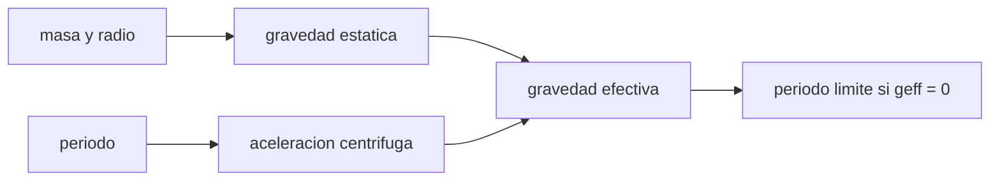

# B53-C16 — Superficies de asteroides

<!-- nav:top -->
[🏠 Programa](../../../../README.md) · [📚 Bloque B53](../../../tronco-comun/B53-astrogeologia-y-geodesia-planetaria.md) · [← Anterior: B53-C15 — Geología de Encélado](../B53-C15-geologia-de-encelado/CLASE.md) · [Siguiente: B53-C17 — Mineralogía espectral →](../B53-C17-mineralogia-espectral/CLASE.md)
<!-- /nav -->

## 1. Ubicación, nivel y alcance

Clase 16 del bloque B53. Nivel N3. En un asteroide pequeño la gravedad es tan débil que la rotación importa: en el ecuador, la aceleración efectiva es `GM/R² − ω²R`. Si se anula, el material suelto sale despedido. Aquí calculas esa aceleración para un cuerpo esférico **ilustrativo**, hallas por bisección el período límite y lo contrastas con `√(3π/(Gρ))`, y evalúas la velocidad de escape. La misión OSIRIS-REx mostró en Bennu una superficie rocosa con bloques y regolito (página de NASA consultada); no se usan sus datos.

## 2. Por qué esta clase existe

La estabilidad de rocas y regolito depende de cuánto de la gravedad cancela la rotación. La decisión central: **¿con qué período un asteroide pierde material por el ecuador y cuánto vale la gravedad efectiva a otros períodos?**

## 3. Lo que podrás hacer al terminar

1. Calcular la gravedad efectiva en el ecuador.
2. Encontrar el período límite por bisección.
3. Contrastarlo con la fórmula `√(3π/(Gρ))`.
4. Calcular la velocidad de escape y compararla con la rotación.
5. Interpretar el límite sin cohesión.
6. Explicar el efecto sobre el regolito.

La evidencia es la **ficha de la gravedad en un asteroide** del ejercicio 12 (sección 20).

## 4. Con qué llegas y cómo comprobarlo

1. ¿Qué es la aceleración centrífuga?
2. ¿Qué es la gravedad superficial?
3. ¿Qué es el período de rotación?
4. ¿Qué es una bisección?
5. ¿Qué es un valor ilustrativo?

<details>
<summary>Ver respuestas</summary>

1. `ω²R`, aparente en un sistema que rota. 2. `GM/R²`. 3. `2π/ω`. 4. Un método para hallar raíces acotándolas. 5. Uno propuesto para el ejemplo.
</details>

Con cuatro o cinco aciertos, sigue; si no, repasa los prerrequisitos.

## 5. Un caso de contexto y casos de referencia

Un asteroide esférico de `R = 250 m` y `ρ = 1190 kg/m³` (ilustrativos) tiene `g = 8,32 × 10⁻⁵ m/s²`. Con período de `4 h` la gravedad efectiva es `3,56 × 10⁻⁵ m/s²` (`42,8 %` de la estática). El período límite es `3,0259 h` por bisección y `3,0259 h` por la fórmula. La velocidad de escape es `0,204 m/s`. Es el **ejemplo conductor**. Todo es **sintético o ilustrativo** y así se rotula.

## 6. Vocabulario

La **gravedad efectiva** en el ecuador es `g_eff = GM/R² − ω²R`. El **período límite** es aquel en que `g_eff = 0` y vale `√(3π/(Gρ))` para una esfera. Un cuerpo **sin cohesión** no puede girar más rápido.

## 7. Modelo mental

Analogía: un tiovivo: si gira muy rápido, todo lo que no esté sujeto sale despedido por el borde.



*Descripción textual:* La gravedad estática y la aceleración centrífuga dan la gravedad efectiva; al anularse se obtiene el período límite.

Límite de la analogía: los asteroides reales no son esféricos y tienen cohesión; el límite varía con la forma.

## 8. La explicación, paso a paso

### 8,1 Gravedad efectiva

`g = G M/R²` con `M = (4π/3) ρ R³`.

| Período [h] | `g_eff` [m/s²] | % de la estática |
|---|---|---|
| 24 | 8,185 × 10⁻⁵ | 98,4 |
| 8 | 7,127 × 10⁻⁵ | 85,7 |
| 4 | 3,558 × 10⁻⁵ | 42,8 |

### 8,2 Período límite

| Método | `P_c` [h] |
|---|---|
| bisección en `g_eff = 0` | 3,02591 |
| `√(3π/(Gρ))` | 3,02591 |

### 8,3 Escape

`v_esc = √(2GM/R) = 0,2039 m/s`, es decir, `20,4 cm/s`. La velocidad en el ecuador a `P = 4 h` es `0,1091 m/s`, `0,53` veces la de escape.

### 8,4 Lectura

A baja gravedad, el regolito puede sostenerse por cohesión y fuerzas de contacto muy pequeñas, no por peso.

## 9. Magnitudes, símbolos y unidades

| Símbolo | Qué es | Unidad | Valor / nota |
|---|---|---|---|
| `G` | constante gravitatoria | m³ kg⁻¹ s⁻² | 6,67430 × 10⁻¹¹ (NIST) |
| `R` | radio | m | 250 (ilustrativo) |
| `ρ` | densidad | kg/m³ | 1190 (ilustrativa) |
| `P` | período de rotación | h | 24, 8, 4 |
| `g_eff` | gravedad efectiva | m/s² | ver 8,1 |

## 10. Convenciones y referencias

Esfera homogénea que gira rígida; gravedad en el ecuador; bisección con tolerancia 10⁻¹² s; `G` de NIST; tolerancia: período límite dentro de 10⁻⁹ relativa.

## 11. De dónde sale lo que afirmamos

| ID | Fuente | Localizador | Respalda | Estado |
|---|---|---|---|---|
| S1 | NIST, *Fundamental Physical Constants*: constante gravitatoria newtoniana (CODATA 2022) | https://physics.nist.gov/cgi-bin/cuu/Value?bg | valor de `G` | Consultada el 2026-11-09 |
| S2 | NASA Science, misión OSIRIS-REx | https://science.nasa.gov/mission/osiris-rex/ | contexto: Bennu tiene superficie rocosa y regolito | Página consultada el 2026-11-09 |

Límites: el radio y la densidad son ilustrativos; la página de OSIRIS-REx no se usó para ningún valor numérico.

## 12. Cómo ver el resultado

| Magnitud | Valor |
|---|---|
| `g` estática | 8,32 × 10⁻⁵ m/s² |
| `g_eff` a 4 h | 3,56 × 10⁻⁵ m/s² |
| `P_c` | 3,0259 h |
| `v_esc` | 0,204 m/s |
| `v_eq`/`v_esc` a 4 h | 0,53 |

Descripción larga: la rotación a 4 h cancela una fracción apreciable de la gravedad.

## 13. Ejemplo trabajado

**Paso 1.** Masa: `M = 7,789 × 10¹⁰ kg`.

**Paso 2.** Gravedad: `g = 8,317 × 10⁻⁵ m/s²`.

**Paso 3.** A 4 h: `ω = 4,36 × 10⁻⁴ rad/s`, `ω²R = 4,760 × 10⁻⁵`.

**Paso 4.** Efectiva: `3,558 × 10⁻⁵ m/s²`.

## 14. Distintas formas de describirlo

**Por fórmula:** `g − ω²R`. **Por bisección:** `P_c`. **Por tabla:** períodos. **Por razón:** `v_eq/v_esc`.

## 15. Práctica guiada

**Ejercicio 1 · con los pasos indicados.** Calcula `ω` para `P = 4 h`.

<details><summary>Solución comentada</summary>

`2π/14400 = 4,363 × 10⁻⁴ rad/s`.
</details>

**Ejercicio 2 · con una pista.** Calcula `ω²R` para `P = 4 h`.

<details><summary>Solución comentada</summary>

`4,760 × 10⁻⁵ m/s²`.
</details>

**Ejercicio 3 · casi autónomo.** ¿Qué período límite resulta?

<details><summary>Solución comentada</summary>

`3,026 h`.
</details>

## 16. Práctica autónoma, transferencia e integrador

**Ejercicio 4 · autónomo.** ¿Cómo cambia `P_c` si `ρ` se cuadruplica?

<details><summary>Solución comentada</summary>

Se reduce a la mitad.
</details>

**Ejercicio 5 · autónomo.** ¿Depende `P_c` del radio?

<details><summary>Solución comentada</summary>

No, solo de la densidad.
</details>

**Ejercicio 6 · autónomo.** ¿Qué pasa con `v_esc` si `R` se duplica?

<details><summary>Solución comentada</summary>

Se duplica (a densidad fija).
</details>

**Ejercicio 7 · autónomo.** ¿Qué porcentaje de `g` queda a 8 h?

<details><summary>Solución comentada</summary>

`85,7 %`.
</details>

**Ejercicio 8 · autónomo.** ¿Qué retiene al regolito a baja gravedad?

<details><summary>Solución comentada</summary>

La cohesión y fuerzas de contacto.
</details>

**Ejercicio 9 · transferencia.** Un asteroide gira con 2 h y es una pila de escombros de 1200 kg/m³. ¿Qué dices?

<details><summary>Solución comentada</summary>

Está por debajo del `P_c` sin cohesión: debería tener cohesión.
</details>

**Ejercicio 10 · transferencia.** ¿Por qué una forma no esférica cambia el límite?

<details><summary>Solución comentada</summary>

La gravedad y la centrífuga varían sobre el cuerpo.
</details>

**Ejercicio 11 · transferencia.** ¿Qué mide una nave en órbita cercana?

<details><summary>Solución comentada</summary>

El campo gravitatorio, y con él la masa.
</details>

**Ejercicio 12 · integrador.** Elabora tu *ficha de la gravedad en un asteroide*: `g`, `g_eff`, `P_c`, `v_esc` y límites.

<details><summary>Solución modelo</summary>

Secciones 8,1 a 8,4.
</details>

## 17. Laboratorio: gravedad efectiva y período límite

El script [asteroide.py](asteroide.py) calcula la gravedad efectiva para tres períodos y halla `P_c` por bisección (**comprueba** 10⁻⁹ relativa frente a la fórmula).

**Datos:** `G` de NIST; cuerpo **ilustrativo**. **Predice antes de ejecutar:** ¿qué período límite tendrá un cuerpo de 1190 kg/m³? (unas 3 h). **Ejecución del 2026-11-09 (Python 3,12,9):**

```text
Python 3.12.9 (biblioteca estandar)
M = 7.7885e+10 kg ; g estatica = 8.3173e-05 m/s2 ; v_esc = 0.2039 m/s
P = 24 h: g_eff = 8.1851e-05 m/s2 (98.4 % de la estatica)
P =  8 h: g_eff = 7.1274e-05 m/s2 (85.7 % de la estatica)
P =  4 h: g_eff = 3.5576e-05 m/s2 (42.8 % de la estatica)
periodo limite: biseccion 3.025915 h ; formula 3.025915 h
v_ecuador (4 h) = 0.1091 m/s = 0.535 v_esc
Pruebas superadas.
```

```bash
python programa/clases/B53/B53-C16-superficies-de-asteroides/asteroide.py
```

**Límites:** esfera, sin cohesión ni forma real.

## 18. Errores frecuentes y cómo corregirlos

**Creer que la gravedad es uniforme en la superficie.** se corrige con 8,1

**Aplicar el límite a un cuerpo con cohesión.** se corrige con 8,4

**Presentar el asteroide como real.** se corrige con la sección 10

## 19. Cómo sabrás que vas bien

Tras la sección 8: ¿qué resultado esperabas y cuál obtuviste? Si dudas, repasa el ejemplo de la sección 13. Tras el laboratorio: ¿qué comprueba? (ver la sección 17).

## 20. Qué entregas y cómo se evalúa

El producto es tu **ficha de la gravedad en un asteroide** (ejercicio 12).

| Criterio | Inicial | En desarrollo | Logrado | Destacado |
|---|---|---|---|---|
| Conceptos | Los confunde | Parciales | Conceptos de la clase | Explica los límites |
| Cálculo | Sin unidades | Con errores | Tablas completas | Calcula casos nuevos |
| Numérico | Sin comprobar | Un caso | Contraste con el análisis | Interpreta las diferencias |
| Fuentes | Sin fuente | Sin fecha | Fuentes con fecha | Declara lo sintético |
| Límites | No los nombra | Uno | Tres | Discute qué falta del modelo |

**Condiciones críticas (no se compensan con promedio):** rotular el asteroide como ilustrativo; no atribuir valores a Bennu; citar solo lo consultado.

## 21. Ética, seguridad y límites

Clase educativa: los modelos son simplificados y no sustituyen a los productos de una misión ni a la literatura primaria. Ningún dato simulado se presenta como observado. Accesibilidad: tablas equivalentes a las gráficas, fórmulas en texto, ejercicios sin conexión.

## 22. Para cerrar y seguir

El período límite sale igual por bisección y por fórmula (`3,026 h`) y a 4 h la gravedad efectiva es el `43 %` de la estática. Queda una pregunta: ¿cómo se lee la composición por su espectro?

**Glosario español–inglés.** gravedad efectiva · *effective gravity*; pila de escombros · *rubble pile*; cohesión · *cohesion*.

**Continuidad.** [B53-C17](../B53-C17-mineralogia-espectral/CLASE.md) estudia la mineralogía espectral.

**Referencias:** ver sección 11.

<!-- nav:bottom -->
---

[← Anterior: B53-C15 — Geología de Encélado](../B53-C15-geologia-de-encelado/CLASE.md) · [📚 Bloque B53](../../../tronco-comun/B53-astrogeologia-y-geodesia-planetaria.md) · [Siguiente: B53-C17 — Mineralogía espectral →](../B53-C17-mineralogia-espectral/CLASE.md)
<!-- /nav -->
