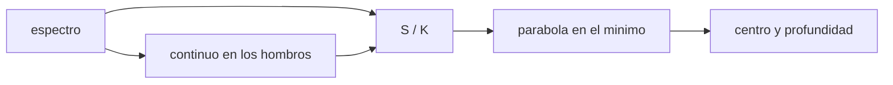

# B53-C17 — Mineralogía espectral

<!-- nav:top -->
[🏠 Programa](../../../../README.md) · [📚 Bloque B53](../../../tronco-comun/B53-astrogeologia-y-geodesia-planetaria.md) · [← Anterior: B53-C16 — Superficies de asteroides](../B53-C16-superficies-de-asteroides/CLASE.md) · [Siguiente: B53-C18 — Cartografía geológica digital →](../B53-C18-cartografia-geologica-digital/CLASE.md)
<!-- /nav -->

## 1. Ubicación, nivel y alcance

Clase 17 del bloque B53. Nivel N3. Un mineral absorbe luz a longitudes de onda características; la **posición** y la **profundidad** de la banda informan de su composición. Para medirlas se divide el espectro por un **continuo** ajustado en los hombros de la banda. Aquí generas un espectro **sintético** con una absorción gaussiana cerca de `1,05 µm` sobre un continuo lineal y ruido, quitas el continuo, ajustas una parábola al mínimo y estimas centro y profundidad con su incertidumbre por Monte Carlo. No se usa ningún espectro de laboratorio ni de misión.

## 2. Por qué esta clase existe

La misma banda se mide distinto según cómo se defina el continuo y el ruido. La decisión central: **¿con qué incertidumbre se conocen el centro y la profundidad de una banda y qué sesgo introduce el método?**

## 3. Lo que podrás hacer al terminar

1. Ajustar un continuo lineal en los hombros.
2. Dividir el espectro por el continuo.
3. Ajustar una parábola al mínimo de la banda.
4. Calcular centro y profundidad.
5. Estimar su incertidumbre y su sesgo por Monte Carlo.
6. Explicar por qué el centro de banda ayuda a identificar un mineral.

La evidencia es la **ficha de una banda de absorción** del ejercicio 12 (sección 20).

## 4. Con qué llegas y cómo comprobarlo

1. ¿Qué es un espectro?
2. ¿Qué es una banda de absorción?
3. ¿Qué es un ajuste por mínimos cuadrados?
4. ¿Qué es la relación señal-ruido?
5. ¿Qué es un dato sintético?

<details>
<summary>Ver respuestas</summary>

1. La intensidad en función de la longitud de onda. 2. Una caída del espectro a una longitud de onda característica. 3. Minimizar la suma de cuadrados de los residuos. 4. El cociente entre señal y desviación del ruido. 5. Uno generado por el modelo.
</details>

Con cuatro o cinco aciertos, sigue; si no, repasa los prerrequisitos.

## 5. Un caso de contexto y casos de referencia

Un continuo `R_c = 0,30 + 0,05(λ − 0,7)`, una banda de profundidad `0,25` centrada en `1,05 µm` con `σ = 0,08 µm` y ruido de `0,003`. Sin ruido, el método recupera un centro de `1,05001 µm` y una profundidad de `0,2490`. Con ruido, en 500 espectros, el centro es `1,04996 ± 0,00152 µm` y la profundidad `0,2492 ± 0,0030`. Es el **ejemplo conductor**. Todo es **sintético o ilustrativo** y así se rotula.

## 6. Vocabulario

El **continuo** es la línea base sin la banda. La **profundidad** es `1 − R/R_c` en el mínimo. El **centro** es la longitud de onda del mínimo. El **ajuste cuadrático** estima el mínimo con sub-muestreo.

## 7. Modelo mental

Analogía: medir un valle entre dos colinas: primero se traza la línea que une las cimas y luego se mide cuánto baja el suelo y dónde está el punto más bajo.



*Descripción textual:* Del espectro se ajusta el continuo, se divide, se ajusta una parábola al mínimo y se obtienen centro y profundidad.

Límite de la analogía: los espectros reales mezclan varias bandas y dependen del tamaño de grano y de la geometría.

## 8. La explicación, paso a paso

### 8,1 Continuo y banda

Los hombros son `0,72–0,78 µm` y `1,38–1,45 µm`. Se ajusta una recta por mínimos cuadrados y se divide. La parábola se ajusta en `λ0 ± 0,06 µm`, con `λ0 = 1,05`.

| Caso | centro [µm] | profundidad |
|---|---|---|
| sin ruido | 1,05001 | 0,24900 |
| verdadero | 1,05000 | 0,25000 |

### 8,2 Con ruido (500 espectros)

| Magnitud | media | dispersión | sesgo |
|---|---|---|---|
| centro [µm] | 1,04996 | 0,00152 | -0,00004 |
| profundidad | 0,2492 | 0,0030 | -0,0008 |

### 8,3 Lectura

El sesgo sin ruido proviene de ajustar una parábola a una gaussiana; el ruido añade dispersión. Conviene declarar ambas cantidades al reportar un centro de banda.

## 9. Magnitudes, símbolos y unidades

| Símbolo | Qué es | Unidad | Valor / nota |
|---|---|---|---|
| `λ` | longitud de onda | µm | 0,70 a 1,60 |
| `R` | reflectancia | — | sintética |
| `d` | profundidad de banda | — | 0,25 (sintética) |
| `σ_n` | ruido | — | 0,003 (sintético) |
| `λ_c` | centro de banda | µm | 1,0500 |

## 10. Convenciones y referencias

Espectro sintético de 181 puntos cada 0,005 µm, reflectancia relativa; semilla `20261109`; 500 repeticiones; tolerancia: sesgo del centro menor que 0,002 µm y de profundidad menor que 0,01.

## 11. De dónde sale lo que afirmamos

| ID | Fuente | Localizador | Respalda | Estado |
|---|---|---|---|---|
| — | Sin fuente externa | — | relaciones estándar que verifica el laboratorio | No se consultó una fuente para esta clase |

Límites: no se consultó ninguna fuente espectroscópica; la banda no corresponde a un mineral específico.

## 12. Cómo ver el resultado

| Magnitud | Valor |
|---|---|
| centro sin ruido | 1,05001 µm |
| centro con ruido | 1,04996 ± 0,00152 µm |
| profundidad sin ruido | 0,2490 |
| profundidad con ruido | 0,2492 ± 0,0030 |

Descripción larga: el centro se recupera con unas milésimas de micrómetro de incertidumbre y la profundidad tiene un sesgo pequeño.

## 13. Ejemplo trabajado

**Paso 1.** Datos: banda en `1,05 µm`, `d = 0,25`.

**Paso 2.** Continuo: recta por los hombros.

**Paso 3.** Parábola: `a x² + b x + c` con `x = λ − 1,05`.

**Paso 4.** Centro: `λ = 1,05 − b/(2a) = 1,05001`.

## 14. Distintas formas de describirlo

**Por gráfica:** espectro y continuo. **Por tabla:** centro y profundidad. **Por ajuste:** parábola. **Por simulación:** Monte Carlo.

## 15. Práctica guiada

**Ejercicio 1 · con los pasos indicados.** Calcula `R_c` en `λ = 1,05`.

<details><summary>Solución comentada</summary>

`0,30 + 0,05 × 0,35 = 0,3175`.
</details>

**Ejercicio 2 · con una pista.** Calcula el valor mínimo del espectro sin ruido.

<details><summary>Solución comentada</summary>

`0,3175 × 0,75 = 0,2381`.
</details>

**Ejercicio 3 · casi autónomo.** ¿Por qué se divide por el continuo?

<details><summary>Solución comentada</summary>

Para aislar la banda de la pendiente espectral.
</details>

## 16. Práctica autónoma, transferencia e integrador

**Ejercicio 4 · autónomo.** ¿Qué sesgo tiene el centro?

<details><summary>Solución comentada</summary>

`-0,00004 µm`.
</details>

**Ejercicio 5 · autónomo.** ¿Qué relación señal-ruido tiene el mínimo?

<details><summary>Solución comentada</summary>

`0,238/0,003 = 79`.
</details>

**Ejercicio 6 · autónomo.** ¿Qué pasa si el ruido se duplica?

<details><summary>Solución comentada</summary>

La dispersión del centro se duplica.
</details>

**Ejercicio 7 · autónomo.** ¿Qué pasa si la ventana de ajuste crece?

<details><summary>Solución comentada</summary>

El sesgo de la parábola crece.
</details>

**Ejercicio 8 · autónomo.** ¿Qué ocurre con dos bandas solapadas?

<details><summary>Solución comentada</summary>

Hay que ajustar un modelo de varias componentes.
</details>

**Ejercicio 9 · transferencia.** Un colega reporta un centro con 5 decimales. ¿Qué preguntas?

<details><summary>Solución comentada</summary>

Su incertidumbre, su continuo y su ventana.
</details>

**Ejercicio 10 · transferencia.** ¿Qué más afecta al espectro además de la mineralogía?

<details><summary>Solución comentada</summary>

Tamaño de grano, geometría y meteorización.
</details>

**Ejercicio 11 · transferencia.** ¿Se identifica un mineral con solo la banda?

<details><summary>Solución comentada</summary>

No; se usan varias bandas y otros datos.
</details>

**Ejercicio 12 · integrador.** Elabora tu *ficha de una banda de absorción*: continuo, centro, profundidad, sesgo y dispersión.

<details><summary>Solución modelo</summary>

Secciones 8,1 a 8,3.
</details>

## 17. Laboratorio: remoción del continuo y banda de absorción

El script [espectro.py](espectro.py) genera 500 espectros sintéticos con ruido y mide centro y profundidad (**comprueba** sesgo del centro < 0,002 µm y de profundidad < 0,01).

**Datos:** espectro **sintético**; semilla `20261109`. **Predice antes de ejecutar:** ¿el centro saldrá desplazado de 1,05? (muy poco). **Ejecución del 2026-11-09 (Python 3,12,9):**

```text
Python 3.12.9 (biblioteca estandar)
sin ruido: centro = 1.05001 um ; profundidad = 0.24900 (verdaderos 1.05000 y 0.25000)
500 espectros: centro = 1.04996 +- 0.00152 um (sesgo -0.00004) ; profundidad = 0.24915 +- 0.00297 (sesgo -0.00085)
Pruebas superadas.
```

```bash
python programa/clases/B53/B53-C17-mineralogia-espectral/espectro.py
```

**Límites:** una sola banda gaussiana, ruido blanco, continuo lineal.

## 18. Errores frecuentes y cómo corregirlos

**Medir sin quitar el continuo.** se corrige con 8,1

**Reportar un centro sin incertidumbre.** se corrige con 8,2

**Atribuir la banda a un mineral real.** se corrige con la sección 10

## 19. Cómo sabrás que vas bien

Tras la sección 8: ¿qué resultado esperabas y cuál obtuviste? Si dudas, repasa el ejemplo de la sección 13. Tras el laboratorio: ¿qué comprueba? (ver la sección 17).

## 20. Qué entregas y cómo se evalúa

El producto es tu **ficha de una banda de absorción** (ejercicio 12).

| Criterio | Inicial | En desarrollo | Logrado | Destacado |
|---|---|---|---|---|
| Conceptos | Los confunde | Parciales | Conceptos de la clase | Explica los límites |
| Cálculo | Sin unidades | Con errores | Tablas completas | Calcula casos nuevos |
| Numérico | Sin comprobar | Un caso | Contraste con el análisis | Interpreta las diferencias |
| Fuentes | Sin fuente | Sin fecha | Fuentes con fecha | Declara lo sintético |
| Límites | No los nombra | Uno | Tres | Discute qué falta del modelo |

**Condiciones críticas (no se compensan con promedio):** rotular el espectro como sintético; no identificar un mineral; citar solo lo consultado.

## 21. Ética, seguridad y límites

Clase educativa: los modelos son simplificados y no sustituyen a los productos de una misión ni a la literatura primaria. Ningún dato simulado se presenta como observado. Accesibilidad: tablas equivalentes a las gráficas, fórmulas en texto, ejercicios sin conexión.

## 22. Para cerrar y seguir

Centro `1,0500 ± 0,0015 µm` y profundidad `0,249 ± 0,003`. Queda una pregunta: ¿cómo se ordenan y publican los resultados en un mapa?

**Glosario español–inglés.** remoción del continuo · *continuum removal*; centro de banda · *band center*; profundidad de banda · *band depth*.

**Continuidad.** [B53-C18](../B53-C18-cartografia-geologica-digital/CLASE.md) estudia la cartografía geológica digital.

**Referencias:** ver sección 11.

<!-- nav:bottom -->
---

[← Anterior: B53-C16 — Superficies de asteroides](../B53-C16-superficies-de-asteroides/CLASE.md) · [📚 Bloque B53](../../../tronco-comun/B53-astrogeologia-y-geodesia-planetaria.md) · [Siguiente: B53-C18 — Cartografía geológica digital →](../B53-C18-cartografia-geologica-digital/CLASE.md)
<!-- /nav -->
