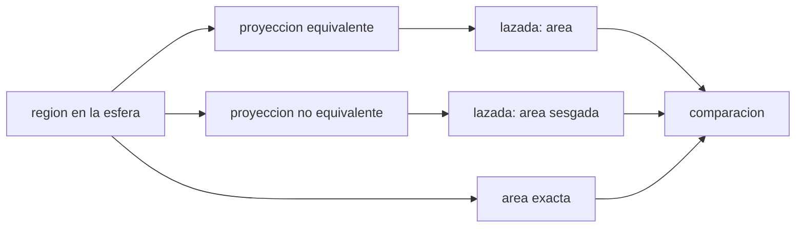

# B53-C18 — Cartografía geológica digital

<!-- nav:top -->
[🏠 Programa](../../../../README.md) · [📚 Bloque B53](../../../tronco-comun/B53-astrogeologia-y-geodesia-planetaria.md) · [← Anterior: B53-C17 — Mineralogía espectral](../B53-C17-mineralogia-espectral/CLASE.md) · [Siguiente: B53-C19 — Incertidumbre en mapas planetarios →](../B53-C19-incertidumbre-en-mapas-planetarios/CLASE.md)
<!-- /nav -->

## 1. Ubicación, nivel y alcance

Clase 18 del bloque B53. Nivel N3. Un mapa geológico digital es un conjunto de polígonos con atributos. Medir áreas sobre él exige una proyección que las conserve; y la calidad topológica exige que las unidades no dejen huecos ni se superpongan. Aquí mides el área de una región sobre una esfera **sintética** por la fórmula exacta, por una proyección equivalente (sinusoidal), por una azimutal equivalente de Lambert y por una proyección cilíndrica simple (equirrectangular), y revisas huecos y solapes con una malla. El centro de Astrogeología del USGS elabora mapas geológicos y cartografía planetaria (página consultada); aquí no se usa ningún mapa suyo.

## 2. Por qué esta clase existe

Un área medida en una proyección inadecuada es un área falsa. La decisión central: **¿qué proyección conserva las áreas y qué errores topológicos tiene el mapa?**

## 3. Lo que podrás hacer al terminar

1. Calcular el área exacta de un cuadrilátero esférico.
2. Medir áreas con la fórmula de la lazada (shoelace) en proyecciones.
3. Cuantificar el error de una proyección que no conserva áreas.
4. Detectar huecos y solapes entre polígonos.
5. Distinguir proyecciones conformes, equivalentes y compromiso.
6. Registrar la proyección en los metadatos.

La evidencia es la **ficha del mapa geológico digital** del ejercicio 12 (sección 20).

## 4. Con qué llegas y cómo comprobarlo

1. ¿Qué es un polígono?
2. ¿Qué es una proyección equivalente?
3. ¿Qué es la fórmula de la lazada?
4. ¿Qué es la topología?
5. ¿Qué es un dato sintético?

<details>
<summary>Ver respuestas</summary>

1. Una región delimitada por una línea cerrada. 2. Una que conserva las áreas. 3. Una suma que da el área de un polígono plano. 4. Las relaciones de vecindad y contacto entre elementos. 5. Uno generado por el modelo.
</details>

Con cuatro o cinco aciertos, sigue; si no, repasa los prerrequisitos.

## 5. Un caso de contexto y casos de referencia

En una esfera sintética de `R = 1000 km`, la región entre `60°` y `70°` de latitud y `0°` y `10°` de longitud tiene un área exacta de `12857,4 km²`. La sinusoidal da `12857,4`, la azimutal de Lambert `12857,4` y la equirrectangular `30461,7`, con un error de `+136,92 %`. Dos unidades con un hueco de `0,1°` dejan `100` celdas sin cubrir y con un solape de `0,1°` hay `100` celdas dobles. Es el **ejemplo conductor**. Todo es **sintético o ilustrativo** y así se rotula.

## 6. Vocabulario

Una proyección **equivalente** conserva áreas. La **sinusoidal** es `x = R λ cos φ`, `y = R φ`. La **azimutal equivalente de Lambert** usa `k' = √(2/(1 + sin φ₀ sin φ + cos φ₀ cos φ cos Δλ))`. La **topología** exige sin huecos ni solapes entre unidades.

## 7. Modelo mental

Analogía: aplanar la piel de una naranja: algo se estira o se rompe; una proyección equivalente conserva el tamaño de cada trozo, pero cambia su forma.



*Descripción textual:* El área exacta sirve de referencia para comparar las áreas medidas en proyecciones equivalentes y no equivalentes.

Límite de la analogía: aquí se usa una esfera; los cuerpos reales requieren un elipsoide o un modelo digital de elevación.

## 8. La explicación, paso a paso

### 8,1 Áreas

El área exacta es `R² Δλ (sin φ₂ − sin φ₁)`. Las demás se miden con la fórmula de la lazada sobre el borde densificado (400 puntos por lado).

| Proyección | área [km²] | error relativo |
|---|---|---|
| exacta | 12857,35 | — |
| sinusoidal | 12857,35 | -1,59 × 10⁻⁸ |
| Lambert azimutal equivalente | 12857,35 | -3,72 × 10⁻⁸ |
| equirrectangular | 30461,74 | +136,92 % |

### 8,2 Topología

Se rasteriza con celdas de `0,1°` (100 × 100) y se cuentan cubrimientos.

| Caso | huecos | solapes |
|---|---|---|
| unidades contiguas | 0 | 0 |
| hueco de 0,1° (B empieza en 5,1°) | 100 | 0 |
| solape de 0,1° (A llega a 5,1°) | 0 | 100 |

### 8,3 Lectura

La proyección equirrectangular exagera el área en latitudes altas. Un mapa con huecos o solapes no se puede usar para estadísticas de área sin corregirlos.

## 9. Magnitudes, símbolos y unidades

| Símbolo | Qué es | Unidad | Valor / nota |
|---|---|---|---|
| `R` | radio de la esfera | km | 1000 (sintético) |
| `φ`, `λ` | latitud y longitud | grados | 60–70; 0–10 |
| `A` | área | km² | 12857,4 |
| celda | tamaño de la malla | grados | 0,1 |
| `k'` | factor de Lambert | — | — |

## 10. Convenciones y referencias

Esfera sintética; polígono con aristas densificadas (400 puntos por arista); malla de 100 × 100 celdas; tolerancia: sinusoidal y Lambert dentro de 10⁻⁵ relativo.

## 11. De dónde sale lo que afirmamos

| ID | Fuente | Localizador | Respalda | Estado |
|---|---|---|---|---|
| S1 | USGS Astrogeology Science Center, página institucional | https://www.usgs.gov/centers/astrogeology-science-center | contexto: producción de mapas geológicos y cartografía planetaria | Página consultada el 2026-11-09 (no menciona estándares de forma explícita) |

Límites: la página no menciona estándares de forma explícita; las proyecciones son fórmulas estándar que verifica el laboratorio.

## 12. Cómo ver el resultado

| Magnitud | Valor |
|---|---|
| área exacta | 12857,4 km² |
| error sinusoidal | -1,6 × 10⁻⁸ |
| error Lambert | -3,7 × 10⁻⁸ |
| error equirrectangular | +136,92 % |
| huecos con hueco de 0,1° | 100 |

Descripción larga: las proyecciones equivalentes reproducen el área; la equirrectangular no.

## 13. Ejemplo trabajado

**Paso 1.** Región: `φ ∈ [60°, 70°]`, `λ ∈ [0°, 10°]`.

**Paso 2.** Exacta: `R² Δλ (sin 70° − sin 60°) = 12857,4 km²`.

**Paso 3.** Equirrectangular: `R² Δλ Δφ = 30461,7 km²`.

**Paso 4.** Error: `+136,92 %`.

## 14. Distintas formas de describirlo

**Por fórmula:** área exacta. **Por proyección:** lazada. **Por malla:** huecos y solapes. **Por tabla:** errores.

## 15. Práctica guiada

**Ejercicio 1 · con los pasos indicados.** Calcula el área exacta.

<details><summary>Solución comentada</summary>

`12857,4 km²`.
</details>

**Ejercicio 2 · con una pista.** Calcula el error de la equirrectangular a 65° de latitud media.

<details><summary>Solución comentada</summary>

el factor es `1/cos 65° = 2,37`: el error es `+137 %`.
</details>

**Ejercicio 3 · casi autónomo.** ¿Por qué una proyección equivalente distorsiona las formas?

<details><summary>Solución comentada</summary>

No puede conservar áreas y ángulos a la vez.
</details>

## 16. Práctica autónoma, transferencia e integrador

**Ejercicio 4 · autónomo.** ¿Cuántas celdas tiene la malla?

<details><summary>Solución comentada</summary>

10 000.
</details>

**Ejercicio 5 · autónomo.** ¿Qué indica un solape?

<details><summary>Solución comentada</summary>

Dos unidades ocupan la misma zona.
</details>

**Ejercicio 6 · autónomo.** ¿Qué indica un hueco?

<details><summary>Solución comentada</summary>

Una zona sin unidad asignada.
</details>

**Ejercicio 7 · autónomo.** ¿Qué proyección usarías para estadísticas de área?

<details><summary>Solución comentada</summary>

Una equivalente.
</details>

**Ejercicio 8 · autónomo.** ¿Y para medir ángulos o rumbos?

<details><summary>Solución comentada</summary>

Una conforme.
</details>

**Ejercicio 9 · transferencia.** Un mapa lista «Proyección: desconocida». ¿Qué haces?

<details><summary>Solución comentada</summary>

No mido áreas hasta averiguarla.
</details>

**Ejercicio 10 · transferencia.** ¿Qué precisión de coordenadas necesita el polígono?

<details><summary>Solución comentada</summary>

La de la escala de mapa (clase 26).
</details>

**Ejercicio 11 · transferencia.** ¿Por qué densificar las aristas?

<details><summary>Solución comentada</summary>

Porque en la proyección los meridianos no son rectas.
</details>

**Ejercicio 12 · integrador.** Elabora tu *ficha del mapa geológico digital*: proyección, áreas, errores y topología.

<details><summary>Solución modelo</summary>

Secciones 8,1 a 8,3.
</details>

## 17. Laboratorio: áreas en proyecciones y topología de polígonos

El script [mapa.py](mapa.py) mide el área por cuatro vías y revisa huecos y solapes en una malla (**comprueba** 10⁻⁵ relativo para las equivalentes).

**Datos:** esfera y polígonos **sintéticos**. **Predice antes de ejecutar:** ¿cuál proyección dará un error mayor? (la equirrectangular). **Ejecución del 2026-11-09 (Python 3,12,9):**

```text
Python 3.12.9 (biblioteca estandar)
area exacta = 12857.355 km2
sinusoidal = 12857.355 (-1.59e-08) ; Lambert = 12857.354 (-3.72e-08) ; equirrectangular R^2 dl dphi = 30461.742 (+136.92 %)
topologia: contiguas -> huecos 0, solapes 0 ; con hueco -> huecos 100, solapes 0 ; con solape -> huecos 0, solapes 100
Pruebas superadas.
```

```bash
python programa/clases/B53/B53-C18-cartografia-geologica-digital/mapa.py
```

**Límites:** esfera, aristas densificadas, sin elipsoide ni atributos.

## 18. Errores frecuentes y cómo corregirlos

**Medir áreas en una proyección no equivalente.** se corrige con 8,1

**Ignorar la topología.** se corrige con 8,2

**No declarar la proyección.** se corrige con la sección 10

## 19. Cómo sabrás que vas bien

Tras la sección 8: ¿qué resultado esperabas y cuál obtuviste? Si dudas, repasa el ejemplo de la sección 13. Tras el laboratorio: ¿qué comprueba? (ver la sección 17).

## 20. Qué entregas y cómo se evalúa

El producto es tu **ficha del mapa geológico digital** (ejercicio 12).

| Criterio | Inicial | En desarrollo | Logrado | Destacado |
|---|---|---|---|---|
| Conceptos | Los confunde | Parciales | Conceptos de la clase | Explica los límites |
| Cálculo | Sin unidades | Con errores | Tablas completas | Calcula casos nuevos |
| Numérico | Sin comprobar | Un caso | Contraste con el análisis | Interpreta las diferencias |
| Fuentes | Sin fuente | Sin fecha | Fuentes con fecha | Declara lo sintético |
| Límites | No los nombra | Uno | Tres | Discute qué falta del modelo |

**Condiciones críticas (no se compensan con promedio):** declarar proyección y esfera; rotular el mapa como sintético; citar solo lo consultado.

## 21. Ética, seguridad y límites

Clase educativa: los modelos son simplificados y no sustituyen a los productos de una misión ni a la literatura primaria. Ningún dato simulado se presenta como observado. Accesibilidad: tablas equivalentes a las gráficas, fórmulas en texto, ejercicios sin conexión.

## 22. Para cerrar y seguir

Las proyecciones equivalentes reproducen el área (`-2 × 10⁻⁸`) y la equirrectangular la sesga `+136,9 %`. Queda una pregunta: ¿cómo se propaga la incertidumbre de un mapa?

**Glosario español–inglés.** proyección equivalente · *equal-area projection*; topología · *topology*; polígono · *polygon*.

**Continuidad.** [B53-C19](../B53-C19-incertidumbre-en-mapas-planetarios/CLASE.md) estudia la incertidumbre en mapas planetarios.

**Referencias:** ver sección 11.

<!-- nav:bottom -->
---

[← Anterior: B53-C17 — Mineralogía espectral](../B53-C17-mineralogia-espectral/CLASE.md) · [📚 Bloque B53](../../../tronco-comun/B53-astrogeologia-y-geodesia-planetaria.md) · [Siguiente: B53-C19 — Incertidumbre en mapas planetarios →](../B53-C19-incertidumbre-en-mapas-planetarios/CLASE.md)
<!-- /nav -->
