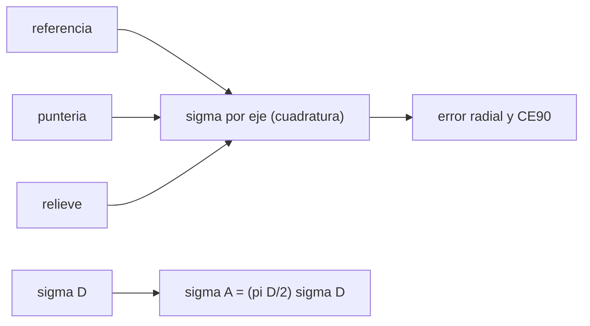

# B53-C19 — Incertidumbre en mapas planetarios

<!-- nav:top -->
[🏠 Programa](../../../../README.md) · [📚 Bloque B53](../../../tronco-comun/B53-astrogeologia-y-geodesia-planetaria.md) · [← Anterior: B53-C18 — Cartografía geológica digital](../B53-C18-cartografia-geologica-digital/CLASE.md) · [Siguiente: B53-C20 — Proyecto SIG de terreno extraterrestre →](../B53-C20-proyecto-sig-de-terreno-extraterrestre/CLASE.md)
<!-- /nav -->

## 1. Ubicación, nivel y alcance

Clase 19 del bloque B53. Nivel N3. Todo mapa tiene error: de georreferenciación, de medición y de interpretación. Aquí propagas con fórmulas y con Monte Carlo (a) un error de posición compuesto (referencia, puntería y relieve) y su error circular al 90 %, y (b) el error del área de un cráter a partir del error de su diámetro, incluyendo el sesgo que aparece cuando el error relativo es grande. Todos los valores son **sintéticos**.

## 2. Por qué esta clase existe

Un contorno sin barras de error afirma más de lo que sabe. La decisión central: **¿con qué incertidumbre se conoce una posición y un área en un mapa, y cuándo falla la propagación lineal?**

## 3. Lo que podrás hacer al terminar

1. Combinar errores independientes en cuadratura.
2. Obtener el error circular al 90 % (CE90) por Monte Carlo.
3. Propagar el error del diámetro al área.
4. Comparar la propagación lineal con la simulación.
5. Detectar el sesgo por no linealidad.
6. Escribir la incertidumbre en los metadatos.

La evidencia es la **ficha de incertidumbre de un mapa** del ejercicio 12 (sección 20).

## 4. Con qué llegas y cómo comprobarlo

1. ¿Qué es una desviación estándar?
2. ¿Qué es una suma en cuadratura?
3. ¿Qué es una derivada?
4. ¿Qué es Monte Carlo?
5. ¿Qué es el CE90?

<details>
<summary>Ver respuestas</summary>

1. Una medida de dispersión. 2. La raíz de la suma de cuadrados. 3. La razón de cambio de una función. 4. Repetir con números aleatorios de semilla fija. 5. El radio que contiene el 90 % de los errores de posición.
</details>

Con cuatro o cinco aciertos, sigue; si no, repasa los prerrequisitos.

## 5. Un caso de contexto y casos de referencia

Un error por eje de `25,2 m` (referencia 20 m, puntería 15 m, relieve 2,9 m, en cuadratura). El error radial RMS es `35,6 m` (Monte Carlo `35,6 m`) y el CE90 es `54,0 m`, es decir `2,147` veces `σ`. El área de un cráter de `300 m` de diámetro con `σ_D = 15 m` tiene `σ_A = 7069 m²` (Monte Carlo `7069`) y un sesgo relativo de `+0,0023`. Es el **ejemplo conductor**. Todo es **sintético o ilustrativo** y así se rotula.

## 6. Vocabulario

El **error de posición** por eje es la combinación en cuadratura de sus componentes. El **CE90** contiene el 90 % de los errores radiales. La **propagación lineal** es `σ_f = |f'| σ_x`. El **sesgo por no linealidad** aparece cuando `f` es curva en el rango del error.

## 7. Modelo mental

Analogía: tirar dardos con manos temblorosas: el error se compone de varios temblores, y el círculo que contiene nueve de cada diez dardos es el CE90.



*Descripción textual:* Tres componentes forman el error por eje; este da el error radial; aparte, el error del diámetro se propaga al área.

Límite de la analogía: los errores reales pueden estar correlacionados y no ser gaussianos.

## 8. La explicación, paso a paso

### 8,1 Posición

`σ = √(σ_ref² + σ_punt² + σ_rel²)` con `σ_ref = 20`, `σ_punt = 15`, `σ_rel = 5·tan 30° = 2,9 m`.

| Magnitud | analítica | Monte Carlo (200 000) |
|---|---|---|
| `σ` por eje [m] | 25,17 | — |
| error radial RMS `√2 σ` [m] | 35,59 | 35,59 |
| CE90 [m] | 54,01 (`2,146 σ`) | 54,02 |

### 8,2 Área de un cráter

`A = π D²/4`, `σ_A ≈ (π D/2) σ_D` con `σ_D = 15 m`.

| `D` [m] | `σ_A` lineal [m²] | `σ_A` Monte Carlo [m²] | sesgo relativo de `A` |
|---|---|---|---|
| 300 | 7069 | 7069 | +0,0023 |
| 3000 | 70686 | 70756 | +0,00003 |

### 8,3 Lectura

A diámetros grandes la propagación lineal funciona; a 300 m, con `σ_D/D = 5 %`, aparece un sesgo del orden de `(σ_D/D)²`. El valor `2,146` del CE90 es el de un error circular gaussiano.

## 9. Magnitudes, símbolos y unidades

| Símbolo | Qué es | Unidad | Valor / nota |
|---|---|---|---|
| `σ` | error por eje | m | 25,2 (sintético) |
| `σ_D` | error del diámetro | m | 15 (sintético) |
| `CE90` | error circular al 90 % | m | 54,0 |
| `A` | área | m² | — |
| `N` | sorteos | — | 200 000 |

## 10. Convenciones y referencias

Errores independientes y gaussianos; semilla `20261109`; tolerancias: RMS dentro de 1 %, CE90 dentro de 1 % de `2,146 σ`, `σ_A` a 3000 m dentro de 2 %.

## 11. De dónde sale lo que afirmamos

| ID | Fuente | Localizador | Respalda | Estado |
|---|---|---|---|---|
| — | Sin fuente externa | — | relaciones estándar que verifica el laboratorio | No se consultó una fuente para esta clase |

Límites: no se consultó ninguna fuente; el valor 2,146 es la propiedad de la distribución de Rayleigh y la verifica el laboratorio.

## 12. Cómo ver el resultado

| Magnitud | Valor |
|---|---|
| `σ` por eje | 25,17 m |
| RMS radial | 35,59 m |
| CE90 | 54,02 m |
| `σ_A` a 300 m (MC) | 7069 m² |
| sesgo a 300 m | +0,0023 |

Descripción larga: el CE90 es unas 2,1 veces el error por eje.

## 13. Ejemplo trabajado

**Paso 1.** Cuadratura: `√(20² + 15² + 2,9²) = 25,17 m`.

**Paso 2.** Radial RMS: `√2 × 25,17 = 35,59 m`.

**Paso 3.** CE90: `2,146 × 25,17 = 54,01 m`.

**Paso 4.** Área: `(π·300/2)·15 = 7069 m²`.

## 14. Distintas formas de describirlo

**Por fórmula:** cuadratura. **Por simulación:** Monte Carlo. **Por derivada:** propagación lineal. **Por tabla:** CE90.

## 15. Práctica guiada

**Ejercicio 1 · con los pasos indicados.** Calcula `σ` por eje.

<details><summary>Solución comentada</summary>

`25,17 m`.
</details>

**Ejercicio 2 · con una pista.** Calcula el error radial RMS.

<details><summary>Solución comentada</summary>

`35,59 m`.
</details>

**Ejercicio 3 · casi autónomo.** Calcula el CE90.

<details><summary>Solución comentada</summary>

`54,01 m`.
</details>

## 16. Práctica autónoma, transferencia e integrador

**Ejercicio 4 · autónomo.** Calcula `σ_A` para `D = 1000 m`.

<details><summary>Solución comentada</summary>

`π·1000/2 × 15 = 23 562 m²`.
</details>

**Ejercicio 5 · autónomo.** ¿Cómo cambia el error radial si desaparece el término de puntería?

<details><summary>Solución comentada</summary>

Baja a `√2·√(20²+2,9²)`.
</details>

**Ejercicio 6 · autónomo.** ¿Por qué el área crece más rápido que el diámetro?

<details><summary>Solución comentada</summary>

Va con `D²`.
</details>

**Ejercicio 7 · autónomo.** ¿Qué es una incertidumbre sistemática?

<details><summary>Solución comentada</summary>

Una que no se promedia con más datos.
</details>

**Ejercicio 8 · autónomo.** ¿Qué significa que los errores estén correlacionados?

<details><summary>Solución comentada</summary>

La cuadratura subestima o sobrestima.
</details>

**Ejercicio 9 · transferencia.** Un mapa declara una precisión de 1 m con una referencia de 20 m. ¿Qué dices?

<details><summary>Solución comentada</summary>

La precisión no puede ser mejor que la referencia.
</details>

**Ejercicio 10 · transferencia.** ¿Cuántos sorteos hacen falta para CE90 con 1 %?

<details><summary>Solución comentada</summary>

Del orden de decenas de miles.
</details>

**Ejercicio 11 · transferencia.** ¿Qué debe ir en los metadatos?

<details><summary>Solución comentada</summary>

Las fuentes de error, su magnitud y el nivel de confianza.
</details>

**Ejercicio 12 · integrador.** Elabora tu *ficha de incertidumbre de un mapa*: componentes, `σ`, CE90, propagación y límites.

<details><summary>Solución modelo</summary>

Secciones 8,1 a 8,3.
</details>

## 17. Laboratorio: propagación de errores de posición y medida

El script [incertidumbre.py](incertidumbre.py) sortea 200 000 errores de posición y de diámetro y compara con la propagación (**comprueba** RMS 1 %, CE90 1 %, `σ_A` a 3000 m 2 %).

**Datos:** errores **sintéticos**; semilla `20261109`. **Predice antes de ejecutar:** ¿será el CE90 mayor o menor que el RMS radial? (mayor, 2,146σ frente a 1,414σ). **Ejecución del 2026-11-09 (Python 3,12,9):**

```text
Python 3.12.9 (biblioteca estandar)
sigma por eje = 25.166 m ; RMS radial: analitica 35.590 ; MC 35.589 m
CE90: 2.146 sigma = 54.006 m ; MC = 54.024 m (2.1467 sigma)
D = 300 m: sigma_A lineal = 7068.6 m2 ; MC = 7068.7 m2 ; sesgo relativo de A = +0.00227
D = 3000 m: sigma_A lineal = 70685.8 m2 ; MC = 70756.0 m2 ; sesgo relativo de A = +0.00003
Pruebas superadas.
```

```bash
python programa/clases/B53/B53-C19-incertidumbre-en-mapas-planetarios/incertidumbre.py
```

**Límites:** errores gaussianos e independientes; sin correlación espacial.

## 18. Errores frecuentes y cómo corregirlos

**Sumar errores en vez de combinarlos en cuadratura.** se corrige con 8,1

**Aplicar la propagación lineal con error relativo grande.** se corrige con 8,2

**Presentar la precisión sin referencia.** se corrige con la sección 10

## 19. Cómo sabrás que vas bien

Tras la sección 8: ¿qué resultado esperabas y cuál obtuviste? Si dudas, repasa el ejemplo de la sección 13. Tras el laboratorio: ¿qué comprueba? (ver la sección 17).

## 20. Qué entregas y cómo se evalúa

El producto es tu **ficha de incertidumbre de un mapa** (ejercicio 12).

| Criterio | Inicial | En desarrollo | Logrado | Destacado |
|---|---|---|---|---|
| Conceptos | Los confunde | Parciales | Conceptos de la clase | Explica los límites |
| Cálculo | Sin unidades | Con errores | Tablas completas | Calcula casos nuevos |
| Numérico | Sin comprobar | Un caso | Contraste con el análisis | Interpreta las diferencias |
| Fuentes | Sin fuente | Sin fecha | Fuentes con fecha | Declara lo sintético |
| Límites | No los nombra | Uno | Tres | Discute qué falta del modelo |

**Condiciones críticas (no se compensan con promedio):** rotular los errores como sintéticos; declarar el nivel de confianza; citar solo lo consultado.

## 21. Ética, seguridad y límites

Clase educativa: los modelos son simplificados y no sustituyen a los productos de una misión ni a la literatura primaria. Ningún dato simulado se presenta como observado. Accesibilidad: tablas equivalentes a las gráficas, fórmulas en texto, ejercicios sin conexión.

## 22. Para cerrar y seguir

El CE90 es `2,15 σ` y la propagación lineal falla a 300 m por un sesgo de `+0,002`. Queda una pregunta: ¿cómo se integra todo en un proyecto?

**Glosario español–inglés.** error circular · *circular error*; propagación de errores · *error propagation*; sesgo · *bias*.

**Continuidad.** [B53-C20](../B53-C20-proyecto-sig-de-terreno-extraterrestre/CLASE.md) integra el proyecto SIG de terreno extraterrestre.

**Referencias:** ver sección 11.

<!-- nav:bottom -->
---

[← Anterior: B53-C18 — Cartografía geológica digital](../B53-C18-cartografia-geologica-digital/CLASE.md) · [📚 Bloque B53](../../../tronco-comun/B53-astrogeologia-y-geodesia-planetaria.md) · [Siguiente: B53-C20 — Proyecto SIG de terreno extraterrestre →](../B53-C20-proyecto-sig-de-terreno-extraterrestre/CLASE.md)
<!-- /nav -->
