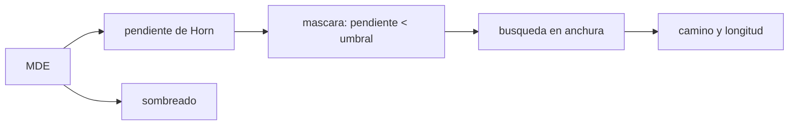

# B53-C20 — Proyecto SIG de terreno extraterrestre

<!-- nav:top -->
[🏠 Programa](../../../../README.md) · [📚 Bloque B53](../../../tronco-comun/B53-astrogeologia-y-geodesia-planetaria.md) · [← Anterior: B53-C19 — Incertidumbre en mapas planetarios](../B53-C19-incertidumbre-en-mapas-planetarios/CLASE.md) · [Siguiente: B53-C21 — Rotación y orientación de cuerpos planetarios: polos y meridiano origen →](../../../tronco-comun/B53-astrogeologia-y-geodesia-planetaria.md#b53-c21)
<!-- /nav -->

## 1. Ubicación, nivel y alcance

Clase 20 del bloque B53. Nivel N3. Un proyecto SIG de terreno une un **modelo digital de elevación** (MDE), derivados (pendiente, sombreado) y una regla de decisión (transitabilidad). Aquí construyes un MDE **sintético** de 101 × 101 celdas con una colina y una inclinación, calculas la pendiente con el esquema de Horn, la verificas contra un plano y un paraboloide de pendiente conocida, generas un sombreado, defines una máscara de transitabilidad con un umbral de pendiente y buscas un camino por búsqueda en anchura. Es la integración del bloque: marco, incertidumbre y publicación se declaran en la ficha. No se usa ningún MDE real.

## 2. Por qué esta clase existe

Un derivado sin verificar propaga errores a la decisión. La decisión central: **¿qué parte del terreno cumple un criterio de pendiente y existe un camino que lo respete?**

## 3. Lo que podrás hacer al terminar

1. Calcular la pendiente de un MDE con el esquema de Horn.
2. Verificar el cálculo contra superficies de pendiente conocida.
3. Generar un sombreado.
4. Definir y aplicar una máscara de transitabilidad.
5. Buscar un camino con búsqueda en anchura.
6. Documentar el proyecto con sus supuestos.

La evidencia es la **ficha del proyecto SIG de terreno** del ejercicio 12 (sección 20).

## 4. Con qué llegas y cómo comprobarlo

1. ¿Qué es un MDE?
2. ¿Qué es la pendiente?
3. ¿Qué es un umbral?
4. ¿Qué es una búsqueda en anchura?
5. ¿Qué es un dato sintético?

<details>
<summary>Ver respuestas</summary>

1. Una malla de alturas. 2. El ángulo de la superficie con la horizontal. 3. Un valor de corte para decidir. 4. Explorar celdas vecinas por capas hasta llegar a la meta. 5. Uno generado por el modelo.
</details>

Con cuatro o cinco aciertos, sigue; si no, repasa los prerrequisitos.

## 5. Un caso de contexto y casos de referencia

Un MDE sintético de `101 × 101` celdas de `10 m` con una colina gaussiana de `120 m` y una inclinación de `0,02`. La pendiente de Horn recupera un plano con un error de `0,0 × 10⁰°` y un paraboloide con `1,28 × 10⁻¹³°`. La pendiente máxima es `21,0°`. Con un umbral de `15°` el `70,7 %` de las celdas es transitable y el camino más corto de esquina a esquina mide `1960 m`, igual a la distancia Manhattan (`1960 m`). Es el **ejemplo conductor**. Todo es **sintético o ilustrativo** y así se rotula.

## 6. Vocabulario

El **esquema de Horn** calcula derivadas con una ventana de 3 × 3 ponderada. El **sombreado** es `cos z cos s + sin z sin s cos(a − o)`. La **máscara de transitabilidad** marca las celdas con pendiente menor que el umbral. La **búsqueda en anchura** da el camino más corto en pasos de 4 vecinos.

## 7. Modelo mental

Analogía: un mapa de senderismo: se marca en verde lo suficientemente llano y se busca un camino que solo pise lo verde.



*Descripción textual:* El MDE da pendiente y sombreado; la pendiente produce la máscara; la búsqueda da el camino.

Límite de la analogía: un proyecto real considera rugosidad, rocas, sombras, comunicaciones y seguridad; aquí solo la pendiente.

## 8. La explicación, paso a paso

### 8,1 Verificación de la pendiente

| Superficie | pendiente verdadera | error máximo [°] |
|---|---|---|
| plano `z = 0,1 x` | 5,7106° | 0,00 × 10⁰ |
| paraboloide `z = r²/(2 R_c)`, `R_c = 500 m` | `atan(r/R_c)` | 1,28 × 10⁻¹³ |

### 8,2 Terreno del proyecto

| Magnitud | Valor |
|---|---|
| pendiente máxima [°] | 20,98 |
| celdas transitables (< 15°) [%] | 70,69 |
| camino más corto [m] | 1960 |
| distancia Manhattan entre esquinas [m] | 1960 |
| sombreado en el plano `z = 0,02 x` (sol a 30° de elevación, azimut 135°) | 0,4877 |

### 8,3 Lectura

El camino coincide con la distancia Manhattan: se puede bordear la zona de pendiente alta sin alargar el recorrido. El resultado depende de la resolución del MDE, del umbral y de que la pendiente sea el único criterio. Una incertidumbre del MDE de unos metros altera las celdas cercanas al umbral.

## 9. Magnitudes, símbolos y unidades

| Símbolo | Qué es | Unidad | Valor / nota |
|---|---|---|---|
| `h` | tamaño de celda | m | 10 |
| `z` | altura | m | sintética |
| umbral | pendiente máxima | grados | 15 |
| `s` | pendiente | grados | ver 8,2 |
| camino | longitud | m | 1960 |

## 10. Convenciones y referencias

Malla regular de 101 × 101 celdas; coordenadas planas en metros; bordes sin calcular (se excluye 1 celda); vecindad de 4 celdas para el camino (distancia Manhattan); tolerancia: error de pendiente de Horn menor que 10⁻⁶° en el plano y 0,05° en el paraboloide.

## 11. De dónde sale lo que afirmamos

| ID | Fuente | Localizador | Respalda | Estado |
|---|---|---|---|---|
| — | Sin fuente externa | — | relaciones estándar que verifica el laboratorio | No se consultó una fuente para esta clase |

Límites: no se consultó ninguna fuente; el MDE y el umbral son sintéticos.

## 12. Cómo ver el resultado

| Magnitud | Valor |
|---|---|
| error en el plano | 0,0 × 10⁰° |
| error en el paraboloide | 1,28 × 10⁻¹³° |
| pendiente máxima | 21,0° |
| celdas transitables | 70,7 % |
| camino | 1960 m |

Descripción larga: el camino coincide con la distancia Manhattan: la zona empinada se bordea sin costo en una vecindad de 4 celdas.

## 13. Ejemplo trabajado

**Paso 1.** Plano `z = 0,1 x`: pendiente `atan(0,1) = 5,7106°`.

**Paso 2.** Horn: error `0,0 × 10⁰°`.

**Paso 3.** Umbral `15°` sobre el MDE: `70,7 %` transitable.

**Paso 4.** Camino: `1960 m`.

## 14. Distintas formas de describirlo

**Por fórmula:** Horn. **Por verificación:** plano y paraboloide. **Por máscara:** umbral. **Por búsqueda:** anchura.

## 15. Práctica guiada

**Ejercicio 1 · con los pasos indicados.** Calcula `atan(0,1)`.

<details><summary>Solución comentada</summary>

`5,7106°`.
</details>

**Ejercicio 2 · con una pista.** ¿Qué pendiente tiene `z = 0,02 x`?

<details><summary>Solución comentada</summary>

`1,146°`.
</details>

**Ejercicio 3 · casi autónomo.** ¿Cuántas celdas tiene el MDE?

<details><summary>Solución comentada</summary>

10 201.
</details>

## 16. Práctica autónoma, transferencia e integrador

**Ejercicio 4 · autónomo.** ¿Por qué se excluye el borde?

<details><summary>Solución comentada</summary>

La ventana de 3 × 3 no cabe.
</details>

**Ejercicio 5 · autónomo.** ¿Qué mide la distancia Manhattan?

<details><summary>Solución comentada</summary>

La suma de pasos horizontales y verticales.
</details>

**Ejercicio 6 · autónomo.** ¿Cuánto mide la distancia Manhattan entre esquinas?

<details><summary>Solución comentada</summary>

`1960 m`.
</details>

**Ejercicio 7 · autónomo.** ¿Qué pasa con el camino si el umbral baja a 10°?

<details><summary>Solución comentada</summary>

Puede alargarse o desaparecer; hay que recalcular.
</details>

**Ejercicio 8 · autónomo.** ¿Qué ignora el criterio de pendiente?

<details><summary>Solución comentada</summary>

Rugosidad, rocas, sombras y comunicaciones.
</details>

**Ejercicio 9 · transferencia.** El MDE tiene 3 m de incertidumbre. ¿Qué haces?

<details><summary>Solución comentada</summary>

Hago el análisis de sensibilidad del umbral (clase 19).
</details>

**Ejercicio 10 · transferencia.** ¿Por qué verificar con superficies conocidas?

<details><summary>Solución comentada</summary>

Porque un error en la fórmula se vería en ellas.
</details>

**Ejercicio 11 · transferencia.** ¿Qué metadatos entregarías?

<details><summary>Solución comentada</summary>

Marco, resolución, proyección, incertidumbre y supuestos (clase 26).
</details>

**Ejercicio 12 · integrador.** Elabora tu *ficha del proyecto SIG de terreno*: MDE, derivados, verificación, criterio, camino y límites.

<details><summary>Solución modelo</summary>

Secciones 8,1 a 8,3.
</details>

## 17. Laboratorio: pendiente, sombreado y transitabilidad sobre un MDE sintético

El script [sig.py](sig.py) calcula la pendiente de Horn, la verifica con dos superficies, aplica el umbral y busca el camino con búsqueda en anchura (**comprueba** 10⁻⁶° en el plano y 0,05° en el paraboloide).

**Datos:** MDE **sintético**. **Predice antes de ejecutar:** ¿será el camino más largo que la distancia Manhattan? (no, es igual: se puede bordear la colina). **Ejecución del 2026-11-09 (Python 3,12,9):**

```text
Python 3.12.9 (biblioteca estandar)
error maximo de pendiente: plano 0.00e+00 grados ; paraboloide 1.279e-13 grados
pendiente maxima del terreno = 20.98 grados ; celdas transitables (<15) = 70.69 %
camino mas corto = 1960 m ; Manhattan entre esquinas = 1960 m
sombreado en el plano inclinado = 0.4877
Pruebas superadas.
```

```bash
python programa/clases/B53/B53-C20-proyecto-sig-de-terreno-extraterrestre/sig.py
```

**Límites:** solo pendiente; vecindad de 4 celdas; terreno sin incertidumbre.

## 18. Errores frecuentes y cómo corregirlos

**Usar un derivado sin verificar.** se corrige con 8,1

**Tomar el umbral como universal.** se corrige con 8,3

**Presentar el terreno como real.** se corrige con la sección 10

## 19. Cómo sabrás que vas bien

Tras la sección 8: ¿qué resultado esperabas y cuál obtuviste? Si dudas, repasa el ejemplo de la sección 13. Tras el laboratorio: ¿qué comprueba? (ver la sección 17).

## 20. Qué entregas y cómo se evalúa

El producto es tu **ficha del proyecto SIG de terreno** (ejercicio 12).

| Criterio | Inicial | En desarrollo | Logrado | Destacado |
|---|---|---|---|---|
| Conceptos | Los confunde | Parciales | Conceptos de la clase | Explica los límites |
| Cálculo | Sin unidades | Con errores | Tablas completas | Calcula casos nuevos |
| Numérico | Sin comprobar | Un caso | Contraste con el análisis | Interpreta las diferencias |
| Fuentes | Sin fuente | Sin fecha | Fuentes con fecha | Declara lo sintético |
| Límites | No los nombra | Uno | Tres | Discute qué falta del modelo |

**Condiciones críticas (no se compensan con promedio):** rotular el MDE como sintético; no proponer una ruta para operaciones reales; citar solo lo consultado.

## 21. Ética, seguridad y límites

Clase educativa: los modelos son simplificados y no sustituyen a los productos de una misión ni a la literatura primaria. Ningún dato simulado se presenta como observado. Accesibilidad: tablas equivalentes a las gráficas, fórmulas en texto, ejercicios sin conexión.

## 22. Para cerrar y seguir

La pendiente de Horn pasa la verificación y el camino mide `1960 m` con un `71 %` de terreno transitable. El bloque cierra aquí: lo derivado de un modelo es tan fiable como su verificación.

**Glosario español–inglés.** modelo digital de elevación · *digital elevation model*; pendiente · *slope*; transitabilidad · *traversability*; búsqueda en anchura · *breadth-first search*.

**Continuidad.** [B53-C21](../B53-C21-rotacion-y-orientacion-de-cuerpos-planetarios-polos-y-meridiano-origen/CLASE.md) cierra el bloque con el proyecto integrador.

**Referencias:** ver sección 11.

<!-- nav:bottom -->
---

[← Anterior: B53-C19 — Incertidumbre en mapas planetarios](../B53-C19-incertidumbre-en-mapas-planetarios/CLASE.md) · [📚 Bloque B53](../../../tronco-comun/B53-astrogeologia-y-geodesia-planetaria.md) · [Siguiente: B53-C21 — Rotación y orientación de cuerpos planetarios: polos y meridiano origen →](../../../tronco-comun/B53-astrogeologia-y-geodesia-planetaria.md#b53-c21)
<!-- /nav -->
