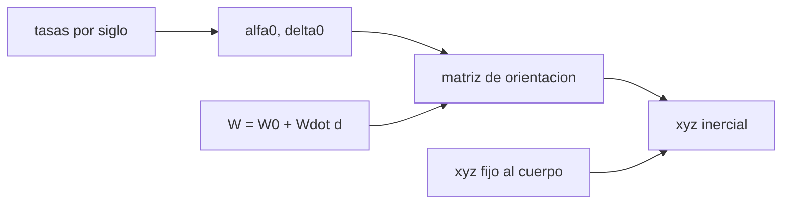

# B53-C21 — Rotación y orientación de cuerpos planetarios: polos y meridiano origen

<!-- nav:top -->
[🏠 Programa](../../../../README.md) · [📚 Bloque B53](../../../tronco-comun/B53-astrogeologia-y-geodesia-planetaria.md) · [← Anterior: B53-C20 — Proyecto SIG de terreno extraterrestre](../B53-C20-proyecto-sig-de-terreno-extraterrestre/CLASE.md) · [Siguiente: B53-C22 — Meteorización espacial: micrometeoritos, viento solar y maduración del regolito →](../B53-C22-meteorizacion-espacial-micrometeoritos-viento-solar-y-maduracion-del-regolito/CLASE.md)
<!-- /nav -->

## 1. Ubicación, nivel y alcance

Clase 21 del bloque B53. Nivel N3. Para ubicar un punto de un cuerpo en el espacio inercial hay que conocer la dirección de su **polo** (ascensión recta `α₀` y declinación `δ₀`), el ángulo `W` de su **meridiano origen** y cómo cambian con el tiempo. Los modelos de los grupos de trabajo de la IAU dan esos elementos de rotación con tasas lineales para cada cuerpo (informe de la IAU, **no consultado**). Aquí construyes la matriz de rotación del cuerpo al marco inercial con elementos **ilustrativos**, verificas que sea una rotación propia, que el eje apunte al polo declarado, que `W` avance al ritmo previsto y que el polo precese como indica la tasa.

## 2. Por qué esta clase existe

Un mismo punto de la superficie está en lugares distintos del espacio según la hora. La decisión central: **¿cuál es la matriz que lleva coordenadas fijas al cuerpo a coordenadas inerciales en una fecha, y qué tan bien está definida?**

## 3. Lo que podrás hacer al terminar

1. Definir polo, meridiano origen y tasa de rotación.
2. Construir la matriz `Rz(α₀+90°) Rx(90°−δ₀) Rz(W)`.
3. Verificar ortogonalidad y determinante.
4. Comprobar que el eje de la matriz es el polo.
5. Verificar el avance de `W` y el período.
6. Calcular la precesión del polo entre dos fechas.

La evidencia es la **ficha de orientación de un cuerpo** del ejercicio 12 (sección 20).

## 4. Con qué llegas y cómo comprobarlo

1. ¿Qué es la ascensión recta?
2. ¿Qué es la declinación?
3. ¿Qué es una matriz de rotación?
4. ¿Qué es una tasa lineal?
5. ¿Qué es un valor ilustrativo?

<details>
<summary>Ver respuestas</summary>

1. La longitud celeste medida desde el equinoccio. 2. La latitud celeste. 3. Una matriz ortogonal de determinante 1. 4. Un cambio proporcional al tiempo. 5. Uno propuesto para el ejemplo.
</details>

Con cuatro o cinco aciertos, sigue; si no, repasa los prerrequisitos.

## 5. Un caso de contexto y casos de referencia

Un cuerpo ilustrativo con `α₀ = 100°`, `δ₀ = 60°`, tasas polares de `0,05°` y `−0,03°` por siglo juliano y `W = 30° + 350,9° d` (`d` en días). La matriz es ortogonal con error `2,2 × 10⁻¹⁶` y `det = 1,000000000000`. El eje coincide con el polo con error `1,7 × 10⁻¹⁶`. El período de rotación es `24,6224 h`, `W` avanza como se espera con error `1,1 × 10⁻¹³°` y el polo se mueve `0,03906°` en un siglo (analítico `0,03905°`). Es el **ejemplo conductor**. Todo es **sintético o ilustrativo** y así se rotula.

## 6. Vocabulario

El **polo** es la dirección del eje de rotación. El **meridiano origen** es el meridiano de longitud 0; `W` es el ángulo que lo separa del nodo del ecuador del cuerpo con el ecuador celeste. La **precesión** es el cambio lento de la dirección del polo.

## 7. Modelo mental

Analogía: una peonza: el eje señala una dirección que cambia lento y la marca pintada en su borde da vueltas rápido.



*Descripción textual:* El polo y el ángulo `W` forman la matriz que convierte coordenadas fijas al cuerpo en inerciales; las tasas actualizan el polo con el tiempo.

Límite de la analogía: los modelos reales incluyen términos periódicos y de libración, y sus elementos proceden de la IAU; aquí son inventados.

## 8. La explicación, paso a paso

### 8,1 La matriz

`R = Rz(α₀ + 90°) · Rx(90° − δ₀) · Rz(W)`. Aplicada a `(0,0,1)` debe dar `(cos δ₀ cos α₀, cos δ₀ sen α₀, sen δ₀)`.

| Prueba | Resultado |
|---|---|
| error de ortogonalidad `max|R Rᵀ − I|` | 2,22 × 10⁻¹⁶ |
| determinante | 1,000000000000 |
| error del eje frente al polo | 1,67 × 10⁻¹⁶ |

### 8,2 Rotación

El período es `360°/Ẇ`: `1,025933 d = 24,6224 h`. Tras `d = 2,75` días, `W` avanza `244,9750°` y el ángulo medido en la matriz difiere del esperado en `1,14 × 10⁻¹³°`.

### 8,3 Precesión

En un siglo el polo cambia `δ₀` en `−0,03°` y `α₀` en `0,05°`; el ángulo entre los dos polos es `0,039059°` (numérico) frente a `0,039051°` (analítico `√(δ̇² + (α̇ cos δ₀)²)`).

### 8,4 Lectura

Una incertidumbre de `0,1°` en `W` equivale a `1,75 km` en el ecuador de un cuerpo de `1000 km` de radio. Los elementos deben citarse con su época y su versión.

## 9. Magnitudes, símbolos y unidades

| Símbolo | Qué es | Unidad | Valor / nota |
|---|---|---|---|
| `α₀`, `δ₀` | polo | grados | 100; 60 (ilustrativos) |
| `Ẇ` | tasa de rotación | grados/día | 350,9 (ilustrativo) |
| `T` | tiempo | siglos julianos | 36 525 d |
| `R` | matriz de orientación | — | 3 × 3 |
| `P` | período | h | 24,6224 |

## 10. Convenciones y referencias

Rotaciones activas, ángulos en grados, tiempo en días desde la época; marco inercial ecuatorial; valores **ilustrativos**, no los de la IAU; tolerancias: ortogonalidad 10⁻¹², `W` 10⁻⁹°.

## 11. De dónde sale lo que afirmamos

| ID | Fuente | Localizador | Respalda | Estado |
|---|---|---|---|---|
| S1 | Archinal et al., informe del grupo de trabajo IAU sobre coordenadas cartográficas y elementos de rotación (2018) | https://doi.org/10.1007/s10569-017-9805-5 | modelo de orientación (polo y meridiano origen) de cada cuerpo | No consultada (la página redirige a un inicio de sesión) |

Límites: no se leyó el informe: la forma de la matriz es la convención habitual y la verifica el laboratorio, pero ningún elemento numérico procede de la fuente.

## 12. Cómo ver el resultado

| Magnitud | Valor |
|---|---|
| ortogonalidad | 2,2 × 10⁻¹⁶ |
| determinante | 1,000000000 |
| período | 24,6224 h |
| error de `W` | 1,1 × 10⁻¹³° |
| precesión por siglo | 0,03906° |

Descripción larga: la matriz es una rotación propia y su eje es el polo.

## 13. Ejemplo trabajado

**Paso 1.** Datos: `α₀ = 100°`, `δ₀ = 60°`, `Ẇ = 350,9°/d`.

**Paso 2.** Período: `360/350,9 = 1,025933 d`.

**Paso 3.** Eje: `R·ẑ` apunta a `δ₀ = 60°`.

**Paso 4.** Precesión: `√(0,03² + (0,05 cos 60°)²) = 0,03905°`.

## 14. Distintas formas de describirlo

**Por matriz:** `R`. **Por vector:** eje y polo. **Por tabla:** pruebas. **Por tasa:** precesión.

## 15. Práctica guiada

**Ejercicio 1 · con los pasos indicados.** Calcula el período con `Ẇ = 350,9°/d`.

<details><summary>Solución comentada</summary>

`1,025933 d`.
</details>

**Ejercicio 2 · con una pista.** ¿Cuánto avanza `W` en 2 días?

<details><summary>Solución comentada</summary>

`701,8°`, o `341,8°` módulo 360.
</details>

**Ejercicio 3 · casi autónomo.** ¿Cuánto vale `det R`?

<details><summary>Solución comentada</summary>

`1`.
</details>

## 16. Práctica autónoma, transferencia e integrador

**Ejercicio 4 · autónomo.** ¿Por qué `R Rᵀ = I`?

<details><summary>Solución comentada</summary>

Es una rotación.
</details>

**Ejercicio 5 · autónomo.** Calcula la precesión analítica.

<details><summary>Solución comentada</summary>

`0,03905°`.
</details>

**Ejercicio 6 · autónomo.** ¿Qué error en superficie da `0,1°` de `W` en un radio de 1737 km?

<details><summary>Solución comentada</summary>

`3,03 km`.
</details>

**Ejercicio 7 · autónomo.** ¿Qué cambia con `α₀` en la matriz?

<details><summary>Solución comentada</summary>

El giro inicial alrededor del eje celeste.
</details>

**Ejercicio 8 · autónomo.** ¿Qué hacer si dos fuentes dan polos distintos?

<details><summary>Solución comentada</summary>

Citar época, versión y diferencia.
</details>

**Ejercicio 9 · transferencia.** ¿Qué es una libración?

<details><summary>Solución comentada</summary>

Una oscilación de la rotación en torno a su valor medio.
</details>

**Ejercicio 10 · transferencia.** ¿Por qué una rotación sincronizada igual necesita `W`?

<details><summary>Solución comentada</summary>

Porque el meridiano origen sigue girando respecto del espacio inercial.
</details>

**Ejercicio 11 · transferencia.** ¿Se puede obtener `W` de imágenes?

<details><summary>Solución comentada</summary>

Sí, ajustando puntos de control; aquí no se hace.
</details>

**Ejercicio 12 · integrador.** Elabora tu *ficha de orientación de un cuerpo*: elementos, matriz, verificaciones y límites.

<details><summary>Solución modelo</summary>

Secciones 8,1 a 8,4.
</details>

## 17. Laboratorio: polo, meridiano origen y matriz de rotación

El script [orientacion.py](orientacion.py) construye la matriz, verifica ortogonalidad, eje y avance de `W`, y la precesión del polo (**comprueba** 10⁻¹² en ortogonalidad y 10⁻⁹° en `W`).

**Datos:** elementos **ilustrativos**. **Predice antes de ejecutar:** ¿qué determinante tendrá la matriz? (1). **Ejecución del 2026-11-09 (Python 3,12,9):**

```text
Python 3.12.9 (biblioteca estandar)
ortogonalidad max|R R^T - I| = 2.22e-16 ; det = 1.000000000000 ; error del eje frente al polo = 1.67e-16
periodo = 1.025933 d = 24.6224 h ; error de W tras 2.75 d = 1.14e-13 grados
precesion en un siglo: numerica 0.039059 grados ; analitica 0.039051 grados
Pruebas superadas.
```

```bash
python programa/clases/B53/B53-C21-rotacion-y-orientacion-de-cuerpos-planetarios-polos-y-meridiano-origen/orientacion.py
```

**Límites:** sin libración ni términos periódicos; elementos inventados.

## 18. Errores frecuentes y cómo corregirlos

**Mezclar rotaciones activas y pasivas.** se corrige con la sección 10

**Omitir la época de los elementos.** se corrige con 8,4

**Tomar los elementos ilustrativos como los de un cuerpo real.** se corrige con la sección 11

## 19. Cómo sabrás que vas bien

Tras la sección 8: ¿qué resultado esperabas y cuál obtuviste? Si dudas, repasa el ejemplo de la sección 13. Tras el laboratorio: ¿qué comprueba? (ver la sección 17).

## 20. Qué entregas y cómo se evalúa

El producto es tu **ficha de orientación de un cuerpo** (ejercicio 12).

| Criterio | Inicial | En desarrollo | Logrado | Destacado |
|---|---|---|---|---|
| Conceptos | Los confunde | Parciales | Conceptos de la clase | Explica los límites |
| Cálculo | Sin unidades | Con errores | Tablas completas | Calcula casos nuevos |
| Numérico | Sin comprobar | Un caso | Contraste con el análisis | Interpreta las diferencias |
| Fuentes | Sin fuente | Sin fecha | Fuentes con fecha | Declara lo sintético |
| Límites | No los nombra | Uno | Tres | Discute qué falta del modelo |

**Condiciones críticas (no se compensan con promedio):** rotular los elementos como ilustrativos; citar época y versión; no atribuir valores a un cuerpo real; citar solo lo consultado.

## 21. Ética, seguridad y límites

Clase educativa: los modelos son simplificados y no sustituyen a los productos de una misión ni a la literatura primaria. Ningún dato simulado se presenta como observado. Accesibilidad: tablas equivalentes a las gráficas, fórmulas en texto, ejercicios sin conexión.

## 22. Para cerrar y seguir

La matriz es ortogonal (`2 × 10⁻¹⁶`), su eje es el polo y `W` avanza como se espera. Queda una pregunta: ¿qué le pasa a una superficie sin atmósfera con el tiempo?

**Glosario español–inglés.** polo · *pole*; meridiano origen · *prime meridian*; precesión · *precession*; libración · *libration*.

**Continuidad.** [B53-C22](../B53-C22-meteorizacion-espacial-micrometeoritos-viento-solar-y-maduracion-del-regolito/CLASE.md) estudia la meteorización espacial.

**Referencias:** ver sección 11.

<!-- nav:bottom -->
---

[← Anterior: B53-C20 — Proyecto SIG de terreno extraterrestre](../B53-C20-proyecto-sig-de-terreno-extraterrestre/CLASE.md) · [📚 Bloque B53](../../../tronco-comun/B53-astrogeologia-y-geodesia-planetaria.md) · [Siguiente: B53-C22 — Meteorización espacial: micrometeoritos, viento solar y maduración del regolito →](../B53-C22-meteorizacion-espacial-micrometeoritos-viento-solar-y-maduracion-del-regolito/CLASE.md)
<!-- /nav -->
