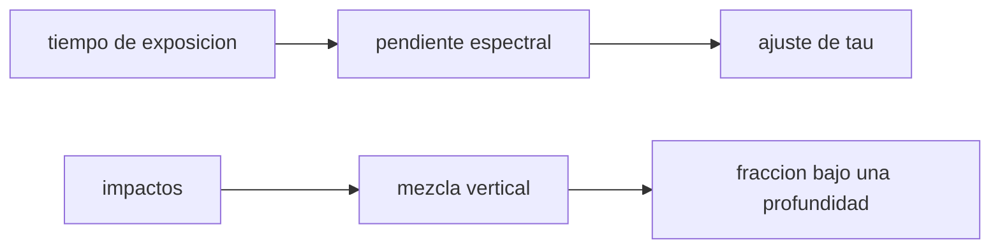

# B53-C22 — Meteorización espacial: micrometeoritos, viento solar y maduración del regolito

<!-- nav:top -->
[🏠 Programa](../../../../README.md) · [📚 Bloque B53](../../../tronco-comun/B53-astrogeologia-y-geodesia-planetaria.md) · [← Anterior: B53-C21 — Rotación y orientación de cuerpos planetarios: polos y meridiano origen](../B53-C21-rotacion-y-orientacion-de-cuerpos-planetarios-polos-y-meridiano-origen/CLASE.md) · [Siguiente: B53-C23 — Mecánica de hielo: reología, fracturas y deformación →](../B53-C23-mecanica-de-hielo-reologia-fracturas-y-deformacion/CLASE.md)
<!-- /nav -->

## 1. Ubicación, nivel y alcance

Clase 22 del bloque B53. Nivel N3. En una superficie sin atmósfera, micrometeoritos y partículas del viento solar alteran el regolito: lo oscurecen, enrojecen su espectro y lo **mezclan** (jardinería). Aquí modelas con datos **sintéticos** el enrojecimiento como una saturación exponencial del pendiente espectral con el tiempo de exposición, ajustas su escala temporal por mínimos cuadrados con barrido en la escala y estimas su incertidumbre por Monte Carlo; y modelas la jardinería como una caminata aleatoria con reflexión en la superficie, contrastando la fracción de partículas por debajo de una profundidad con `erfc`. Los tiempos están en unidades arbitrarias.

## 2. Por qué esta clase existe

Una superficie «vieja» se ve distinta de una «fresca» aunque tenga la misma composición. La decisión central: **¿cuánto del cambio espectral se debe al tiempo de exposición y con qué incertidumbre se estima su escala?**

## 3. Lo que podrás hacer al terminar

1. Plantear un modelo de saturación exponencial.
2. Ajustarlo barriendo la escala temporal y resolviendo lo lineal.
3. Estimar la incertidumbre por Monte Carlo.
4. Simular la mezcla como caminata aleatoria con reflexión.
5. Comparar con la solución con `erfc`.
6. Interpretar maduración y mezcla.

La evidencia es la **ficha de maduración del regolito** del ejercicio 12 (sección 20).

## 4. Con qué llegas y cómo comprobarlo

1. ¿Qué es el regolito?
2. ¿Qué es una exponencial de saturación?
3. ¿Qué es una caminata aleatoria?
4. ¿Qué es `erfc`?
5. ¿Qué es un dato sintético?

<details>
<summary>Ver respuestas</summary>

1. La capa suelta de polvo y fragmentos sobre un cuerpo. 2. `1 − e^(−t/τ)`: crece y se estabiliza. 3. Una sucesión de pasos al azar. 4. La función de error complementaria. 5. Uno generado por el modelo.
</details>

Con cuatro o cinco aciertos, sigue; si no, repasa los prerrequisitos.

## 5. Un caso de contexto y casos de referencia

Un pendiente espectral `S(t) = 0,10 + 0,40 (1 − e^(−t/0,30))` (sintético, `t` en ua). Con ruido de `0,01` en 12 edades de exposición, el ajuste da `τ = 0,299 ± 0,019` y `ΔS = 0,401 ± 0,012` (500 repeticiones). La mezcla por 400 pasos de `0,5 cm` deja una fracción por debajo de `10 cm` de `0,3137` (analítica `0,3173`). Es el **ejemplo conductor**. Todo es **sintético o ilustrativo** y así se rotula.

## 6. Vocabulario

La **maduración** es el cambio espectral con la exposición. El **enrojecimiento** es el aumento del pendiente hacia el rojo. La **jardinería** es la mezcla vertical por impactos. La **reflexión** impide que una partícula salga de la superficie.

## 7. Modelo mental

Analogía: un camino que se pisa cada día: al principio cada pisada cambia mucho el aspecto, y con el tiempo ya no cambia más; además, la tierra se va mezclando.



*Descripción textual:* El tiempo de exposición determina el pendiente espectral, del que se ajusta una escala; los impactos mezclan en vertical y se mide la fracción enterrada.

Límite de la analogía: la maduración real depende de la composición, el flujo de partículas y la lejanía al Sol.

## 8. La explicación, paso a paso

### 8,1 Enrojecimiento

`S(t) = S₀ + ΔS (1 − e^(−t/τ))`. Para cada `τ` de una malla se resuelve por mínimos cuadrados el par `(S₀, ΔS)` y se elige el `τ` de menor residuo.

| Magnitud | verdadero | media (500) | dispersión |
|---|---|---|---|
| `τ` [ua] | 0,300 | 0,2994 | 0,0187 |
| `ΔS` | 0,400 | 0,4007 | 0,0117 |
| `S₀` | 0,100 | 0,0991 | 0,0120 |

### 8,2 Jardinería

Tras 400 pasos gaussianos de `0,5 cm`, la desviación es `σ = 0,5·√400 = 10,0 cm` y con reflexión `P(profundidad > z) = erfc(z/(√2 σ))`.

| Magnitud | Valor |
|---|---|
| varianza simulada [cm²] | 98,91 |
| varianza analítica [cm²] | 100,00 |
| fracción bajo 10 cm, simulada | 0,3137 |
| fracción bajo 10 cm, analítica | 0,3173 |

### 8,3 Lectura

El pendiente satura: pasada cierta edad ya no distingue la antigüedad. Esta es una limitación de usar el color como reloj.

## 9. Magnitudes, símbolos y unidades

| Símbolo | Qué es | Unidad | Valor / nota |
|---|---|---|---|
| `S` | pendiente espectral | adimensional | sintético |
| `τ` | escala de maduración | ua | 0,30 (sintética) |
| `σ_p` | paso de mezcla | cm | 0,5 (sintético) |
| `n` | pasos | — | 400 |
| `z` | profundidad | cm | 10 |

## 10. Convenciones y referencias

Datos sintéticos; semilla `20261109`; barrido de `τ` de 0,05 a 1,5 en 600 puntos; 20 000 partículas; tolerancias: `τ` dentro de 3 errores típicos de su verdadero valor y varianza de la mezcla dentro de 2 %.

## 11. De dónde sale lo que afirmamos

| ID | Fuente | Localizador | Respalda | Estado |
|---|---|---|---|---|
| — | Sin fuente externa | — | relaciones estándar que verifica el laboratorio | No se consultó una fuente para esta clase |

Límites: no se consultó ninguna fuente sobre meteorización espacial; el modelo es una forma funcional ilustrativa.

## 12. Cómo ver el resultado

| Magnitud | Valor |
|---|---|
| `τ` estimada | 0,299 ± 0,019 |
| `ΔS` estimada | 0,401 ± 0,012 |
| varianza de la mezcla | 98,9 cm² |
| fracción bajo 10 cm | 0,3137 |

Descripción larga: el ajuste recupera la escala de maduración y la mezcla coincide con la solución analítica.

## 13. Ejemplo trabajado

**Paso 1.** Saturación: para `t ≫ τ`, `S → S₀ + ΔS`.

**Paso 2.** Ajuste: grilla en `τ`, lineal en `(S₀, ΔS)`.

**Paso 3.** Mezcla: `σ = 0,5·√400 = 10,0 cm`.

**Paso 4.** Fracción: `erfc(10/(√2·10)) = 0,3173`.

## 14. Distintas formas de describirlo

**Por fórmula:** saturación y `erfc`. **Por ajuste:** barrido de `τ`. **Por simulación:** caminata. **Por tabla:** estimaciones.

## 15. Práctica guiada

**Ejercicio 1 · con los pasos indicados.** Calcula `S(0)` y `S(∞)`.

<details><summary>Solución comentada</summary>

`0,10` y `0,50`.
</details>

**Ejercicio 2 · con una pista.** ¿Cuánto vale `S(τ)`?

<details><summary>Solución comentada</summary>

`0,10 + 0,40(1 − e⁻¹) = 0,353`.
</details>

**Ejercicio 3 · casi autónomo.** ¿Cuándo es el pendiente el 95 % de su máximo?

<details><summary>Solución comentada</summary>

`t = 3 τ = 0,9 ua`.
</details>

## 16. Práctica autónoma, transferencia e integrador

**Ejercicio 4 · autónomo.** ¿Qué limita medir edades con color?

<details><summary>Solución comentada</summary>

La saturación.
</details>

**Ejercicio 5 · autónomo.** Calcula `σ` de la mezcla.

<details><summary>Solución comentada</summary>

`10,0 cm`.
</details>

**Ejercicio 6 · autónomo.** ¿Qué fracción queda bajo `σ`?

<details><summary>Solución comentada</summary>

`erfc(1/√2) = 0,3173`.
</details>

**Ejercicio 7 · autónomo.** ¿Cómo cambia `σ` si los pasos se cuadruplican?

<details><summary>Solución comentada</summary>

Se duplica.
</details>

**Ejercicio 8 · autónomo.** ¿Qué falta para modelar una superficie real?

<details><summary>Solución comentada</summary>

Flujo de impactos, composición y estructura del regolito.
</details>

**Ejercicio 9 · transferencia.** Dos superficies tienen igual pendiente. ¿Igual edad?

<details><summary>Solución comentada</summary>

No necesariamente: saturación y composición.
</details>

**Ejercicio 10 · transferencia.** ¿Por qué la reflexión es necesaria?

<details><summary>Solución comentada</summary>

Una partícula no puede estar sobre la superficie.
</details>

**Ejercicio 11 · transferencia.** ¿Qué observable remoto informa de la maduración?

<details><summary>Solución comentada</summary>

El color y el albedo; se estudian en la clase de mineralogía.
</details>

**Ejercicio 12 · integrador.** Elabora tu *ficha de maduración del regolito*: modelo, ajuste, incertidumbre, mezcla y límites.

<details><summary>Solución modelo</summary>

Secciones 8,1 a 8,3.
</details>

## 17. Laboratorio: enrojecimiento por exposición y mezcla por impactos

El script [regolito.py](regolito.py) ajusta el modelo de saturación a 500 conjuntos sintéticos y simula 20 000 partículas con reflexión (**comprueba** `τ` dentro de 3 errores típicos y varianza dentro de 2 %).

**Datos:** datos **sintéticos**; semilla `20261109`. **Predice antes de ejecutar:** ¿qué parámetro se estimará peor, `τ` o `ΔS`? (`τ`, más correlado con otros). **Ejecución del 2026-11-09 (Python 3,12,9):**

```text
Python 3.12.9 (biblioteca estandar)
tau = 0.2994 +- 0.0187 (verdadero 0.3) ; dS = 0.4007 +- 0.0117 (0.4) ; S0 = 0.0991 +- 0.0120 (0.1)
mezcla: sigma = 10.00 cm ; varianza simulada 98.909 ; analitica 100.000 cm2
fraccion bajo 10 cm: simulada 0.3137 ; erfc 0.3173
Pruebas superadas.
```

```bash
python programa/clases/B53/B53-C22-meteorizacion-espacial-micrometeoritos-viento-solar-y-maduracion-del-regolito/regolito.py
```

**Límites:** una sola exponencial y una mezcla gaussiana sin flujo de impactos.

## 18. Errores frecuentes y cómo corregirlos

**Usar el color como reloj sin considerar saturación.** se corrige con 8,3

**Olvidar la reflexión.** se corrige con 8,2

**Presentar el ajuste como una edad real.** se corrige con la sección 10

## 19. Cómo sabrás que vas bien

Tras la sección 8: ¿qué resultado esperabas y cuál obtuviste? Si dudas, repasa el ejemplo de la sección 13. Tras el laboratorio: ¿qué comprueba? (ver la sección 17).

## 20. Qué entregas y cómo se evalúa

El producto es tu **ficha de maduración del regolito** (ejercicio 12).

| Criterio | Inicial | En desarrollo | Logrado | Destacado |
|---|---|---|---|---|
| Conceptos | Los confunde | Parciales | Conceptos de la clase | Explica los límites |
| Cálculo | Sin unidades | Con errores | Tablas completas | Calcula casos nuevos |
| Numérico | Sin comprobar | Un caso | Contraste con el análisis | Interpreta las diferencias |
| Fuentes | Sin fuente | Sin fecha | Fuentes con fecha | Declara lo sintético |
| Límites | No los nombra | Uno | Tres | Discute qué falta del modelo |

**Condiciones críticas (no se compensan con promedio):** rotular los datos como sintéticos; no datar una superficie real; citar solo lo consultado.

## 21. Ética, seguridad y límites

Clase educativa: los modelos son simplificados y no sustituyen a los productos de una misión ni a la literatura primaria. Ningún dato simulado se presenta como observado. Accesibilidad: tablas equivalentes a las gráficas, fórmulas en texto, ejercicios sin conexión.

## 22. Para cerrar y seguir

El ajuste recupera `τ = 0,30` y la mezcla reproduce la solución con `erfc`. Queda una pregunta: ¿cómo fluye y se agrieta el hielo?

**Glosario español–inglés.** meteorización espacial · *space weathering*; regolito · *regolith*; jardinería de impactos · *impact gardening*; enrojecimiento · *reddening*.

**Continuidad.** [B53-C23](../B53-C23-mecanica-de-hielo-reologia-fracturas-y-deformacion/CLASE.md) estudia la mecánica del hielo.

**Referencias:** ver sección 11.

<!-- nav:bottom -->
---

[← Anterior: B53-C21 — Rotación y orientación de cuerpos planetarios: polos y meridiano origen](../B53-C21-rotacion-y-orientacion-de-cuerpos-planetarios-polos-y-meridiano-origen/CLASE.md) · [📚 Bloque B53](../../../tronco-comun/B53-astrogeologia-y-geodesia-planetaria.md) · [Siguiente: B53-C23 — Mecánica de hielo: reología, fracturas y deformación →](../B53-C23-mecanica-de-hielo-reologia-fracturas-y-deformacion/CLASE.md)
<!-- /nav -->
