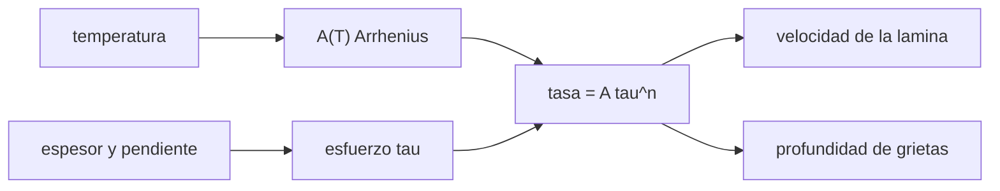

# B53-C23 — Mecánica de hielo: reología, fracturas y deformación

<!-- nav:top -->
[🏠 Programa](../../../../README.md) · [📚 Bloque B53](../../../tronco-comun/B53-astrogeologia-y-geodesia-planetaria.md) · [← Anterior: B53-C22 — Meteorización espacial: micrometeoritos, viento solar y maduración del regolito](../B53-C22-meteorizacion-espacial-micrometeoritos-viento-solar-y-maduracion-del-regolito/CLASE.md) · [Siguiente: B53-C24 — Sondeo radar de penetración de hielo →](../B53-C24-sondeo-radar-de-penetracion-de-hielo/CLASE.md)
<!-- /nav -->

## 1. Ubicación, nivel y alcance

Clase 23 del bloque B53. Nivel N3. El hielo fluye como un material de ley de potencias: la tasa de deformación crece con el esfuerzo elevado a `n` y depende de la temperatura según una ley de Arrhenius (ley de Glen). Aquí aplicas la ley con coeficientes de uso común **no consultados**: integras el perfil de velocidad de una lámina inclinada y lo comparas con la fórmula, calculas el cociente de tasas entre dos temperaturas, el efecto de la gravedad y la profundidad de una grieta según el criterio de Nye. Todos los valores son **ilustrativos**.

## 2. Por qué esta clase existe

El hielo de una luna fría se comporta como un sólido casi rígido y el de un glaciar templado fluye. La decisión central: **¿cuánto cambia la velocidad de deformación con la temperatura, el espesor y la gravedad?**

## 3. Lo que podrás hacer al terminar

1. Escribir la ley de Glen con dependencia de la temperatura.
2. Integrar el perfil de velocidad de una lámina.
3. Verificar con la fórmula `u_s = 2A/(n+1) (ρ g sin α)ⁿ Hⁿ⁺¹`.
4. Calcular el cociente de tasas entre temperaturas.
5. Escalar con la gravedad.
6. Estimar la profundidad de una grieta (Nye).

La evidencia es la **ficha de la reología del hielo** del ejercicio 12 (sección 20).

## 4. Con qué llegas y cómo comprobarlo

1. ¿Qué es una tasa de deformación?
2. ¿Qué es un esfuerzo cortante?
3. ¿Qué es la ley de Arrhenius?
4. ¿Qué es una ley de potencias?
5. ¿Qué es un valor ilustrativo?

<details>
<summary>Ver respuestas</summary>

1. La rapidez con que cambia la deformación. 2. Una fuerza por unidad de área paralela a la superficie. 3. Una dependencia `e^(−Q/RT)` con la temperatura. 4. `y ∝ x^n`. 5. Uno propuesto para el ejemplo.
</details>

Con cuatro o cinco aciertos, sigue; si no, repasa los prerrequisitos.

## 5. Un caso de contexto y casos de referencia

Con `n = 3`, `A(273 K) = 2,4 × 10⁻²⁴ Pa⁻³ s⁻¹` y `Q = 60 kJ/mol` (uso común, **no consultados**), una lámina de `100 m` inclinada `2°` a `270 K` fluye en la superficie a `0,087 m/año` (numérico `0,087`) en la Tierra y a `2,03 × 10⁻⁴ m/año` con `g = 1,3`. La tasa a 270 K supera a la de 100 K en un factor `5,4 × 10¹⁹`. La profundidad de una grieta de Nye con `ε̇ = 10⁻¹⁰ s⁻¹` es `8,5 m`. Es el **ejemplo conductor**. Todo es **sintético o ilustrativo** y así se rotula.

## 6. Vocabulario

La **ley de Glen** es `ε̇ = A(T) τⁿ`. La velocidad superficial de una lámina es `u_s = 2A/(n+1) (ρ g sin α)ⁿ Hⁿ⁺¹`. La **profundidad de Nye** es `d = (2/(ρ g)) (ε̇/A)^(1/n)`.

## 7. Modelo mental

Analogía: una masa de pan muy espesa: a baja temperatura casi no fluye y a alta temperatura, sí; y una masa más gruesa fluye mucho más rápido.



*Descripción textual:* La temperatura fija el coeficiente `A`; con el esfuerzo da la tasa de deformación; esta se integra en la velocidad de la lámina y fija la profundidad de las grietas.

Límite de la analogía: el hielo real tiene varios mecanismos de deformación (difusión, deslizamiento en bordes de grano) y una reología que cambia con el tamaño de grano.

## 8. La explicación, paso a paso

### 8,1 Velocidad de la lámina

Esfuerzo `τ(z) = ρ g sin α (H − z)` y `du/dz = 2 A τⁿ`. Integrando de 0 a `H` con Simpson:

| Magnitud | Numérico | Fórmula |
|---|---|---|
| `u_s` Tierra [m/año] | 0,0874 | 0,0874 |
| `u_s` con `g = 1,3` [m/año] | — | 2,033 × 10⁻⁴ |
| razón de gravedades | — | 0,0023 |

La razón de velocidades es `(g₂/g₁)ⁿ`, por ser `u_s ∝ gⁿ`.

### 8,2 Temperatura

`A(T) = A₀ exp[−(Q/R)(1/T − 1/273)]`, con `Q/R = 7216 K`.

| `T` [K] | `A` [Pa⁻³ s⁻¹] |
|---|---|
| 270 | 1,789 × 10⁻²⁴ |
| 200 | 1,549 × 10⁻²⁸ |
| 100 | 3,311 × 10⁻⁴⁴ |

El cociente 270 K / 100 K es `5,40 × 10¹⁹`.

### 8,3 Grietas

`d = (2/(ρ g)) (ε̇/A)^(1/3) = 8,50 m` con `ε̇ = 10⁻¹⁰ s⁻¹` a 270 K.

## 9. Magnitudes, símbolos y unidades

| Símbolo | Qué es | Unidad | Valor / nota |
|---|---|---|---|
| `n` | exponente de la ley de Glen | — | 3 (uso común, no consultado) |
| `A₀` | coeficiente a 273 K | Pa⁻³ s⁻¹ | 2,4 × 10⁻²⁴ (uso común, no consultado) |
| `Q` | energía de activación | J/mol | 60 000 (uso común, no consultada) |
| `ρ` | densidad | kg/m³ | 917 (ilustrativa) |
| `α`, `H` | pendiente y espesor | °, m | 2; 100 (ilustrativos) |

## 10. Convenciones y referencias

Lámina inclinada con deformación simple en cizalla; coeficientes de uso común no consultados; año = 3,156 × 10⁷ s; Simpson con 2000 intervalos; tolerancia 10⁻⁹ relativa.

## 11. De dónde sale lo que afirmamos

| ID | Fuente | Localizador | Respalda | Estado |
|---|---|---|---|---|
| — | Sin fuente externa | — | relaciones estándar que verifica el laboratorio | No se consultó una fuente para esta clase |

Límites: no se consultó ninguna fuente de reología del hielo; los coeficientes son de uso común y se tratan como ilustrativos.

## 12. Cómo ver el resultado

| Magnitud | Valor |
|---|---|
| `u_s` Tierra | 0,087 m/año |
| `u_s` `g = 1,3` | 2,03 × 10⁻⁴ m/año |
| cociente 270/100 K | 5,4 × 10¹⁹ |
| profundidad de Nye | 8,5 m |

Descripción larga: la velocidad cae con el cubo de la gravedad y colapsa a baja temperatura.

## 13. Ejemplo trabajado

**Paso 1.** Esfuerzo basal: `ρ g sin α H = 3,139 × 10⁴ Pa`.

**Paso 2.** Tasa: `2 A τ³`.

**Paso 3.** Velocidad: `u_s = 2A/(n+1) τ_bⁿ H = 0,0874 m/año`.

**Paso 4.** Comparación con Simpson: `0,0874`.

## 14. Distintas formas de describirlo

**Por fórmula:** `u_s`. **Por integral:** Simpson. **Por tabla:** temperaturas. **Por razón:** `gⁿ`.

## 15. Práctica guiada

**Ejercicio 1 · con los pasos indicados.** Calcula el esfuerzo basal.

<details><summary>Solución comentada</summary>

`3,139 × 10⁴ Pa`.
</details>

**Ejercicio 2 · con una pista.** ¿Cómo cambia `u_s` si `H` se duplica?

<details><summary>Solución comentada</summary>

Se multiplica por `2⁴ = 16`.
</details>

**Ejercicio 3 · casi autónomo.** ¿Cómo cambia si `sin α` se duplica?

<details><summary>Solución comentada</summary>

Se multiplica por 8.
</details>

## 16. Práctica autónoma, transferencia e integrador

**Ejercicio 4 · autónomo.** Razón de velocidades con `g = 1,3` frente a `9,81`.

<details><summary>Solución comentada</summary>

`0,0023`.
</details>

**Ejercicio 5 · autónomo.** ¿Cuánto vale `Q/R`?

<details><summary>Solución comentada</summary>

`7216 K`.
</details>

**Ejercicio 6 · autónomo.** ¿Qué pasa con `A` si `T` baja de 270 a 200 K?

<details><summary>Solución comentada</summary>

Cae por un factor `8,7 × 10⁻⁵`.
</details>

**Ejercicio 7 · autónomo.** ¿Qué pasa con la grieta si `ε̇` se multiplica por 8?

<details><summary>Solución comentada</summary>

`d` se duplica.
</details>

**Ejercicio 8 · autónomo.** ¿Qué mecanismo domina a muy baja temperatura?

<details><summary>Solución comentada</summary>

Otros mecanismos; la ley de Glen no basta.
</details>

**Ejercicio 9 · transferencia.** Un colega usa la ley a 100 K. ¿Qué dices?

<details><summary>Solución comentada</summary>

Que extrapola muy lejos de donde se calibra.
</details>

**Ejercicio 10 · transferencia.** ¿Se puede medir `A` en una luna?

<details><summary>Solución comentada</summary>

Se infiere de la forma y la relajación de relieve; no se hace aquí.
</details>

**Ejercicio 11 · transferencia.** ¿Qué observable delata un hielo blando?

<details><summary>Solución comentada</summary>

Relajación de cráteres.
</details>

**Ejercicio 12 · integrador.** Elabora tu *ficha de la reología del hielo*: ley, `u_s`, temperatura, gravedad, grietas y límites.

<details><summary>Solución modelo</summary>

Secciones 8,1 a 8,3.
</details>

## 17. Laboratorio: ley de Glen, flujo en una lámina y profundidad de grietas

El script [reologia.py](reologia.py) integra el perfil de velocidad con Simpson y calcula razones de temperatura y gravedad (**comprueba** 10⁻⁹ relativa).

**Datos:** coeficientes **de uso común, no consultados**. **Predice antes de ejecutar:** ¿qué razón de velocidades darán `g = 1,3` y `g = 9,81`? (`(1,3/9,81)³`). **Ejecución del 2026-11-09 (Python 3,12,9):**

```text
Python 3.12.9 (biblioteca estandar)
u_s (g = 9.81): formula 0.087365 m/ano ; Simpson 0.087365 m/ano ; error relativo 2.54e-15
u_s (g = 1.3) = 2.0331e-04 m/ano ; razon = 0.00233 ; (1.3/9.81)^3 = 0.00233
A(270) = 1.789e-24 ; A(200) = 1.549e-28 ; A(100) = 3.311e-44 Pa^-3 s^-1 ; cociente 270/100 = 5.404e+19
profundidad de Nye (1e-10 /s, 270 K) = 8.500 m
Pruebas superadas.
```

```bash
python programa/clases/B53/B53-C23-mecanica-de-hielo-reologia-fracturas-y-deformacion/reologia.py
```

**Límites:** un solo mecanismo, lámina simple y temperatura uniforme.

## 18. Errores frecuentes y cómo corregirlos

**Extrapolar la ley a temperaturas lejanas.** se corrige con 8,2

**Olvidar el exponente.** se corrige con 8,1

**Presentar los coeficientes como consultados.** se corrige con la sección 11

## 19. Cómo sabrás que vas bien

Tras la sección 8: ¿qué resultado esperabas y cuál obtuviste? Si dudas, repasa el ejemplo de la sección 13. Tras el laboratorio: ¿qué comprueba? (ver la sección 17).

## 20. Qué entregas y cómo se evalúa

El producto es tu **ficha de la reología del hielo** (ejercicio 12).

| Criterio | Inicial | En desarrollo | Logrado | Destacado |
|---|---|---|---|---|
| Conceptos | Los confunde | Parciales | Conceptos de la clase | Explica los límites |
| Cálculo | Sin unidades | Con errores | Tablas completas | Calcula casos nuevos |
| Numérico | Sin comprobar | Un caso | Contraste con el análisis | Interpreta las diferencias |
| Fuentes | Sin fuente | Sin fecha | Fuentes con fecha | Declara lo sintético |
| Límites | No los nombra | Uno | Tres | Discute qué falta del modelo |

**Condiciones críticas (no se compensan con promedio):** rotular los coeficientes como no consultados e ilustrativos; no afirmar la reología de un cuerpo; citar solo lo consultado.

## 21. Ética, seguridad y límites

Clase educativa: los modelos son simplificados y no sustituyen a los productos de una misión ni a la literatura primaria. Ningún dato simulado se presenta como observado. Accesibilidad: tablas equivalentes a las gráficas, fórmulas en texto, ejercicios sin conexión.

## 22. Para cerrar y seguir

La integral numérica reproduce la fórmula y la velocidad escala como `gⁿ`. Queda una pregunta: ¿cómo se ve el interior del hielo con ondas de radio?

**Glosario español–inglés.** ley de Glen · *Glen's flow law*; reología · *rheology*; grieta de Nye · *Nye crevasse*.

**Continuidad.** [B53-C24](../B53-C24-sondeo-radar-de-penetracion-de-hielo/CLASE.md) estudia el sondeo radar del hielo.

**Referencias:** ver sección 11.

<!-- nav:bottom -->
---

[← Anterior: B53-C22 — Meteorización espacial: micrometeoritos, viento solar y maduración del regolito](../B53-C22-meteorizacion-espacial-micrometeoritos-viento-solar-y-maduracion-del-regolito/CLASE.md) · [📚 Bloque B53](../../../tronco-comun/B53-astrogeologia-y-geodesia-planetaria.md) · [Siguiente: B53-C24 — Sondeo radar de penetración de hielo →](../B53-C24-sondeo-radar-de-penetracion-de-hielo/CLASE.md)
<!-- /nav -->
