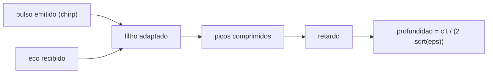

# B53-C24 — Sondeo radar de penetración de hielo

<!-- nav:top -->
[🏠 Programa](../../../../README.md) · [📚 Bloque B53](../../../tronco-comun/B53-astrogeologia-y-geodesia-planetaria.md) · [← Anterior: B53-C23 — Mecánica de hielo: reología, fracturas y deformación](../B53-C23-mecanica-de-hielo-reologia-fracturas-y-deformacion/CLASE.md) · [Siguiente: B53-C25 — Corrección geométrica y ortorrectificación de imágenes planetarias →](../B53-C25-correccion-geometrica-y-ortorrectificacion-de-imagenes-planetarias/CLASE.md)
<!-- /nav -->

## 1. Ubicación, nivel y alcance

Clase 24 del bloque B53. Nivel N3. Un radar sondeador emite un pulso, recibe los ecos de las interfaces internas del hielo y convierte el retardo en profundidad con la velocidad de la onda en el medio. La misión Europa Clipper lleva un radar (REASON) para estudiar la estructura y el espesor del hielo (página de NASA consultada; no da frecuencias). Aquí calculas con parámetros **ilustrativos** la velocidad en el hielo, la profundidad según el retardo, la resolución en rango, y simulas una **compresión de pulso** con un chirp: mides el ancho del eco comprimido y compruebas cuándo se resuelven dos reflectores.

## 2. Por qué esta clase existe

Un eco sin escala de profundidad no dice nada. La decisión central: **¿a qué profundidad está una interfaz según su retardo y qué separación mínima permite distinguir dos interfaces?**

## 3. Lo que podrás hacer al terminar

1. Convertir retardo en profundidad con `ε_r`.
2. Calcular la resolución en rango.
3. Simular un chirp y su compresión con filtro adaptado.
4. Medir el ancho del eco comprimido.
5. Comprobar si se resuelven dos reflectores.
6. Estimar la pérdida de potencia por atenuación.

La evidencia es la **ficha del sondeo de hielo** del ejercicio 12 (sección 20).

## 4. Con qué llegas y cómo comprobarlo

1. ¿Qué es la constante dieléctrica?
2. ¿Qué es un chirp?
3. ¿Qué es un filtro adaptado?
4. ¿Qué es un decibelio?
5. ¿Qué es un valor ilustrativo?

<details>
<summary>Ver respuestas</summary>

1. La razón entre la permitividad del medio y la del vacío. 2. Un pulso cuya frecuencia varía con el tiempo. 3. Una correlación con el pulso emitido. 4. Una escala logarítmica de cocientes de potencia. 5. Uno propuesto para el ejemplo.
</details>

Con cuatro o cinco aciertos, sigue; si no, repasa los prerrequisitos.

## 5. Un caso de contexto y casos de referencia

Con `ε_r = 3,15` (valor de uso común, **no consultado**), la velocidad es `1,689 × 10⁸ m/s`. Un retardo de `2 µs` corresponde a `168,9 m`. Con un ancho de banda de `10 MHz` la resolución en rango es `8,45 m`. La compresión de pulso da un ancho a mitad de potencia de `7,44 m` (teórico `7,48 m`). Dos reflectores separados 2 resoluciones dan `2` picos y separados media resolución, `1`. La pérdida bidireccional en `3 km` es `60 dB` con `10 dB/km` (ilustrativo). Es el **ejemplo conductor**. Todo es **sintético o ilustrativo** y así se rotula.

## 6. Vocabulario

La **profundidad** es `d = c t/(2√ε_r)`. La **resolución en rango** es `c/(2B√ε_r)`. La **compresión de pulso** correlaciona el eco con el pulso emitido. El **ancho a mitad de potencia** de un pulso comprimido sin ventana es `0,886/B` en tiempo.

## 7. Modelo mental

Analogía: un grito en un valle: el tiempo que tarda el eco dice la distancia, y dos peñascos muy próximos suenan como un solo eco.



*Descripción textual:* El eco se correlaciona con el pulso emitido; los picos dan retardos que se convierten en profundidades.

Límite de la analogía: el medio real tiene pérdidas, dispersión y capas rugosas que ensanchan los ecos.

## 8. La explicación, paso a paso

### 8,1 Retardo y profundidad

`v = c/√ε_r = 1,6891 × 10⁸ m/s`, `d = c t/(2√ε_r)`. Para `t = 2 µs`: `d = 168,91 m`.

### 8,2 Resolución

`δ_d = c/(2B√ε_r) = 8,446 m` con `B = 10 MHz`.

### 8,3 Compresión de pulso (chirp)

Chirp lineal de `B = 10 MHz`, duración `10 µs`, muestreo a `100 MHz`. El filtro adaptado da un pico con ancho a mitad de potencia:

| Magnitud | Valor |
|---|---|
| ancho numérico [m] | 7,445 |
| `0,886 c/(2B√ε_r)` [m] | 7,483 |

Con dos reflectores del mismo tamaño:

| Separación | picos hallados |
|---|---|
| 0,5 × resolución | 1 |
| 2 × resolución | 2 |

### 8,4 Atenuación

La pérdida de potencia bidireccional es `2 α d`: con `10 dB/km` y `3 km`, `60 dB`. El eco de una interfaz profunda puede quedar bajo el ruido aunque su retardo sea bien conocido.

## 9. Magnitudes, símbolos y unidades

| Símbolo | Qué es | Unidad | Valor / nota |
|---|---|---|---|
| `ε_r` | constante dieléctrica relativa | — | 3,15 (uso común, no consultado) |
| `B` | ancho de banda | MHz | 10 (ilustrativo) |
| `c` | velocidad de la luz | m/s | 299 792 458 (exacta) |
| `α` | atenuación unidireccional | dB/km | 10 (ilustrativa) |
| `d` | profundidad | m | — |

## 10. Convenciones y referencias

Medio homogéneo y sin dispersión; chirp lineal sin ventana; muestreo a 100 MHz; tolerancia: ancho numérico dentro de 10 % del teórico.

## 11. De dónde sale lo que afirmamos

| ID | Fuente | Localizador | Respalda | Estado |
|---|---|---|---|---|
| S1 | NASA Science, Europa Clipper: instrumentos | https://science.nasa.gov/mission/europa-clipper/spacecraft-instruments/ | contexto: REASON sondea la capa de hielo de Europa para estudiar su estructura y espesor | Página consultada el 2026-11-09 (no da frecuencias) |

Límites: la página no da frecuencias, anchos de banda ni sensibilidades; todos los parámetros del radar son ilustrativos.

## 12. Cómo ver el resultado

| Magnitud | Valor |
|---|---|
| velocidad | 1,689 × 10⁸ m/s |
| profundidad a 2 µs | 168,9 m |
| resolución | 8,45 m |
| ancho numérico | 7,44 m |
| pérdida en 3 km | 60 dB |

Descripción larga: el ancho numérico del pulso comprimido coincide con el teórico y dos reflectores se separan solo si distan más que la resolución.

## 13. Ejemplo trabajado

**Paso 1.** Velocidad: `c/√3,15 = 1,6891 × 10⁸ m/s`.

**Paso 2.** Profundidad: `d = v t/2 = 168,9 m`.

**Paso 3.** Resolución: `8,446 m`.

**Paso 4.** Pérdida: `2 × 10 × 3 = 60 dB`.

## 14. Distintas formas de describirlo

**Por fórmula:** retardo→profundidad. **Por correlación:** compresión. **Por tabla:** resolución. **Por decibelios:** pérdida.

## 15. Práctica guiada

**Ejercicio 1 · con los pasos indicados.** Calcula `v` en el hielo.

<details><summary>Solución comentada</summary>

`1,689 × 10⁸ m/s`.
</details>

**Ejercicio 2 · con una pista.** Calcula `d` para `t = 5 µs`.

<details><summary>Solución comentada</summary>

`422,3 m`.
</details>

**Ejercicio 3 · casi autónomo.** ¿Cómo cambia la resolución si `B` se duplica?

<details><summary>Solución comentada</summary>

Se reduce a la mitad.
</details>

## 16. Práctica autónoma, transferencia e integrador

**Ejercicio 4 · autónomo.** ¿Y si `ε_r` aumenta?

<details><summary>Solución comentada</summary>

La resolución mejora (en metros).
</details>

**Ejercicio 5 · autónomo.** ¿Cuántos picos esperas a 0,5 resoluciones?

<details><summary>Solución comentada</summary>

Uno (no se resuelven).
</details>

**Ejercicio 6 · autónomo.** Calcula la pérdida a 1 km.

<details><summary>Solución comentada</summary>

`20 dB`.
</details>

**Ejercicio 7 · autónomo.** ¿Qué pasa con la profundidad si se supone mal `ε_r`?

<details><summary>Solución comentada</summary>

`d ∝ 1/√ε_r`: un error relativo de `ε_r` se traduce en la mitad en `d`.
</details>

**Ejercicio 8 · autónomo.** ¿Por qué se usa un chirp?

<details><summary>Solución comentada</summary>

Da energía alta con buena resolución tras la compresión.
</details>

**Ejercicio 9 · transferencia.** ¿Qué ve el radar en una capa de agua?

<details><summary>Solución comentada</summary>

Un eco fuerte; aquí no se modela la reflectividad.
</details>

**Ejercicio 10 · transferencia.** ¿Se puede medir el espesor sin conocer `ε_r`?

<details><summary>Solución comentada</summary>

No directamente; se calibra con datos o modelos.
</details>

**Ejercicio 11 · transferencia.** ¿Qué limita la profundidad de sondeo?

<details><summary>Solución comentada</summary>

La atenuación y el ruido.
</details>

**Ejercicio 12 · integrador.** Elabora tu *ficha del sondeo de hielo*: velocidad, profundidad, resolución, compresión y límites.

<details><summary>Solución modelo</summary>

Secciones 8,1 a 8,4.
</details>

## 17. Laboratorio: retardo, resolución y compresión de pulso

El script [radar_hielo.py](radar_hielo.py) simula un chirp de 1000 muestras, lo comprime con filtro adaptado y mide el ancho y la resolución de dos reflectores (**comprueba** ancho dentro de 10 % del teórico).

**Datos:** parámetros **ilustrativos**; sin ruido. **Predice antes de ejecutar:** ¿se resolverán dos reflectores a 0,5 resoluciones? (no). **Ejecución del 2026-11-09 (Python 3,12,9):**

```text
Python 3.12.9 (biblioteca estandar)
v = 1.68914e+08 m/s ; profundidad a 2 us = 168.914 m ; a 5 us = 422.285 m ; resolucion = 8.4457 m
ancho a mitad de potencia: numerico 7.4447 m ; 0.886*res = 7.4829 m
picos a 0.5 resoluciones: 1 ; a 2 resoluciones: 2 ; perdida bidireccional en 3 km = 60 dB
Pruebas superadas.
```

```bash
python programa/clases/B53/B53-C24-sondeo-radar-de-penetracion-de-hielo/radar_hielo.py
```

**Límites:** medio homogéneo sin ruido, atenuación ni dispersión.

## 18. Errores frecuentes y cómo corregirlos

**Confundir retardo con profundidad.** se corrige con 8,1

**Ignorar la resolución.** se corrige con 8,2

**Presentar los parámetros del radar como los de una misión.** se corrige con la sección 11

## 19. Cómo sabrás que vas bien

Tras la sección 8: ¿qué resultado esperabas y cuál obtuviste? Si dudas, repasa el ejemplo de la sección 13. Tras el laboratorio: ¿qué comprueba? (ver la sección 17).

## 20. Qué entregas y cómo se evalúa

El producto es tu **ficha del sondeo de hielo** (ejercicio 12).

| Criterio | Inicial | En desarrollo | Logrado | Destacado |
|---|---|---|---|---|
| Conceptos | Los confunde | Parciales | Conceptos de la clase | Explica los límites |
| Cálculo | Sin unidades | Con errores | Tablas completas | Calcula casos nuevos |
| Numérico | Sin comprobar | Un caso | Contraste con el análisis | Interpreta las diferencias |
| Fuentes | Sin fuente | Sin fecha | Fuentes con fecha | Declara lo sintético |
| Límites | No los nombra | Uno | Tres | Discute qué falta del modelo |

**Condiciones críticas (no se compensan con promedio):** rotular los parámetros como ilustrativos; no atribuir frecuencias a REASON; citar solo lo consultado.

## 21. Ética, seguridad y límites

Clase educativa: los modelos son simplificados y no sustituyen a los productos de una misión ni a la literatura primaria. Ningún dato simulado se presenta como observado. Accesibilidad: tablas equivalentes a las gráficas, fórmulas en texto, ejercicios sin conexión.

## 22. Para cerrar y seguir

La compresión de pulso da un ancho de `7,4 m`, cercano al teórico, y dos reflectores se resuelven a 2 resoluciones. Queda una pregunta: ¿cómo se corrige geométricamente una imagen?

**Glosario español–inglés.** radar sondeador · *sounding radar*; compresión de pulso · *pulse compression*; filtro adaptado · *matched filter*; resolución en rango · *range resolution*.

**Continuidad.** [B53-C25](../B53-C25-correccion-geometrica-y-ortorrectificacion-de-imagenes-planetarias/CLASE.md) estudia la corrección geométrica de imágenes.

**Referencias:** ver sección 11.

<!-- nav:bottom -->
---

[← Anterior: B53-C23 — Mecánica de hielo: reología, fracturas y deformación](../B53-C23-mecanica-de-hielo-reologia-fracturas-y-deformacion/CLASE.md) · [📚 Bloque B53](../../../tronco-comun/B53-astrogeologia-y-geodesia-planetaria.md) · [Siguiente: B53-C25 — Corrección geométrica y ortorrectificación de imágenes planetarias →](../B53-C25-correccion-geometrica-y-ortorrectificacion-de-imagenes-planetarias/CLASE.md)
<!-- /nav -->
