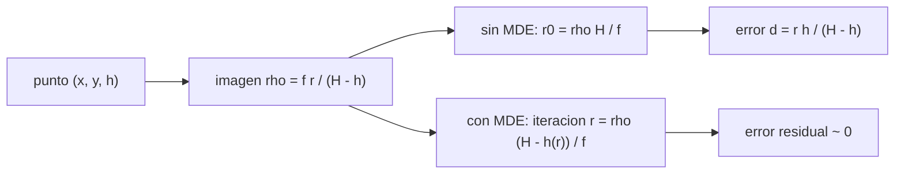

# B53-C25 — Corrección geométrica y ortorrectificación de imágenes planetarias

<!-- nav:top -->
[🏠 Programa](../../../../README.md) · [📚 Bloque B53](../../../tronco-comun/B53-astrogeologia-y-geodesia-planetaria.md) · [← Anterior: B53-C24 — Sondeo radar de penetración de hielo](../B53-C24-sondeo-radar-de-penetracion-de-hielo/CLASE.md) · [Siguiente: B53-C26 — Publicación de mapas geológicos planetarios: estándares y leyendas →](../B53-C26-publicacion-de-mapas-geologicos-planetarios-estandares-y-leyendas/CLASE.md)
<!-- /nav -->

## 1. Ubicación, nivel y alcance

Clase 25 del bloque B53. Nivel N3. En una imagen de cámara de cuadro, un punto elevado sobre el plano de referencia aparece desplazado radialmente respecto del nadir: es el **desplazamiento por relieve**. Aquí simulas una cámara en nadir sobre un terreno **sintético**, proyectas 2000 puntos de la superficie, mides el desplazamiento si se ignora el relieve, lo comparas con la fórmula `r h/(H − h)` y ortorrectificas con el MDE por iteración, comprobando que el error residual queda por debajo de `10⁻⁶ m`. La cámara y el terreno son **ilustrativos**; la corrección real usa modelos de cámara de cada misión (HiRISE y CRISM se mencionan en la página de MRO consultada, sin parámetros).

## 2. Por qué esta clase existe

Una imagen sin ortorrectificar no se superpone con un mapa. La decisión central: **¿cuánto se desplaza cada punto por el relieve y qué MDE y modelo de cámara se necesitan para corregirlo?**

## 3. Lo que podrás hacer al terminar

1. Proyectar un punto 3D con un modelo de cámara de agujero.
2. Calcular el desplazamiento por relieve.
3. Compararlo con la fórmula `r h/(H − h)`.
4. Ortorrectificar por iteración con un MDE.
5. Calcular el tamaño de píxel sobre el terreno (GSD).
6. Evaluar el efecto de un error del MDE.

La evidencia es la **ficha de la ortorrectificación** del ejercicio 12 (sección 20).

## 4. Con qué llegas y cómo comprobarlo

1. ¿Qué es un modelo de agujero?
2. ¿Qué es un nadir?
3. ¿Qué es un MDE?
4. ¿Qué es una iteración de punto fijo?
5. ¿Qué es un valor ilustrativo?

<details>
<summary>Ver respuestas</summary>

1. Una cámara ideal con proyección central. 2. El punto bajo la cámara. 3. Una malla de alturas. 4. Repetir una fórmula hasta que el valor no cambie. 5. Uno propuesto para el ejemplo.
</details>

Con cuatro o cinco aciertos, sigue; si no, repasa los prerrequisitos.

## 5. Un caso de contexto y casos de referencia

Una cámara a `H = 250 km` sobre el plano de referencia, con focal `f = 0,5 m` y píxel de `10 µm` (GSD `5,0 m`). El desplazamiento máximo por relieve en 2000 puntos con alturas de 0 a `3 km` y radios hasta `15 km` es `178,6 m`, y la fórmula da `178,6 m`. Tras ortorrectificar, el error máximo es `7,3 × 10⁻¹¹ m`. Un error de `100 m` en el MDE produce un error horizontal de hasta `6,5 m`. Es el **ejemplo conductor**. Todo es **sintético o ilustrativo** y así se rotula.

## 6. Vocabulario

El **desplazamiento por relieve** es `d = r h/(H − h)`. La **ortorrectificación** reubica cada píxel con la altura del MDE. El **GSD** es el tamaño de píxel proyectado `H p/f`. Una **iteración de punto fijo** actualiza `r` con el `h` de la posición anterior.

## 7. Modelo mental

Analogía: una foto de un edificio alto tomada desde arriba: la azotea parece desplazarse hacia fuera del centro; al corregirla con su altura, vuelve a su sitio.



*Descripción textual:* Un punto elevado se proyecta más lejos del centro de la imagen; sin MDE queda desplazado, con MDE se recupera su posición.

Límite de la analogía: las cámaras reales tienen distorsión, actitud y órbita inciertas, y barren la escena (pushbroom).

## 8. La explicación, paso a paso

### 8,1 Proyección y desplazamiento

Un punto a distancia horizontal `r` del nadir y altura `h` se proyecta a `ρ = f r/(H − h)`. Si se supone `h = 0`, se reconstruye `r₀ = ρ H/f = r H/(H − h)`, con error `d = r h/(H − h)`.

| Magnitud | Valor |
|---|---|
| GSD `H p/f` [m] | 5,00 |
| desplazamiento máximo simulado [m] | 178,65 |
| fórmula, máximo [m] | 178,65 |
| desplazamiento medio [m] | 60,92 |

### 8,2 Ortorrectificación

La iteración `r(k+1) = ρ (H − h(r(k)))/f` converge en pocas pasadas.

| Magnitud | Valor |
|---|---|
| error máximo tras ortorrectificar [m] | 7,34 × 10⁻¹¹ |
| iteraciones máximas | 12 |

### 8,3 Error del MDE

Si el MDE se desvía `δh = 100 m`, el punto se coloca con un error `≈ r δh/(H − h)`: máximo `6,54 m`.

### 8,4 Lectura

El relieve de 3 km produce desplazamientos de varias decenas de píxeles; sin MDE, la imagen no se alinea con un mapa. La calidad del producto está acotada por la del MDE y por el modelo de cámara.

## 9. Magnitudes, símbolos y unidades

| Símbolo | Qué es | Unidad | Valor / nota |
|---|---|---|---|
| `H` | altura de la cámara | km | 250 (ilustrativa) |
| `f` | distancia focal | m | 0,5 (ilustrativa) |
| `p` | tamaño de píxel | µm | 10 (ilustrativo) |
| `h` | altura del terreno | m | 0 a 3000 (sintética) |
| `d` | desplazamiento por relieve | m | 178,6 |

## 10. Convenciones y referencias

Cámara de cuadro en nadir sobre un plano de referencia; sin distorsión; terreno sintético `h = 1500 + 1500 sin(2πx/8000) cos(2πy/6000)`; semilla `20261109`; iteración con tolerancia 10⁻⁹ m.

## 11. De dónde sale lo que afirmamos

| ID | Fuente | Localizador | Respalda | Estado |
|---|---|---|---|---|
| S1 | NASA Science, Mars Reconnaissance Orbiter | https://science.nasa.gov/mission/mars-reconnaissance-orbiter/ | contexto: se mencionan HiRISE y un espectrómetro de imágenes; la página no da parámetros de cámara | Página consultada el 2026-11-09 (SHARAD no aparece) |

Límites: no se consultó ningún modelo de cámara de una misión; todos los parámetros son ilustrativos.

## 12. Cómo ver el resultado

| Magnitud | Valor |
|---|---|
| GSD | 5,0 m |
| desplazamiento máximo | 178,6 m |
| fórmula | 178,6 m |
| error tras ortorrectificar | 7,3 × 10⁻¹¹ m |
| error por MDE de 100 m | 6,5 m |

Descripción larga: el desplazamiento simulado coincide con la fórmula y la ortorrectificación lo elimina.

## 13. Ejemplo trabajado

**Paso 1.** Datos: `r = 15 km`, `h = 3 km`, `H = 250 km`.

**Paso 2.** Desplazamiento: `d = 15000·3000/(250000 − 3000) = 182,2 m`.

**Paso 3.** GSD: `250000·10⁻⁵/0,5 = 5,0 m`.

**Paso 4.** Ortorrectificación: error residual `7,3 × 10⁻¹¹ m`.

## 14. Distintas formas de describirlo

**Por fórmula:** `d = r h/(H − h)`. **Por simulación:** 2000 puntos. **Por iteración:** ortorrectificación. **Por tabla:** errores.

## 15. Práctica guiada

**Ejercicio 1 · con los pasos indicados.** Calcula el GSD.

<details><summary>Solución comentada</summary>

`5,0 m`.
</details>

**Ejercicio 2 · con una pista.** Calcula `d` para `r = 10 km` y `h = 1 km`.

<details><summary>Solución comentada</summary>

`40,2 m`.
</details>

**Ejercicio 3 · casi autónomo.** ¿Dónde es nulo el desplazamiento?

<details><summary>Solución comentada</summary>

En el nadir (`r = 0`) y en `h = 0`.
</details>

## 16. Práctica autónoma, transferencia e integrador

**Ejercicio 4 · autónomo.** ¿Cuántos píxeles de desplazamiento hay en `179 m`?

<details><summary>Solución comentada</summary>

`35,7`.
</details>

**Ejercicio 5 · autónomo.** ¿Cómo cambia `d` si `H` se duplica?

<details><summary>Solución comentada</summary>

Casi se reduce a la mitad.
</details>

**Ejercicio 6 · autónomo.** ¿Y si el relieve se duplica?

<details><summary>Solución comentada</summary>

Se duplica aproximadamente.
</details>

**Ejercicio 7 · autónomo.** ¿Qué pasa si el MDE tiene un sesgo de 50 m?

<details><summary>Solución comentada</summary>

El error horizontal máximo es `3,3 m`.
</details>

**Ejercicio 8 · autónomo.** ¿Por qué la iteración converge?

<details><summary>Solución comentada</summary>

Porque `h` varía poco con `r` respecto de `H`.
</details>

**Ejercicio 9 · transferencia.** Una cámara de barrido tiene una actitud variable. ¿Qué cambia?

<details><summary>Solución comentada</summary>

El modelo debe ajustarse por línea.
</details>

**Ejercicio 10 · transferencia.** ¿Por qué se necesitan puntos de control?

<details><summary>Solución comentada</summary>

Para corregir la órbita y la actitud.
</details>

**Ejercicio 11 · transferencia.** ¿Qué entregarías con la imagen?

<details><summary>Solución comentada</summary>

El MDE, el modelo de cámara y la incertidumbre (clases 19 y 26).
</details>

**Ejercicio 12 · integrador.** Elabora tu *ficha de la ortorrectificación*: modelo, desplazamiento, corrección, error del MDE y límites.

<details><summary>Solución modelo</summary>

Secciones 8,1 a 8,4.
</details>

## 17. Laboratorio: desplazamiento por relieve y ortorrectificación con un MDE

El script [ortorrectificacion.py](ortorrectificacion.py) proyecta 2000 puntos, mide el desplazamiento y ortorrectifica con iteración (**comprueba** error residual < 10⁻⁶ m y desplazamiento dentro de 10⁻⁹ de la fórmula).

**Datos:** cámara y terreno **ilustrativos**; semilla `20261109`. **Predice antes de ejecutar:** ¿qué error residual esperas tras la iteración? (casi cero). **Ejecución del 2026-11-09 (Python 3,12,9):**

```text
Python 3.12.9 (biblioteca estandar)
GSD = 5.000 m ; desplazamiento por relieve: maximo 178.650 m ; medio 60.924 m ; formula (max de r h/(H-h)) 178.650 m
ortorrectificacion: error maximo 7.34e-11 m en <= 12 iteraciones
con sesgo de 100 m en el MDE: error horizontal maximo 6.537 m
Pruebas superadas.
```

```bash
python programa/clases/B53/B53-C25-correccion-geometrica-y-ortorrectificacion-de-imagenes-planetarias/ortorrectificacion.py
```

**Límites:** cámara de cuadro, sin distorsión, sin errores de órbita ni de actitud.

## 18. Errores frecuentes y cómo corregirlos

**Ignorar el relieve.** se corrige con 8,1

**Suponer que el MDE es perfecto.** se corrige con 8,3

**Presentar la cámara como la de una misión.** se corrige con la sección 11

## 19. Cómo sabrás que vas bien

Tras la sección 8: ¿qué resultado esperabas y cuál obtuviste? Si dudas, repasa el ejemplo de la sección 13. Tras el laboratorio: ¿qué comprueba? (ver la sección 17).

## 20. Qué entregas y cómo se evalúa

El producto es tu **ficha de la ortorrectificación** (ejercicio 12).

| Criterio | Inicial | En desarrollo | Logrado | Destacado |
|---|---|---|---|---|
| Conceptos | Los confunde | Parciales | Conceptos de la clase | Explica los límites |
| Cálculo | Sin unidades | Con errores | Tablas completas | Calcula casos nuevos |
| Numérico | Sin comprobar | Un caso | Contraste con el análisis | Interpreta las diferencias |
| Fuentes | Sin fuente | Sin fecha | Fuentes con fecha | Declara lo sintético |
| Límites | No los nombra | Uno | Tres | Discute qué falta del modelo |

**Condiciones críticas (no se compensan con promedio):** rotular la cámara y el terreno como ilustrativos; declarar el MDE usado; citar solo lo consultado.

## 21. Ética, seguridad y límites

Clase educativa: los modelos son simplificados y no sustituyen a los productos de una misión ni a la literatura primaria. Ningún dato simulado se presenta como observado. Accesibilidad: tablas equivalentes a las gráficas, fórmulas en texto, ejercicios sin conexión.

## 22. Para cerrar y seguir

El desplazamiento por relieve llega a `179 m` y la ortorrectificación lo reduce a `7 × 10⁻¹¹ m`. Queda una pregunta: ¿cómo se publica un mapa con sus metadatos?

**Glosario español–inglés.** ortorrectificación · *orthorectification*; desplazamiento por relieve · *relief displacement*; GSD · *ground sample distance*.

**Continuidad.** [B53-C26](../B53-C26-publicacion-de-mapas-geologicos-planetarios-estandares-y-leyendas/CLASE.md) estudia la publicación de mapas geológicos.

**Referencias:** ver sección 11.

<!-- nav:bottom -->
---

[← Anterior: B53-C24 — Sondeo radar de penetración de hielo](../B53-C24-sondeo-radar-de-penetracion-de-hielo/CLASE.md) · [📚 Bloque B53](../../../tronco-comun/B53-astrogeologia-y-geodesia-planetaria.md) · [Siguiente: B53-C26 — Publicación de mapas geológicos planetarios: estándares y leyendas →](../B53-C26-publicacion-de-mapas-geologicos-planetarios-estandares-y-leyendas/CLASE.md)
<!-- /nav -->
