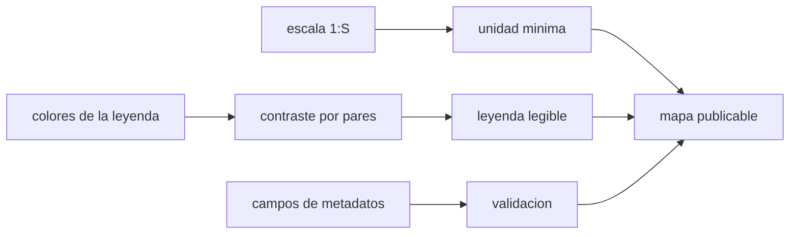

# B53-C26 — Publicación de mapas geológicos planetarios: estándares y leyendas

<!-- nav:top -->
[🏠 Programa](../../../../README.md) · [📚 Bloque B53](../../../tronco-comun/B53-astrogeologia-y-geodesia-planetaria.md) · [← Anterior: B53-C25 — Corrección geométrica y ortorrectificación de imágenes planetarias](../B53-C25-correccion-geometrica-y-ortorrectificacion-de-imagenes-planetarias/CLASE.md) · [Siguiente: B53-C27 — Detección remota de océanos subsuperficiales: inducción magnética, libración y radar →](../B53-C27-deteccion-remota-de-oceanos-subsuperficiales-induccion-magnetica-libracion-y-radar/CLASE.md)
<!-- /nav -->

## 1. Ubicación, nivel y alcance

Clase 26 del bloque B53. Nivel N3. Publicar un mapa es decidir qué escala, qué unidad mínima cartografiable, qué colores y qué metadatos acompañan al producto. Aquí calculas, con convenciones **ilustrativas**, la unidad mínima cartografiable de una escala, el tamaño de píxel de impresión, el **contraste** de los colores de una leyenda con la fórmula de contraste de la guía WCAG (de uso común, **no consultada**), detectas pares indistinguibles y validas que un registro de metadatos tenga los campos mínimos y los declare. El centro de Astrogeología del USGS publica mapas geológicos planetarios (página consultada, que no menciona estándares de forma explícita); aquí no se aplica ninguna norma oficial.

## 2. Por qué esta clase existe

Un mapa excelente mal publicado no se puede reutilizar. La decisión central: **¿qué escala justifica el detalle mostrado, qué leyenda es legible y qué metadatos hacen el mapa reproducible?**

## 3. Lo que podrás hacer al terminar

1. Relacionar escala, resolución y unidad mínima cartografiable.
2. Calcular el contraste de colores de una leyenda.
3. Detectar pares de colores indistinguibles.
4. Validar un registro de metadatos.
5. Declarar marco, proyección, incertidumbre y fuente.
6. Explicar por qué la leyenda no debe depender solo del color.

La evidencia es la **ficha de publicación del mapa** del ejercicio 12 (sección 20).

## 4. Con qué llegas y cómo comprobarlo

1. ¿Qué es una escala 1:1 000 000?
2. ¿Qué es una leyenda?
3. ¿Qué son los metadatos?
4. ¿Qué es el contraste de color?
5. ¿Qué es una convención ilustrativa?

<details>
<summary>Ver respuestas</summary>

1. 1 mm del mapa son 1000 m del terreno. 2. La explicación de los símbolos y colores del mapa. 3. Datos que describen otros datos. 4. La diferencia de luminosidad entre dos colores. 5. Una regla propuesta para el ejemplo, no una norma.
</details>

Con cuatro o cinco aciertos, sigue; si no, repasa los prerrequisitos.

## 5. Un caso de contexto y casos de referencia

A escala `1:1 000 000`, con una convención ilustrativa de `0,5 mm` de ancho mínimo, la unidad mínima cartografiable es `500 m` (área `1,00 km²`). Impreso a `300 ppp`, un píxel mide `84,7 m` en el terreno. De los `15` pares de colores de la leyenda, `10` quedan por debajo de contraste `1,5:1`. El registro de metadatos incompleto pierde `3` campos. Es el **ejemplo conductor**. Todo es **sintético o ilustrativo** y así se rotula.

## 6. Vocabulario

La **escala** `1:S` convierte longitudes del mapa en longitudes del terreno. La **unidad mínima cartografiable** es el menor elemento representable. El **contraste** WCAG es `(L₁ + 0,05)/(L₂ + 0,05)` con `L` la luminancia relativa. Los **metadatos** declaran fuente, marco, proyección e incertidumbre.

## 7. Modelo mental

Analogía: el pie de foto de una fotografía histórica: sin fecha, lugar y autor, la imagen pierde valor como evidencia.



*Descripción textual:* La escala fija el detalle; el contraste valida la leyenda; la validación comprueba los metadatos; juntos hacen el mapa publicable.

Límite de la analogía: los estándares oficiales de cartografía planetaria tienen requisitos propios que este laboratorio no reproduce.

## 8. La explicación, paso a paso

### 8,1 Escala

`d_terreno = d_mapa × S`. Con `S = 10⁶`:

| Magnitud | Valor |
|---|---|
| ancho mínimo en el mapa [mm] | 0,5 |
| unidad mínima cartografiable [m] | 500,0 |
| área mínima (cuadrado de 2 × ancho) [km²] | 1,00 |
| píxel a 300 ppp en el terreno [m] | 84,67 |

### 8,2 Contraste de la leyenda

Luminancia relativa `L = 0,2126 R + 0,7152 G + 0,0722 B` con canales linealizados. Para seis colores **sintéticos**:

| Par | contraste |
|---|---|
| más bajo | 1,01 |
| más alto | 1,91 |
| pares bajo 1,5 | 10 de 15 |

Los pares con bajo contraste necesitan una trama o una etiqueta además del color.

### 8,3 Metadatos

Campos mínimos de la convención ilustrativa: fuente, marco_de_referencia, proyeccion, escala, incertidumbre, fecha, licencia. En el registro de ejemplo faltan: incertidumbre, fecha, licencia.

### 8,4 Lectura

Un mapa sin escala, proyección, fuente e incertidumbre no es reproducible; un color no basta para distinguir unidades.

## 9. Magnitudes, símbolos y unidades

| Símbolo | Qué es | Unidad | Valor / nota |
|---|---|---|---|
| `S` | denominador de la escala | — | 10⁶ (ilustrativo) |
| ancho mínimo | convención | mm | 0,5 (ilustrativa) |
| resolución | impresión | ppp | 300 |
| `L` | luminancia relativa | — | 0 a 1 |
| contraste | razón WCAG | — | 1 a 21 |

## 10. Convenciones y referencias

Convenciones ilustrativas; colores sintéticos en sRGB; fórmula WCAG de uso común no consultada; tolerancia: contraste blanco/negro igual a 21,0 dentro de 10⁻⁹.

## 11. De dónde sale lo que afirmamos

| ID | Fuente | Localizador | Respalda | Estado |
|---|---|---|---|---|
| S1 | USGS Astrogeology Science Center, página institucional | https://www.usgs.gov/centers/astrogeology-science-center | contexto: el centro publica mapas geológicos planetarios | Página consultada el 2026-11-09 (no menciona estándares de forma explícita) |

Límites: la página no menciona estándares de forma explícita; ni los anchos mínimos ni el umbral de contraste proceden de una norma consultada.

## 12. Cómo ver el resultado

| Magnitud | Valor |
|---|---|
| unidad mínima | 500 m |
| píxel a 300 ppp | 84,7 m |
| contraste mínimo | 1,01 |
| pares bajos | 10 de 15 |
| campos faltantes | 3 |

Descripción larga: la escala acota el detalle mostrable y la leyenda requiere un apoyo además del color.

## 13. Ejemplo trabajado

**Paso 1.** Escala: `0,5 mm × 10⁶ = 500 m`.

**Paso 2.** Píxel: `0,0254/300 × 10⁶ = 84,7 m`.

**Paso 3.** Contraste: blanco/negro `21`.

**Paso 4.** Metadatos: faltan 3 campos.

## 14. Distintas formas de describirlo

**Por fórmula:** escala. **Por tabla:** contrastes. **Por validación:** campos. **Por regla:** apoyo no cromático.

## 15. Práctica guiada

**Ejercicio 1 · con los pasos indicados.** Calcula la unidad mínima a 1:250 000 con 0,5 mm.

<details><summary>Solución comentada</summary>

`125 m`.
</details>

**Ejercicio 2 · con una pista.** ¿Cuánto mide un píxel a 300 ppp en papel?

<details><summary>Solución comentada</summary>

`0,0847 mm`.
</details>

**Ejercicio 3 · casi autónomo.** ¿Cuál es el contraste blanco/negro?

<details><summary>Solución comentada</summary>

`21`.
</details>

## 16. Práctica autónoma, transferencia e integrador

**Ejercicio 4 · autónomo.** ¿Y blanco/blanco?

<details><summary>Solución comentada</summary>

`1`.
</details>

**Ejercicio 5 · autónomo.** ¿Qué pasa con la unidad mínima si la escala pasa a 1:500 000?

<details><summary>Solución comentada</summary>

Se reduce a la mitad.
</details>

**Ejercicio 6 · autónomo.** ¿Por qué no depender solo del color?

<details><summary>Solución comentada</summary>

Por daltonismo y por impresión en blanco y negro.
</details>

**Ejercicio 7 · autónomo.** ¿Qué campos de metadatos son críticos?

<details><summary>Solución comentada</summary>

Fuente, marco, proyección, escala e incertidumbre.
</details>

**Ejercicio 8 · autónomo.** Un mapa publica áreas sin proyección. ¿Qué dices?

<details><summary>Solución comentada</summary>

Que las áreas no son reproducibles (clase 18).
</details>

**Ejercicio 9 · transferencia.** ¿Qué incertidumbre se declara?

<details><summary>Solución comentada</summary>

La posicional y la temática (clase 19).
</details>

**Ejercicio 10 · transferencia.** ¿Qué pasa si la leyenda tiene 20 unidades?

<details><summary>Solución comentada</summary>

El color no basta; se agregan tramas y códigos.
</details>

**Ejercicio 11 · transferencia.** ¿Qué licencia pondrías?

<details><summary>Solución comentada</summary>

La que corresponda a los datos de origen; aquí no se decide.
</details>

**Ejercicio 12 · integrador.** Elabora tu *ficha de publicación del mapa*: escala, unidad mínima, contraste, metadatos y límites.

<details><summary>Solución modelo</summary>

Secciones 8,1 a 8,4.
</details>

## 17. Laboratorio: escala, contraste de leyenda y metadatos

El script [publicacion.py](publicacion.py) calcula la unidad mínima, el contraste de seis colores sintéticos y valida un registro de metadatos (**comprueba** contraste blanco/negro igual a 21).

**Datos:** convenciones y colores **sintéticos**. **Predice antes de ejecutar:** ¿cuántos campos faltarán en el registro de ejemplo? (los omitidos a propósito: 3). **Ejecución del 2026-11-09 (Python 3,12,9):**

```text
Python 3.12.9 (biblioteca estandar)
escala 1:1000000: unidad minima = 500.0 m ; area minima = 1.000 km2 ; pixel a 300 ppp = 84.67 m
contraste blanco/negro = 21.000000 ; leyenda: minimo 1.007, maximo 1.907, pares < 1.5: 10 de 15
metadatos: campos minimos = fuente, marco_de_referencia, proyeccion, escala, incertidumbre, fecha, licencia
faltan en el registro de ejemplo (3): incertidumbre, fecha, licencia
{"validacion": "incompleto"}
Pruebas superadas.
```

```bash
python programa/clases/B53/B53-C26-publicacion-de-mapas-geologicos-planetarios-estandares-y-leyendas/publicacion.py
```

**Límites:** no aplica ninguna norma oficial; los colores son inventados.

## 18. Errores frecuentes y cómo corregirlos

**Dar un detalle que la escala no sostiene.** se corrige con 8,1

**Depender solo del color.** se corrige con 8,2

**Omitir los metadatos.** se corrige con 8,3

## 19. Cómo sabrás que vas bien

Tras la sección 8: ¿qué resultado esperabas y cuál obtuviste? Si dudas, repasa el ejemplo de la sección 13. Tras el laboratorio: ¿qué comprueba? (ver la sección 17).

## 20. Qué entregas y cómo se evalúa

El producto es tu **ficha de publicación del mapa** (ejercicio 12).

| Criterio | Inicial | En desarrollo | Logrado | Destacado |
|---|---|---|---|---|
| Conceptos | Los confunde | Parciales | Conceptos de la clase | Explica los límites |
| Cálculo | Sin unidades | Con errores | Tablas completas | Calcula casos nuevos |
| Numérico | Sin comprobar | Un caso | Contraste con el análisis | Interpreta las diferencias |
| Fuentes | Sin fuente | Sin fecha | Fuentes con fecha | Declara lo sintético |
| Límites | No los nombra | Uno | Tres | Discute qué falta del modelo |

**Condiciones críticas (no se compensan con promedio):** declarar escala, marco, proyección e incertidumbre; rotular las convenciones como ilustrativas; citar solo lo consultado.

## 21. Ética, seguridad y límites

Clase educativa: los modelos son simplificados y no sustituyen a los productos de una misión ni a la literatura primaria. Ningún dato simulado se presenta como observado. Accesibilidad: tablas equivalentes a las gráficas, fórmulas en texto, ejercicios sin conexión.

## 22. Para cerrar y seguir

La unidad mínima es `500 m` y `10` de `15` pares de la leyenda necesitan apoyo no cromático. Queda una pregunta: ¿cómo se detecta un océano bajo el hielo?

**Glosario español–inglés.** unidad mínima cartografiable · *minimum mapping unit*; leyenda · *legend*; metadatos · *metadata*; contraste · *contrast ratio*.

**Continuidad.** [B53-C27](../B53-C27-deteccion-remota-de-oceanos-subsuperficiales-induccion-magnetica-libracion-y-radar/CLASE.md) estudia la detección de océanos subsuperficiales.

**Referencias:** ver sección 11.

<!-- nav:bottom -->
---

[← Anterior: B53-C25 — Corrección geométrica y ortorrectificación de imágenes planetarias](../B53-C25-correccion-geometrica-y-ortorrectificacion-de-imagenes-planetarias/CLASE.md) · [📚 Bloque B53](../../../tronco-comun/B53-astrogeologia-y-geodesia-planetaria.md) · [Siguiente: B53-C27 — Detección remota de océanos subsuperficiales: inducción magnética, libración y radar →](../B53-C27-deteccion-remota-de-oceanos-subsuperficiales-induccion-magnetica-libracion-y-radar/CLASE.md)
<!-- /nav -->
