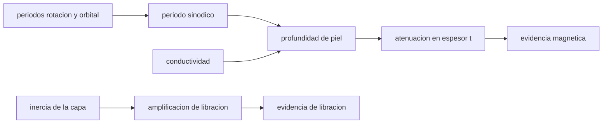

# B53-C27 — Detección remota de océanos subsuperficiales: inducción magnética, libración y radar

<!-- nav:top -->
[🏠 Programa](../../../../README.md) · [📚 Bloque B53](../../../tronco-comun/B53-astrogeologia-y-geodesia-planetaria.md) · [← Anterior: B53-C26 — Publicación de mapas geológicos planetarios: estándares y leyendas](../B53-C26-publicacion-de-mapas-geologicos-planetarios-estandares-y-leyendas/CLASE.md) · [Siguiente: B53-C28 — Inversión gravimétrica y modelos de densidad →](../../../tronco-comun/B53-astrogeologia-y-geodesia-planetaria.md#b53-c28)
<!-- /nav -->

## 1. Ubicación, nivel y alcance

Clase 27 del bloque B53. Nivel N3. Un océano de agua salada bajo una capa de hielo se puede delatar por tres vías: la **inducción magnética** (el agua salada conductora reacciona a un campo variable), la **libración** (una capa de hielo desacoplada del interior oscila con más amplitud) y el **radar** (clase 24). Europa Clipper lleva un magnetómetro para confirmar el océano y medir su profundidad y salinidad (página de NASA consultada), y para Encélado la página de Cassini cita mediciones gravitatorias y de bamboleo orbital que indican un océano global; aquí no se usan esos datos. Calculas con parámetros **ilustrativos** la profundidad de piel de un conductor, la atenuación de un campo a través de él y la amplificación de la libración de una capa desacoplada.

## 2. Por qué esta clase existe

Cada método ve algo distinto y ninguno basta solo. La decisión central: **¿qué señal esperaría un océano de cierta conductividad y espesor y cuánto se distingue de un cuerpo sólido?**

## 3. Lo que podrás hacer al terminar

1. Calcular el período de excitación (sinódico).
2. Calcular la profundidad de piel de un océano.
3. Calcular la atenuación del campo a través de una capa.
4. Calcular la amplificación de la libración de una capa desacoplada.
5. Verificar el momento de inercia de la capa por integración.
6. Combinar métodos y declarar sus límites.

La evidencia es la **ficha de la evidencia de un océano** del ejercicio 12 (sección 20).

## 4. Con qué llegas y cómo comprobarlo

1. ¿Qué es la inducción electromagnética?
2. ¿Qué es la conductividad?
3. ¿Qué es la libración?
4. ¿Qué es el período sinódico?
5. ¿Qué es un valor ilustrativo?

<details>
<summary>Ver respuestas</summary>

1. La corriente generada por un campo magnético variable. 2. La facilidad con que un material conduce corriente. 3. Una oscilación de la orientación en torno a la rotación media. 4. El intervalo entre configuraciones relativas repetidas. 5. Uno propuesto para el ejemplo.
</details>

Con cuatro o cinco aciertos, sigue; si no, repasa los prerrequisitos.

## 5. Un caso de contexto y casos de referencia

Con un período sinódico de `11,23 h` (de períodos de rotación y orbital de uso común, **no consultados**) y `σ = 2,5 S/m` (ilustrativa), la profundidad de piel es `64,0 km`. Un océano de `100 km` atenúa un campo por `0,210` (amplitud). Una capa de hielo de `100 km` en un cuerpo de `1560 km` (ilustrativos) tiene una fracción de inercia de `0,2820` y se amplifica la libración `3,55` veces si se desacopla. Es el **ejemplo conductor**. Todo es **sintético o ilustrativo** y así se rotula.

## 6. Vocabulario

La **profundidad de piel** es `δ = √(2/(μ₀ σ ω))`. La **atenuación** de una onda plana en un espesor `t` es `e^(−t/δ)`. La **amplificación de libración** es `C_total/C_capa`. El **período sinódico** es `1/|1/P_rot − 1/P_orb|`.

## 7. Modelo mental

Analogía: una campana de pared: si la cáscara está pegada, oscila poco; si flota sobre un líquido, oscila mucho más con el mismo golpe.



*Descripción textual:* El período de excitación y la conductividad dan la profundidad de piel y la atenuación; la inercia de la capa da la amplificación de la libración; ambas son evidencia independiente.

Límite de la analogía: la inducción real depende de la geometría y de la excitación completa; la libración depende de acoplamientos que aquí no se modelan.

## 8. La explicación, paso a paso

### 8,1 Período y profundidad de piel

`T_syn = 1/|1/9,925 h − 1/85,228 h| = 11,233 h`, `ω = 2π/T_syn = 1,5537 × 10⁻⁴ rad/s`. Con `μ₀ = 4π × 10⁻⁷ N/A²` (uso común):

| Magnitud | Valor |
|---|---|
| `δ` [km] | 64,01 |

### 8,2 Atenuación

| espesor `t` [km] | amplitud `e^(−t/δ)` |
|---|---|
| 1 | 0,9845 |
| 10 | 0,8554 |
| 100 | 0,2097 |

### 8,3 Libración

Para un cuerpo uniforme de radio `R = 1560 km`, una capa exterior de espesor `t = 100 km` tiene `C_capa/C = 1 − (1 − t/R)⁵`.

| Magnitud | Valor |
|---|---|
| fracción numérica (Simpson) | 0,28197 |
| fracción analítica | 0,28197 |
| amplificación `C/C_capa` | 3,546 |

### 8,4 Lectura

Una amplificación de libración por encima de 1 apunta a desacoplamiento, pero depende de la inercia asumida; la inducción magnética necesita que el océano sea más grueso que `δ` para dar señal clara. Se requieren varias evidencias.

## 9. Magnitudes, símbolos y unidades

| Símbolo | Qué es | Unidad | Valor / nota |
|---|---|---|---|
| `σ` | conductividad | S/m | 2,5 (ilustrativa) |
| `T_syn` | período sinódico | h | 11,23 |
| `δ` | profundidad de piel | km | 64,0 |
| `R`, `t` | radio y espesor de la capa | km | 1560; 100 (ilustrativos) |
| `μ₀` | permeabilidad del vacío | N/A² | 4π × 10⁻⁷ (uso común) |

## 10. Convenciones y referencias

Onda plana en medio conductor homogéneo; cuerpo de densidad uniforme; períodos 9,925 h y 85,228 h de uso común no consultados; Simpson con 2000 intervalos; tolerancia: fracción de inercia 10⁻⁹ relativa.

## 11. De dónde sale lo que afirmamos

| ID | Fuente | Localizador | Respalda | Estado |
|---|---|---|---|---|
| S1 | NASA Science, Europa Clipper: instrumentos | https://science.nasa.gov/mission/europa-clipper/spacecraft-instruments/ | contexto: el magnetómetro ECM busca confirmar el océano y medir su profundidad y salinidad | Página consultada el 2026-11-09 (no da frecuencias) |
| S2 | NASA Science, Cassini: Enceladus | https://science.nasa.gov/mission/cassini/science/enceladus/ | contexto: mediciones gravitatorias y de bamboleo orbital indican un océano global | Página consultada el 2026-11-09 |

Límites: las páginas no dan conductividades, períodos ni amplitudes; todos los valores numéricos son ilustrativos o de uso común no consultados.

## 12. Cómo ver el resultado

| Magnitud | Valor |
|---|---|
| período sinódico | 11,23 h |
| profundidad de piel | 64,0 km |
| atenuación a 100 km | 0,210 |
| fracción de inercia | 0,2820 |
| amplificación | 3,55 |

Descripción larga: un océano de espesor comparable a la profundidad de piel atenúa el campo y una capa desacoplada libra varias veces más.

## 13. Ejemplo trabajado

**Paso 1.** Período: `11,233 h`, `ω = 1,554 × 10⁻⁴ rad/s`.

**Paso 2.** Piel: `δ = √(2/(μ₀ σ ω)) = 64,0 km`.

**Paso 3.** Atenuación: `e^(−100/δ) = 0,210`.

**Paso 4.** Libración: `C/C_capa = 3,546`.

## 14. Distintas formas de describirlo

**Por fórmula:** `δ`. **Por exponencial:** atenuación. **Por integral:** inercia de la capa. **Por razón:** amplificación.

## 15. Práctica guiada

**Ejercicio 1 · con los pasos indicados.** Calcula el período sinódico.

<details><summary>Solución comentada</summary>

`11,233 h`.
</details>

**Ejercicio 2 · con una pista.** Calcula `δ`.

<details><summary>Solución comentada</summary>

`64,0 km`.
</details>

**Ejercicio 3 · casi autónomo.** ¿Qué pasa con `δ` si `σ` se cuadruplica?

<details><summary>Solución comentada</summary>

Se reduce a la mitad.
</details>

## 16. Práctica autónoma, transferencia e integrador

**Ejercicio 4 · autónomo.** ¿Qué atenuación da `t = δ`?

<details><summary>Solución comentada</summary>

`e⁻¹ = 0,368`.
</details>

**Ejercicio 5 · autónomo.** Calcula la fracción de inercia para `t = 50 km`.

<details><summary>Solución comentada</summary>

`0,1503`.
</details>

**Ejercicio 6 · autónomo.** ¿Qué amplificación resulta?

<details><summary>Solución comentada</summary>

`6,65`.
</details>

**Ejercicio 7 · autónomo.** ¿Qué método es más sensible a una capa delgada de hielo?

<details><summary>Solución comentada</summary>

La libración, por la inercia pequeña de la capa.
</details>

**Ejercicio 8 · autónomo.** ¿Y a un océano muy conductor?

<details><summary>Solución comentada</summary>

La inducción.
</details>

**Ejercicio 9 · transferencia.** Se mide una libración 1,1 veces la rígida. ¿Qué dices?

<details><summary>Solución comentada</summary>

Que no hay evidencia clara de desacoplamiento; hay incertidumbre.
</details>

**Ejercicio 10 · transferencia.** ¿Por qué combinar métodos?

<details><summary>Solución comentada</summary>

Porque cada uno tiene ambigüedades distintas.
</details>

**Ejercicio 11 · transferencia.** ¿Qué asume la onda plana?

<details><summary>Solución comentada</summary>

Un campo uniforme y un medio homogéneo.
</details>

**Ejercicio 12 · integrador.** Elabora tu *ficha de la evidencia de un océano*: período, `δ`, atenuación, libración y límites.

<details><summary>Solución modelo</summary>

Secciones 8,1 a 8,4.
</details>

## 17. Laboratorio: profundidad de piel, inercia de la capa y libración

El script [oceano.py](oceano.py) calcula la profundidad de piel, la atenuación y la inercia de la capa por Simpson (**comprueba** 10⁻⁹ relativa frente a la fórmula cerrada).

**Datos:** parámetros **ilustrativos**; períodos **de uso común, no consultados**. **Predice antes de ejecutar:** ¿qué amplificación saldrá, mayor o menor que 1? (mayor). **Ejecución del 2026-11-09 (Python 3,12,9):**

```text
Python 3.12.9 (biblioteca estandar)
T_sinodico = 11.2331 h ; omega = 1.5537e-04 rad/s ; profundidad de piel = 64.011 km
atenuacion de amplitud: 1 km 0.9845 ; 10 km 0.8554 ; 100 km 0.2097
fraccion de inercia de la capa (t = 100 km): Simpson 0.281972 ; formula 0.281972 ; error relativo 4.37e-14
amplificacion de la libracion C/C_capa = 3.546 (t = 50 km: 6.653)
Pruebas superadas.
```

```bash
python programa/clases/B53/B53-C27-deteccion-remota-de-oceanos-subsuperficiales-induccion-magnetica-libracion-y-radar/oceano.py
```

**Límites:** onda plana, cuerpo uniforme, sin acoplamientos ni mareas.

## 18. Errores frecuentes y cómo corregirlos

**Creer que un método basta.** se corrige con 8,4

**Confundir atenuación con profundidad del océano.** se corrige con 8,2

**Presentar los valores como medidos.** se corrige con la sección 10

## 19. Cómo sabrás que vas bien

Tras la sección 8: ¿qué resultado esperabas y cuál obtuviste? Si dudas, repasa el ejemplo de la sección 13. Tras el laboratorio: ¿qué comprueba? (ver la sección 17).

## 20. Qué entregas y cómo se evalúa

El producto es tu **ficha de la evidencia de un océano** (ejercicio 12).

| Criterio | Inicial | En desarrollo | Logrado | Destacado |
|---|---|---|---|---|
| Conceptos | Los confunde | Parciales | Conceptos de la clase | Explica los límites |
| Cálculo | Sin unidades | Con errores | Tablas completas | Calcula casos nuevos |
| Numérico | Sin comprobar | Un caso | Contraste con el análisis | Interpreta las diferencias |
| Fuentes | Sin fuente | Sin fecha | Fuentes con fecha | Declara lo sintético |
| Límites | No los nombra | Uno | Tres | Discute qué falta del modelo |

**Condiciones críticas (no se compensan con promedio):** rotular los parámetros como ilustrativos; no afirmar la existencia de un océano en un cuerpo real; citar solo lo consultado.

## 21. Ética, seguridad y límites

Clase educativa: los modelos son simplificados y no sustituyen a los productos de una misión ni a la literatura primaria. Ningún dato simulado se presenta como observado. Accesibilidad: tablas equivalentes a las gráficas, fórmulas en texto, ejercicios sin conexión.

## 22. Para cerrar y seguir

La profundidad de piel es de `64 km` y la libración se amplifica `3,5` veces si la capa está desacoplada. Queda una pregunta: ¿cómo se infiere la estructura interior desde la gravedad?

**Glosario español–inglés.** inducción magnética · *magnetic induction*; profundidad de piel · *skin depth*; libración · *libration*; océano subsuperficial · *subsurface ocean*.

**Continuidad.** [B53-C28](../B53-C28-inversion-gravimetrica-y-modelos-de-densidad/CLASE.md) estudia la inversión gravimétrica.

**Referencias:** ver sección 11.

<!-- nav:bottom -->
---

[← Anterior: B53-C26 — Publicación de mapas geológicos planetarios: estándares y leyendas](../B53-C26-publicacion-de-mapas-geologicos-planetarios-estandares-y-leyendas/CLASE.md) · [📚 Bloque B53](../../../tronco-comun/B53-astrogeologia-y-geodesia-planetaria.md) · [Siguiente: B53-C28 — Inversión gravimétrica y modelos de densidad →](../../../tronco-comun/B53-astrogeologia-y-geodesia-planetaria.md#b53-c28)
<!-- /nav -->
