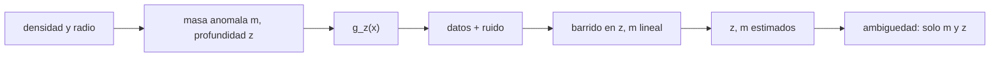

# B53-C28 — Inversión gravimétrica y modelos de densidad

<!-- nav:top -->
[🏠 Programa](../../../../README.md) · [📚 Bloque B53](../../../tronco-comun/B53-astrogeologia-y-geodesia-planetaria.md) · [← Anterior: B53-C27 — Detección remota de océanos subsuperficiales: inducción magnética, libración y radar](../B53-C27-deteccion-remota-de-oceanos-subsuperficiales-induccion-magnetica-libracion-y-radar/CLASE.md) · [Siguiente: B53-C29 — Imágenes hiperespectrales de superficies planetarias →](../B53-C29-imagenes-hiperespectrales-de-superficies-planetarias/CLASE.md)
<!-- /nav -->

## 1. Ubicación, nivel y alcance

Clase 28 del bloque B53. Nivel N3. Las anomalías de gravedad en superficie reflejan masas anómalas bajo ella. **Invertir** significa deducir la masa y su profundidad a partir de las anomalías, y el problema tiene una ambigüedad inherente: distintos modelos dan la misma señal. Aquí simulas la anomalía vertical de una esfera enterrada **sintética** a lo largo de un perfil, le agregas ruido, estiman profundidad y masa por mínimos cuadrados (barrido en la profundidad y resolución lineal de la masa) con su incertidumbre por Monte Carlo, verificas la relación entre el ancho a media altura y la profundidad y muestras la degeneración entre densidad y radio. Usa `G` de NIST (consultada).

## 2. Por qué esta clase existe

La gravedad mide masa, no densidad ni forma. La decisión central: **¿qué profundidad y qué masa anómala son compatibles con una anomalía y qué cosas no se pueden distinguir?**

## 3. Lo que podrás hacer al terminar

1. Escribir la anomalía vertical de una esfera enterrada.
2. Ajustar profundidad y masa por mínimos cuadrados.
3. Estimar la incertidumbre por Monte Carlo.
4. Relacionar el ancho a media altura con la profundidad.
5. Mostrar la degeneración entre densidad y radio.
6. Explicar la no unicidad de la inversión.

La evidencia es la **ficha de la inversión gravimétrica** del ejercicio 12 (sección 20).

## 4. Con qué llegas y cómo comprobarlo

1. ¿Qué es una anomalía de gravedad?
2. ¿Qué es 1 mGal?
3. ¿Qué es un problema inverso?
4. ¿Qué es el ancho a media altura?
5. ¿Qué es un dato sintético?

<details>
<summary>Ver respuestas</summary>

1. La diferencia entre la gravedad medida y la de un modelo de referencia. 2. `10⁻⁵ m/s²`. 3. Deducir las causas a partir de los efectos. 4. El ancho de la curva donde cae a la mitad del máximo. 5. Uno generado por el modelo.
</details>

Con cuatro o cinco aciertos, sigue; si no, repasa los prerrequisitos.

## 5. Un caso de contexto y casos de referencia

Una esfera de radio `2 km` y contraste de densidad `300 kg/m³` a `5 km` de profundidad (sintética) tiene masa anómala `1,005 × 10¹³ kg` y produce un máximo de `2,68 mGal`. Con ruido de `0,02 mGal`, la inversión da `z = 4,999 ± 0,027 km` y `m = 1,005 × 10¹³ ± 9,0 × 10¹⁰ kg`. El ancho a media altura es `0,7664` veces la profundidad (teórico `0,7664`). Otra esfera de `1 km` con contraste `2400 kg/m³` da la misma señal (diferencia `0,0 × 10⁰ m/s²`). Es el **ejemplo conductor**. Todo es **sintético o ilustrativo** y así se rotula.

## 6. Vocabulario

La anomalía vertical de una esfera enterrada es `g_z = G m z/(x² + z²)^(3/2)`. La **no unicidad** significa que distintas fuentes producen la misma señal. La **degeneración** densidad-radio es `m = Δρ (4/3) π a³`.

## 7. Modelo mental

Analogía: adivinar el peso de una piedra enterrada desde la sensación al caminar encima: se nota que hay algo, pero no si es pequeña y densa o grande y liviana.



*Descripción textual:* La masa y la profundidad generan la anomalía; los datos con ruido permiten estimarlas, pero no separar densidad y radio.

Límite de la analogía: los cuerpos reales no son esferas y los datos reales tienen señales regionales y errores de reducción.

## 8. La explicación, paso a paso

### 8,1 Modelo

`g_z(x) = G m z/(x² + z²)^(3/2)`. En el centro vale `G m/z²`. El ancho a media altura cumple `x₁/₂ = z √(2^(2/3) − 1)`.

| Magnitud | Valor |
|---|---|
| `m` verdadera [kg] | 1,0053 × 10¹³ |
| máximo [mGal] | 2,684 |
| `x₁/₂/z` numérico | 0,76642 |
| `x₁/₂/z` teórico | 0,76642 |

### 8,2 Inversión (300 repeticiones)

| Parámetro | verdadero | media | dispersión |
|---|---|---|---|
| `z` [km] | 5,000 | 4,999 | 0,027 |
| `m` [kg] | 1,005 × 10¹³ | 1,005 × 10¹³ | 9,02 × 10¹⁰ |

### 8,3 Degeneración

La esfera de `1 km` y contraste `2400 kg/m³` tiene la misma masa anómala y produce la misma señal: diferencia máxima `0,00 × 10⁰ m/s²`.

### 8,4 Lectura

La gravedad entrega `m` y `z`; la separación de densidad y tamaño exige otra información (geología, sísmica, límites de profundidad).

## 9. Magnitudes, símbolos y unidades

| Símbolo | Qué es | Unidad | Valor / nota |
|---|---|---|---|
| `G` | constante gravitatoria | m³ kg⁻¹ s⁻² | 6,67430 × 10⁻¹¹ (NIST) |
| `m` | masa anómala | kg | 1,005 × 10¹³ (sintética) |
| `z` | profundidad | km | 5 (sintética) |
| ruido | desviación | mGal | 0,02 (sintético) |
| `g_z` | anomalía vertical | m/s² | ver 8,1 |

## 10. Convenciones y referencias

Esfera puntual equivalente; perfil de −20 a 20 km cada 1 km; ruido gaussiano de `2 × 10⁻⁷ m/s²`; semilla `20261109`; 300 repeticiones; tolerancias: profundidad dentro de 3 errores típicos y razón de ancho 10⁻⁶.

## 11. De dónde sale lo que afirmamos

| ID | Fuente | Localizador | Respalda | Estado |
|---|---|---|---|---|
| S1 | NIST, *Fundamental Physical Constants*: constante gravitatoria newtoniana (CODATA 2022) | https://physics.nist.gov/cgi-bin/cuu/Value?bg | valor de `G` | Consultada el 2026-11-09 |

Límites: no se consultó ninguna fuente de inversión gravimétrica; el modelo es sintético.

## 12. Cómo ver el resultado

| Magnitud | Valor |
|---|---|
| máximo | 2,68 mGal |
| `z` estimada | 4,999 ± 0,027 km |
| `m` estimada | 1,005 × 10¹³ kg |
| `x₁/₂/z` | 0,7664 |
| degeneración | 0,0 × 10⁰ m/s² |

Descripción larga: la inversión recupera masa y profundidad dentro de su incertidumbre, y densidad y radio quedan sin separar.

## 13. Ejemplo trabajado

**Paso 1.** Masa: `m = 300 · (4/3)π · 2000³ = 1,005 × 10¹³ kg`.

**Paso 2.** Máximo: `G m/z² = 2,684 × 10⁻⁵ m/s² = 2,68 mGal`.

**Paso 3.** Ancho: `x₁/₂ = 0,766 z`.

**Paso 4.** Inversión: `z = 4,999 km`.

## 14. Distintas formas de describirlo

**Por fórmula:** `g_z`. **Por ajuste:** barrido y mínimos cuadrados. **Por razón:** ancho/profundidad. **Por degeneración:** `Δρ a³`.

## 15. Práctica guiada

**Ejercicio 1 · con los pasos indicados.** Calcula la masa anómala.

<details><summary>Solución comentada</summary>

`1,005 × 10¹³ kg`.
</details>

**Ejercicio 2 · con una pista.** Calcula el máximo en mGal.

<details><summary>Solución comentada</summary>

`2,68`.
</details>

**Ejercicio 3 · casi autónomo.** Calcula `x₁/₂` para `z = 5 km`.

<details><summary>Solución comentada</summary>

`3,83 km`.
</details>

## 16. Práctica autónoma, transferencia e integrador

**Ejercicio 4 · autónomo.** ¿Cómo cambia el máximo si `z` se duplica?

<details><summary>Solución comentada</summary>

Cae 4 veces.
</details>

**Ejercicio 5 · autónomo.** ¿Cuánto vale `Δρ a³` del segundo modelo?

<details><summary>Solución comentada</summary>

`2400 · 1³ = 300 · 2³`.
</details>

**Ejercicio 6 · autónomo.** ¿Por qué el ruido limita la profundidad estimable?

<details><summary>Solución comentada</summary>

Una fuente profunda da una señal débil y ancha.
</details>

**Ejercicio 7 · autónomo.** ¿Qué información rompe la degeneración?

<details><summary>Solución comentada</summary>

Límites geológicos, sísmica o densidad conocida.
</details>

**Ejercicio 8 · autónomo.** ¿Cuál es la incertidumbre relativa de `z`?

<details><summary>Solución comentada</summary>

`0,54%`.
</details>

**Ejercicio 9 · transferencia.** Un perfil corto no cubre las colas. ¿Qué pasa?

<details><summary>Solución comentada</summary>

Aumenta la incertidumbre de `z`.
</details>

**Ejercicio 10 · transferencia.** ¿Qué es la señal regional?

<details><summary>Solución comentada</summary>

Una tendencia de gran escala que se resta antes de invertir.
</details>

**Ejercicio 11 · transferencia.** ¿Qué entregas con la inversión?

<details><summary>Solución comentada</summary>

Los parámetros, su incertidumbre y la lista de modelos equivalentes.
</details>

**Ejercicio 12 · integrador.** Elabora tu *ficha de la inversión gravimétrica*: modelo, ajuste, incertidumbre, degeneración y límites.

<details><summary>Solución modelo</summary>

Secciones 8,1 a 8,4.
</details>

## 17. Laboratorio: profundidad y masa de una esfera enterrada

El script [inversion.py](inversion.py) simula 300 perfiles con ruido, invierte `z` y `m` con barrido y búsqueda áurea y verifica la relación de ancho (**comprueba** `z` dentro de 3 errores típicos).

**Datos:** `G` de NIST; modelo **sintético**; semilla `20261109`. **Predice antes de ejecutar:** ¿recuperará la inversión el valor verdadero de `z`? (sí, con dispersión pequeña). **Ejecución del 2026-11-09 (Python 3,12,9):**

```text
Python 3.12.9 (biblioteca estandar)
m = 1.0053e+13 kg ; maximo = 2.6839 mGal
inversion (300 perfiles): z = 4.9993 +- 0.0272 km (verdadero 5) ; m = 1.0049e+13 +- 9.02e+10 kg
ancho a media altura / profundidad: numerico 0.766421 ; teorico 0.766421
degeneracion (a = 1 km, drho = 2400): diferencia maxima 0.00e+00 m/s2
Pruebas superadas.
```

```bash
python programa/clases/B53/B53-C28-inversion-gravimetrica-y-modelos-de-densidad/inversion.py
```

**Límites:** una sola esfera, sin señal regional ni errores de reducción.

## 18. Errores frecuentes y cómo corregirlos

**Confundir masa con densidad.** se corrige con 8,3

**Ignorar la no unicidad.** se corrige con 8,4

**Presentar el modelo como real.** se corrige con la sección 10

## 19. Cómo sabrás que vas bien

Tras la sección 8: ¿qué resultado esperabas y cuál obtuviste? Si dudas, repasa el ejemplo de la sección 13. Tras el laboratorio: ¿qué comprueba? (ver la sección 17).

## 20. Qué entregas y cómo se evalúa

El producto es tu **ficha de la inversión gravimétrica** (ejercicio 12).

| Criterio | Inicial | En desarrollo | Logrado | Destacado |
|---|---|---|---|---|
| Conceptos | Los confunde | Parciales | Conceptos de la clase | Explica los límites |
| Cálculo | Sin unidades | Con errores | Tablas completas | Calcula casos nuevos |
| Numérico | Sin comprobar | Un caso | Contraste con el análisis | Interpreta las diferencias |
| Fuentes | Sin fuente | Sin fecha | Fuentes con fecha | Declara lo sintético |
| Límites | No los nombra | Uno | Tres | Discute qué falta del modelo |

**Condiciones críticas (no se compensan con promedio):** rotular la fuente como sintética; declarar la no unicidad; citar solo lo consultado.

## 21. Ética, seguridad y límites

Clase educativa: los modelos son simplificados y no sustituyen a los productos de una misión ni a la literatura primaria. Ningún dato simulado se presenta como observado. Accesibilidad: tablas equivalentes a las gráficas, fórmulas en texto, ejercicios sin conexión.

## 22. Para cerrar y seguir

La inversión recupera `z = 5,00 km` y `m`, pero no separa densidad y radio. Queda una pregunta: ¿cómo se interpretan imágenes con cientos de bandas?

**Glosario español–inglés.** inversión · *inversion*; no unicidad · *non-uniqueness*; anomalía de gravedad · *gravity anomaly*; mGal · *mGal*.

**Continuidad.** [B53-C29](../B53-C29-imagenes-hiperespectrales-de-superficies-planetarias/CLASE.md) estudia las imágenes hiperespectrales.

**Referencias:** ver sección 11.

<!-- nav:bottom -->
---

[← Anterior: B53-C27 — Detección remota de océanos subsuperficiales: inducción magnética, libración y radar](../B53-C27-deteccion-remota-de-oceanos-subsuperficiales-induccion-magnetica-libracion-y-radar/CLASE.md) · [📚 Bloque B53](../../../tronco-comun/B53-astrogeologia-y-geodesia-planetaria.md) · [Siguiente: B53-C29 — Imágenes hiperespectrales de superficies planetarias →](../B53-C29-imagenes-hiperespectrales-de-superficies-planetarias/CLASE.md)
<!-- /nav -->
